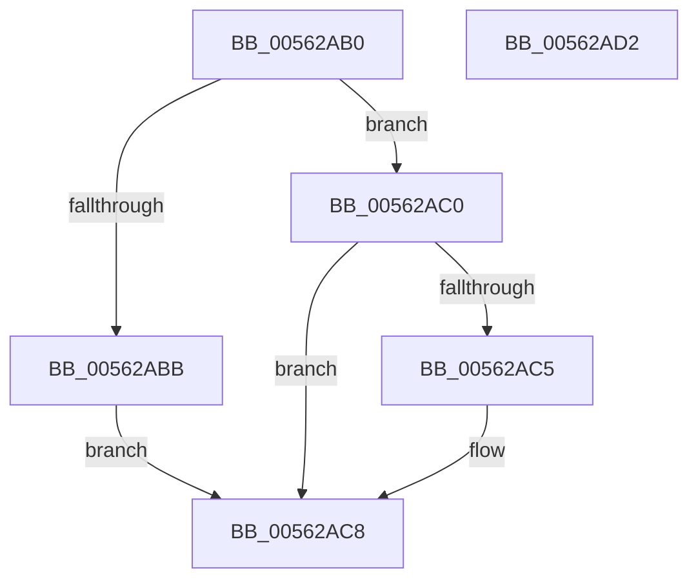

# HalpTscQueryCounter

- RVA: `0x00562AB0`–`0x00562AD3` (길이 `35` bytes)
- VA: `0x0000000140562AB0`
- 실행 섹션: `.text`
- PDB 이름 있음: `예`; PDB Function 태그: `아니요`
- unwind 정보 RVA: `0x000DB714`
- 디코드: `13`개 명령, `35/35` bytes 표시
- 미해석 바이트: `0` (있으면 어셈블리에 `.byte`로 보존)

> 이 문서는 커널 이미지의 기계어와 PDB 기호를 분석해 생성했습니다. 4번과 5번은 함수 원형과 자료형을 바이너리 사용 방식에서 추정한 C 해석이며 원본 소스 복구 결과는 아닙니다.

## 1. Dependencies

- 직접 호출 지점: **0**; 고유 호출 대상: **0**
- 직접 호출자로 확인된 함수: **0**
- RIP 상대 이미지 참조: **1**

### Outgoing calls
- 직접 디코드된 call 명령이 없습니다.

### Direct callers
- 이 함수 시작 RVA로 연결되는 직접 call은 확인되지 않았습니다. 간접 호출은 완전히 역산할 수 없습니다.

### Static image references
- `0x00562AB0` → RVA `0x00F8FB94` (`.data`; read)

## 2. Other-region calls and transfers

- 다른 실행 섹션으로 향하는 call: **0**
- 별도 외부 분기/꼬리 이동을 확인하지 못했습니다.

## 3. Assembly (complete function range)

```asm
00562AB0  8B 05 DE D0 A2 00               mov eax, dword ptr [rip + 0xa2d0de]
00562AB6  83 F8 01                        cmp eax, 1
00562AB9  75 05                           jne 0x140562ac0
00562ABB  0F AE E8                        lfence
00562ABE  EB 08                           jmp 0x140562ac8
00562AC0  83 F8 02                        cmp eax, 2
00562AC3  75 03                           jne 0x140562ac8
00562AC5  0F AE F0                        mfence
00562AC8  0F 31                           rdtsc
00562ACA  48 C1 E2 20                     shl rdx, 0x20
00562ACE  48 0B C2                        or rax, rdx
00562AD1  C3                              ret
00562AD2  CC                              int3
```

## 4. C-style interpretation (structured pseudocode)

```c
__int64 __fastcall HalpTscQueryCounter(__int64 a1, __int64 a2)
{
    __int64 result;

    if (((unsigned int)((unsigned int)(*(unsigned int *)(v_rip + 10670302)))) != 1) goto loc_00562AC0;
    goto loc_00562AC8;
loc_00562AC0:
    if (((unsigned int)((unsigned int)(*(unsigned int *)(v_rip + 10670302)))) == 2) {
    }
    a2 = (a2) << (32);
    result = ((unsigned int)(*(unsigned int *)(v_rip + 10670302))) | (a2);
    return result;
}
```

## 5. (Beta) C Style

```c
int64_t HalpTscQueryCounter(int64_t Arg1, int64_t Arg2)
{
    int64_t result;

    if (((uint32_t)((uint32_t)(*(uint32_t *)(v_rip + 0xA2D0DE)))) != 1) goto loc_00562AC0;
    goto loc_00562AC8;
loc_00562AC0:
    if (((uint32_t)((uint32_t)(*(uint32_t *)(v_rip + 0xA2D0DE)))) == 2) {
    }
    Arg2 = (Arg2) << (32);
    result = ((uint32_t)(*(uint32_t *)(v_rip + 0xA2D0DE))) | (Arg2);
    return result;
}
```

## 6. Execution-region graph

[열기: 2D/3D 그래프와 함수 탐색 컨트롤 패널](../../../control-panel.html?section=text&rva=0x00562AB0&view=graph)

- 2D 그래프는 위에서 아래로 흐르고, 3D 그래프는 빈 공간을 드래그해 회전합니다. Shift+드래그는 이동, 휠은 확대·축소, 함수 노드 선택은 대상 보고서 이동입니다.

### Static fallback


