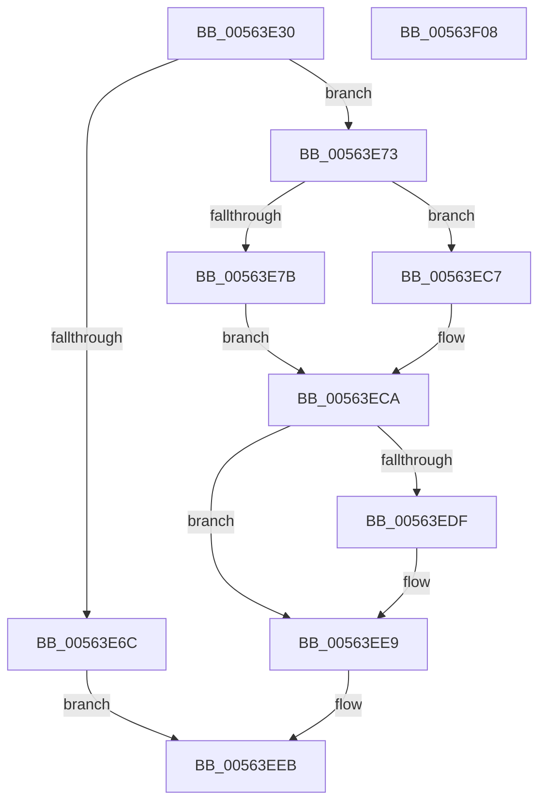

# HalpUpdateCapsule

- RVA: `0x00563E30`–`0x00563F09` (길이 `217` bytes)
- VA: `0x0000000140563E30`
- 실행 섹션: `.text`
- PDB 이름 있음: `예`; PDB Function 태그: `아니요`
- unwind 정보 RVA: `0x000C4CC8`
- 디코드: `62`개 명령, `217/217` bytes 표시
- 미해석 바이트: `0` (있으면 어셈블리에 `.byte`로 보존)

> 이 문서는 커널 이미지의 기계어와 PDB 기호를 분석해 생성했습니다. 4번과 5번은 함수 원형과 자료형을 바이너리 사용 방식에서 추정한 C 해석이며 원본 소스 복구 결과는 아닙니다.

## 1. Dependencies

- 직접 호출 지점: **4**; 고유 호출 대상: **4**
- 직접 호출자로 확인된 함수: **0**
- RIP 상대 이미지 참조: **3**

### Outgoing calls
- `0x00563EC0` → [KeSetSystemGroupAffinityThread](../39/KeSetSystemGroupAffinityThread_function_00399140.md) (function, `0x00399140`)
- `0x00563ED3` → [HalEfiUpdateCapsule](../54/HalEfiUpdateCapsule_function_0054E0C0.md) (function, `0x0054E0C0`)
- `0x00563EE4` → [KeRevertToUserGroupAffinityThread](../39/KeRevertToUserGroupAffinityThread_function_00398EC0.md) (function, `0x00398EC0`)
- `0x00563EF3` → [_security_check_cookie](../6A/_security_check_cookie_function_006AC640.md) (function, `0x006AC640`)

### Direct callers
- 이 함수 시작 RVA로 연결되는 직접 call은 확인되지 않았습니다. 간접 호출은 완전히 역산할 수 없습니다.

### Static image references
- `0x00563E3C` → RVA `0x00E0A740` (`.data`; read)
- `0x00563E4B` → RVA `0x00FC1A28` (`.data`; read)
- `0x00563E8F` → RVA `0x00F231B0` (`.data`; read)

## 2. Other-region calls and transfers

- 다른 실행 섹션으로 향하는 call: **0**
- 별도 외부 분기/꼬리 이동을 확인하지 못했습니다.

## 3. Assembly (complete function range)

```asm
00563E30  48 89 5C 24 20                  mov qword ptr [rsp + 0x20], rbx
00563E35  55                              push rbp
00563E36  56                              push rsi
00563E37  57                              push rdi
00563E38  48 83 EC 50                     sub rsp, 0x50
00563E3C  48 8B 05 FD 68 8A 00            mov rax, qword ptr [rip + 0x8a68fd]
00563E43  48 33 C4                        xor rax, rsp
00563E46  48 89 44 24 40                  mov qword ptr [rsp + 0x40], rax
00563E4B  80 3D D6 DB A5 00 00            cmp byte ptr [rip + 0xa5dbd6], 0
00563E52  0F 57 C0                        xorps xmm0, xmm0
00563E55  0F 57 C9                        xorps xmm1, xmm1
00563E58  8B EA                           mov ebp, edx
00563E5A  0F 11 44 24 20                  movups xmmword ptr [rsp + 0x20], xmm0
00563E5F  49 8B D8                        mov rbx, r8
00563E62  48 8B F1                        mov rsi, rcx
00563E65  0F 11 4C 24 30                  movups xmmword ptr [rsp + 0x30], xmm1
00563E6A  75 07                           jne 0x140563e73
00563E6C  B8 02 00 00 C0                  mov eax, 0xc0000002
00563E71  EB 78                           jmp 0x140563eeb
00563E73  44 0F 20 C0                     mov rax, cr8
00563E77  3C 02                           cmp al, 2
00563E79  73 4C                           jae 0x140563ec7
00563E7B  65 8B 04 25 A4 01 00 00         mov eax, dword ptr gs:[0x1a4]
00563E83  48 8D 54 24 30                  lea rdx, [rsp + 0x30]
00563E88  8B C8                           mov ecx, eax
00563E8A  BF 01 00 00 00                  mov edi, 1
00563E8F  48 8B 05 1A F3 9B 00            mov rax, qword ptr [rip + 0x9bf31a]
00563E96  8B 0C 88                        mov ecx, dword ptr [rax + rcx*4]
00563E99  33 C0                           xor eax, eax
00563E9B  89 44 24 2A                     mov dword ptr [rsp + 0x2a], eax
00563E9F  66 89 44 24 2E                  mov word ptr [rsp + 0x2e], ax
00563EA4  8B C1                           mov eax, ecx
00563EA6  C1 E8 06                        shr eax, 6
00563EA9  83 E1 3F                        and ecx, 0x3f
00563EAC  66 89 44 24 28                  mov word ptr [rsp + 0x28], ax
00563EB1  8B C7                           mov eax, edi
00563EB3  48 D3 E0                        shl rax, cl
00563EB6  48 8D 4C 24 20                  lea rcx, [rsp + 0x20]
00563EBB  48 89 44 24 20                  mov qword ptr [rsp + 0x20], rax
00563EC0  E8 7B 52 E3 FF                  call 0x140399140
00563EC5  EB 03                           jmp 0x140563eca
00563EC7  40 32 FF                        xor dil, dil
00563ECA  48 8B D5                        mov rdx, rbp
00563ECD  4C 8B C3                        mov r8, rbx
00563ED0  48 8B CE                        mov rcx, rsi
00563ED3  E8 E8 A1 FE FF                  call 0x14054e0c0
00563ED8  8B D8                           mov ebx, eax
00563EDA  40 84 FF                        test dil, dil
00563EDD  74 0A                           je 0x140563ee9
00563EDF  48 8D 4C 24 30                  lea rcx, [rsp + 0x30]
00563EE4  E8 D7 4F E3 FF                  call 0x140398ec0
00563EE9  8B C3                           mov eax, ebx
00563EEB  48 8B 4C 24 40                  mov rcx, qword ptr [rsp + 0x40]
00563EF0  48 33 CC                        xor rcx, rsp
00563EF3  E8 48 87 14 00                  call 0x1406ac640
00563EF8  48 8B 9C 24 88 00 00 00         mov rbx, qword ptr [rsp + 0x88]
00563F00  48 83 C4 50                     add rsp, 0x50
00563F04  5F                              pop rdi
00563F05  5E                              pop rsi
00563F06  5D                              pop rbp
00563F07  C3                              ret
00563F08  CC                              int3
```

## 4. C-style interpretation (structured pseudocode)

```c
__int64 __fastcall HalpUpdateCapsule(__int64 a1, int a2, __int64 a3)
{
    __int64 result;
    __int64 v_rdi;
    __int64 v_rsp;
    unsigned __int64 v_stack_m28;
    unsigned __int64 v_stack_m38;
    unsigned __int16 v_stack_m3A;
    unsigned int v_stack_m3E;
    unsigned __int16 v_stack_m40;
    unsigned __int64 v_stack_m48;
    unsigned __int64 v_stack_p20;

    v_stack_p20 = v_rbx;
    v_rsp = (v_rsp) - (80);
    result = (*(unsigned __int64 *)(v_rip + 9070845)) ^ (v_rsp);
    v_stack_m28 = result;
    v_stack_m48 = v_xmm0;
    v_stack_m38 = v_xmm1;
    if ((*(unsigned __int8 *)(v_rip + 10869718)) != 0) goto loc_00563E73;
    goto loc_00563EEB;
loc_00563E73:
    if (((unsigned __int8)(v_cr8)) >= 2) goto loc_00563EC7;
    result = 0;
    v_stack_m3E = 0;
    v_stack_m3A = 0;
    result = (unsigned int)(((unsigned int)((unsigned int)((unsigned int)(*(unsigned int *)(*(unsigned __int64 *)(v_rip + 10220314) + (unsigned int)((unsigned int)((unsigned int)(*(unsigned int *)(gs_base + (0 + 420))))) * 4))))) >> (6));
    a1 = (unsigned int)(((unsigned int)(*(unsigned int *)(*(unsigned __int64 *)(v_rip + 10220314) + (unsigned int)((unsigned int)((unsigned int)(*(unsigned int *)(gs_base + (0 + 420))))) * 4))) & (63));
    v_stack_m40 = (unsigned __int16)(result);
    result = (1) << ((unsigned __int8)(a1));
    v_stack_m48 = result;
    result = KeSetSystemGroupAffinityThread(v_stack_m48, v_stack_m38, a3, a4);
    goto loc_00563ECA;
loc_00563EC7:
    v_rdi = 0;
loc_00563ECA:
    result = HalEfiUpdateCapsule(a1, (unsigned int)(a2), a3, a4);
    if (0 != 0) {
        a1 = v_stack_m38;
        result = KeRevertToUserGroupAffinityThread(a1, (unsigned int)(a2), a3, a4);
    }
loc_00563EEB:
    a1 = (v_stack_m28) ^ (v_rsp);
    result = _security_check_cookie(a1, (unsigned int)(a2), a3, a4);
    v_rsp = (v_rsp) + (80);
    return result;
}
```

## 5. (Beta) C Style

```c
int64_t HalpUpdateCapsule(int64_t Arg1, int32_t Arg2, int64_t Arg3)
{
    int64_t result;
    int64_t local_rdi;
    int64_t local_rsp;
    uint64_t v_stack_m28;
    uint64_t v_stack_m38;
    uint16_t v_stack_m3A;
    uint32_t v_stack_m3E;
    uint16_t v_stack_m40;
    uint64_t v_stack_m48;
    uint64_t v_stack_p20;

    v_stack_p20 = local_rbx;
    local_rsp = (local_rsp) - (80);
    result = (*(uint64_t *)(v_rip + 0x8A68FD)) ^ (local_rsp);
    v_stack_m28 = result;
    v_stack_m48 = v_xmm0;
    v_stack_m38 = v_xmm1;
    if ((*(uint8_t *)(v_rip + 0xA5DBD6)) != 0) goto loc_00563E73;
    goto loc_00563EEB;
loc_00563E73:
    if (((uint8_t)(v_cr8)) >= 2) goto loc_00563EC7;
    result = 0;
    v_stack_m3E = 0;
    v_stack_m3A = 0;
    result = (uint32_t)(((uint32_t)((uint32_t)((uint32_t)(*(uint32_t *)(*(uint64_t *)(v_rip + 0x9BF31A) + (uint32_t)((uint32_t)((uint32_t)(*(uint32_t *)(gs_base + (0 + 0x1A4))))) * 4))))) >> (6));
    Arg1 = (uint32_t)(((uint32_t)(*(uint32_t *)(*(uint64_t *)(v_rip + 0x9BF31A) + (uint32_t)((uint32_t)((uint32_t)(*(uint32_t *)(gs_base + (0 + 0x1A4))))) * 4))) & (63));
    v_stack_m40 = (uint16_t)(result);
    result = (1) << ((uint8_t)(Arg1));
    v_stack_m48 = result;
    result = KeSetSystemGroupAffinityThread(v_stack_m48, v_stack_m38, Arg3, a4);
    goto loc_00563ECA;
loc_00563EC7:
    local_rdi = 0;
loc_00563ECA:
    result = HalEfiUpdateCapsule(Arg1, (uint32_t)(Arg2), Arg3, a4);
    if (0 != 0) {
        Arg1 = v_stack_m38;
        result = KeRevertToUserGroupAffinityThread(Arg1, (uint32_t)(Arg2), Arg3, a4);
    }
loc_00563EEB:
    Arg1 = (v_stack_m28) ^ (local_rsp);
    result = _security_check_cookie(Arg1, (uint32_t)(Arg2), Arg3, a4);
    local_rsp = (local_rsp) + (80);
    return result;
}
```

## 6. Execution-region graph

[열기: 2D/3D 그래프와 함수 탐색 컨트롤 패널](../../../control-panel.html?section=text&rva=0x00563E30&view=graph)

- 2D 그래프는 위에서 아래로 흐르고, 3D 그래프는 빈 공간을 드래그해 회전합니다. Shift+드래그는 이동, 휠은 확대·축소, 함수 노드 선택은 대상 보고서 이동입니다.

### Static fallback


