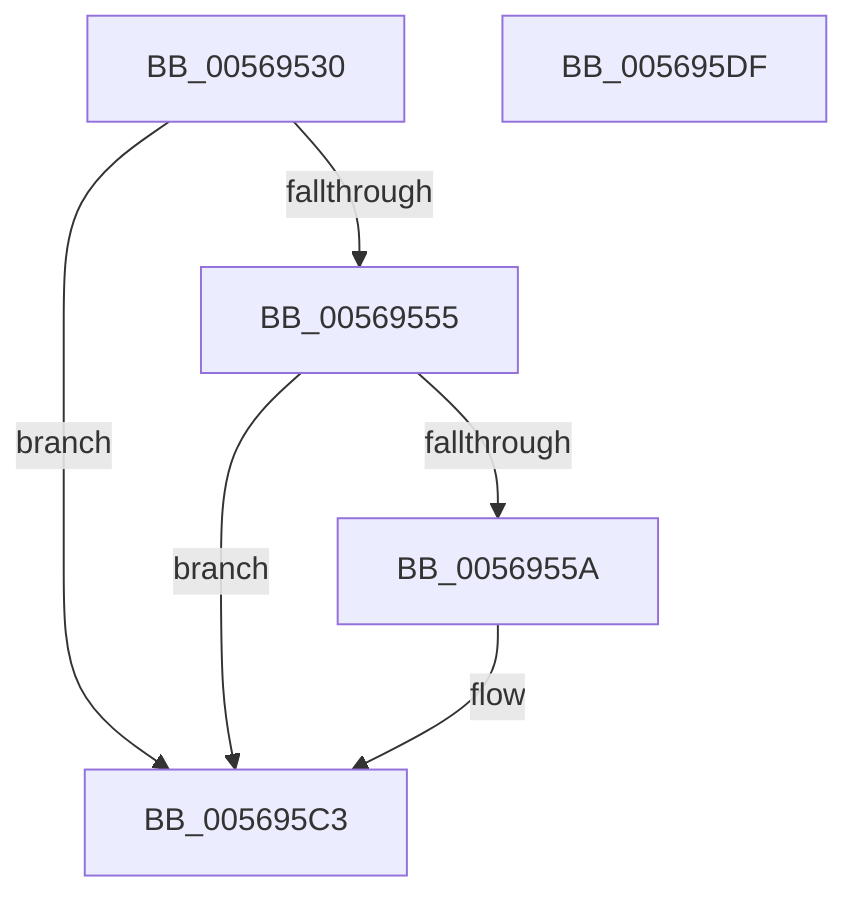

# HalpUpdateCoolingPacket

- RVA: `0x00569530`–`0x005695E0` (길이 `176` bytes)
- VA: `0x0000000140569530`
- 실행 섹션: `.text`
- PDB 이름 있음: `예`; PDB Function 태그: `아니요`
- unwind 정보 RVA: `0x0005CAAC`
- 디코드: `39`개 명령, `176/176` bytes 표시
- 미해석 바이트: `0` (있으면 어셈블리에 `.byte`로 보존)

> 이 문서는 커널 이미지의 기계어와 PDB 기호를 분석해 생성했습니다. 4번과 5번은 함수 원형과 자료형을 바이너리 사용 방식에서 추정한 C 해석이며 원본 소스 복구 결과는 아닙니다.

## 1. Dependencies

- 직접 호출 지점: **2**; 고유 호출 대상: **2**
- 직접 호출자로 확인된 함수: **1**
- RIP 상대 이미지 참조: **12**

### Outgoing calls
- `0x00569544` → [ExAcquireSpinLockExclusive](../24/ExAcquireSpinLockExclusive_function_00248690.md) (function, `0x00248690`)
- `0x005695CC` → [ExReleaseSpinLockExclusive](../2C/ExReleaseSpinLockExclusive_function_002C0EF0.md) (function, `0x002C0EF0`)

### Direct callers
- [HalpStartPccCommand](../../page/70/HalpStartPccCommand_function_0070D8D4.md) at `0x0070D908`
- [HalpStartPccCommand](../../page/70/HalpStartPccCommand_function_0070D8D4.md) at `0x0070D933`

### Static image references
- `0x0056953D` → RVA `0x00F8FA88` (`.data`; read)
- `0x00569549` → RVA `0x00F8FA8C` (`.data`; read)
- `0x0056955D` → RVA `0x00F8FA00` (`.data`; read)
- `0x00569564` → RVA `0x00F8FA8C` (`.data`; write)
- `0x0056956F` → RVA `0x00F8FA10` (`.data`; read)
- `0x0056957A` → RVA `0x00F8FA20` (`.data`; read)
- `0x00569585` → RVA `0x00F8FA30` (`.data`; read)
- `0x00569590` → RVA `0x00F8FA40` (`.data`; read)
- `0x0056959B` → RVA `0x00F8FA50` (`.data`; read)
- `0x005695A6` → RVA `0x00F8FA60` (`.data`; read)
- `0x005695B1` → RVA `0x00F8FA70` (`.data`; read)
- `0x005695BC` → RVA `0x00F8FA80` (`.data`; write)

## 2. Other-region calls and transfers

- 다른 실행 섹션으로 향하는 call: **0**
- 별도 외부 분기/꼬리 이동을 확인하지 못했습니다.

## 3. Assembly (complete function range)

```asm
00569530  48 89 5C 24 08                  mov qword ptr [rsp + 8], rbx
00569535  57                              push rdi
00569536  48 83 EC 20                     sub rsp, 0x20
0056953A  48 8B D9                        mov rbx, rcx
0056953D  48 8D 0D 44 65 A2 00            lea rcx, [rip + 0xa26544]
00569544  E8 47 F1 CD FF                  call 0x140248690
00569549  40 8A 3D 3C 65 A2 00            mov dil, byte ptr [rip + 0xa2653c]
00569550  48 85 DB                        test rbx, rbx
00569553  74 6E                           je 0x1405695c3
00569555  40 84 FF                        test dil, dil
00569558  75 69                           jne 0x1405695c3
0056955A  0F 28 03                        movaps xmm0, xmmword ptr [rbx]
0056955D  0F 11 05 9C 64 A2 00            movups xmmword ptr [rip + 0xa2649c], xmm0
00569564  C6 05 21 65 A2 00 01            mov byte ptr [rip + 0xa26521], 1
0056956B  0F 28 4B 10                     movaps xmm1, xmmword ptr [rbx + 0x10]
0056956F  0F 11 0D 9A 64 A2 00            movups xmmword ptr [rip + 0xa2649a], xmm1
00569576  0F 28 43 20                     movaps xmm0, xmmword ptr [rbx + 0x20]
0056957A  0F 11 05 9F 64 A2 00            movups xmmword ptr [rip + 0xa2649f], xmm0
00569581  0F 28 4B 30                     movaps xmm1, xmmword ptr [rbx + 0x30]
00569585  0F 11 0D A4 64 A2 00            movups xmmword ptr [rip + 0xa264a4], xmm1
0056958C  0F 28 43 40                     movaps xmm0, xmmword ptr [rbx + 0x40]
00569590  0F 11 05 A9 64 A2 00            movups xmmword ptr [rip + 0xa264a9], xmm0
00569597  0F 28 4B 50                     movaps xmm1, xmmword ptr [rbx + 0x50]
0056959B  0F 11 0D AE 64 A2 00            movups xmmword ptr [rip + 0xa264ae], xmm1
005695A2  0F 28 43 60                     movaps xmm0, xmmword ptr [rbx + 0x60]
005695A6  0F 11 05 B3 64 A2 00            movups xmmword ptr [rip + 0xa264b3], xmm0
005695AD  0F 28 4B 70                     movaps xmm1, xmmword ptr [rbx + 0x70]
005695B1  0F 11 0D B8 64 A2 00            movups xmmword ptr [rip + 0xa264b8], xmm1
005695B8  48 8B 53 48                     mov rdx, qword ptr [rbx + 0x48]
005695BC  48 89 15 BD 64 A2 00            mov qword ptr [rip + 0xa264bd], rdx
005695C3  8A D0                           mov dl, al
005695C5  48 8D 0D BC 64 A2 00            lea rcx, [rip + 0xa264bc]
005695CC  E8 1F 79 D5 FF                  call 0x1402c0ef0
005695D1  48 8B 5C 24 30                  mov rbx, qword ptr [rsp + 0x30]
005695D6  40 8A C7                        mov al, dil
005695D9  48 83 C4 20                     add rsp, 0x20
005695DD  5F                              pop rdi
005695DE  C3                              ret
005695DF  CC                              int3
```

## 4. C-style interpretation (structured pseudocode)

```c
__int64 __fastcall HalpUpdateCoolingPacket(__int64 a1)
{
    __int64 result;
    __int64 v_rsp;
    unsigned __int64 v_stack_p8;

    v_stack_p8 = v_rbx;
    v_rsp = (v_rsp) - (32);
    result = ExAcquireSpinLockExclusive(v_rip + 10642756, a2, a3, a4);
    if (a1 == 0) goto loc_005695C3;
    if ((unsigned __int8)(*(unsigned __int8 *)(v_rip + 10642748)) == 0) {
        *(unsigned __int64 *)(v_rip + 10642588) = v_xmm0;
        *(unsigned __int8 *)(v_rip + 10642721) = 1;
        *(unsigned __int64 *)(v_rip + 10642586) = v_xmm1;
        *(unsigned __int64 *)(v_rip + 10642591) = v_xmm0;
        *(unsigned __int64 *)(v_rip + 10642596) = v_xmm1;
        *(unsigned __int64 *)(v_rip + 10642601) = v_xmm0;
        *(unsigned __int64 *)(v_rip + 10642606) = v_xmm1;
        *(unsigned __int64 *)(v_rip + 10642611) = v_xmm0;
        *(unsigned __int64 *)(v_rip + 10642616) = v_xmm1;
        a2 = *(unsigned __int64 *)(a1 + 72);
        *(unsigned __int64 *)(v_rip + 10642621) = a2;
    }
    result = ExReleaseSpinLockExclusive(v_rip + 10642620, (unsigned __int8)(result), a3, a4);
    v_rsp = (v_rsp) + (32);
    return (unsigned __int8)(*(unsigned __int8 *)(v_rip + 10642748));
}
```

## 5. (Beta) C Style

```c
int64_t HalpUpdateCoolingPacket(int64_t Arg1)
{
    int64_t result;
    int64_t local_rsp;
    uint64_t v_stack_p8;

    v_stack_p8 = local_rbx;
    local_rsp = (local_rsp) - (32);
    result = ExAcquireSpinLockExclusive(v_rip + 10642756, a2, a3, a4);
    if (Arg1 == 0) goto loc_005695C3;
    if ((uint8_t)(*(uint8_t *)(v_rip + 0xA2653C)) == 0) {
        *(uint64_t *)(v_rip + 0xA2649C) = v_xmm0;
        *(uint8_t *)(v_rip + 0xA26521) = 1;
        *(uint64_t *)(v_rip + 0xA2649A) = v_xmm1;
        *(uint64_t *)(v_rip + 0xA2649F) = v_xmm0;
        *(uint64_t *)(v_rip + 0xA264A4) = v_xmm1;
        *(uint64_t *)(v_rip + 0xA264A9) = v_xmm0;
        *(uint64_t *)(v_rip + 0xA264AE) = v_xmm1;
        *(uint64_t *)(v_rip + 0xA264B3) = v_xmm0;
        *(uint64_t *)(v_rip + 0xA264B8) = v_xmm1;
        a2 = *(uint64_t *)(Arg1 + 0x48);
        *(uint64_t *)(v_rip + 0xA264BD) = a2;
    }
    result = ExReleaseSpinLockExclusive(v_rip + 10642620, (uint8_t)(result), a3, a4);
    local_rsp = (local_rsp) + (32);
    return (uint8_t)(*(uint8_t *)(v_rip + 0xA2653C));
}
```

## 6. Execution-region graph

[열기: 2D/3D 그래프와 함수 탐색 컨트롤 패널](../../../control-panel.html?section=text&rva=0x00569530&view=graph)

- 2D 그래프는 위에서 아래로 흐르고, 3D 그래프는 빈 공간을 드래그해 회전합니다. Shift+드래그는 이동, 휠은 확대·축소, 함수 노드 선택은 대상 보고서 이동입니다.

### Static fallback


