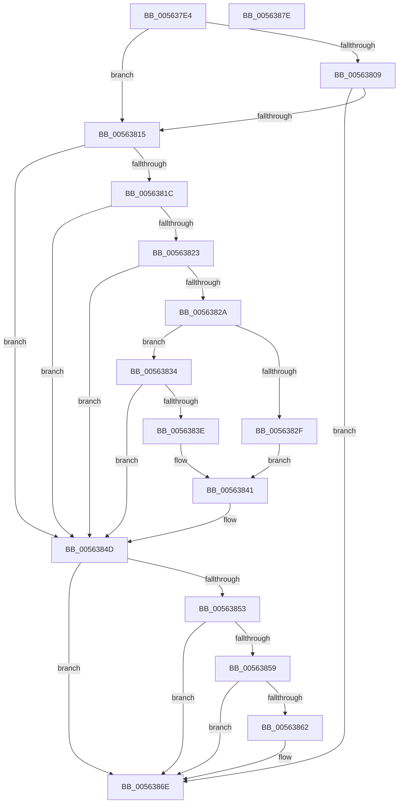

# HalpUsbLegacyDeviceHandoff

- RVA: `0x005637E4`–`0x0056387F` (길이 `155` bytes)
- VA: `0x00000001405637E4`
- 실행 섹션: `.text`
- PDB 이름 있음: `예`; PDB Function 태그: `아니요`
- unwind 정보 RVA: `0x00060BC4`
- 디코드: `49`개 명령, `155/155` bytes 표시
- 미해석 바이트: `0` (있으면 어셈블리에 `.byte`로 보존)

> 이 문서는 커널 이미지의 기계어와 PDB 기호를 분석해 생성했습니다. 4번과 5번은 함수 원형과 자료형을 바이너리 사용 방식에서 추정한 C 해석이며 원본 소스 복구 결과는 아닙니다.

## 1. Dependencies

- 직접 호출 지점: **2**; 고유 호출 대상: **1**
- 직접 호출자로 확인된 함수: **1**
- RIP 상대 이미지 참조: **0**

### Outgoing calls
- `0x00563848` → [HalpRegisterUsbController](HalpRegisterUsbController_function_00563758.md) (function, `0x00563758`)
- `0x00563869` → [HalpRegisterUsbController](HalpRegisterUsbController_function_00563758.md) (function, `0x00563758`)

### Direct callers
- [HalpUsbLegacyScanBusForHandoff](HalpUsbLegacyScanBusForHandoff_function_0056395C.md) at `0x00563A28`

### Static image references
- 디코드된 RIP-relative 메모리 참조가 없습니다.

## 2. Other-region calls and transfers

- 다른 실행 섹션으로 향하는 call: **0**
- 별도 외부 분기/꼬리 이동을 확인하지 못했습니다.

## 3. Assembly (complete function range)

```asm
005637E4  48 89 5C 24 08                  mov qword ptr [rsp + 8], rbx
005637E9  48 89 74 24 10                  mov qword ptr [rsp + 0x10], rsi
005637EE  57                              push rdi
005637EF  48 83 EC 20                     sub rsp, 0x20
005637F3  41 0F B7 01                     movzx eax, word ptr [r9]
005637F7  8B F2                           mov esi, edx
005637F9  BA 86 80 00 00                  mov edx, 0x8086
005637FE  49 8B D9                        mov rbx, r9
00563801  41 8B F8                        mov edi, r8d
00563804  66 3B C2                        cmp ax, dx
00563807  75 0C                           jne 0x140563815
00563809  B9 10 71 00 00                  mov ecx, 0x7110
0056380E  66 41 39 49 02                  cmp word ptr [r9 + 2], cx
00563813  74 59                           je 0x14056386e
00563815  41 80 79 0B 0C                  cmp byte ptr [r9 + 0xb], 0xc
0056381A  75 31                           jne 0x14056384d
0056381C  41 80 79 0A 03                  cmp byte ptr [r9 + 0xa], 3
00563821  75 2A                           jne 0x14056384d
00563823  41 80 79 09 00                  cmp byte ptr [r9 + 9], 0
00563828  75 23                           jne 0x14056384d
0056382A  66 3B C2                        cmp ax, dx
0056382D  75 05                           jne 0x140563834
0056382F  41 B1 01                        mov r9b, 1
00563832  EB 0D                           jmp 0x140563841
00563834  B9 06 11 00 00                  mov ecx, 0x1106
00563839  66 3B C1                        cmp ax, cx
0056383C  75 0F                           jne 0x14056384d
0056383E  45 33 C9                        xor r9d, r9d
00563841  45 33 C0                        xor r8d, r8d
00563844  8B D7                           mov edx, edi
00563846  8B CE                           mov ecx, esi
00563848  E8 0B FF FF FF                  call 0x140563758
0056384D  80 7B 0B 0C                     cmp byte ptr [rbx + 0xb], 0xc
00563851  75 1B                           jne 0x14056386e
00563853  80 7B 0A 03                     cmp byte ptr [rbx + 0xa], 3
00563857  75 15                           jne 0x14056386e
00563859  41 B0 10                        mov r8b, 0x10
0056385C  44 38 43 09                     cmp byte ptr [rbx + 9], r8b
00563860  75 0C                           jne 0x14056386e
00563862  45 33 C9                        xor r9d, r9d
00563865  8B D7                           mov edx, edi
00563867  8B CE                           mov ecx, esi
00563869  E8 EA FE FF FF                  call 0x140563758
0056386E  48 8B 5C 24 30                  mov rbx, qword ptr [rsp + 0x30]
00563873  48 8B 74 24 38                  mov rsi, qword ptr [rsp + 0x38]
00563878  48 83 C4 20                     add rsp, 0x20
0056387C  5F                              pop rdi
0056387D  C3                              ret
0056387E  CC                              int3
```

## 4. C-style interpretation (structured pseudocode)

```c
__int64 __fastcall HalpUsbLegacyDeviceHandoff(__int64 a1, int a2, int a3, __int64 a4)
{
    __int64 result;
    __int64 v_rsp;
    unsigned __int64 v_stack_p10;
    unsigned __int64 v_stack_p8;

    v_stack_p8 = v_rbx;
    v_stack_p10 = v_rsi;
    v_rsp = (v_rsp) - (32);
    if (((unsigned __int16)(*(unsigned __int16 *)(a4))) != ((unsigned __int16)((unsigned int)(0x8086ULL)))) goto loc_00563815;
    if ((*(unsigned __int16 *)(a4 + 2)) == ((unsigned __int16)((unsigned int)(0x7110ULL)))) goto loc_0056386E;
loc_00563815:
    if ((*(unsigned __int8 *)(a4 + 11)) != 12) goto loc_0056384D;
    if ((*(unsigned __int8 *)(a4 + 10)) != 3) goto loc_0056384D;
    if ((*(unsigned __int8 *)(a4 + 9)) != 0) goto loc_0056384D;
    if (((unsigned __int16)(*(unsigned __int16 *)(a4))) != ((unsigned __int16)((unsigned int)(0x8086ULL)))) goto loc_00563834;
    goto loc_00563841;
loc_00563834:
    if (((unsigned __int16)(*(unsigned __int16 *)(a4))) != ((unsigned __int16)((unsigned int)(0x1106ULL)))) goto loc_0056384D;
    a4 = 0;
loc_00563841:
    a3 = 0;
    result = HalpRegisterUsbController((unsigned int)((unsigned int)((unsigned int)(a2))), (unsigned int)((unsigned int)((unsigned int)(a3))), a3, a4);
loc_0056384D:
    if ((*(unsigned __int8 *)(a4 + 11)) != 12) goto loc_0056386E;
    if ((*(unsigned __int8 *)(a4 + 10)) != 3) goto loc_0056386E;
    if ((*(unsigned __int8 *)(a4 + 9)) == 16) {
        a4 = 0;
        a2 = (unsigned int)((unsigned int)(a3));
        a1 = (unsigned int)((unsigned int)(a2));
        result = HalpRegisterUsbController(a1, a2, 16, a4);
    }
    v_rsp = (v_rsp) + (32);
    return result;
}
```

## 5. (Beta) C Style

```c
int64_t HalpUsbLegacyDeviceHandoff(int64_t Arg1, int32_t Arg2, int32_t Arg3, void *Arg4)
{
    uint8_t *arg4 = (uint8_t *)Arg4;

    int64_t result;
    int64_t local_rsp;
    uint64_t v_stack_p10;
    uint64_t v_stack_p8;

    v_stack_p8 = local_rbx;
    v_stack_p10 = local_rsi;
    local_rsp = (local_rsp) - (32);
    if (((uint16_t)(*(uint16_t *)(arg4))) != ((uint16_t)((uint32_t)(0x8086ULL)))) goto loc_00563815;
    if ((*(uint16_t *)(arg4 + 0x2)) == ((uint16_t)((uint32_t)(0x7110ULL)))) goto loc_0056386E;
loc_00563815:
    if ((*(uint8_t *)(arg4 + 0xB)) != 12) goto loc_0056384D;
    if ((*(uint8_t *)(arg4 + 0xA)) != 3) goto loc_0056384D;
    if ((*(uint8_t *)(arg4 + 0x9)) != 0) goto loc_0056384D;
    if (((uint16_t)(*(uint16_t *)(arg4))) != ((uint16_t)((uint32_t)(0x8086ULL)))) goto loc_00563834;
    goto loc_00563841;
loc_00563834:
    if (((uint16_t)(*(uint16_t *)(arg4))) != ((uint16_t)((uint32_t)(0x1106ULL)))) goto loc_0056384D;
    Arg4 = 0;
loc_00563841:
    Arg3 = 0;
    result = HalpRegisterUsbController((uint32_t)((uint32_t)((uint32_t)(Arg2))), (uint32_t)((uint32_t)((uint32_t)(Arg3))), Arg3, Arg4);
loc_0056384D:
    if ((*(uint8_t *)(arg4 + 0xB)) != 12) goto loc_0056386E;
    if ((*(uint8_t *)(arg4 + 0xA)) != 3) goto loc_0056386E;
    if ((*(uint8_t *)(arg4 + 0x9)) == 16) {
        Arg4 = 0;
        Arg2 = (uint32_t)((uint32_t)(Arg3));
        Arg1 = (uint32_t)((uint32_t)(Arg2));
        result = HalpRegisterUsbController(Arg1, Arg2, 16, Arg4);
    }
    local_rsp = (local_rsp) + (32);
    return result;
}
```

### 관측된 메모리 오프셋

구조체 형식이 확인되지 않은 접근은 인자 기준의 오프셋으로만 기록했습니다.

| 기준 인자 | 오프셋 표현 | 폭 (bit) | 접근 |
|---|---:|---:|---|
| `Arg4` | `+ 0x0` | `16` | `R` |
| `Arg4` | `+ 0x2` | `16` | `R` |
| `Arg4` | `+ 0x9` | `8` | `R` |
| `Arg4` | `+ 0xA` | `8` | `R` |
| `Arg4` | `+ 0xB` | `8` | `R` |

## 6. Execution-region graph

[열기: 2D/3D 그래프와 함수 탐색 컨트롤 패널](../../../control-panel.html?section=text&rva=0x005637E4&view=graph)

- 2D 그래프는 위에서 아래로 흐르고, 3D 그래프는 빈 공간을 드래그해 회전합니다. Shift+드래그는 이동, 휠은 확대·축소, 함수 노드 선택은 대상 보고서 이동입니다.

### Static fallback


