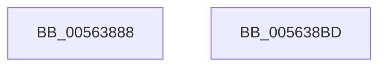

# HalpUsbLegacyReadPCIConfig

- RVA: `0x00563888`–`0x005638BE` (길이 `54` bytes)
- VA: `0x0000000140563888`
- 실행 섹션: `.text`
- PDB 이름 있음: `예`; PDB Function 태그: `아니요`
- unwind 정보 RVA: `0x00064C80`
- 디코드: `17`개 명령, `54/54` bytes 표시
- 미해석 바이트: `0` (있으면 어셈블리에 `.byte`로 보존)

> 이 문서는 커널 이미지의 기계어와 PDB 기호를 분석해 생성했습니다. 4번과 5번은 함수 원형과 자료형을 바이너리 사용 방식에서 추정한 C 해석이며 원본 소스 복구 결과는 아닙니다.

## 1. Dependencies

- 직접 호출 지점: **1**; 고유 호출 대상: **1**
- 직접 호출자로 확인된 함수: **3**
- RIP 상대 이미지 참조: **1**

### Outgoing calls
- `0x005638B2` → [guard_dispatch_icall](../6B/guard_dispatch_icall_function_006BAAD0.md) (function, `0x006BAAD0`)

### Direct callers
- [HalpUsbLegacyScanBusForHandoff](HalpUsbLegacyScanBusForHandoff_function_0056395C.md) at `0x005639DA`
- [HalpUsbLegacyScanBusForHandoff](HalpUsbLegacyScanBusForHandoff_function_0056395C.md) at `0x00563A0D`
- [HalpUsbLegacyStopOhciInterrupt](HalpUsbLegacyStopOhciInterrupt_function_00563AA0.md) at `0x00563AF1`
- [HalpUsbLegacyStopUhciInterrupt](HalpUsbLegacyStopUhciInterrupt_function_00563BD4.md) at `0x00563C3A`
- [HalpUsbLegacyStopUhciInterrupt](HalpUsbLegacyStopUhciInterrupt_function_00563BD4.md) at `0x00563C91`

### Static image references
- `0x00563895` → RVA `0x00E00890` (`.data`; read)

## 2. Other-region calls and transfers

- 다른 실행 섹션으로 향하는 call: **0**
- 별도 외부 분기/꼬리 이동을 확인하지 못했습니다.

## 3. Assembly (complete function range)

```asm
00563888  40 53                           push rbx
0056388A  48 83 EC 30                     sub rsp, 0x30
0056388E  8B 4C 24 68                     mov ecx, dword ptr [rsp + 0x68]
00563892  4D 8B D1                        mov r10, r9
00563895  48 8B 05 F4 CF 89 00            mov rax, qword ptr [rip + 0x89cff4]
0056389C  45 8B D8                        mov r11d, r8d
0056389F  44 8B 4C 24 60                  mov r9d, dword ptr [rsp + 0x60]
005638A4  8B DA                           mov ebx, edx
005638A6  89 4C 24 20                     mov dword ptr [rsp + 0x20], ecx
005638AA  4D 8B C2                        mov r8, r10
005638AD  41 8B D3                        mov edx, r11d
005638B0  8B CB                           mov ecx, ebx
005638B2  E8 19 72 15 00                  call 0x1406baad0
005638B7  48 83 C4 30                     add rsp, 0x30
005638BB  5B                              pop rbx
005638BC  C3                              ret
005638BD  CC                              int3
```

## 4. C-style interpretation (structured pseudocode)

```c
__int64 __fastcall HalpUsbLegacyReadPCIConfig(__int64 a1, int a2, int a3, __int64 a4, unsigned int a5, unsigned int a6)
{
    __int64 result;
    __int64 v_rsp;
    unsigned int v_stack_m18;

    v_rsp = (v_rsp) - (48);
    v_stack_m18 = (unsigned int)((unsigned int)(a6));
    result = guard_dispatch_icall((unsigned int)((unsigned int)((unsigned int)(a2))), (unsigned int)((unsigned int)((unsigned int)(a3))), a4, (unsigned int)(a5));
    v_rsp = (v_rsp) + (48);
    return result;
}
```

## 5. (Beta) C Style

```c
int64_t HalpUsbLegacyReadPCIConfig(int64_t Arg1, int32_t Arg2, int32_t Arg3, int64_t Arg4, uint32_t Arg5, uint32_t Arg6)
{
    int64_t result;
    int64_t local_rsp;
    uint32_t v_stack_m18;

    local_rsp = (local_rsp) - (48);
    v_stack_m18 = (uint32_t)((uint32_t)(Arg6));
    result = guard_dispatch_icall((uint32_t)((uint32_t)((uint32_t)(Arg2))), (uint32_t)((uint32_t)((uint32_t)(Arg3))), Arg4, (uint32_t)(Arg5));
    local_rsp = (local_rsp) + (48);
    return result;
}
```

## 6. Execution-region graph

[열기: 2D/3D 그래프와 함수 탐색 컨트롤 패널](../../../control-panel.html?section=text&rva=0x00563888&view=graph)

- 2D 그래프는 위에서 아래로 흐르고, 3D 그래프는 빈 공간을 드래그해 회전합니다. Shift+드래그는 이동, 휠은 확대·축소, 함수 노드 선택은 대상 보고서 이동입니다.

### Static fallback


