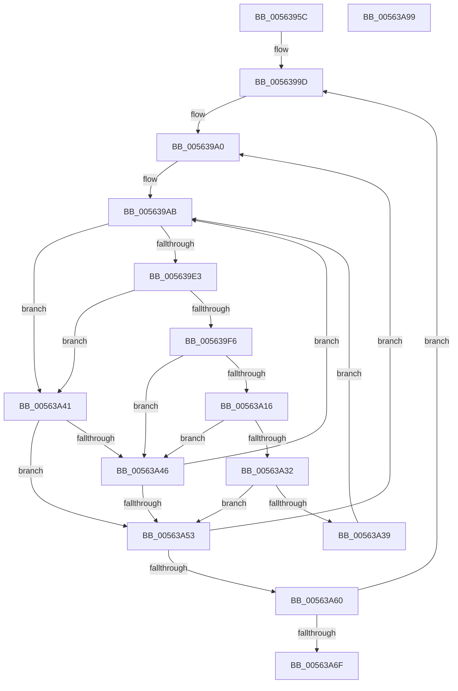

# HalpUsbLegacyScanBusForHandoff

- RVA: `0x0056395C`–`0x00563A9A` (길이 `318` bytes)
- VA: `0x000000014056395C`
- 실행 섹션: `.text`
- PDB 이름 있음: `예`; PDB Function 태그: `아니요`
- unwind 정보 RVA: `0x000C4C8C`
- 디코드: `87`개 명령, `318/318` bytes 표시
- 미해석 바이트: `0` (있으면 어셈블리에 `.byte`로 보존)

> 이 문서는 커널 이미지의 기계어와 PDB 기호를 분석해 생성했습니다. 4번과 5번은 함수 원형과 자료형을 바이너리 사용 방식에서 추정한 C 해석이며 원본 소스 복구 결과는 아닙니다.

## 1. Dependencies

- 직접 호출 지점: **5**; 고유 호출 대상: **4**
- 직접 호출자로 확인된 함수: **1**
- RIP 상대 이미지 참조: **1**

### Outgoing calls
- `0x00563990` → [memset](../6C/memset_function_006C6C40.md) (function, `0x006C6C40`)
- `0x005639DA` → [HalpUsbLegacyReadPCIConfig](HalpUsbLegacyReadPCIConfig_function_00563888.md) (function, `0x00563888`)
- `0x00563A0D` → [HalpUsbLegacyReadPCIConfig](HalpUsbLegacyReadPCIConfig_function_00563888.md) (function, `0x00563888`)
- `0x00563A28` → [HalpUsbLegacyDeviceHandoff](HalpUsbLegacyDeviceHandoff_function_005637E4.md) (function, `0x005637E4`)
- `0x00563A77` → [_security_check_cookie](../6A/_security_check_cookie_function_006AC640.md) (function, `0x006AC640`)

### Direct callers
- [HalpErrataInitSystem](../../pagelk/B5/HalpErrataInitSystem_function_00B5D310.md) at `0x00B5D34F`

### Static image references
- `0x00563977` → RVA `0x00E0A740` (`.data`; read)

## 2. Other-region calls and transfers

- 다른 실행 섹션으로 향하는 call: **0**
- 별도 외부 분기/꼬리 이동을 확인하지 못했습니다.

## 3. Assembly (complete function range)

```asm
0056395C  4C 8B DC                        mov r11, rsp
0056395F  49 89 5B 08                     mov qword ptr [r11 + 8], rbx
00563963  49 89 6B 10                     mov qword ptr [r11 + 0x10], rbp
00563967  49 89 73 18                     mov qword ptr [r11 + 0x18], rsi
0056396B  57                              push rdi
0056396C  41 54                           push r12
0056396E  41 56                           push r14
00563970  48 81 EC 80 00 00 00            sub rsp, 0x80
00563977  48 8B 05 C2 6D 8A 00            mov rax, qword ptr [rip + 0x8a6dc2]
0056397E  48 33 C4                        xor rax, rsp
00563981  48 89 44 24 70                  mov qword ptr [rsp + 0x70], rax
00563986  33 D2                           xor edx, edx
00563988  49 8D 4B 98                     lea rcx, [r11 - 0x68]
0056398C  44 8D 42 40                     lea r8d, [rdx + 0x40]
00563990  E8 AB 32 16 00                  call 0x1406c6c40
00563995  33 DB                           xor ebx, ebx
00563997  33 F6                           xor esi, esi
00563999  44 8D 63 01                     lea r12d, [rbx + 1]
0056399D  40 32 ED                        xor bpl, bpl
005639A0  40 32 FF                        xor dil, dil
005639A3  44 0F B6 F5                     movzx r14d, bpl
005639A7  41 83 E6 1F                     and r14d, 0x1f
005639AB  8B C3                           mov eax, ebx
005639AD  40 0F B6 CF                     movzx ecx, dil
005639B1  83 E1 07                        and ecx, 7
005639B4  C7 44 24 28 02 00 00 00         mov dword ptr [rsp + 0x28], 2
005639BC  83 64 24 20 00                  and dword ptr [rsp + 0x20], 0
005639C1  4C 8D 4C 24 30                  lea r9, [rsp + 0x30]
005639C6  C1 E1 05                        shl ecx, 5
005639C9  25 00 FF FF FF                  and eax, 0xffffff00
005639CE  8B D9                           mov ebx, ecx
005639D0  8B D6                           mov edx, esi
005639D2  0B D8                           or ebx, eax
005639D4  41 0B DE                        or ebx, r14d
005639D7  44 8B C3                        mov r8d, ebx
005639DA  E8 A9 FE FF FF                  call 0x140563888
005639DF  85 C0                           test eax, eax
005639E1  74 5E                           je 0x140563a41
005639E3  0F B7 44 24 30                  movzx eax, word ptr [rsp + 0x30]
005639E8  B9 FD FF 00 00                  mov ecx, 0xfffd
005639ED  66 41 2B C4                     sub ax, r12w
005639F1  66 3B C1                        cmp ax, cx
005639F4  77 4B                           ja 0x140563a41
005639F6  C7 44 24 28 10 00 00 00         mov dword ptr [rsp + 0x28], 0x10
005639FE  4C 8D 4C 24 30                  lea r9, [rsp + 0x30]
00563A03  83 64 24 20 00                  and dword ptr [rsp + 0x20], 0
00563A08  44 8B C3                        mov r8d, ebx
00563A0B  8B D6                           mov edx, esi
00563A0D  E8 76 FE FF FF                  call 0x140563888
00563A12  85 C0                           test eax, eax
00563A14  74 30                           je 0x140563a46
00563A16  48 83 64 24 20 00               and qword ptr [rsp + 0x20], 0
00563A1C  4C 8D 4C 24 30                  lea r9, [rsp + 0x30]
00563A21  44 8B C3                        mov r8d, ebx
00563A24  8B D6                           mov edx, esi
00563A26  33 C9                           xor ecx, ecx
00563A28  E8 B7 FD FF FF                  call 0x1405637e4
00563A2D  40 84 FF                        test dil, dil
00563A30  75 14                           jne 0x140563a46
00563A32  F6 44 24 3E 80                  test byte ptr [rsp + 0x3e], 0x80
00563A37  74 1A                           je 0x140563a53
00563A39  41 8A FC                        mov dil, r12b
00563A3C  E9 6A FF FF FF                  jmp 0x1405639ab
00563A41  40 84 FF                        test dil, dil
00563A44  74 0D                           je 0x140563a53
00563A46  41 02 FC                        add dil, r12b
00563A49  40 80 FF 08                     cmp dil, 8
00563A4D  0F 82 58 FF FF FF               jb 0x1405639ab
00563A53  41 02 EC                        add bpl, r12b
00563A56  40 80 FD 20                     cmp bpl, 0x20
00563A5A  0F 82 40 FF FF FF               jb 0x1405639a0
00563A60  41 03 F4                        add esi, r12d
00563A63  81 FE FF 00 00 00               cmp esi, 0xff
00563A69  0F 86 2E FF FF FF               jbe 0x14056399d
00563A6F  48 8B 4C 24 70                  mov rcx, qword ptr [rsp + 0x70]
00563A74  48 33 CC                        xor rcx, rsp
00563A77  E8 C4 8B 14 00                  call 0x1406ac640
00563A7C  4C 8D 9C 24 80 00 00 00         lea r11, [rsp + 0x80]
00563A84  49 8B 5B 20                     mov rbx, qword ptr [r11 + 0x20]
00563A88  49 8B 6B 28                     mov rbp, qword ptr [r11 + 0x28]
00563A8C  49 8B 73 30                     mov rsi, qword ptr [r11 + 0x30]
00563A90  49 8B E3                        mov rsp, r11
00563A93  41 5E                           pop r14
00563A95  41 5C                           pop r12
00563A97  5F                              pop rdi
00563A98  C3                              ret
00563A99  CC                              int3
```

## 4. C-style interpretation (structured pseudocode)

```c
__int64 __fastcall HalpUsbLegacyScanBusForHandoff(__int64 a1, int a2)
{
    __int64 result;
    __int64 v_r14;
    __int64 v_rbp;
    __int64 v_rbx;
    __int64 v_rdi;
    __int64 v_rsi;
    __int64 v_rsp;
    unsigned __int64 v_stack_m18;
    unsigned __int64 v_stack_m28;
    unsigned __int8 v_stack_m5A;
    unsigned __int64 v_stack_m68;
    unsigned int v_stack_m70;
    unsigned int v_stack_m78;

    *(unsigned __int64 *)(v_rsp + 8) = v_rbx;
    *(unsigned __int64 *)(v_rsp + 16) = v_rbp;
    *(unsigned __int64 *)(v_rsp + 24) = v_rsi;
    v_rsp = (v_rsp) - (128);
    result = (*(unsigned __int64 *)(v_rip + 9072066)) ^ (v_rsp);
    v_stack_m28 = result;
    a2 = 0;
    result = memset(v_rsp - 104, a2, a2 + 64, a4);
    v_rbx = 0;
    v_rsi = 0;
loc_0056399D:
    v_rbp = 0;
loc_005639A0:
    v_rdi = 0;
    v_r14 = (unsigned int)((0) & (31));
loc_005639AB:
    a1 = (unsigned int)((0) & (7));
    v_stack_m70 = 2;
    a1 = (unsigned int)((a1) << (5));
    result = (unsigned int)((0) & (0xFFFFFF00ULL));
    v_rbx = (unsigned int)(((unsigned int)((unsigned int)(a1))) | ((unsigned int)(result)));
    v_rbx = (unsigned int)((v_rbx) | ((unsigned int)(v_r14)));
    result = HalpUsbLegacyReadPCIConfig(a1, 0, (unsigned int)((unsigned int)(v_rbx)), v_stack_m68);
    if ((unsigned int)(result) == 0) goto loc_00563A41;
    result = (unsigned __int16)((v_stack_m68) - ((unsigned __int16)(v_rbx + 1)));
    if (((unsigned __int16)(result)) > ((unsigned __int16)((unsigned int)(0xFFFDULL)))) goto loc_00563A41;
    v_stack_m70 = 16;
    result = HalpUsbLegacyReadPCIConfig((unsigned int)(0xFFFDULL), 0, (unsigned int)((unsigned int)(v_rbx)), v_stack_m68);
    if ((unsigned int)(result) == 0) goto loc_00563A46;
    a1 = 0;
    result = HalpUsbLegacyDeviceHandoff(a1, 0, (unsigned int)((unsigned int)(v_rbx)), v_stack_m68);
    if (0 != 0) goto loc_00563A46;
    if (((v_stack_m5A) & (128)) == 0) goto loc_00563A53;
    goto loc_005639AB;
loc_00563A41:
    if ((unsigned __int8)((unsigned __int8)(v_rbx + 1)) == 0) goto loc_00563A53;
loc_00563A46:
    v_rdi = (unsigned __int8)(((unsigned __int8)(v_rbx + 1)) + ((unsigned __int8)(v_rbx + 1)));
    if (((unsigned __int8)(v_rdi)) < 8) goto loc_005639AB;
loc_00563A53:
    v_rbp = (unsigned __int8)((v_rbp) + ((unsigned __int8)(v_rbx + 1)));
    if (((unsigned __int8)(v_rbp)) < 32) goto loc_005639A0;
    v_rsi = (unsigned int)((v_rsi) + ((unsigned int)(v_rbx + 1)));
    if (((unsigned int)(v_rsi)) <= 255) goto loc_0056399D;
    a1 = (v_stack_m28) ^ (v_rsp);
    result = _security_check_cookie(a1, 0, (unsigned int)((unsigned int)(v_rbx)), v_stack_m68);
    return result;
}
```

## 5. (Beta) C Style

```c
int64_t HalpUsbLegacyScanBusForHandoff(int64_t Arg1, int32_t Arg2)
{
    int64_t result;
    int64_t local_r14;
    int64_t local_rbp;
    int64_t local_rbx;
    int64_t local_rdi;
    int64_t local_rsi;
    int64_t local_rsp;
    uint64_t v_stack_m18;
    uint64_t v_stack_m28;
    uint8_t v_stack_m5A;
    uint64_t v_stack_m68;
    uint32_t v_stack_m70;
    uint32_t v_stack_m78;

    *(uint64_t *)(local_rsp + 0x8) = local_rbx;
    *(uint64_t *)(local_rsp + 0x10) = local_rbp;
    *(uint64_t *)(local_rsp + 0x18) = local_rsi;
    local_rsp = (local_rsp) - (128);
    result = (*(uint64_t *)(v_rip + 0x8A6DC2)) ^ (local_rsp);
    v_stack_m28 = result;
    Arg2 = 0;
    result = memset(local_rsp - 104, Arg2, Arg2 + 64, a4);
    local_rbx = 0;
    local_rsi = 0;
loc_0056399D:
    local_rbp = 0;
loc_005639A0:
    local_rdi = 0;
    local_r14 = (uint32_t)((0) & (31));
loc_005639AB:
    Arg1 = (uint32_t)((0) & (7));
    v_stack_m70 = 2;
    Arg1 = (uint32_t)((Arg1) << (5));
    result = (uint32_t)((0) & (0xFFFFFF00ULL));
    local_rbx = (uint32_t)(((uint32_t)((uint32_t)(Arg1))) | ((uint32_t)(result)));
    local_rbx = (uint32_t)((local_rbx) | ((uint32_t)(local_r14)));
    result = HalpUsbLegacyReadPCIConfig(Arg1, 0, (uint32_t)((uint32_t)(local_rbx)), v_stack_m68);
    if ((uint32_t)(result) == 0) goto loc_00563A41;
    result = (uint16_t)((v_stack_m68) - ((uint16_t)(local_rbx + 1)));
    if (((uint16_t)(result)) > ((uint16_t)((uint32_t)(0xFFFDULL)))) goto loc_00563A41;
    v_stack_m70 = 16;
    result = HalpUsbLegacyReadPCIConfig((uint32_t)(0xFFFDULL), 0, (uint32_t)((uint32_t)(local_rbx)), v_stack_m68);
    if ((uint32_t)(result) == 0) goto loc_00563A46;
    Arg1 = 0;
    result = HalpUsbLegacyDeviceHandoff(Arg1, 0, (uint32_t)((uint32_t)(local_rbx)), v_stack_m68);
    if (0 != 0) goto loc_00563A46;
    if (((v_stack_m5A) & (128)) == 0) goto loc_00563A53;
    goto loc_005639AB;
loc_00563A41:
    if ((uint8_t)((uint8_t)(local_rbx + 1)) == 0) goto loc_00563A53;
loc_00563A46:
    local_rdi = (uint8_t)(((uint8_t)(local_rbx + 1)) + ((uint8_t)(local_rbx + 1)));
    if (((uint8_t)(local_rdi)) < 8) goto loc_005639AB;
loc_00563A53:
    local_rbp = (uint8_t)((local_rbp) + ((uint8_t)(local_rbx + 1)));
    if (((uint8_t)(local_rbp)) < 32) goto loc_005639A0;
    local_rsi = (uint32_t)((local_rsi) + ((uint32_t)(local_rbx + 1)));
    if (((uint32_t)(local_rsi)) <= 255) goto loc_0056399D;
    Arg1 = (v_stack_m28) ^ (local_rsp);
    result = _security_check_cookie(Arg1, 0, (uint32_t)((uint32_t)(local_rbx)), v_stack_m68);
    return result;
}
```

## 6. Execution-region graph

[열기: 2D/3D 그래프와 함수 탐색 컨트롤 패널](../../../control-panel.html?section=text&rva=0x0056395C&view=graph)

- 2D 그래프는 위에서 아래로 흐르고, 3D 그래프는 빈 공간을 드래그해 회전합니다. Shift+드래그는 이동, 휠은 확대·축소, 함수 노드 선택은 대상 보고서 이동입니다.

### Static fallback


