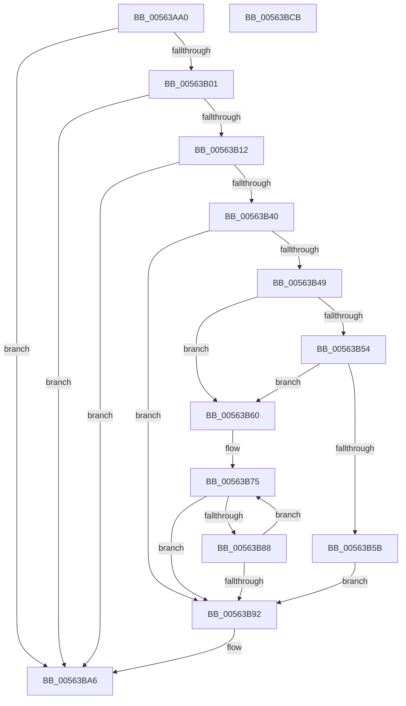

# HalpUsbLegacyStopOhciInterrupt

- RVA: `0x00563AA0`–`0x00563BCC` (길이 `300` bytes)
- VA: `0x0000000140563AA0`
- 실행 섹션: `.text`
- PDB 이름 있음: `예`; PDB Function 태그: `아니요`
- unwind 정보 RVA: `0x000C4C4C`
- 디코드: `75`개 명령, `300/300` bytes 표시
- 미해석 바이트: `0` (있으면 어셈블리에 `.byte`로 보존)

> 이 문서는 커널 이미지의 기계어와 PDB 기호를 분석해 생성했습니다. 4번과 5번은 함수 원형과 자료형을 바이너리 사용 방식에서 추정한 C 해석이며 원본 소스 복구 결과는 아닙니다.

## 1. Dependencies

- 직접 호출 지점: **6**; 고유 호출 대상: **6**
- 직접 호출자로 확인된 함수: **1**
- RIP 상대 이미지 참조: **1**

### Outgoing calls
- `0x00563AD4` → [memset](../6C/memset_function_006C6C40.md) (function, `0x006C6C40`)
- `0x00563AF1` → [HalpUsbLegacyReadPCIConfig](HalpUsbLegacyReadPCIConfig_function_00563888.md) (function, `0x00563888`)
- `0x00563B33` → [HalpMap](../3F/HalpMap_function_003F88F4.md) (function, `0x003F88F4`)
- `0x00563B7A` → [KeStallExecutionProcessor](../44/KeStallExecutionProcessor_function_0044F620.md) (function, `0x0044F620`)
- `0x00563BA1` → [HalpUnmapVirtualAddress](../3F/HalpUnmapVirtualAddress_function_003F8C30.md) (function, `0x003F8C30`)
- `0x00563BB1` → [_security_check_cookie](../6A/_security_check_cookie_function_006AC640.md) (function, `0x006AC640`)

### Direct callers
- [HalpStopLegacyUsbInterruptsInternal](../../pagelk/B6/HalpStopLegacyUsbInterruptsInternal_function_00B60A40.md) at `0x00B60AE8`

### Static image references
- `0x00563AB2` → RVA `0x00E0A740` (`.data`; read)

## 2. Other-region calls and transfers

- 다른 실행 섹션으로 향하는 call: **0**
- 별도 외부 분기/꼬리 이동을 확인하지 못했습니다.

## 3. Assembly (complete function range)

```asm
00563AA0  48 89 5C 24 08                  mov qword ptr [rsp + 8], rbx
00563AA5  48 89 74 24 20                  mov qword ptr [rsp + 0x20], rsi
00563AAA  57                              push rdi
00563AAB  48 81 EC 90 00 00 00            sub rsp, 0x90
00563AB2  48 8B 05 87 6C 8A 00            mov rax, qword ptr [rip + 0x8a6c87]
00563AB9  48 33 C4                        xor rax, rsp
00563ABC  48 89 84 24 80 00 00 00         mov qword ptr [rsp + 0x80], rax
00563AC4  8B FA                           mov edi, edx
00563AC6  48 8D 4C 24 40                  lea rcx, [rsp + 0x40]
00563ACB  33 D2                           xor edx, edx
00563ACD  41 8B D8                        mov ebx, r8d
00563AD0  44 8D 42 40                     lea r8d, [rdx + 0x40]
00563AD4  E8 67 31 16 00                  call 0x1406c6c40
00563AD9  33 F6                           xor esi, esi
00563ADB  C7 44 24 28 40 00 00 00         mov dword ptr [rsp + 0x28], 0x40
00563AE3  4C 8D 4C 24 40                  lea r9, [rsp + 0x40]
00563AE8  89 74 24 20                     mov dword ptr [rsp + 0x20], esi
00563AEC  44 8B C3                        mov r8d, ebx
00563AEF  8B D7                           mov edx, edi
00563AF1  E8 92 FD FF FF                  call 0x140563888
00563AF6  F6 44 24 44 02                  test byte ptr [rsp + 0x44], 2
00563AFB  0F 84 A5 00 00 00               je 0x140563ba6
00563B01  8B 44 24 50                     mov eax, dword ptr [rsp + 0x50]
00563B05  83 E0 F0                        and eax, 0xfffffff0
00563B08  89 44 24 30                     mov dword ptr [rsp + 0x30], eax
00563B0C  0F 84 94 00 00 00               je 0x140563ba6
00563B12  8D 7E 01                        lea edi, [rsi + 1]
00563B15  89 74 24 34                     mov dword ptr [rsp + 0x34], esi
00563B19  48 8B 4C 24 30                  mov rcx, qword ptr [rsp + 0x30]
00563B1E  44 8B C7                        mov r8d, edi
00563B21  8B D7                           mov edx, edi
00563B23  48 89 74 24 28                  mov qword ptr [rsp + 0x28], rsi
00563B28  45 33 C9                        xor r9d, r9d
00563B2B  C7 44 24 20 04 00 00 00         mov dword ptr [rsp + 0x20], 4
00563B33  E8 BC 4D E9 FF                  call 0x1403f88f4
00563B38  48 8B D8                        mov rbx, rax
00563B3B  48 85 C0                        test rax, rax
00563B3E  74 66                           je 0x140563ba6
00563B40  8B 48 04                        mov ecx, dword ptr [rax + 4]
00563B43  0F BA E1 08                     bt ecx, 8
00563B47  73 49                           jae 0x140563b92
00563B49  8B 48 04                        mov ecx, dword ptr [rax + 4]
00563B4C  81 F9 00 01 00 00               cmp ecx, 0x100
00563B52  75 0C                           jne 0x140563b60
00563B54  8B 48 10                        mov ecx, dword ptr [rax + 0x10]
00563B57  85 C9                           test ecx, ecx
00563B59  75 05                           jne 0x140563b60
00563B5B  89 70 04                        mov dword ptr [rax + 4], esi
00563B5E  EB 32                           jmp 0x140563b92
00563B60  C7 40 14 40 00 00 00            mov dword ptr [rax + 0x14], 0x40
00563B67  C7 40 10 00 00 00 C0            mov dword ptr [rax + 0x10], 0xc0000000
00563B6E  C7 40 08 08 00 00 00            mov dword ptr [rax + 8], 8
00563B75  B9 E8 03 00 00                  mov ecx, 0x3e8
00563B7A  E8 A1 BA EE FF                  call 0x14044f620
00563B7F  8B 43 04                        mov eax, dword ptr [rbx + 4]
00563B82  0F BA E0 08                     bt eax, 8
00563B86  73 0A                           jae 0x140563b92
00563B88  03 F7                           add esi, edi
00563B8A  81 FE F4 01 00 00               cmp esi, 0x1f4
00563B90  72 E3                           jb 0x140563b75
00563B92  45 33 C0                        xor r8d, r8d
00563B95  C7 43 14 00 00 00 80            mov dword ptr [rbx + 0x14], 0x80000000
00563B9C  8B D7                           mov edx, edi
00563B9E  48 8B CB                        mov rcx, rbx
00563BA1  E8 8A 50 E9 FF                  call 0x1403f8c30
00563BA6  48 8B 8C 24 80 00 00 00         mov rcx, qword ptr [rsp + 0x80]
00563BAE  48 33 CC                        xor rcx, rsp
00563BB1  E8 8A 8A 14 00                  call 0x1406ac640
00563BB6  4C 8D 9C 24 90 00 00 00         lea r11, [rsp + 0x90]
00563BBE  49 8B 5B 10                     mov rbx, qword ptr [r11 + 0x10]
00563BC2  49 8B 73 28                     mov rsi, qword ptr [r11 + 0x28]
00563BC6  49 8B E3                        mov rsp, r11
00563BC9  5F                              pop rdi
00563BCA  C3                              ret
00563BCB  CC                              int3
```

## 4. C-style interpretation (structured pseudocode)

```c
__int64 __fastcall HalpUsbLegacyStopOhciInterrupt(__int64 a1, int a2, int a3)
{
    __int64 result;
    __int64 v_rsi;
    __int64 v_rsp;
    unsigned __int64 v_stack_m18;
    unsigned int v_stack_m48;
    unsigned __int8 v_stack_m54;
    unsigned __int64 v_stack_m58;
    unsigned int v_stack_m64;
    unsigned int v_stack_m68;
    unsigned int v_stack_m70;
    unsigned int v_stack_m78;
    unsigned __int64 v_stack_m8;
    unsigned __int64 v_stack_p20;
    unsigned __int64 v_stack_p8;

    v_stack_p8 = v_rbx;
    v_stack_p20 = v_rsi;
    v_rsp = (v_rsp) - (144);
    result = (*(unsigned __int64 *)(v_rip + 9071751)) ^ (v_rsp);
    v_stack_m18 = result;
    a2 = 0;
    result = memset(v_stack_m58, a2, a2 + 64, a4);
    v_rsi = 0;
    v_stack_m70 = 64;
    v_stack_m78 = 0;
    result = HalpUsbLegacyReadPCIConfig(v_stack_m58, (unsigned int)((unsigned int)((unsigned int)(a2))), (unsigned int)((unsigned int)((unsigned int)(a3))), v_stack_m58);
    if (((v_stack_m54) & (2)) == 0) goto loc_00563BA6;
    result = (unsigned int)(((unsigned int)(v_stack_m48)) & (0xFFFFFFF0ULL));
    v_stack_m68 = (unsigned int)(result);
    if (condition_is_equal) goto loc_00563BA6;
    v_stack_m64 = 0;
    v_stack_m70 = 0;
    a4 = 0;
    v_stack_m78 = 4;
    result = HalpMap(v_stack_m68, (unsigned int)((unsigned int)(v_rsi + 1)), (unsigned int)((unsigned int)(v_rsi + 1)), a4);
    if (result == 0) goto loc_00563BA6;
    if (condition_is_above_or_equal) goto loc_00563B92;
    if (((unsigned int)((unsigned int)(*(unsigned int *)(result + 4)))) != 256) goto loc_00563B60;
    if ((unsigned int)((unsigned int)(*(unsigned int *)(result + 16))) != 0) goto loc_00563B60;
    *(unsigned int *)(result + 4) = 0;
    goto loc_00563B92;
loc_00563B60:
    *(unsigned int *)(result + 20) = 64;
    *(unsigned int *)(result + 16) = 0xC0000000ULL;
    *(unsigned int *)(result + 8) = 8;
loc_00563B75:
    result = KeStallExecutionProcessor(1000, (unsigned int)((unsigned int)(v_rsi + 1)), (unsigned int)((unsigned int)(v_rsi + 1)), a4);
    if (condition_is_above_or_equal) goto loc_00563B92;
    v_rsi = (unsigned int)((v_rsi) + ((unsigned int)(v_rsi + 1)));
    if (((unsigned int)(v_rsi)) < 500) goto loc_00563B75;
loc_00563B92:
    a3 = 0;
    *(unsigned int *)(result + 20) = 0x80000000ULL;
    result = HalpUnmapVirtualAddress(result, (unsigned int)((unsigned int)(v_rsi + 1)), a3, a4);
loc_00563BA6:
    a1 = (v_stack_m18) ^ (v_rsp);
    result = _security_check_cookie(a1, (unsigned int)((unsigned int)(v_rsi + 1)), a3, a4);
    return result;
}
```

## 5. (Beta) C Style

```c
int64_t HalpUsbLegacyStopOhciInterrupt(int64_t Arg1, int32_t Arg2, int32_t Arg3)
{
    int64_t result;
    int64_t local_rsi;
    int64_t local_rsp;
    uint64_t v_stack_m18;
    uint32_t v_stack_m48;
    uint8_t v_stack_m54;
    uint64_t v_stack_m58;
    uint32_t v_stack_m64;
    uint32_t v_stack_m68;
    uint32_t v_stack_m70;
    uint32_t v_stack_m78;
    uint64_t v_stack_m8;
    uint64_t v_stack_p20;
    uint64_t v_stack_p8;

    v_stack_p8 = local_rbx;
    v_stack_p20 = local_rsi;
    local_rsp = (local_rsp) - (144);
    result = (*(uint64_t *)(v_rip + 0x8A6C87)) ^ (local_rsp);
    v_stack_m18 = result;
    Arg2 = 0;
    result = memset(v_stack_m58, Arg2, Arg2 + 64, a4);
    local_rsi = 0;
    v_stack_m70 = 64;
    v_stack_m78 = 0;
    result = HalpUsbLegacyReadPCIConfig(v_stack_m58, (uint32_t)((uint32_t)((uint32_t)(Arg2))), (uint32_t)((uint32_t)((uint32_t)(Arg3))), v_stack_m58);
    if (((v_stack_m54) & (2)) == 0) goto loc_00563BA6;
    result = (uint32_t)(((uint32_t)(v_stack_m48)) & (0xFFFFFFF0ULL));
    v_stack_m68 = (uint32_t)(result);
    if (condition_is_equal) goto loc_00563BA6;
    v_stack_m64 = 0;
    v_stack_m70 = 0;
    a4 = 0;
    v_stack_m78 = 4;
    result = HalpMap(v_stack_m68, (uint32_t)((uint32_t)(local_rsi + 1)), (uint32_t)((uint32_t)(local_rsi + 1)), a4);
    if (result == 0) goto loc_00563BA6;
    if (condition_is_above_or_equal) goto loc_00563B92;
    if (((uint32_t)((uint32_t)(*(uint32_t *)(result + 0x4)))) != 256) goto loc_00563B60;
    if ((uint32_t)((uint32_t)(*(uint32_t *)(result + 0x10))) != 0) goto loc_00563B60;
    *(uint32_t *)(result + 0x4) = 0;
    goto loc_00563B92;
loc_00563B60:
    *(uint32_t *)(result + 0x14) = 64;
    *(uint32_t *)(result + 0x10) = 0xC0000000ULL;
    *(uint32_t *)(result + 0x8) = 8;
loc_00563B75:
    result = KeStallExecutionProcessor(1000, (uint32_t)((uint32_t)(local_rsi + 1)), (uint32_t)((uint32_t)(local_rsi + 1)), a4);
    if (condition_is_above_or_equal) goto loc_00563B92;
    local_rsi = (uint32_t)((local_rsi) + ((uint32_t)(local_rsi + 1)));
    if (((uint32_t)(local_rsi)) < 500) goto loc_00563B75;
loc_00563B92:
    Arg3 = 0;
    *(uint32_t *)(result + 0x14) = 0x80000000ULL;
    result = HalpUnmapVirtualAddress(result, (uint32_t)((uint32_t)(local_rsi + 1)), Arg3, a4);
loc_00563BA6:
    Arg1 = (v_stack_m18) ^ (local_rsp);
    result = _security_check_cookie(Arg1, (uint32_t)((uint32_t)(local_rsi + 1)), Arg3, a4);
    return result;
}
```

## 6. Execution-region graph

[열기: 2D/3D 그래프와 함수 탐색 컨트롤 패널](../../../control-panel.html?section=text&rva=0x00563AA0&view=graph)

- 2D 그래프는 위에서 아래로 흐르고, 3D 그래프는 빈 공간을 드래그해 회전합니다. Shift+드래그는 이동, 휠은 확대·축소, 함수 노드 선택은 대상 보고서 이동입니다.

### Static fallback


