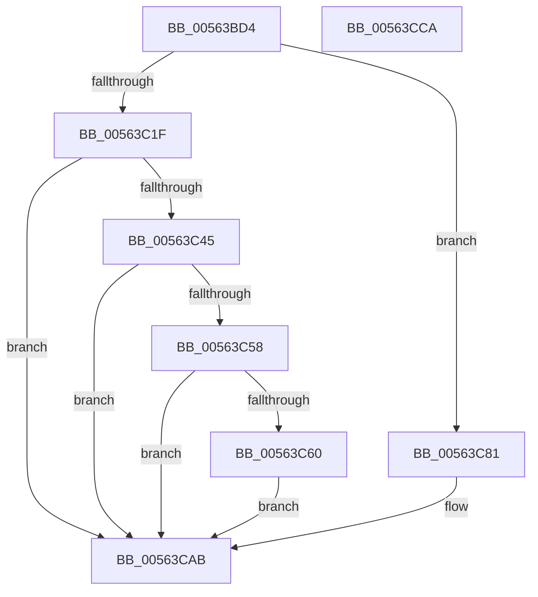

# HalpUsbLegacyStopUhciInterrupt

- RVA: `0x00563BD4`–`0x00563CCB` (길이 `247` bytes)
- VA: `0x0000000140563BD4`
- 실행 섹션: `.text`
- PDB 이름 있음: `예`; PDB Function 태그: `아니요`
- unwind 정보 RVA: `0x000C4C6C`
- 디코드: `73`개 명령, `247/247` bytes 표시
- 미해석 바이트: `0` (있으면 어셈블리에 `.byte`로 보존)

> 이 문서는 커널 이미지의 기계어와 PDB 기호를 분석해 생성했습니다. 4번과 5번은 함수 원형과 자료형을 바이너리 사용 방식에서 추정한 C 해석이며 원본 소스 복구 결과는 아닙니다.

## 1. Dependencies

- 직접 호출 지점: **7**; 고유 호출 대상: **5**
- 직접 호출자로 확인된 함수: **2**
- RIP 상대 이미지 참조: **1**

### Outgoing calls
- `0x00563C08` → [memset](../6C/memset_function_006C6C40.md) (function, `0x006C6C40`)
- `0x00563C1F` → [HalpUsbLegacyWritePCIConfig](HalpUsbLegacyWritePCIConfig_function_005638C4.md) (function, `0x005638C4`)
- `0x00563C3A` → [HalpUsbLegacyReadPCIConfig](HalpUsbLegacyReadPCIConfig_function_00563888.md) (function, `0x00563888`)
- `0x00563C71` → [KeStallExecutionProcessor](../44/KeStallExecutionProcessor_function_0044F620.md) (function, `0x0044F620`)
- `0x00563C91` → [HalpUsbLegacyReadPCIConfig](HalpUsbLegacyReadPCIConfig_function_00563888.md) (function, `0x00563888`)
- `0x00563CA6` → [HalpUsbLegacyWritePCIConfig](HalpUsbLegacyWritePCIConfig_function_005638C4.md) (function, `0x005638C4`)
- `0x00563CB2` → [_security_check_cookie](../6A/_security_check_cookie_function_006AC640.md) (function, `0x006AC640`)

### Direct callers
- [HalpStopLegacyUsbInterruptsInternal](../../pagelk/B6/HalpStopLegacyUsbInterruptsInternal_function_00B60A40.md) at `0x00B60B00`
- [HalpPiix4Detect](../../pagelk/B7/HalpPiix4Detect_function_00B79E00.md) at `0x00B7A326`

### Static image references
- `0x00563BE8` → RVA `0x00E0A740` (`.data`; read)

## 2. Other-region calls and transfers

- 다른 실행 섹션으로 향하는 call: **0**
- 별도 외부 분기/꼬리 이동을 확인하지 못했습니다.

## 3. Assembly (complete function range)

```asm
00563BD4  48 89 5C 24 08                  mov qword ptr [rsp + 8], rbx
00563BD9  55                              push rbp
00563BDA  56                              push rsi
00563BDB  57                              push rdi
00563BDC  48 8D 6C 24 B9                  lea rbp, [rsp - 0x47]
00563BE1  48 81 EC 90 00 00 00            sub rsp, 0x90
00563BE8  48 8B 05 51 6B 8A 00            mov rax, qword ptr [rip + 0x8a6b51]
00563BEF  48 33 C4                        xor rax, rsp
00563BF2  48 89 45 37                     mov qword ptr [rbp + 0x37], rax
00563BF6  8B F2                           mov esi, edx
00563BF8  48 8D 4D F7                     lea rcx, [rbp - 9]
00563BFC  33 D2                           xor edx, edx
00563BFE  41 8B D8                        mov ebx, r8d
00563C01  41 8A F9                        mov dil, r9b
00563C04  44 8D 42 40                     lea r8d, [rdx + 0x40]
00563C08  E8 33 30 16 00                  call 0x1406c6c40
00563C0D  83 65 E7 00                     and dword ptr [rbp - 0x19], 0
00563C11  4C 8D 4D E7                     lea r9, [rbp - 0x19]
00563C15  44 8B C3                        mov r8d, ebx
00563C18  8B D6                           mov edx, esi
00563C1A  40 84 FF                        test dil, dil
00563C1D  74 62                           je 0x140563c81
00563C1F  E8 A0 FC FF FF                  call 0x1405638c4
00563C24  4C 8D 4D F7                     lea r9, [rbp - 9]
00563C28  C7 44 24 28 40 00 00 00         mov dword ptr [rsp + 0x28], 0x40
00563C30  83 64 24 20 00                  and dword ptr [rsp + 0x20], 0
00563C35  44 8B C3                        mov r8d, ebx
00563C38  8B D6                           mov edx, esi
00563C3A  E8 49 FC FF FF                  call 0x140563888
00563C3F  F6 45 FB 01                     test byte ptr [rbp - 5], 1
00563C43  74 66                           je 0x140563cab
00563C45  8B 55 17                        mov edx, dword ptr [rbp + 0x17]
00563C48  83 E2 FC                        and edx, 0xfffffffc
00563C4B  89 55 E7                        mov dword ptr [rbp - 0x19], edx
00563C4E  8D 42 FF                        lea eax, [rdx - 1]
00563C51  3D FD FF 00 00                  cmp eax, 0xfffd
00563C56  77 53                           ja 0x140563cab
00563C58  90                              nop
00563C59  66 ED                           in ax, dx
00563C5B  90                              nop
00563C5C  A8 08                           test al, 8
00563C5E  75 4B                           jne 0x140563cab
00563C60  8B 55 E7                        mov edx, dword ptr [rbp - 0x19]
00563C63  B8 04 00 00 00                  mov eax, 4
00563C68  90                              nop
00563C69  B9 10 27 00 00                  mov ecx, 0x2710
00563C6E  66 EF                           out dx, ax
00563C70  90                              nop
00563C71  E8 AA B9 EE FF                  call 0x14044f620
00563C76  8B 55 E7                        mov edx, dword ptr [rbp - 0x19]
00563C79  33 C0                           xor eax, eax
00563C7B  90                              nop
00563C7C  66 EF                           out dx, ax
00563C7E  90                              nop
00563C7F  EB 2A                           jmp 0x140563cab
00563C81  C7 44 24 28 04 00 00 00         mov dword ptr [rsp + 0x28], 4
00563C89  C7 44 24 20 C0 00 00 00         mov dword ptr [rsp + 0x20], 0xc0
00563C91  E8 F2 FB FF FF                  call 0x140563888
00563C96  81 65 E7 FF 40 FF FF            and dword ptr [rbp - 0x19], 0xffff40ff
00563C9D  4C 8D 4D E7                     lea r9, [rbp - 0x19]
00563CA1  44 8B C3                        mov r8d, ebx
00563CA4  8B D6                           mov edx, esi
00563CA6  E8 19 FC FF FF                  call 0x1405638c4
00563CAB  48 8B 4D 37                     mov rcx, qword ptr [rbp + 0x37]
00563CAF  48 33 CC                        xor rcx, rsp
00563CB2  E8 89 89 14 00                  call 0x1406ac640
00563CB7  48 8B 9C 24 B0 00 00 00         mov rbx, qword ptr [rsp + 0xb0]
00563CBF  48 81 C4 90 00 00 00            add rsp, 0x90
00563CC6  5F                              pop rdi
00563CC7  5E                              pop rsi
00563CC8  5D                              pop rbp
00563CC9  C3                              ret
00563CCA  CC                              int3
```

## 4. C-style interpretation (structured pseudocode)

```c
__int64 __fastcall HalpUsbLegacyStopUhciInterrupt(__int64 a1, int a2, int a3, unsigned __int8 a4)
{
    __int64 result;
    __int64 v_rsp;
    unsigned __int64 v_stack_m28;
    unsigned int v_stack_m48;
    unsigned __int64 v_stack_m5F;
    unsigned __int8 v_stack_m64;
    unsigned __int64 v_stack_m68;
    unsigned int v_stack_m78;
    unsigned int v_stack_m80;
    unsigned int v_stack_m88;
    unsigned __int64 v_stack_p8;

    v_stack_p8 = v_rbx;
    v_rsp = (v_rsp) - (144);
    result = (*(unsigned __int64 *)(v_rip + 9071441)) ^ (v_rsp);
    v_stack_m28 = result;
    a2 = 0;
    result = memset(v_stack_m68, a2, a2 + 64, a4);
    if (a4 == 0) goto loc_00563C81;
    result = HalpUsbLegacyWritePCIConfig(v_stack_m68, (unsigned int)((unsigned int)((unsigned int)(a2))), (unsigned int)((unsigned int)((unsigned int)(a3))), v_stack_m78);
    v_stack_m80 = 64;
    result = HalpUsbLegacyReadPCIConfig(v_stack_m68, (unsigned int)((unsigned int)((unsigned int)(a2))), (unsigned int)((unsigned int)((unsigned int)(a3))), v_stack_m68);
    if (((v_stack_m64) & (1)) == 0) goto loc_00563CAB;
    a2 = (unsigned int)(((unsigned int)(v_stack_m48)) & (0xFFFFFFFCULL));
    v_stack_m78 = a2;
    if (((unsigned int)(a2 - 1)) > 0xFFFDULL) goto loc_00563CAB;
    if ((((unsigned __int8)(a2 - 1)) & (8)) != 0) goto loc_00563CAB;
    result = KeStallExecutionProcessor((unsigned int)(0x2710ULL), (unsigned int)(v_stack_m78), (unsigned int)((unsigned int)((unsigned int)(a3))), v_stack_m68);
    result = 0;
    goto loc_00563CAB;
loc_00563C81:
    v_stack_m80 = 4;
    v_stack_m88 = 192;
    result = HalpUsbLegacyReadPCIConfig((unsigned int)(0x2710ULL), (unsigned int)(v_stack_m78), (unsigned int)((unsigned int)((unsigned int)(a3))), v_stack_m68);
    result = HalpUsbLegacyWritePCIConfig((unsigned int)(0x2710ULL), (unsigned int)((unsigned int)((unsigned int)(a2))), (unsigned int)((unsigned int)((unsigned int)(a3))), v_stack_m78);
loc_00563CAB:
    a1 = (v_stack_m28) ^ (v_rsp);
    result = _security_check_cookie(a1, (unsigned int)((unsigned int)((unsigned int)(a2))), (unsigned int)((unsigned int)((unsigned int)(a3))), v_stack_m78);
    v_rsp = (v_rsp) + (144);
    return result;
}
```

## 5. (Beta) C Style

```c
int64_t HalpUsbLegacyStopUhciInterrupt(int64_t Arg1, int32_t Arg2, int32_t Arg3, uint8_t Arg4)
{
    int64_t result;
    int64_t local_rsp;
    uint64_t v_stack_m28;
    uint32_t v_stack_m48;
    uint64_t v_stack_m5F;
    uint8_t v_stack_m64;
    uint64_t v_stack_m68;
    uint32_t v_stack_m78;
    uint32_t v_stack_m80;
    uint32_t v_stack_m88;
    uint64_t v_stack_p8;

    v_stack_p8 = local_rbx;
    local_rsp = (local_rsp) - (144);
    result = (*(uint64_t *)(v_rip + 0x8A6B51)) ^ (local_rsp);
    v_stack_m28 = result;
    Arg2 = 0;
    result = memset(v_stack_m68, Arg2, Arg2 + 64, Arg4);
    if (Arg4 == 0) goto loc_00563C81;
    result = HalpUsbLegacyWritePCIConfig(v_stack_m68, (uint32_t)((uint32_t)((uint32_t)(Arg2))), (uint32_t)((uint32_t)((uint32_t)(Arg3))), v_stack_m78);
    v_stack_m80 = 64;
    result = HalpUsbLegacyReadPCIConfig(v_stack_m68, (uint32_t)((uint32_t)((uint32_t)(Arg2))), (uint32_t)((uint32_t)((uint32_t)(Arg3))), v_stack_m68);
    if (((v_stack_m64) & (1)) == 0) goto loc_00563CAB;
    Arg2 = (uint32_t)(((uint32_t)(v_stack_m48)) & (0xFFFFFFFCULL));
    v_stack_m78 = Arg2;
    if (((uint32_t)(Arg2 - 1)) > 0xFFFDULL) goto loc_00563CAB;
    if ((((uint8_t)(Arg2 - 1)) & (8)) != 0) goto loc_00563CAB;
    result = KeStallExecutionProcessor((uint32_t)(0x2710ULL), (uint32_t)(v_stack_m78), (uint32_t)((uint32_t)((uint32_t)(Arg3))), v_stack_m68);
    result = 0;
    goto loc_00563CAB;
loc_00563C81:
    v_stack_m80 = 4;
    v_stack_m88 = 192;
    result = HalpUsbLegacyReadPCIConfig((uint32_t)(0x2710ULL), (uint32_t)(v_stack_m78), (uint32_t)((uint32_t)((uint32_t)(Arg3))), v_stack_m68);
    result = HalpUsbLegacyWritePCIConfig((uint32_t)(0x2710ULL), (uint32_t)((uint32_t)((uint32_t)(Arg2))), (uint32_t)((uint32_t)((uint32_t)(Arg3))), v_stack_m78);
loc_00563CAB:
    Arg1 = (v_stack_m28) ^ (local_rsp);
    result = _security_check_cookie(Arg1, (uint32_t)((uint32_t)((uint32_t)(Arg2))), (uint32_t)((uint32_t)((uint32_t)(Arg3))), v_stack_m78);
    local_rsp = (local_rsp) + (144);
    return result;
}
```

## 6. Execution-region graph

[열기: 2D/3D 그래프와 함수 탐색 컨트롤 패널](../../../control-panel.html?section=text&rva=0x00563BD4&view=graph)

- 2D 그래프는 위에서 아래로 흐르고, 3D 그래프는 빈 공간을 드래그해 회전합니다. Shift+드래그는 이동, 휠은 확대·축소, 함수 노드 선택은 대상 보고서 이동입니다.

### Static fallback


