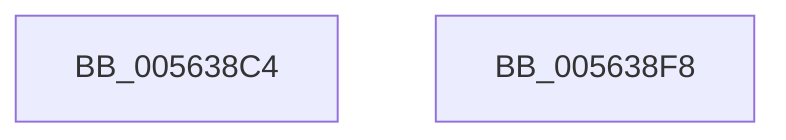

# HalpUsbLegacyWritePCIConfig

- RVA: `0x005638C4`–`0x005638F9` (길이 `53` bytes)
- VA: `0x00000001405638C4`
- 실행 섹션: `.text`
- PDB 이름 있음: `예`; PDB Function 태그: `아니요`
- unwind 정보 RVA: `0x00064C80`
- 디코드: `15`개 명령, `53/53` bytes 표시
- 미해석 바이트: `0` (있으면 어셈블리에 `.byte`로 보존)

> 이 문서는 커널 이미지의 기계어와 PDB 기호를 분석해 생성했습니다. 4번과 5번은 함수 원형과 자료형을 바이너리 사용 방식에서 추정한 C 해석이며 원본 소스 복구 결과는 아닙니다.

## 1. Dependencies

- 직접 호출 지점: **1**; 고유 호출 대상: **1**
- 직접 호출자로 확인된 함수: **1**
- RIP 상대 이미지 참조: **1**

### Outgoing calls
- `0x005638ED` → [guard_dispatch_icall](../6B/guard_dispatch_icall_function_006BAAD0.md) (function, `0x006BAAD0`)

### Direct callers
- [HalpUsbLegacyStopUhciInterrupt](HalpUsbLegacyStopUhciInterrupt_function_00563BD4.md) at `0x00563C1F`
- [HalpUsbLegacyStopUhciInterrupt](HalpUsbLegacyStopUhciInterrupt_function_00563BD4.md) at `0x00563CA6`

### Static image references
- `0x005638CA` → RVA `0x00E00898` (`.data`; read)

## 2. Other-region calls and transfers

- 다른 실행 섹션으로 향하는 call: **0**
- 별도 외부 분기/꼬리 이동을 확인하지 못했습니다.

## 3. Assembly (complete function range)

```asm
005638C4  40 53                           push rbx
005638C6  48 83 EC 30                     sub rsp, 0x30
005638CA  48 8B 05 C7 CF 89 00            mov rax, qword ptr [rip + 0x89cfc7]
005638D1  4D 8B D1                        mov r10, r9
005638D4  45 8B D8                        mov r11d, r8d
005638D7  C7 44 24 20 04 00 00 00         mov dword ptr [rsp + 0x20], 4
005638DF  8B CA                           mov ecx, edx
005638E1  4D 8B C2                        mov r8, r10
005638E4  41 8B D3                        mov edx, r11d
005638E7  41 B9 C0 00 00 00               mov r9d, 0xc0
005638ED  E8 DE 71 15 00                  call 0x1406baad0
005638F2  48 83 C4 30                     add rsp, 0x30
005638F6  5B                              pop rbx
005638F7  C3                              ret
005638F8  CC                              int3
```

## 4. C-style interpretation (structured pseudocode)

```c
__int64 __fastcall HalpUsbLegacyWritePCIConfig(__int64 a1, int a2, int a3, __int64 a4)
{
    __int64 result;
    __int64 v_rsp;
    unsigned int v_stack_m18;

    v_rsp = (v_rsp) - (48);
    v_stack_m18 = 4;
    result = guard_dispatch_icall((unsigned int)(a2), (unsigned int)((unsigned int)((unsigned int)(a3))), a4, 192);
    v_rsp = (v_rsp) + (48);
    return result;
}
```

## 5. (Beta) C Style

```c
int64_t HalpUsbLegacyWritePCIConfig(int64_t Arg1, int32_t Arg2, int32_t Arg3, int64_t Arg4)
{
    int64_t result;
    int64_t local_rsp;
    uint32_t v_stack_m18;

    local_rsp = (local_rsp) - (48);
    v_stack_m18 = 4;
    result = guard_dispatch_icall((uint32_t)(Arg2), (uint32_t)((uint32_t)((uint32_t)(Arg3))), Arg4, 192);
    local_rsp = (local_rsp) + (48);
    return result;
}
```

## 6. Execution-region graph

[열기: 2D/3D 그래프와 함수 탐색 컨트롤 패널](../../../control-panel.html?section=text&rva=0x005638C4&view=graph)

- 2D 그래프는 위에서 아래로 흐르고, 3D 그래프는 빈 공간을 드래그해 회전합니다. Shift+드래그는 이동, 휠은 확대·축소, 함수 노드 선택은 대상 보고서 이동입니다.

### Static fallback


