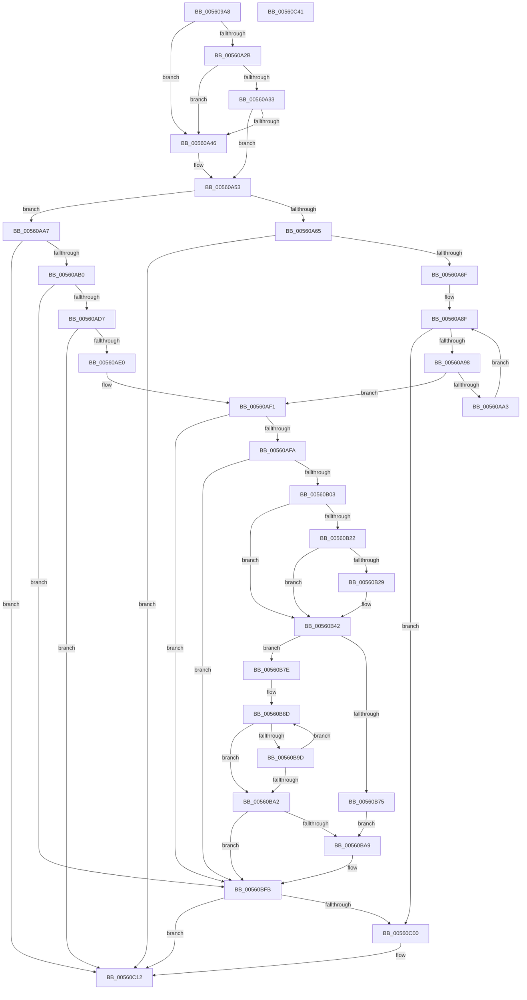

# HalpWdatDiscover

- RVA: `0x005609A8`–`0x00560C42` (길이 `666` bytes)
- VA: `0x00000001405609A8`
- 실행 섹션: `.text`
- PDB 이름 있음: `예`; PDB Function 태그: `아니요`
- unwind 정보 RVA: `0x000C4A64`
- 디코드: `167`개 명령, `666/666` bytes 표시
- 미해석 바이트: `0` (있으면 어셈블리에 `.byte`로 보존)

> 이 문서는 커널 이미지의 기계어와 PDB 기호를 분석해 생성했습니다. 4번과 5번은 함수 원형과 자료형을 바이너리 사용 방식에서 추정한 C 해석이며 원본 소스 복구 결과는 아닙니다.

## 1. Dependencies

- 직접 호출 지점: **12**; 고유 호출 대상: **8**
- 직접 호출자로 확인된 함수: **1**
- RIP 상대 이미지 참조: **5**

### Outgoing calls
- `0x005609F0` → [memset](../6C/memset_function_006C6C40.md) (function, `0x006C6C40`)
- `0x005609FF` → [memset](../6C/memset_function_006C6C40.md) (function, `0x006C6C40`)
- `0x00560A22` → [HalpIsMicrosoftCompatibleHvLoaded](../4A/HalpIsMicrosoftCompatibleHvLoaded_function_004AFAAC.md) (function, `0x004AFAAC`)
- `0x00560A37` → [HviGetHardwareFeatures](../4A/HviGetHardwareFeatures_function_004ADBC0.md) (function, `0x004ADBC0`)
- `0x00560A4B` → [HalSocGetAcpiTable](HalSocGetAcpiTable_function_00561580.md) (function, `0x00561580`)
- `0x00560A58` → [HalSocGetAcpiTable](HalSocGetAcpiTable_function_00561580.md) (function, `0x00561580`)
- `0x00560AC5` → [HalpWdatProcessWdrtInternalData](HalpWdatProcessWdrtInternalData_function_00560FC0.md) (function, `0x00560FC0`)
- `0x00560B19` → [HalpWdatExecuteActionBeforeInitialize](HalpWdatExecuteActionBeforeInitialize_function_00560C48.md) (function, `0x00560C48`)
- `0x00560B3D` → [HalpWdatExecuteActionBeforeInitialize](HalpWdatExecuteActionBeforeInitialize_function_00560C48.md) (function, `0x00560C48`)
- `0x00560BF6` → [HalpTimerRegister](HalpTimerRegister_function_005616BC.md) (function, `0x005616BC`)
- `0x00560C0D` → [HalpWdatExecuteActionBeforeInitialize](HalpWdatExecuteActionBeforeInitialize_function_00560C48.md) (function, `0x00560C48`)
- `0x00560C1B` → [_security_check_cookie](../6A/_security_check_cookie_function_006AC640.md) (function, `0x006AC640`)

### Direct callers
- [HalpTimerRegisterBuiltinPluginsCommon](../54/HalpTimerRegisterBuiltinPluginsCommon_function_0054A014.md) at `0x0054A062`

### Static image references
- `0x005609CB` → RVA `0x00E0A740` (`.data`; read)
- `0x00560A2B` → RVA `0x00FC1ED0` (`.data`; read)
- `0x00560BAF` → RVA `0x00560DB0` (`HalpWdatInitialize`; read)
- `0x00560BCB` → RVA `0x004CBF40` (`HalpWdatArmTimer`; read)
- `0x00560BD7` → RVA `0x00561080` (`HalpWdatStop`; read)

## 2. Other-region calls and transfers

- 다른 실행 섹션으로 향하는 call: **0**
- 별도 외부 분기/꼬리 이동을 확인하지 못했습니다.

## 3. Assembly (complete function range)

```asm
005609A8  48 8B C4                        mov rax, rsp
005609AB  48 89 58 08                     mov qword ptr [rax + 8], rbx
005609AF  48 89 70 10                     mov qword ptr [rax + 0x10], rsi
005609B3  48 89 78 18                     mov qword ptr [rax + 0x18], rdi
005609B7  4C 89 60 20                     mov qword ptr [rax + 0x20], r12
005609BB  55                              push rbp
005609BC  41 56                           push r14
005609BE  41 57                           push r15
005609C0  48 8D 68 88                     lea rbp, [rax - 0x78]
005609C4  48 81 EC 60 01 00 00            sub rsp, 0x160
005609CB  48 8B 05 6E 9D 8A 00            mov rax, qword ptr [rip + 0x8a9d6e]
005609D2  48 33 C4                        xor rax, rsp
005609D5  48 89 45 50                     mov qword ptr [rbp + 0x50], rax
005609D9  83 64 24 38 00                  and dword ptr [rsp + 0x38], 0
005609DE  48 8D 4C 24 48                  lea rcx, [rsp + 0x48]
005609E3  83 64 24 34 00                  and dword ptr [rsp + 0x34], 0
005609E8  33 D2                           xor edx, edx
005609EA  41 B8 88 00 00 00               mov r8d, 0x88
005609F0  E8 4B 62 16 00                  call 0x1406c6c40
005609F5  33 D2                           xor edx, edx
005609F7  48 8D 4D D0                     lea rcx, [rbp - 0x30]
005609FB  44 8D 42 70                     lea r8d, [rdx + 0x70]
005609FF  E8 3C 62 16 00                  call 0x1406c6c40
00560A04  0F 57 C0                        xorps xmm0, xmm0
00560A07  C7 44 24 40 01 00 00 00         mov dword ptr [rsp + 0x40], 1
00560A0F  0F 11 45 40                     movups xmmword ptr [rbp + 0x40], xmm0
00560A13  C7 44 24 44 90 00 00 00         mov dword ptr [rsp + 0x44], 0x90
00560A1B  33 DB                           xor ebx, ebx
00560A1D  C6 44 24 30 00                  mov byte ptr [rsp + 0x30], 0
00560A22  E8 85 F0 F4 FF                  call 0x1404afaac
00560A27  84 C0                           test al, al
00560A29  74 1B                           je 0x140560a46
00560A2B  38 1D 9F 14 A6 00               cmp byte ptr [rip + 0xa6149f], bl
00560A31  74 13                           je 0x140560a46
00560A33  48 8D 4D 40                     lea rcx, [rbp + 0x40]
00560A37  E8 84 D1 F4 FF                  call 0x1404adbc0
00560A3C  8B 45 40                        mov eax, dword ptr [rbp + 0x40]
00560A3F  C1 E8 19                        shr eax, 0x19
00560A42  A8 01                           test al, 1
00560A44  75 0D                           jne 0x140560a53
00560A46  B9 57 44 41 54                  mov ecx, 0x54414457
00560A4B  E8 30 0B 00 00                  call 0x140561580
00560A50  48 8B D8                        mov rbx, rax
00560A53  B9 57 44 52 54                  mov ecx, 0x54524457
00560A58  E8 23 0B 00 00                  call 0x140561580
00560A5D  48 8B F8                        mov rdi, rax
00560A60  48 85 DB                        test rbx, rbx
00560A63  74 42                           je 0x140560aa7
00560A65  F6 43 3C 01                     test byte ptr [rbx + 0x3c], 1
00560A69  0F 84 A3 01 00 00               je 0x140560c12
00560A6F  44 8B 4B 40                     mov r9d, dword ptr [rbx + 0x40]
00560A73  40 B6 01                        mov sil, 1
00560A76  44 8B 7B 34                     mov r15d, dword ptr [rbx + 0x34]
00560A7A  45 8B F1                        mov r14d, r9d
00560A7D  44 8B 43 38                     mov r8d, dword ptr [rbx + 0x38]
00560A81  44 8B 63 30                     mov r12d, dword ptr [rbx + 0x30]
00560A85  41 C1 E6 06                     shl r14d, 6
00560A89  41 83 C6 70                     add r14d, 0x70
00560A8D  33 D2                           xor edx, edx
00560A8F  41 3B D1                        cmp edx, r9d
00560A92  0F 83 68 01 00 00               jae 0x140560c00
00560A98  48 8D 0C 52                     lea rcx, [rdx + rdx*2]
00560A9C  80 7C CB 44 06                  cmp byte ptr [rbx + rcx*8 + 0x44], 6
00560AA1  74 4E                           je 0x140560af1
00560AA3  FF C2                           inc edx
00560AA5  EB E8                           jmp 0x140560a8f
00560AA7  48 85 FF                        test rdi, rdi
00560AAA  0F 84 62 01 00 00               je 0x140560c12
00560AB0  4C 8D 4C 24 30                  lea r9, [rsp + 0x30]
00560AB5  48 89 7D D8                     mov qword ptr [rbp - 0x28], rdi
00560AB9  4C 8D 44 24 34                  lea r8, [rsp + 0x34]
00560ABE  48 8B CF                        mov rcx, rdi
00560AC1  48 8D 55 D0                     lea rdx, [rbp - 0x30]
00560AC5  E8 F6 04 00 00                  call 0x140560fc0
00560ACA  40 8A 74 24 30                  mov sil, byte ptr [rsp + 0x30]
00560ACF  85 C0                           test eax, eax
00560AD1  0F 88 24 01 00 00               js 0x140560bfb
00560AD7  40 84 F6                        test sil, sil
00560ADA  0F 84 32 01 00 00               je 0x140560c12
00560AE0  44 8B 65 E8                     mov r12d, dword ptr [rbp - 0x18]
00560AE4  44 8B 45 E4                     mov r8d, dword ptr [rbp - 0x1c]
00560AE8  44 8B 7D E0                     mov r15d, dword ptr [rbp - 0x20]
00560AEC  44 8B 74 24 34                  mov r14d, dword ptr [rsp + 0x34]
00560AF1  45 85 E4                        test r12d, r12d
00560AF4  0F 84 01 01 00 00               je 0x140560bfb
00560AFA  45 3B F8                        cmp r15d, r8d
00560AFD  0F 82 F8 00 00 00               jb 0x140560bfb
00560B03  4C 8B CB                        mov r9, rbx
00560B06  C7 45 B4 20 80 02 00            mov dword ptr [rbp - 0x4c], 0x28020
00560B0D  4C 8D 44 24 38                  lea r8, [rsp + 0x38]
00560B12  48 89 7C 24 20                  mov qword ptr [rsp + 0x20], rdi
00560B17  B1 20                           mov cl, 0x20
00560B19  E8 2A 01 00 00                  call 0x140560c48
00560B1E  85 C0                           test eax, eax
00560B20  78 20                           js 0x140560b42
00560B22  83 7C 24 38 01                  cmp dword ptr [rsp + 0x38], 1
00560B27  75 19                           jne 0x140560b42
00560B29  4C 8B CB                        mov r9, rbx
00560B2C  C7 45 B4 20 80 06 00            mov dword ptr [rbp - 0x4c], 0x68020
00560B33  45 33 C0                        xor r8d, r8d
00560B36  48 89 7C 24 20                  mov qword ptr [rsp + 0x20], rdi
00560B3B  B1 21                           mov cl, 0x21
00560B3D  E8 06 01 00 00                  call 0x140560c48
00560B42  41 8B C4                        mov eax, r12d
00560B45  41 8B CF                        mov ecx, r15d
00560B48  48 0F AF C8                     imul rcx, rax
00560B4C  48 B8 77 BE 9F 1A 2F DD 24 06   movabs rax, 0x624dd2f1a9fbe77
00560B56  48 F7 E1                        mul rcx
00560B59  48 B8 E5 3C C7 36 C4 12 00 00   movabs rax, 0x12c436c73ce5
00560B63  48 2B CA                        sub rcx, rdx
00560B66  48 D1 E9                        shr rcx, 1
00560B69  48 03 CA                        add rcx, rdx
00560B6C  48 C1 E9 09                     shr rcx, 9
00560B70  48 3B C8                        cmp rcx, rax
00560B73  76 09                           jbe 0x140560b7e
00560B75  C7 45 A4 40 00 00 00            mov dword ptr [rbp - 0x5c], 0x40
00560B7C  EB 2B                           jmp 0x140560ba9
00560B7E  48 69 D1 30 A4 0D 00            imul rdx, rcx, 0xda430
00560B85  B9 3F 00 00 00                  mov ecx, 0x3f
00560B8A  89 4D A4                        mov dword ptr [rbp - 0x5c], ecx
00560B8D  B8 01 00 00 00                  mov eax, 1
00560B92  48 D3 E0                        shl rax, cl
00560B95  48 FF C8                        dec rax
00560B98  48 3B C2                        cmp rax, rdx
00560B9B  72 05                           jb 0x140560ba2
00560B9D  83 C1 FF                        add ecx, -1
00560BA0  75 EB                           jne 0x140560b8d
00560BA2  89 4D A4                        mov dword ptr [rbp - 0x5c], ecx
00560BA5  85 C9                           test ecx, ecx
00560BA7  74 52                           je 0x140560bfb
00560BA9  48 83 64 24 58 00               and qword ptr [rsp + 0x58], 0
00560BAF  48 8D 05 FA 01 00 00            lea rax, [rip + 0x1fa]
00560BB6  48 83 65 98 00                  and qword ptr [rbp - 0x68], 0
00560BBB  48 8D 4C 24 40                  lea rcx, [rsp + 0x40]
00560BC0  83 65 CC 00                     and dword ptr [rbp - 0x34], 0
00560BC4  33 D2                           xor edx, edx
00560BC6  48 89 44 24 48                  mov qword ptr [rsp + 0x48], rax
00560BCB  48 8D 05 6E B3 F6 FF            lea rax, [rip - 0x94c92]
00560BD2  48 89 44 24 60                  mov qword ptr [rsp + 0x60], rax
00560BD7  48 8D 05 A2 04 00 00            lea rax, [rip + 0x4a2]
00560BDE  48 89 44 24 68                  mov qword ptr [rsp + 0x68], rax
00560BE3  48 C7 45 A8 30 A4 0D 00         mov qword ptr [rbp - 0x58], 0xda430
00560BEB  44 89 75 A0                     mov dword ptr [rbp - 0x60], r14d
00560BEF  C7 45 C8 0D 00 00 00            mov dword ptr [rbp - 0x38], 0xd
00560BF6  E8 C1 0A 00 00                  call 0x1405616bc
00560BFB  40 84 F6                        test sil, sil
00560BFE  74 12                           je 0x140560c12
00560C00  4C 8B CB                        mov r9, rbx
00560C03  48 89 7C 24 20                  mov qword ptr [rsp + 0x20], rdi
00560C08  45 33 C0                        xor r8d, r8d
00560C0B  B1 0B                           mov cl, 0xb
00560C0D  E8 36 00 00 00                  call 0x140560c48
00560C12  33 C0                           xor eax, eax
00560C14  48 8B 4D 50                     mov rcx, qword ptr [rbp + 0x50]
00560C18  48 33 CC                        xor rcx, rsp
00560C1B  E8 20 BA 14 00                  call 0x1406ac640
00560C20  4C 8D 9C 24 60 01 00 00         lea r11, [rsp + 0x160]
00560C28  49 8B 5B 20                     mov rbx, qword ptr [r11 + 0x20]
00560C2C  49 8B 73 28                     mov rsi, qword ptr [r11 + 0x28]
00560C30  49 8B 7B 30                     mov rdi, qword ptr [r11 + 0x30]
00560C34  4D 8B 63 38                     mov r12, qword ptr [r11 + 0x38]
00560C38  49 8B E3                        mov rsp, r11
00560C3B  41 5F                           pop r15
00560C3D  41 5E                           pop r14
00560C3F  5D                              pop rbp
00560C40  C3                              ret
00560C41  CC                              int3
```

## 4. C-style interpretation (structured pseudocode)

```c
__int64 __fastcall HalpWdatDiscover(__int64 a1, int a2)
{
    __int64 result;
    __int64 v_r14;
    __int64 v_rbx;
    __int64 v_rsp;
    unsigned __int64 v_stack_m110;
    unsigned __int64 v_stack_m118;
    unsigned __int64 v_stack_m120;
    unsigned __int64 v_stack_m130;
    unsigned int v_stack_m134;
    unsigned int v_stack_m138;
    unsigned int v_stack_m140;
    unsigned int v_stack_m144;
    unsigned __int8 v_stack_m148;
    unsigned __int64 v_stack_m158;
    unsigned __int64 v_stack_m18;

    *(unsigned __int64 *)(v_rsp + 8) = v_rbx;
    *(unsigned __int64 *)(v_rsp + 16) = v_rsi;
    *(unsigned __int64 *)(v_rsp + 24) = v_rdi;
    *(unsigned __int64 *)(v_rsp + 32) = v_r12;
    v_rsp = (v_rsp) - (352);
    result = (*(unsigned __int64 *)(v_rip + 9084270)) ^ (v_rsp);
    *(unsigned __int64 *)(v_rsp - 120 + 80) = result;
    a2 = 0;
    result = memset(v_stack_m130, a2, 136, a4);
    a2 = 0;
    result = memset(v_rsp - 120 - 48, a2, a2 + 112, a4);
    v_stack_m138 = 1;
    *(unsigned __int64 *)(v_rsp - 120 + 64) = v_xmm0;
    v_stack_m134 = 144;
    v_rbx = 0;
    v_stack_m148 = 0;
    result = HalpIsMicrosoftCompatibleHvLoaded(v_rsp - 120 - 48, a2, a2 + 112, a4);
    if ((unsigned __int8)(result) == 0) goto loc_00560A46;
    if ((*(unsigned __int8 *)(v_rip + 10884255)) == 0) goto loc_00560A46;
    result = HviGetHardwareFeatures(v_rsp - 120 + 64, a2, a2 + 112, a4);
    result = (unsigned int)(((unsigned int)(*(unsigned int *)(v_rsp - 120 + 64))) >> (25));
    if ((((unsigned __int8)(result)) & (1)) == 0) {
        a1 = 0x54414457ULL;
        result = HalSocGetAcpiTable(a1, a2, a2 + 112, a4);
        v_rbx = result;
    }
    result = HalSocGetAcpiTable((unsigned int)(0x54524457ULL), a2, a2 + 112, a4);
    if (v_rbx == 0) goto loc_00560AA7;
    if (((*(unsigned __int8 *)(v_rbx + 60)) & (1)) == 0) goto loc_00560C12;
    v_r14 = (unsigned int)(((unsigned int)((unsigned int)((unsigned int)(*(unsigned int *)(v_rbx + 64))))) << (6));
    v_r14 = (unsigned int)((v_r14) + (112));
    a2 = 0;
loc_00560A8F:
    if (0 >= ((unsigned int)((unsigned int)(*(unsigned int *)(v_rbx + 64))))) goto loc_00560C00;
    if ((*(unsigned __int8 *)(v_rbx + a2 + a2 * 2 * 8 + 68)) == 6) goto loc_00560AF1;
    a2 = (unsigned int)((a2) + 1);
    goto loc_00560A8F;
loc_00560AA7:
    if (result == 0) goto loc_00560C12;
    *(unsigned __int64 *)(v_rsp - 120 - 40) = result;
    result = HalpWdatProcessWdrtInternalData(result, v_rsp - 120 - 48, v_stack_m144, v_stack_m148);
    if (sign_flag) goto loc_00560BFB;
    if ((unsigned __int8)(v_stack_m148) == 0) goto loc_00560C12;
loc_00560AF1:
    if ((unsigned int)((unsigned int)(*(unsigned int *)(v_rsp - 120 - 24))) == 0) goto loc_00560BFB;
    if (((unsigned int)((unsigned int)(*(unsigned int *)(v_rsp - 120 - 32)))) < ((unsigned int)((unsigned int)(*(unsigned int *)(v_rsp - 120 - 28))))) goto loc_00560BFB;
    *(unsigned int *)(v_rsp - 120 - 76) = 0x28020ULL;
    v_stack_m158 = result;
    result = HalpWdatExecuteActionBeforeInitialize(32, v_rsp - 120 - 48, v_stack_m140, v_rbx);
    if (sign_flag) goto loc_00560B42;
    if (v_stack_m140 == 1) {
        a4 = v_rbx;
        *(unsigned int *)(v_rsp - 120 - 76) = 0x68020ULL;
        a3 = 0;
        v_stack_m158 = result;
        a1 = 33;
        result = HalpWdatExecuteActionBeforeInitialize(a1, v_rsp - 120 - 48, a3, a4);
    }
    a1 = ((unsigned int)((unsigned int)((unsigned int)(*(unsigned int *)(v_rsp - 120 - 32))))) * ((unsigned int)((unsigned int)((unsigned int)(*(unsigned int *)(v_rsp - 120 - 24)))));
    a1 = (a1) - (v_rsp - 120 - 48);
    a1 = (a1) >> (1);
    a1 = (a1) + (v_rsp - 120 - 48);
    a1 = (a1) >> (9);
    if (a1 <= ((unsigned int)((unsigned int)((unsigned int)(*(unsigned int *)(v_rsp - 120 - 24)))))) goto loc_00560B7E;
    *(unsigned int *)(v_rsp - 120 - 92) = 64;
    goto loc_00560BA9;
loc_00560B7E:
    a2 = (v_rsp - 120 - 48) * (a1);
    *(unsigned int *)(v_rsp - 120 - 92) = 63;
loc_00560B8D:
    result = (1) << (63);
    result = (result) - 1;
    if (result < a2) goto loc_00560BA2;
    a1 = (unsigned int)((63) + (-1));
    if (condition_is_not_equal) goto loc_00560B8D;
loc_00560BA2:
    *(unsigned int *)(v_rsp - 120 - 92) = (unsigned int)(a1);
    if ((unsigned int)(a1) != 0) {
        result = v_rip + 506;
        a1 = v_stack_m138;
        a2 = 0;
        v_stack_m130 = result;
        result = v_rip - 609426;
        v_stack_m118 = result;
        result = v_rip + 1186;
        v_stack_m110 = result;
        *(unsigned __int64 *)(v_rsp - 120 - 88) = 0xDA430ULL;
        *(unsigned int *)(v_rsp - 120 - 96) = (unsigned int)((unsigned int)(v_stack_m144));
        *(unsigned int *)(v_rsp - 120 - 56) = 13;
        result = HalpTimerRegister(a1, a2, a3, a4);
    }
    if ((unsigned __int8)(v_stack_m148) != 0) {
        a4 = v_rbx;
        v_stack_m158 = result;
        a3 = 0;
        a1 = 11;
        result = HalpWdatExecuteActionBeforeInitialize(a1, a2, a3, a4);
    }
    result = 0;
    a1 = (*(unsigned __int64 *)(v_rsp - 120 + 80)) ^ (v_rsp);
    result = _security_check_cookie(a1, a2, a3, a4);
    return result;
}
```

## 5. (Beta) C Style

```c
int64_t HalpWdatDiscover(int64_t Arg1, int32_t Arg2)
{
    int64_t result;
    int64_t local_r14;
    int64_t local_rbx;
    int64_t local_rsp;
    uint64_t v_stack_m110;
    uint64_t v_stack_m118;
    uint64_t v_stack_m120;
    uint64_t v_stack_m130;
    uint32_t v_stack_m134;
    uint32_t v_stack_m138;
    uint32_t v_stack_m140;
    uint32_t v_stack_m144;
    uint8_t v_stack_m148;
    uint64_t v_stack_m158;
    uint64_t v_stack_m18;

    *(uint64_t *)(local_rsp + 0x8) = local_rbx;
    *(uint64_t *)(local_rsp + 0x10) = local_rsi;
    *(uint64_t *)(local_rsp + 0x18) = local_rdi;
    *(uint64_t *)(local_rsp + 0x20) = local_r12;
    local_rsp = (local_rsp) - (352);
    result = (*(uint64_t *)(v_rip + 0x8A9D6E)) ^ (local_rsp);
    *(uint64_t *)(local_rsp - 0x78 + 0x50) = result;
    Arg2 = 0;
    result = memset(v_stack_m130, Arg2, 136, a4);
    Arg2 = 0;
    result = memset(local_rsp - 120 - 48, Arg2, Arg2 + 112, a4);
    v_stack_m138 = 1;
    *(uint64_t *)(local_rsp - 0x78 + 0x40) = v_xmm0;
    v_stack_m134 = 144;
    local_rbx = 0;
    v_stack_m148 = 0;
    result = HalpIsMicrosoftCompatibleHvLoaded(local_rsp - 120 - 48, Arg2, Arg2 + 112, a4);
    if ((uint8_t)(result) == 0) goto loc_00560A46;
    if ((*(uint8_t *)(v_rip + 0xA6149F)) == 0) goto loc_00560A46;
    result = HviGetHardwareFeatures(local_rsp - 120 + 64, Arg2, Arg2 + 112, a4);
    result = (uint32_t)(((uint32_t)(*(uint32_t *)(local_rsp - 0x78 + 0x40))) >> (25));
    if ((((uint8_t)(result)) & (1)) == 0) {
        Arg1 = 0x54414457ULL;
        result = HalSocGetAcpiTable(Arg1, Arg2, Arg2 + 112, a4);
        local_rbx = result;
    }
    result = HalSocGetAcpiTable((uint32_t)(0x54524457ULL), Arg2, Arg2 + 112, a4);
    if (local_rbx == 0) goto loc_00560AA7;
    if (((*(uint8_t *)(local_rbx + 0x3C)) & (1)) == 0) goto loc_00560C12;
    local_r14 = (uint32_t)(((uint32_t)((uint32_t)((uint32_t)(*(uint32_t *)(local_rbx + 0x40))))) << (6));
    local_r14 = (uint32_t)((local_r14) + (112));
    Arg2 = 0;
loc_00560A8F:
    if (0 >= ((uint32_t)((uint32_t)(*(uint32_t *)(local_rbx + 0x40))))) goto loc_00560C00;
    if ((*(uint8_t *)(local_rbx + Arg2 + Arg2 * 2 * 8 + 0x44)) == 6) goto loc_00560AF1;
    Arg2 = (uint32_t)((Arg2) + 1);
    goto loc_00560A8F;
loc_00560AA7:
    if (result == 0) goto loc_00560C12;
    *(uint64_t *)(local_rsp - 0x78 - 0x28) = result;
    result = HalpWdatProcessWdrtInternalData(result, local_rsp - 120 - 48, v_stack_m144, v_stack_m148);
    if (sign_flag) goto loc_00560BFB;
    if ((uint8_t)(v_stack_m148) == 0) goto loc_00560C12;
loc_00560AF1:
    if ((uint32_t)((uint32_t)(*(uint32_t *)(local_rsp - 0x78 - 0x18))) == 0) goto loc_00560BFB;
    if (((uint32_t)((uint32_t)(*(uint32_t *)(local_rsp - 0x78 - 0x20)))) < ((uint32_t)((uint32_t)(*(uint32_t *)(local_rsp - 0x78 - 0x1C))))) goto loc_00560BFB;
    *(uint32_t *)(local_rsp - 0x78 - 0x4C) = 0x28020ULL;
    v_stack_m158 = result;
    result = HalpWdatExecuteActionBeforeInitialize(32, local_rsp - 120 - 48, v_stack_m140, local_rbx);
    if (sign_flag) goto loc_00560B42;
    if (v_stack_m140 == 1) {
        a4 = local_rbx;
        *(uint32_t *)(local_rsp - 0x78 - 0x4C) = 0x68020ULL;
        a3 = 0;
        v_stack_m158 = result;
        Arg1 = 33;
        result = HalpWdatExecuteActionBeforeInitialize(Arg1, local_rsp - 120 - 48, a3, a4);
    }
    Arg1 = ((uint32_t)((uint32_t)((uint32_t)(*(uint32_t *)(local_rsp - 0x78 - 0x20))))) * ((uint32_t)((uint32_t)((uint32_t)(*(uint32_t *)(local_rsp - 0x78 - 0x18)))));
    Arg1 = (Arg1) - (local_rsp - 120 - 48);
    Arg1 = (Arg1) >> (1);
    Arg1 = (Arg1) + (local_rsp - 120 - 48);
    Arg1 = (Arg1) >> (9);
    if (Arg1 <= ((uint32_t)((uint32_t)((uint32_t)(*(uint32_t *)(local_rsp - 0x78 - 0x18)))))) goto loc_00560B7E;
    *(uint32_t *)(local_rsp - 0x78 - 0x5C) = 64;
    goto loc_00560BA9;
loc_00560B7E:
    Arg2 = (local_rsp - 120 - 48) * (Arg1);
    *(uint32_t *)(local_rsp - 0x78 - 0x5C) = 63;
loc_00560B8D:
    result = (1) << (63);
    result = (result) - 1;
    if (result < Arg2) goto loc_00560BA2;
    Arg1 = (uint32_t)((63) + (-1));
    if (condition_is_not_equal) goto loc_00560B8D;
loc_00560BA2:
    *(uint32_t *)(local_rsp - 0x78 - 0x5C) = (uint32_t)(Arg1);
    if ((uint32_t)(Arg1) != 0) {
        result = v_rip + 506;
        Arg1 = v_stack_m138;
        Arg2 = 0;
        v_stack_m130 = result;
        result = v_rip - 609426;
        v_stack_m118 = result;
        result = v_rip + 1186;
        v_stack_m110 = result;
        *(uint64_t *)(local_rsp - 0x78 - 0x58) = 0xDA430ULL;
        *(uint32_t *)(local_rsp - 0x78 - 0x60) = (uint32_t)((uint32_t)(v_stack_m144));
        *(uint32_t *)(local_rsp - 0x78 - 0x38) = 13;
        result = HalpTimerRegister(Arg1, Arg2, a3, a4);
    }
    if ((uint8_t)(v_stack_m148) != 0) {
        a4 = local_rbx;
        v_stack_m158 = result;
        a3 = 0;
        Arg1 = 11;
        result = HalpWdatExecuteActionBeforeInitialize(Arg1, Arg2, a3, a4);
    }
    result = 0;
    Arg1 = (*(uint64_t *)(local_rsp - 0x78 + 0x50)) ^ (local_rsp);
    result = _security_check_cookie(Arg1, Arg2, a3, a4);
    return result;
}
```

## 6. Execution-region graph

[열기: 2D/3D 그래프와 함수 탐색 컨트롤 패널](../../../control-panel.html?section=text&rva=0x005609A8&view=graph)

- 2D 그래프는 위에서 아래로 흐르고, 3D 그래프는 빈 공간을 드래그해 회전합니다. Shift+드래그는 이동, 휠은 확대·축소, 함수 노드 선택은 대상 보고서 이동입니다.

### Static fallback


