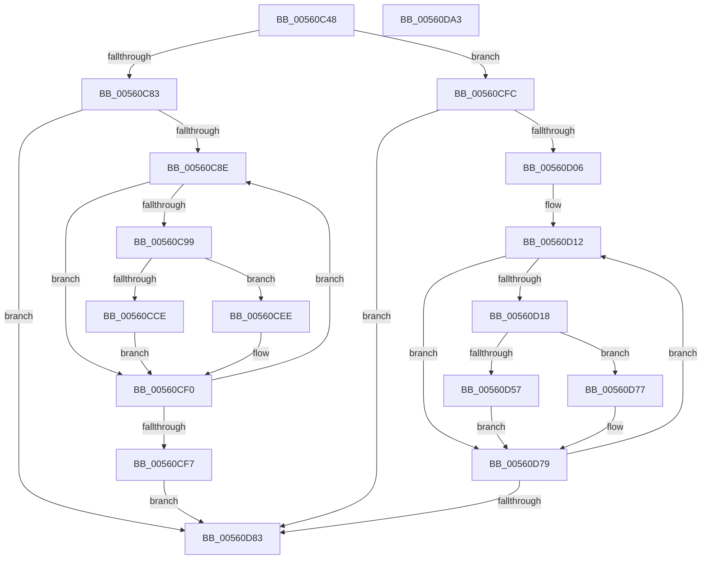

# HalpWdatExecuteActionBeforeInitialize

- RVA: `0x00560C48`–`0x00560DA4` (길이 `348` bytes)
- VA: `0x0000000140560C48`
- 실행 섹션: `.text`
- PDB 이름 있음: `예`; PDB Function 태그: `아니요`
- unwind 정보 RVA: `0x000C4A48`
- 디코드: `96`개 명령, `348/348` bytes 표시
- 미해석 바이트: `0` (있으면 어셈블리에 `.byte`로 보존)

> 이 문서는 커널 이미지의 기계어와 PDB 기호를 분석해 생성했습니다. 4번과 5번은 함수 원형과 자료형을 바이너리 사용 방식에서 추정한 C 해석이며 원본 소스 복구 결과는 아닙니다.

## 1. Dependencies

- 직접 호출 지점: **7**; 고유 호출 대상: **4**
- 직접 호출자로 확인된 함수: **1**
- RIP 상대 이미지 참조: **1**

### Outgoing calls
- `0x00560C77` → [memset](../6C/memset_function_006C6C40.md) (function, `0x006C6C40`)
- `0x00560CC5` → [WdInstrInitializeInstruction](WdInstrInitializeInstruction_function_0056E074.md) (function, `0x0056E074`)
- `0x00560CD8` → [WdInstrExecuteInstruction](WdInstrExecuteInstruction_function_0056DF44.md) (function, `0x0056DF44`)
- `0x00560CE7` → [WdInstrDestroyInstruction](WdInstrDestroyInstruction_function_0056DF14.md) (function, `0x0056DF14`)
- `0x00560D4E` → [WdInstrInitializeInstruction](WdInstrInitializeInstruction_function_0056E074.md) (function, `0x0056E074`)
- `0x00560D61` → [WdInstrExecuteInstruction](WdInstrExecuteInstruction_function_0056DF44.md) (function, `0x0056DF44`)
- `0x00560D70` → [WdInstrDestroyInstruction](WdInstrDestroyInstruction_function_0056DF14.md) (function, `0x0056DF14`)

### Direct callers
- [HalpWdatDiscover](HalpWdatDiscover_function_005609A8.md) at `0x00560B19`
- [HalpWdatDiscover](HalpWdatDiscover_function_005609A8.md) at `0x00560B3D`
- [HalpWdatDiscover](HalpWdatDiscover_function_005609A8.md) at `0x00560C0D`

### Static image references
- `0x00560D06` → RVA `0x00025D82` (`.rdata`; read)

## 2. Other-region calls and transfers

- 다른 실행 섹션으로 향하는 call: **0**
- 별도 외부 분기/꼬리 이동을 확인하지 못했습니다.

## 3. Assembly (complete function range)

```asm
00560C48  48 8B C4                        mov rax, rsp
00560C4B  48 89 58 08                     mov qword ptr [rax + 8], rbx
00560C4F  48 89 70 10                     mov qword ptr [rax + 0x10], rsi
00560C53  48 89 78 18                     mov qword ptr [rax + 0x18], rdi
00560C57  4C 89 70 20                     mov qword ptr [rax + 0x20], r14
00560C5B  41 57                           push r15
00560C5D  48 81 EC 80 00 00 00            sub rsp, 0x80
00560C64  33 D2                           xor edx, edx
00560C66  4D 8B F8                        mov r15, r8
00560C69  44 8A F1                        mov r14b, cl
00560C6C  49 8B F9                        mov rdi, r9
00560C6F  48 8D 48 B8                     lea rcx, [rax - 0x48]
00560C73  44 8D 42 40                     lea r8d, [rdx + 0x40]
00560C77  E8 C4 5F 16 00                  call 0x1406c6c40
00560C7C  33 DB                           xor ebx, ebx
00560C7E  48 85 FF                        test rdi, rdi
00560C81  74 79                           je 0x140560cfc
00560C83  33 F6                           xor esi, esi
00560C85  39 5F 40                        cmp dword ptr [rdi + 0x40], ebx
00560C88  0F 86 F5 00 00 00               jbe 0x140560d83
00560C8E  4C 8D 04 76                     lea r8, [rsi + rsi*2]
00560C92  46 38 74 C7 44                  cmp byte ptr [rdi + r8*8 + 0x44], r14b
00560C97  75 57                           jne 0x140560cf0
00560C99  42 8B 44 C7 58                  mov eax, dword ptr [rdi + r8*8 + 0x58]
00560C9E  4C 8D 4F 48                     lea r9, [rdi + 0x48]
00560CA2  C6 44 24 30 00                  mov byte ptr [rsp + 0x30], 0
00560CA7  4F 8D 0C C1                     lea r9, [r9 + r8*8]
00560CAB  89 44 24 28                     mov dword ptr [rsp + 0x28], eax
00560CAF  48 8D 4C 24 40                  lea rcx, [rsp + 0x40]
00560CB4  42 8B 44 C7 54                  mov eax, dword ptr [rdi + r8*8 + 0x54]
00560CB9  41 8A D6                        mov dl, r14b
00560CBC  46 8A 44 C7 45                  mov r8b, byte ptr [rdi + r8*8 + 0x45]
00560CC1  89 44 24 20                     mov dword ptr [rsp + 0x20], eax
00560CC5  E8 AA D3 00 00                  call 0x14056e074
00560CCA  85 C0                           test eax, eax
00560CCC  78 20                           js 0x140560cee
00560CCE  4D 8B C7                        mov r8, r15
00560CD1  48 8D 4C 24 40                  lea rcx, [rsp + 0x40]
00560CD6  33 D2                           xor edx, edx
00560CD8  E8 67 D2 00 00                  call 0x14056df44
00560CDD  85 C0                           test eax, eax
00560CDF  48 8D 4C 24 40                  lea rcx, [rsp + 0x40]
00560CE4  0F 48 D8                        cmovs ebx, eax
00560CE7  E8 28 D2 00 00                  call 0x14056df14
00560CEC  EB 02                           jmp 0x140560cf0
00560CEE  8B D8                           mov ebx, eax
00560CF0  FF C6                           inc esi
00560CF2  3B 77 40                        cmp esi, dword ptr [rdi + 0x40]
00560CF5  72 97                           jb 0x140560c8e
00560CF7  E9 87 00 00 00                  jmp 0x140560d83
00560CFC  48 39 9C 24 B0 00 00 00         cmp qword ptr [rsp + 0xb0], rbx
00560D04  74 7D                           je 0x140560d83
00560D06  48 8D 3D 75 50 AC FF            lea rdi, [rip - 0x53af8b]
00560D0D  BE 0F 00 00 00                  mov esi, 0xf
00560D12  44 38 77 FE                     cmp byte ptr [rdi - 2], r14b
00560D16  75 61                           jne 0x140560d79
00560D18  8A 07                           mov al, byte ptr [rdi]
00560D1A  48 8D 4C 24 40                  lea rcx, [rsp + 0x40]
00560D1F  44 8A 47 FF                     mov r8b, byte ptr [rdi - 1]
00560D23  F6 D8                           neg al
00560D25  8B 47 06                        mov eax, dword ptr [rdi + 6]
00560D28  41 8A D6                        mov dl, r14b
00560D2B  4D 1B C9                        sbb r9, r9
00560D2E  C6 44 24 30 01                  mov byte ptr [rsp + 0x30], 1
00560D33  41 83 E1 0C                     and r9d, 0xc
00560D37  89 44 24 28                     mov dword ptr [rsp + 0x28], eax
00560D3B  8B 47 02                        mov eax, dword ptr [rdi + 2]
00560D3E  49 83 C1 24                     add r9, 0x24
00560D42  4C 03 8C 24 B0 00 00 00         add r9, qword ptr [rsp + 0xb0]
00560D4A  89 44 24 20                     mov dword ptr [rsp + 0x20], eax
00560D4E  E8 21 D3 00 00                  call 0x14056e074
00560D53  85 C0                           test eax, eax
00560D55  78 20                           js 0x140560d77
00560D57  4D 8B C7                        mov r8, r15
00560D5A  48 8D 4C 24 40                  lea rcx, [rsp + 0x40]
00560D5F  33 D2                           xor edx, edx
00560D61  E8 DE D1 00 00                  call 0x14056df44
00560D66  85 C0                           test eax, eax
00560D68  48 8D 4C 24 40                  lea rcx, [rsp + 0x40]
00560D6D  0F 48 D8                        cmovs ebx, eax
00560D70  E8 9F D1 00 00                  call 0x14056df14
00560D75  EB 02                           jmp 0x140560d79
00560D77  8B D8                           mov ebx, eax
00560D79  48 83 C7 0C                     add rdi, 0xc
00560D7D  48 83 EE 01                     sub rsi, 1
00560D81  75 8F                           jne 0x140560d12
00560D83  4C 8D 9C 24 80 00 00 00         lea r11, [rsp + 0x80]
00560D8B  8B C3                           mov eax, ebx
00560D8D  49 8B 5B 10                     mov rbx, qword ptr [r11 + 0x10]
00560D91  49 8B 73 18                     mov rsi, qword ptr [r11 + 0x18]
00560D95  49 8B 7B 20                     mov rdi, qword ptr [r11 + 0x20]
00560D99  4D 8B 73 28                     mov r14, qword ptr [r11 + 0x28]
00560D9D  49 8B E3                        mov rsp, r11
00560DA0  41 5F                           pop r15
00560DA2  C3                              ret
00560DA3  CC                              int3
```

## 4. C-style interpretation (structured pseudocode)

```c
__int64 __fastcall HalpWdatExecuteActionBeforeInitialize(unsigned __int8 a1, int a2, __int64 a3, __int64 a4, __int64 a5)
{
    __int64 result;
    __int64 v_rbx;
    __int64 v_rdi;
    __int64 v_rsi;
    __int64 v_rsp;
    unsigned __int64 v_stack_m48;
    unsigned __int8 v_stack_m58;
    unsigned int v_stack_m60;
    unsigned int v_stack_m68;
    unsigned __int64 v_stack_m8;

    *(unsigned __int64 *)(v_rsp + 8) = v_rbx;
    *(unsigned __int64 *)(v_rsp + 16) = v_rsi;
    *(unsigned __int64 *)(v_rsp + 24) = v_rdi;
    *(unsigned __int64 *)(v_rsp + 32) = v_r14;
    v_rsp = (v_rsp) - (128);
    a2 = 0;
    result = memset(v_rsp - 72, a2, a2 + 64, a4);
    v_rbx = 0;
    if (a4 == 0) goto loc_00560CFC;
    v_rsi = 0;
    if ((*(unsigned int *)(a4 + 64)) <= 0) goto loc_00560D83;
loc_00560C8E:
    if ((*(unsigned __int8 *)(a4 + v_rsi + v_rsi * 2 * 8 + 68)) != a1) goto loc_00560CF0;
    v_stack_m58 = 0;
    v_stack_m60 = (unsigned int)((unsigned int)(*(unsigned int *)(a4 + v_rsi + v_rsi * 2 * 8 + 88)));
    v_stack_m68 = (unsigned int)((unsigned int)(*(unsigned int *)(a4 + v_rsi + v_rsi * 2 * 8 + 84)));
    result = WdInstrInitializeInstruction(v_stack_m48, a1, *(unsigned __int8 *)(a4 + v_rsi + v_rsi * 2 * 8 + 69), a4 + 72 + v_rsi + v_rsi * 2 * 8);
    if (sign_flag) goto loc_00560CEE;
    a2 = 0;
    result = WdInstrExecuteInstruction(v_stack_m48, a2, a3, a4 + 72 + v_rsi + v_rsi * 2 * 8);
    if (sign_flag) { v_rbx = (unsigned int)(result); }
    result = WdInstrDestroyInstruction(v_stack_m48, a2, a3, a4 + 72 + v_rsi + v_rsi * 2 * 8);
    goto loc_00560CF0;
loc_00560CEE:
loc_00560CF0:
    v_rsi = (unsigned int)((v_rsi) + 1);
    if (((unsigned int)(v_rsi)) < (*(unsigned int *)(a4 + 64))) goto loc_00560C8E;
    goto loc_00560D83;
loc_00560CFC:
    if (a5 == ((unsigned int)((unsigned int)(result)))) goto loc_00560D83;
loc_00560D12:
    if ((*(unsigned __int8 *)(v_rip - 5484427 - 2)) != a1) goto loc_00560D79;
    result = (unsigned __int8)(-(*(unsigned __int8 *)(v_rip - 5484427)));
    v_stack_m58 = 1;
    a4 = (unsigned int)((a4 + 72 + v_rsi + v_rsi * 2 * 8) & (12));
    v_stack_m60 = (unsigned int)((unsigned int)(*(unsigned int *)(v_rip - 5484427 + 6)));
    a4 = (a4) + (36);
    a4 = (a4) + (a5);
    v_stack_m68 = (unsigned int)((unsigned int)(*(unsigned int *)(v_rip - 5484427 + 2)));
    result = WdInstrInitializeInstruction(v_stack_m48, a1, *(unsigned __int8 *)(v_rip - 5484427 - 1), a4);
    if (sign_flag) goto loc_00560D77;
    a2 = 0;
    result = WdInstrExecuteInstruction(v_stack_m48, a2, a3, a4);
    v_rbx = (unsigned int)((unsigned int)(result));
    if (sign_flag) { v_rbx = (unsigned int)(result); }
    result = WdInstrDestroyInstruction(v_stack_m48, a2, a3, a4);
    goto loc_00560D79;
loc_00560D77:
loc_00560D79:
    v_rdi = (v_rip - 5484427) + (12);
    v_rsi = (15) - (1);
    if (condition_is_not_equal) goto loc_00560D12;
loc_00560D83:
    return (unsigned int)((unsigned int)((unsigned int)((unsigned int)(result))));
}
```

## 5. (Beta) C Style

```c
int64_t HalpWdatExecuteActionBeforeInitialize(uint8_t Arg1, int32_t Arg2, int64_t Arg3, int64_t Arg4, int64_t Arg5)
{
    int64_t result;
    int64_t local_rbx;
    int64_t local_rdi;
    int64_t local_rsi;
    int64_t local_rsp;
    uint64_t v_stack_m48;
    uint8_t v_stack_m58;
    uint32_t v_stack_m60;
    uint32_t v_stack_m68;
    uint64_t v_stack_m8;

    *(uint64_t *)(local_rsp + 0x8) = local_rbx;
    *(uint64_t *)(local_rsp + 0x10) = local_rsi;
    *(uint64_t *)(local_rsp + 0x18) = local_rdi;
    *(uint64_t *)(local_rsp + 0x20) = local_r14;
    local_rsp = (local_rsp) - (128);
    Arg2 = 0;
    result = memset(local_rsp - 72, Arg2, Arg2 + 64, Arg4);
    local_rbx = 0;
    if (Arg4 == 0) goto loc_00560CFC;
    local_rsi = 0;
    if ((*(uint32_t *)(Arg4 + 0x40)) <= 0) goto loc_00560D83;
loc_00560C8E:
    if ((*(uint8_t *)(Arg4 + local_rsi + local_rsi * 2 * 8 + 0x44)) != Arg1) goto loc_00560CF0;
    v_stack_m58 = 0;
    v_stack_m60 = (uint32_t)((uint32_t)(*(uint32_t *)(Arg4 + local_rsi + local_rsi * 2 * 8 + 0x58)));
    v_stack_m68 = (uint32_t)((uint32_t)(*(uint32_t *)(Arg4 + local_rsi + local_rsi * 2 * 8 + 0x54)));
    result = WdInstrInitializeInstruction(v_stack_m48, Arg1, *(uint8_t *)(Arg4 + local_rsi + local_rsi * 2 * 8 + 0x45), Arg4 + 72 + local_rsi + local_rsi * 2 * 8);
    if (sign_flag) goto loc_00560CEE;
    Arg2 = 0;
    result = WdInstrExecuteInstruction(v_stack_m48, Arg2, Arg3, Arg4 + 72 + local_rsi + local_rsi * 2 * 8);
    if (sign_flag) { local_rbx = (uint32_t)(result); }
    result = WdInstrDestroyInstruction(v_stack_m48, Arg2, Arg3, Arg4 + 72 + local_rsi + local_rsi * 2 * 8);
    goto loc_00560CF0;
loc_00560CEE:
loc_00560CF0:
    local_rsi = (uint32_t)((local_rsi) + 1);
    if (((uint32_t)(local_rsi)) < (*(uint32_t *)(Arg4 + 0x40))) goto loc_00560C8E;
    goto loc_00560D83;
loc_00560CFC:
    if (Arg5 == ((uint32_t)((uint32_t)(result)))) goto loc_00560D83;
loc_00560D12:
    if ((*(uint8_t *)(v_rip - 0x53AF8B - 0x2)) != Arg1) goto loc_00560D79;
    result = (uint8_t)(-(*(uint8_t *)(v_rip - 0x53AF8B)));
    v_stack_m58 = 1;
    Arg4 = (uint32_t)((Arg4 + 72 + local_rsi + local_rsi * 2 * 8) & (12));
    v_stack_m60 = (uint32_t)((uint32_t)(*(uint32_t *)(v_rip - 0x53AF8B + 0x6)));
    Arg4 = (Arg4) + (36);
    Arg4 = (Arg4) + (Arg5);
    v_stack_m68 = (uint32_t)((uint32_t)(*(uint32_t *)(v_rip - 0x53AF8B + 0x2)));
    result = WdInstrInitializeInstruction(v_stack_m48, Arg1, *(uint8_t *)(v_rip - 0x53AF8B - 0x1), Arg4);
    if (sign_flag) goto loc_00560D77;
    Arg2 = 0;
    result = WdInstrExecuteInstruction(v_stack_m48, Arg2, Arg3, Arg4);
    local_rbx = (uint32_t)((uint32_t)(result));
    if (sign_flag) { local_rbx = (uint32_t)(result); }
    result = WdInstrDestroyInstruction(v_stack_m48, Arg2, Arg3, Arg4);
    goto loc_00560D79;
loc_00560D77:
loc_00560D79:
    local_rdi = (v_rip - 5484427) + (12);
    local_rsi = (15) - (1);
    if (condition_is_not_equal) goto loc_00560D12;
loc_00560D83:
    return (uint32_t)((uint32_t)((uint32_t)((uint32_t)(result))));
}
```

## 6. Execution-region graph

[열기: 2D/3D 그래프와 함수 탐색 컨트롤 패널](../../../control-panel.html?section=text&rva=0x00560C48&view=graph)

- 2D 그래프는 위에서 아래로 흐르고, 3D 그래프는 빈 공간을 드래그해 회전합니다. Shift+드래그는 이동, 휠은 확대·축소, 함수 노드 선택은 대상 보고서 이동입니다.

### Static fallback


