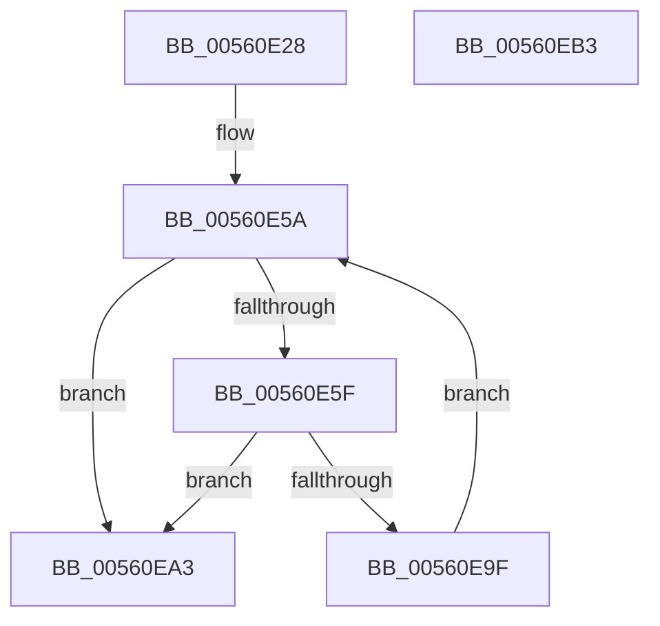

# HalpWdatInitializeWdat

- RVA: `0x00560E28`–`0x00560EB4` (길이 `140` bytes)
- VA: `0x0000000140560E28`
- 실행 섹션: `.text`
- PDB 이름 있음: `예`; PDB Function 태그: `아니요`
- unwind 정보 RVA: `0x00086C28`
- 디코드: `43`개 명령, `140/140` bytes 표시
- 미해석 바이트: `0` (있으면 어셈블리에 `.byte`로 보존)

> 이 문서는 커널 이미지의 기계어와 PDB 기호를 분석해 생성했습니다. 4번과 5번은 함수 원형과 자료형을 바이너리 사용 방식에서 추정한 C 해석이며 원본 소스 복구 결과는 아닙니다.

## 1. Dependencies

- 직접 호출 지점: **1**; 고유 호출 대상: **1**
- 직접 호출자로 확인된 함수: **1**
- RIP 상대 이미지 참조: **0**

### Outgoing calls
- `0x00560E96` → [WdInstrInitializeInstruction](WdInstrInitializeInstruction_function_0056E074.md) (function, `0x0056E074`)

### Direct callers
- [HalpWdatInitialize](HalpWdatInitialize_function_00560DB0.md) at `0x00560DF1`

### Static image references
- 디코드된 RIP-relative 메모리 참조가 없습니다.

## 2. Other-region calls and transfers

- 다른 실행 섹션으로 향하는 call: **0**
- 별도 외부 분기/꼬리 이동을 확인하지 못했습니다.

## 3. Assembly (complete function range)

```asm
00560E28  48 89 5C 24 08                  mov qword ptr [rsp + 8], rbx
00560E2D  48 89 74 24 10                  mov qword ptr [rsp + 0x10], rsi
00560E32  57                              push rdi
00560E33  48 83 EC 40                     sub rsp, 0x40
00560E37  48 8B 59 08                     mov rbx, qword ptr [rcx + 8]
00560E3B  48 8B F9                        mov rdi, rcx
00560E3E  8B 43 34                        mov eax, dword ptr [rbx + 0x34]
00560E41  89 41 10                        mov dword ptr [rcx + 0x10], eax
00560E44  8B 43 38                        mov eax, dword ptr [rbx + 0x38]
00560E47  89 41 14                        mov dword ptr [rcx + 0x14], eax
00560E4A  8B 43 30                        mov eax, dword ptr [rbx + 0x30]
00560E4D  89 41 18                        mov dword ptr [rcx + 0x18], eax
00560E50  8B 43 40                        mov eax, dword ptr [rbx + 0x40]
00560E53  89 41 2C                        mov dword ptr [rcx + 0x2c], eax
00560E56  33 C0                           xor eax, eax
00560E58  33 F6                           xor esi, esi
00560E5A  3B 73 40                        cmp esi, dword ptr [rbx + 0x40]
00560E5D  73 44                           jae 0x140560ea3
00560E5F  48 8D 14 76                     lea rdx, [rsi + rsi*2]
00560E63  C6 44 24 30 00                  mov byte ptr [rsp + 0x30], 0
00560E68  44 8A 44 D3 45                  mov r8b, byte ptr [rbx + rdx*8 + 0x45]
00560E6D  48 8D 4F 30                     lea rcx, [rdi + 0x30]
00560E71  8B C6                           mov eax, esi
00560E73  4C 8D 4B 48                     lea r9, [rbx + 0x48]
00560E77  48 C1 E0 06                     shl rax, 6
00560E7B  4D 8D 0C D1                     lea r9, [r9 + rdx*8]
00560E7F  48 03 C8                        add rcx, rax
00560E82  8B 44 D3 58                     mov eax, dword ptr [rbx + rdx*8 + 0x58]
00560E86  89 44 24 28                     mov dword ptr [rsp + 0x28], eax
00560E8A  8B 44 D3 54                     mov eax, dword ptr [rbx + rdx*8 + 0x54]
00560E8E  8A 54 D3 44                     mov dl, byte ptr [rbx + rdx*8 + 0x44]
00560E92  89 44 24 20                     mov dword ptr [rsp + 0x20], eax
00560E96  E8 D9 D1 00 00                  call 0x14056e074
00560E9B  85 C0                           test eax, eax
00560E9D  78 04                           js 0x140560ea3
00560E9F  FF C6                           inc esi
00560EA1  EB B7                           jmp 0x140560e5a
00560EA3  48 8B 5C 24 50                  mov rbx, qword ptr [rsp + 0x50]
00560EA8  48 8B 74 24 58                  mov rsi, qword ptr [rsp + 0x58]
00560EAD  48 83 C4 40                     add rsp, 0x40
00560EB1  5F                              pop rdi
00560EB2  C3                              ret
00560EB3  CC                              int3
```

## 4. C-style interpretation (structured pseudocode)

```c
__int64 __fastcall HalpWdatInitializeWdat(__int64 a1)
{
    __int64 result;
    __int64 v_rsi;
    __int64 v_rsp;
    unsigned __int8 v_stack_m18;
    unsigned int v_stack_m20;
    unsigned int v_stack_m28;
    unsigned __int64 v_stack_p10;
    unsigned __int64 v_stack_p8;

    v_stack_p8 = v_rbx;
    v_stack_p10 = v_rsi;
    v_rsp = (v_rsp) - (64);
    *(unsigned int *)(a1 + 16) = (unsigned int)((unsigned int)(*(unsigned int *)(*(unsigned __int64 *)(a1 + 8) + 52)));
    *(unsigned int *)(a1 + 20) = (unsigned int)((unsigned int)(*(unsigned int *)(*(unsigned __int64 *)(a1 + 8) + 56)));
    *(unsigned int *)(a1 + 24) = (unsigned int)((unsigned int)(*(unsigned int *)(*(unsigned __int64 *)(a1 + 8) + 48)));
    *(unsigned int *)(a1 + 44) = (unsigned int)((unsigned int)(*(unsigned int *)(*(unsigned __int64 *)(a1 + 8) + 64)));
    result = 0;
    v_rsi = 0;
loc_00560E5A:
    if (0 >= (*(unsigned int *)(*(unsigned __int64 *)(a1 + 8) + 64))) goto loc_00560EA3;
    v_stack_m18 = 0;
    result = (0) << (6);
    a1 = (a1 + 48) + (result);
    v_stack_m20 = (unsigned int)((unsigned int)(*(unsigned int *)(*(unsigned __int64 *)(a1 + 8) + v_rsi + v_rsi * 2 * 8 + 88)));
    v_stack_m28 = (unsigned int)((unsigned int)(*(unsigned int *)(*(unsigned __int64 *)(a1 + 8) + v_rsi + v_rsi * 2 * 8 + 84)));
    result = WdInstrInitializeInstruction(a1, *(unsigned __int8 *)(*(unsigned __int64 *)(a1 + 8) + v_rsi + v_rsi * 2 * 8 + 68), *(unsigned __int8 *)(*(unsigned __int64 *)(a1 + 8) + v_rsi + v_rsi * 2 * 8 + 69), *(unsigned __int64 *)(a1 + 8) + 72 + v_rsi + v_rsi * 2 * 8);
    if (sign_flag) goto loc_00560EA3;
    v_rsi = (unsigned int)((v_rsi) + 1);
    goto loc_00560E5A;
loc_00560EA3:
    v_rsp = (v_rsp) + (64);
    return result;
}
```

## 5. (Beta) C Style

```c
int64_t HalpWdatInitializeWdat(void *Arg1)
{
    uint8_t *arg1 = (uint8_t *)Arg1;

    int64_t result;
    int64_t local_rsi;
    int64_t local_rsp;
    uint8_t v_stack_m18;
    uint32_t v_stack_m20;
    uint32_t v_stack_m28;
    uint64_t v_stack_p10;
    uint64_t v_stack_p8;

    v_stack_p8 = local_rbx;
    v_stack_p10 = local_rsi;
    local_rsp = (local_rsp) - (64);
    *(uint32_t *)(arg1 + 0x10) = (uint32_t)((uint32_t)(*(uint32_t *)(*(uint64_t *)(arg1 + 0x8) + 0x34)));
    *(uint32_t *)(arg1 + 0x14) = (uint32_t)((uint32_t)(*(uint32_t *)(*(uint64_t *)(arg1 + 0x8) + 0x38)));
    *(uint32_t *)(arg1 + 0x18) = (uint32_t)((uint32_t)(*(uint32_t *)(*(uint64_t *)(arg1 + 0x8) + 0x30)));
    *(uint32_t *)(arg1 + 0x2C) = (uint32_t)((uint32_t)(*(uint32_t *)(*(uint64_t *)(arg1 + 0x8) + 0x40)));
    result = 0;
    local_rsi = 0;
loc_00560E5A:
    if (0 >= (*(uint32_t *)(*(uint64_t *)(arg1 + 0x8) + 0x40))) goto loc_00560EA3;
    v_stack_m18 = 0;
    result = (0) << (6);
    Arg1 = (Arg1 + 48) + (result);
    v_stack_m20 = (uint32_t)((uint32_t)(*(uint32_t *)(*(uint64_t *)(arg1 + 0x8) + local_rsi + local_rsi * 2 * 8 + 0x58)));
    v_stack_m28 = (uint32_t)((uint32_t)(*(uint32_t *)(*(uint64_t *)(arg1 + 0x8) + local_rsi + local_rsi * 2 * 8 + 0x54)));
    result = WdInstrInitializeInstruction(Arg1, *(uint8_t *)(*(uint64_t *)(arg1 + 0x8) + local_rsi + local_rsi * 2 * 8 + 0x44), *(uint8_t *)(*(uint64_t *)(arg1 + 0x8) + local_rsi + local_rsi * 2 * 8 + 0x45), *(uint64_t *)(arg1 + 0x8) + 72 + local_rsi + local_rsi * 2 * 8);
    if (sign_flag) goto loc_00560EA3;
    local_rsi = (uint32_t)((local_rsi) + 1);
    goto loc_00560E5A;
loc_00560EA3:
    local_rsp = (local_rsp) + (64);
    return result;
}
```

### 관측된 메모리 오프셋

구조체 형식이 확인되지 않은 접근은 인자 기준의 오프셋으로만 기록했습니다.

| 기준 인자 | 오프셋 표현 | 폭 (bit) | 접근 |
|---|---:|---:|---|
| `Arg1` | `+ 0x8` | `64` | `R` |
| `Arg1` | `+ 0x10` | `32` | `W` |
| `Arg1` | `+ 0x14` | `32` | `W` |
| `Arg1` | `+ 0x18` | `32` | `W` |
| `Arg1` | `+ 0x2C` | `32` | `W` |
| `Arg1` | `+ 0x30` | `64` | `R` |

## 6. Execution-region graph

[열기: 2D/3D 그래프와 함수 탐색 컨트롤 패널](../../../control-panel.html?section=text&rva=0x00560E28&view=graph)

- 2D 그래프는 위에서 아래로 흐르고, 3D 그래프는 빈 공간을 드래그해 회전합니다. Shift+드래그는 이동, 휠은 확대·축소, 함수 노드 선택은 대상 보고서 이동입니다.

### Static fallback


