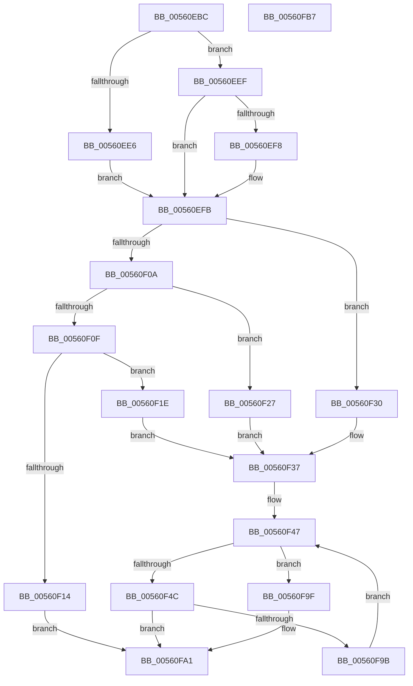

# HalpWdatInitializeWdrt

- RVA: `0x00560EBC`–`0x00560FB8` (길이 `252` bytes)
- VA: `0x0000000140560EBC`
- 실행 섹션: `.text`
- PDB 이름 있음: `예`; PDB Function 태그: `아니요`
- unwind 정보 RVA: `0x000BCAF8`
- 디코드: `68`개 명령, `252/252` bytes 표시
- 미해석 바이트: `0` (있으면 어셈블리에 `.byte`로 보존)

> 이 문서는 커널 이미지의 기계어와 PDB 기호를 분석해 생성했습니다. 4번과 5번은 함수 원형과 자료형을 바이너리 사용 방식에서 추정한 C 해석이며 원본 소스 복구 결과는 아닙니다.

## 1. Dependencies

- 직접 호출 지점: **1**; 고유 호출 대상: **1**
- 직접 호출자로 확인된 함수: **1**
- RIP 상대 이미지 참조: **1**

### Outgoing calls
- `0x00560F92` → [WdInstrInitializeInstruction](WdInstrInitializeInstruction_function_0056E074.md) (function, `0x0056E074`)

### Direct callers
- [HalpWdatInitialize](HalpWdatInitialize_function_00560DB0.md) at `0x00560E0A`

### Static image references
- `0x00560F3E` → RVA `0x00025D80` (`.rdata`; read)

## 2. Other-region calls and transfers

- 다른 실행 섹션으로 향하는 call: **0**
- 별도 외부 분기/꼬리 이동을 확인하지 못했습니다.

## 3. Assembly (complete function range)

```asm
00560EBC  48 89 5C 24 08                  mov qword ptr [rsp + 8], rbx
00560EC1  48 89 74 24 10                  mov qword ptr [rsp + 0x10], rsi
00560EC6  48 89 7C 24 18                  mov qword ptr [rsp + 0x18], rdi
00560ECB  41 56                           push r14
00560ECD  48 83 EC 40                     sub rsp, 0x40
00560ED1  48 8B 71 08                     mov rsi, qword ptr [rcx + 8]
00560ED5  48 8B D9                        mov rbx, rcx
00560ED8  0F B7 46 44                     movzx eax, word ptr [rsi + 0x44]
00560EDC  89 41 10                        mov dword ptr [rcx + 0x10], eax
00560EDF  3D FF 01 00 00                  cmp eax, 0x1ff
00560EE4  73 09                           jae 0x140560eef
00560EE6  C7 41 10 00 02 00 00            mov dword ptr [rcx + 0x10], 0x200
00560EED  EB 0C                           jmp 0x140560efb
00560EEF  B9 FF FF 00 00                  mov ecx, 0xffff
00560EF4  3B C1                           cmp eax, ecx
00560EF6  76 03                           jbe 0x140560efb
00560EF8  89 4B 10                        mov dword ptr [rbx + 0x10], ecx
00560EFB  C7 43 14 01 00 00 00            mov dword ptr [rbx + 0x14], 1
00560F02  0F B6 4E 46                     movzx ecx, byte ptr [rsi + 0x46]
00560F06  85 C9                           test ecx, ecx
00560F08  74 26                           je 0x140560f30
00560F0A  83 E9 01                        sub ecx, 1
00560F0D  74 18                           je 0x140560f27
00560F0F  83 F9 01                        cmp ecx, 1
00560F12  74 0A                           je 0x140560f1e
00560F14  B8 0D 00 00 C0                  mov eax, 0xc000000d
00560F19  E9 83 00 00 00                  jmp 0x140560fa1
00560F1E  C7 43 18 0A 00 00 00            mov dword ptr [rbx + 0x18], 0xa
00560F25  EB 10                           jmp 0x140560f37
00560F27  C7 43 18 64 00 00 00            mov dword ptr [rbx + 0x18], 0x64
00560F2E  EB 07                           jmp 0x140560f37
00560F30  C7 43 18 E8 03 00 00            mov dword ptr [rbx + 0x18], 0x3e8
00560F37  C7 43 2C 0F 00 00 00            mov dword ptr [rbx + 0x2c], 0xf
00560F3E  4C 8D 35 3B 4E AC FF            lea r14, [rip - 0x53b1c5]
00560F45  33 FF                           xor edi, edi
00560F47  83 FF 0F                        cmp edi, 0xf
00560F4A  73 53                           jae 0x140560f9f
00560F4C  48 8D 14 7F                     lea rdx, [rdi + rdi*2]
00560F50  C6 44 24 30 01                  mov byte ptr [rsp + 0x30], 1
00560F55  41 8A 44 96 02                  mov al, byte ptr [r14 + rdx*4 + 2]
00560F5A  45 8A 44 96 01                  mov r8b, byte ptr [r14 + rdx*4 + 1]
00560F5F  F6 D8                           neg al
00560F61  41 8B 44 96 08                  mov eax, dword ptr [r14 + rdx*4 + 8]
00560F66  4D 1B C9                        sbb r9, r9
00560F69  89 44 24 28                     mov dword ptr [rsp + 0x28], eax
00560F6D  41 8B 44 96 04                  mov eax, dword ptr [r14 + rdx*4 + 4]
00560F72  41 83 E1 0C                     and r9d, 0xc
00560F76  41 8A 14 96                     mov dl, byte ptr [r14 + rdx*4]
00560F7A  49 83 C1 24                     add r9, 0x24
00560F7E  8B CF                           mov ecx, edi
00560F80  4C 03 CE                        add r9, rsi
00560F83  48 C1 E1 06                     shl rcx, 6
00560F87  48 83 C1 30                     add rcx, 0x30
00560F8B  89 44 24 20                     mov dword ptr [rsp + 0x20], eax
00560F8F  48 03 CB                        add rcx, rbx
00560F92  E8 DD D0 00 00                  call 0x14056e074
00560F97  85 C0                           test eax, eax
00560F99  78 06                           js 0x140560fa1
00560F9B  FF C7                           inc edi
00560F9D  EB A8                           jmp 0x140560f47
00560F9F  33 C0                           xor eax, eax
00560FA1  48 8B 5C 24 50                  mov rbx, qword ptr [rsp + 0x50]
00560FA6  48 8B 74 24 58                  mov rsi, qword ptr [rsp + 0x58]
00560FAB  48 8B 7C 24 60                  mov rdi, qword ptr [rsp + 0x60]
00560FB0  48 83 C4 40                     add rsp, 0x40
00560FB4  41 5E                           pop r14
00560FB6  C3                              ret
00560FB7  CC                              int3
```

## 4. C-style interpretation (structured pseudocode)

```c
__int64 __fastcall HalpWdatInitializeWdrt(__int64 a1, __int64 a2, __int64 a3, __int64 a4)
{
    __int64 result;
    __int64 v_rdi;
    __int64 v_rsp;
    unsigned __int8 v_stack_m18;
    unsigned int v_stack_m20;
    unsigned int v_stack_m28;
    unsigned __int64 v_stack_p10;
    unsigned __int64 v_stack_p18;
    unsigned __int64 v_stack_p8;

    v_stack_p8 = v_rbx;
    v_stack_p10 = v_rsi;
    v_stack_p18 = v_rdi;
    v_rsp = (v_rsp) - (64);
    *(unsigned int *)(a1 + 16) = (unsigned int)(*(unsigned __int16 *)(*(unsigned __int64 *)(a1 + 8) + 68));
    if (((unsigned int)(*(unsigned __int16 *)(*(unsigned __int64 *)(a1 + 8) + 68))) >= 511) goto loc_00560EEF;
    *(unsigned int *)(a1 + 16) = 512;
    goto loc_00560EFB;
loc_00560EEF:
    if (((unsigned int)(*(unsigned __int16 *)(*(unsigned __int64 *)(a1 + 8) + 68))) >= = ((unsigned int)((unsigned int)(0xFFFFULL)))) {
        *(unsigned int *)(a1 + 16) = (unsigned int)((unsigned int)(0xFFFFULL));
    }
    *(unsigned int *)(a1 + 20) = 1;
    if ((unsigned int)(*(unsigned __int8 *)(*(unsigned __int64 *)(a1 + 8) + 70)) == 0) goto loc_00560F30;
    a1 = (unsigned int)((*(unsigned __int8 *)(*(unsigned __int64 *)(a1 + 8) + 70)) - (1));
    if (condition_is_equal) goto loc_00560F27;
    if (((unsigned int)(a1)) == 1) goto loc_00560F1E;
    goto loc_00560FA1;
loc_00560F1E:
    *(unsigned int *)(a1 + 24) = 10;
    goto loc_00560F37;
loc_00560F27:
    *(unsigned int *)(a1 + 24) = 100;
    goto loc_00560F37;
loc_00560F30:
    *(unsigned int *)(a1 + 24) = 1000;
loc_00560F37:
    *(unsigned int *)(a1 + 44) = 15;
    v_rdi = 0;
loc_00560F47:
    if (0 >= 15) goto loc_00560F9F;
    v_stack_m18 = 1;
    result = (unsigned __int8)(-(*(unsigned __int8 *)(v_rip - 5484997 + v_rdi + v_rdi * 2 * 4 + 2)));
    v_stack_m20 = (unsigned int)((unsigned int)(*(unsigned int *)(v_rip - 5484997 + v_rdi + v_rdi * 2 * 4 + 8)));
    a4 = (unsigned int)((a4) & (12));
    a4 = (a4) + (36);
    a4 = (a4) + (*(unsigned __int64 *)(a1 + 8));
    a1 = (0) << (6);
    a1 = (a1) + (48);
    v_stack_m28 = (unsigned int)((unsigned int)(*(unsigned int *)(v_rip - 5484997 + v_rdi + v_rdi * 2 * 4 + 4)));
    a1 = (a1) + (a1);
    result = WdInstrInitializeInstruction(a1, *(unsigned __int8 *)(v_rip - 5484997 + v_rdi + v_rdi * 2 * 4), *(unsigned __int8 *)(v_rip - 5484997 + v_rdi + v_rdi * 2 * 4 + 1), a4);
    if (sign_flag) goto loc_00560FA1;
    v_rdi = (unsigned int)((v_rdi) + 1);
    goto loc_00560F47;
loc_00560F9F:
    result = 0;
loc_00560FA1:
    v_rsp = (v_rsp) + (64);
    return result;
}
```

## 5. (Beta) C Style

```c
int64_t HalpWdatInitializeWdrt(void *Arg1, int64_t Arg2, int64_t Arg3, int64_t Arg4)
{
    uint8_t *arg1 = (uint8_t *)Arg1;

    int64_t result;
    int64_t local_rdi;
    int64_t local_rsp;
    uint8_t v_stack_m18;
    uint32_t v_stack_m20;
    uint32_t v_stack_m28;
    uint64_t v_stack_p10;
    uint64_t v_stack_p18;
    uint64_t v_stack_p8;

    v_stack_p8 = local_rbx;
    v_stack_p10 = local_rsi;
    v_stack_p18 = local_rdi;
    local_rsp = (local_rsp) - (64);
    *(uint32_t *)(arg1 + 0x10) = (uint32_t)(*(uint16_t *)(*(uint64_t *)(arg1 + 0x8) + 0x44));
    if (((uint32_t)(*(uint16_t *)(*(uint64_t *)(arg1 + 0x8) + 0x44))) >= 511) goto loc_00560EEF;
    *(uint32_t *)(arg1 + 0x10) = 512;
    goto loc_00560EFB;
loc_00560EEF:
    if (((uint32_t)(*(uint16_t *)(*(uint64_t *)(arg1 + 0x8) + 0x44))) >= = ((uint32_t)((uint32_t)(0xFFFFULL)))) {
        *(uint32_t *)(arg1 + 0x10) = (uint32_t)((uint32_t)(0xFFFFULL));
    }
    *(uint32_t *)(arg1 + 0x14) = 1;
    if ((uint32_t)(*(uint8_t *)(*(uint64_t *)(arg1 + 0x8) + 0x46)) == 0) goto loc_00560F30;
    Arg1 = (uint32_t)((*(uint8_t *)(*(uint64_t *)(arg1 + 0x8) + 0x46)) - (1));
    if (condition_is_equal) goto loc_00560F27;
    if (((uint32_t)(Arg1)) == 1) goto loc_00560F1E;
    goto loc_00560FA1;
loc_00560F1E:
    *(uint32_t *)(arg1 + 0x18) = 10;
    goto loc_00560F37;
loc_00560F27:
    *(uint32_t *)(arg1 + 0x18) = 100;
    goto loc_00560F37;
loc_00560F30:
    *(uint32_t *)(arg1 + 0x18) = 1000;
loc_00560F37:
    *(uint32_t *)(arg1 + 0x2C) = 15;
    local_rdi = 0;
loc_00560F47:
    if (0 >= 15) goto loc_00560F9F;
    v_stack_m18 = 1;
    result = (uint8_t)(-(*(uint8_t *)(v_rip - 0x53B1C5 + local_rdi + local_rdi * 2 * 4 + 0x2)));
    v_stack_m20 = (uint32_t)((uint32_t)(*(uint32_t *)(v_rip - 0x53B1C5 + local_rdi + local_rdi * 2 * 4 + 0x8)));
    Arg4 = (uint32_t)((Arg4) & (12));
    Arg4 = (Arg4) + (36);
    Arg4 = (Arg4) + (*(uint64_t *)(arg1 + 0x8));
    Arg1 = (0) << (6);
    Arg1 = (Arg1) + (48);
    v_stack_m28 = (uint32_t)((uint32_t)(*(uint32_t *)(v_rip - 0x53B1C5 + local_rdi + local_rdi * 2 * 4 + 0x4)));
    Arg1 = (Arg1) + (Arg1);
    result = WdInstrInitializeInstruction(Arg1, *(uint8_t *)(v_rip - 0x53B1C5 + local_rdi + local_rdi * 2 * 4), *(uint8_t *)(v_rip - 0x53B1C5 + local_rdi + local_rdi * 2 * 4 + 0x1), Arg4);
    if (sign_flag) goto loc_00560FA1;
    local_rdi = (uint32_t)((local_rdi) + 1);
    goto loc_00560F47;
loc_00560F9F:
    result = 0;
loc_00560FA1:
    local_rsp = (local_rsp) + (64);
    return result;
}
```

### 관측된 메모리 오프셋

구조체 형식이 확인되지 않은 접근은 인자 기준의 오프셋으로만 기록했습니다.

| 기준 인자 | 오프셋 표현 | 폭 (bit) | 접근 |
|---|---:|---:|---|
| `Arg1` | `+ 0x8` | `64` | `R` |
| `Arg1` | `+ 0x10` | `32` | `W` |
| `Arg1` | `+ 0x14` | `32` | `W` |
| `Arg1` | `+ 0x18` | `32` | `W` |
| `Arg1` | `+ 0x2C` | `32` | `W` |

## 6. Execution-region graph

[열기: 2D/3D 그래프와 함수 탐색 컨트롤 패널](../../../control-panel.html?section=text&rva=0x00560EBC&view=graph)

- 2D 그래프는 위에서 아래로 흐르고, 3D 그래프는 빈 공간을 드래그해 회전합니다. Shift+드래그는 이동, 휠은 확대·축소, 함수 노드 선택은 대상 보고서 이동입니다.

### Static fallback


