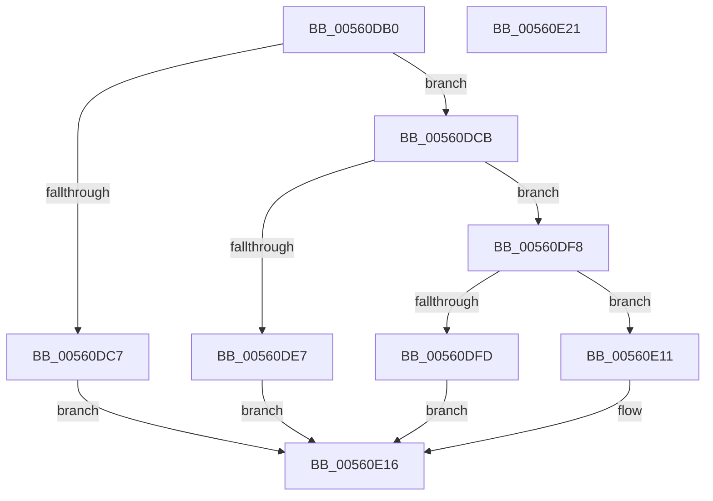

# HalpWdatInitialize

- RVA: `0x00560DB0`–`0x00560E22` (길이 `114` bytes)
- VA: `0x0000000140560DB0`
- 실행 섹션: `.text`
- PDB 이름 있음: `예`; PDB Function 태그: `아니요`
- unwind 정보 RVA: `0x0005CAAC`
- 디코드: `34`개 명령, `114/114` bytes 표시
- 미해석 바이트: `0` (있으면 어셈블리에 `.byte`로 보존)

> 이 문서는 커널 이미지의 기계어와 PDB 기호를 분석해 생성했습니다. 4번과 5번은 함수 원형과 자료형을 바이너리 사용 방식에서 추정한 C 해석이며 원본 소스 복구 결과는 아닙니다.

## 1. Dependencies

- 직접 호출 지점: **4**; 고유 호출 대상: **3**
- 직접 호출자로 확인된 함수: **0**
- RIP 상대 이미지 참조: **0**

### Outgoing calls
- `0x00560DD0` → [HalSocGetAcpiTable](HalSocGetAcpiTable_function_00561580.md) (function, `0x00561580`)
- `0x00560DDD` → [HalSocGetAcpiTable](HalSocGetAcpiTable_function_00561580.md) (function, `0x00561580`)
- `0x00560DF1` → [HalpWdatInitializeWdat](HalpWdatInitializeWdat_function_00560E28.md) (function, `0x00560E28`)
- `0x00560E0A` → [HalpWdatInitializeWdrt](HalpWdatInitializeWdrt_function_00560EBC.md) (function, `0x00560EBC`)

### Direct callers
- 이 함수 시작 RVA로 연결되는 직접 call은 확인되지 않았습니다. 간접 호출은 완전히 역산할 수 없습니다.

### Static image references
- 디코드된 RIP-relative 메모리 참조가 없습니다.

## 2. Other-region calls and transfers

- 다른 실행 섹션으로 향하는 call: **0**
- 별도 외부 분기/꼬리 이동을 확인하지 못했습니다.

## 3. Assembly (complete function range)

```asm
00560DB0  48 89 5C 24 08                  mov qword ptr [rsp + 8], rbx
00560DB5  57                              push rdi
00560DB6  48 83 EC 20                     sub rsp, 0x20
00560DBA  83 79 2C 00                     cmp dword ptr [rcx + 0x2c], 0
00560DBE  48 8B D9                        mov rbx, rcx
00560DC1  C6 41 28 00                     mov byte ptr [rcx + 0x28], 0
00560DC5  74 04                           je 0x140560dcb
00560DC7  33 C0                           xor eax, eax
00560DC9  EB 4B                           jmp 0x140560e16
00560DCB  B9 57 44 41 54                  mov ecx, 0x54414457
00560DD0  E8 AB 07 00 00                  call 0x140561580
00560DD5  B9 57 44 52 54                  mov ecx, 0x54524457
00560DDA  48 8B F8                        mov rdi, rax
00560DDD  E8 9E 07 00 00                  call 0x140561580
00560DE2  48 85 FF                        test rdi, rdi
00560DE5  74 11                           je 0x140560df8
00560DE7  83 23 00                        and dword ptr [rbx], 0
00560DEA  48 8B CB                        mov rcx, rbx
00560DED  48 89 7B 08                     mov qword ptr [rbx + 8], rdi
00560DF1  E8 32 00 00 00                  call 0x140560e28
00560DF6  EB 1E                           jmp 0x140560e16
00560DF8  48 85 C0                        test rax, rax
00560DFB  74 14                           je 0x140560e11
00560DFD  48 8B CB                        mov rcx, rbx
00560E00  C7 03 01 00 00 00               mov dword ptr [rbx], 1
00560E06  48 89 43 08                     mov qword ptr [rbx + 8], rax
00560E0A  E8 AD 00 00 00                  call 0x140560ebc
00560E0F  EB 05                           jmp 0x140560e16
00560E11  B8 01 00 00 C0                  mov eax, 0xc0000001
00560E16  48 8B 5C 24 30                  mov rbx, qword ptr [rsp + 0x30]
00560E1B  48 83 C4 20                     add rsp, 0x20
00560E1F  5F                              pop rdi
00560E20  C3                              ret
00560E21  CC                              int3
```

## 4. C-style interpretation (structured pseudocode)

```c
__int64 __fastcall HalpWdatInitialize(__int64 a1)
{
    __int64 result;
    __int64 v_rsp;
    unsigned __int64 v_stack_p8;

    v_stack_p8 = v_rbx;
    v_rsp = (v_rsp) - (32);
    *(unsigned __int8 *)(a1 + 40) = 0;
    if ((*(unsigned int *)(a1 + 44)) == 0) goto loc_00560DCB;
    result = 0;
    goto loc_00560E16;
loc_00560DCB:
    result = HalSocGetAcpiTable((unsigned int)(0x54414457ULL), a2, a3, a4);
    result = HalSocGetAcpiTable((unsigned int)(0x54524457ULL), a2, a3, a4);
    if (result == 0) goto loc_00560DF8;
    *(unsigned __int64 *)(a1 + 8) = result;
    result = HalpWdatInitializeWdat(a1, a2, a3, a4);
    goto loc_00560E16;
loc_00560DF8:
    if (result == 0) goto loc_00560E11;
    *(unsigned int *)(a1) = 1;
    *(unsigned __int64 *)(a1 + 8) = result;
    result = HalpWdatInitializeWdrt(a1, a2, a3, a4);
    goto loc_00560E16;
loc_00560E11:
loc_00560E16:
    v_rsp = (v_rsp) + (32);
    return (unsigned int)(0xC0000001ULL);
}
```

## 5. (Beta) C Style

```c
int64_t HalpWdatInitialize(void *Arg1)
{
    uint8_t *arg1 = (uint8_t *)Arg1;

    int64_t result;
    int64_t local_rsp;
    uint64_t v_stack_p8;

    v_stack_p8 = local_rbx;
    local_rsp = (local_rsp) - (32);
    *(uint8_t *)(arg1 + 0x28) = 0;
    if ((*(uint32_t *)(arg1 + 0x2C)) == 0) goto loc_00560DCB;
    result = 0;
    goto loc_00560E16;
loc_00560DCB:
    result = HalSocGetAcpiTable((uint32_t)(0x54414457ULL), a2, a3, a4);
    result = HalSocGetAcpiTable((uint32_t)(0x54524457ULL), a2, a3, a4);
    if (result == 0) goto loc_00560DF8;
    *(uint64_t *)(arg1 + 0x8) = result;
    result = HalpWdatInitializeWdat(Arg1, a2, a3, a4);
    goto loc_00560E16;
loc_00560DF8:
    if (result == 0) goto loc_00560E11;
    *(uint32_t *)(arg1) = 1;
    *(uint64_t *)(arg1 + 0x8) = result;
    result = HalpWdatInitializeWdrt(Arg1, a2, a3, a4);
    goto loc_00560E16;
loc_00560E11:
loc_00560E16:
    local_rsp = (local_rsp) + (32);
    return (uint32_t)(0xC0000001ULL);
}
```

### 관측된 메모리 오프셋

구조체 형식이 확인되지 않은 접근은 인자 기준의 오프셋으로만 기록했습니다.

| 기준 인자 | 오프셋 표현 | 폭 (bit) | 접근 |
|---|---:|---:|---|
| `Arg1` | `+ 0x0` | `32` | `R/W` |
| `Arg1` | `+ 0x0` | `32` | `W` |
| `Arg1` | `+ 0x8` | `64` | `W` |
| `Arg1` | `+ 0x28` | `8` | `W` |
| `Arg1` | `+ 0x2C` | `32` | `R` |

## 6. Execution-region graph

[열기: 2D/3D 그래프와 함수 탐색 컨트롤 패널](../../../control-panel.html?section=text&rva=0x00560DB0&view=graph)

- 2D 그래프는 위에서 아래로 흐르고, 3D 그래프는 빈 공간을 드래그해 회전합니다. Shift+드래그는 이동, 휠은 확대·축소, 함수 노드 선택은 대상 보고서 이동입니다.

### Static fallback


