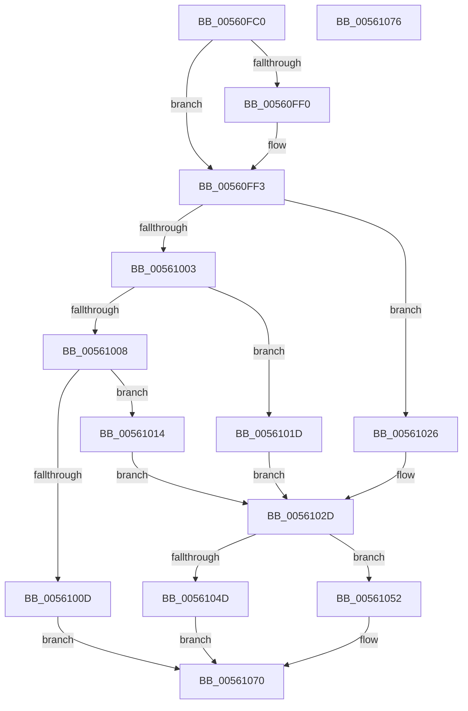

# HalpWdatProcessWdrtInternalData

- RVA: `0x00560FC0`–`0x00561077` (길이 `183` bytes)
- VA: `0x0000000140560FC0`
- 실행 섹션: `.text`
- PDB 이름 있음: `예`; PDB Function 태그: `아니요`
- unwind 정보 RVA: `0x00071A74`
- 디코드: `51`개 명령, `183/183` bytes 표시
- 미해석 바이트: `0` (있으면 어셈블리에 `.byte`로 보존)

> 이 문서는 커널 이미지의 기계어와 PDB 기호를 분석해 생성했습니다. 4번과 5번은 함수 원형과 자료형을 바이너리 사용 방식에서 추정한 C 해석이며 원본 소스 복구 결과는 아닙니다.

## 1. Dependencies

- 직접 호출 지점: **3**; 고유 호출 대상: **3**
- 직접 호출자로 확인된 함수: **1**
- RIP 상대 이미지 참조: **0**

### Outgoing calls
- `0x00561044` → [WdHwCreateHardwareRegister](WdHwCreateHardwareRegister_function_0056DCB8.md) (function, `0x0056DCB8`)
- `0x0056105C` → [guard_dispatch_icall](../6B/guard_dispatch_icall_function_006BAAD0.md) (function, `0x006BAAD0`)
- `0x00561066` → [WdHwDestroyHardwareRegister](WdHwDestroyHardwareRegister_function_0056DE4C.md) (function, `0x0056DE4C`)

### Direct callers
- [HalpWdatDiscover](HalpWdatDiscover_function_005609A8.md) at `0x00560AC5`

### Static image references
- 디코드된 RIP-relative 메모리 참조가 없습니다.

## 2. Other-region calls and transfers

- 다른 실행 섹션으로 향하는 call: **0**
- 별도 외부 분기/꼬리 이동을 확인하지 못했습니다.

## 3. Assembly (complete function range)

```asm
00560FC0  40 53                           push rbx
00560FC2  48 83 EC 50                     sub rsp, 0x50
00560FC6  33 C0                           xor eax, eax
00560FC8  0F 57 C0                        xorps xmm0, xmm0
00560FCB  48 89 44 24 40                  mov qword ptr [rsp + 0x40], rax
00560FD0  4C 8B D1                        mov r10, rcx
00560FD3  0F B7 41 44                     movzx eax, word ptr [rcx + 0x44]
00560FD7  49 8B D9                        mov rbx, r9
00560FDA  B9 FF 01 00 00                  mov ecx, 0x1ff
00560FDF  89 42 10                        mov dword ptr [rdx + 0x10], eax
00560FE2  0F 11 44 24 20                  movups xmmword ptr [rsp + 0x20], xmm0
00560FE7  0F 11 44 24 30                  movups xmmword ptr [rsp + 0x30], xmm0
00560FEC  3B C1                           cmp eax, ecx
00560FEE  73 03                           jae 0x140560ff3
00560FF0  89 4A 10                        mov dword ptr [rdx + 0x10], ecx
00560FF3  C7 42 14 01 00 00 00            mov dword ptr [rdx + 0x14], 1
00560FFA  41 0F B6 4A 46                  movzx ecx, byte ptr [r10 + 0x46]
00560FFF  85 C9                           test ecx, ecx
00561001  74 23                           je 0x140561026
00561003  83 E9 01                        sub ecx, 1
00561006  74 15                           je 0x14056101d
00561008  83 F9 01                        cmp ecx, 1
0056100B  74 07                           je 0x140561014
0056100D  B8 0D 00 00 C0                  mov eax, 0xc000000d
00561012  EB 5C                           jmp 0x140561070
00561014  C7 42 18 0A 00 00 00            mov dword ptr [rdx + 0x18], 0xa
0056101B  EB 10                           jmp 0x14056102d
0056101D  C7 42 18 64 00 00 00            mov dword ptr [rdx + 0x18], 0x64
00561024  EB 07                           jmp 0x14056102d
00561026  C7 42 18 E8 03 00 00            mov dword ptr [rdx + 0x18], 0x3e8
0056102D  41 8A 52 24                     mov dl, byte ptr [r10 + 0x24]
00561031  4C 8D 4C 24 20                  lea r9, [rsp + 0x20]
00561036  49 8B 4A 28                     mov rcx, qword ptr [r10 + 0x28]
0056103A  41 C7 00 30 04 00 00            mov dword ptr [r8], 0x430
00561041  41 B0 03                        mov r8b, 3
00561044  E8 6F CC 00 00                  call 0x14056dcb8
00561049  85 C0                           test eax, eax
0056104B  79 05                           jns 0x140561052
0056104D  C6 03 00                        mov byte ptr [rbx], 0
00561050  EB 1E                           jmp 0x140561070
00561052  48 8B 4C 24 30                  mov rcx, qword ptr [rsp + 0x30]
00561057  48 8B 44 24 38                  mov rax, qword ptr [rsp + 0x38]
0056105C  E8 6F 9A 15 00                  call 0x1406baad0
00561061  48 8D 4C 24 20                  lea rcx, [rsp + 0x20]
00561066  E8 E1 CD 00 00                  call 0x14056de4c
0056106B  33 C0                           xor eax, eax
0056106D  C6 03 01                        mov byte ptr [rbx], 1
00561070  48 83 C4 50                     add rsp, 0x50
00561074  5B                              pop rbx
00561075  C3                              ret
00561076  CC                              int3
```

## 4. C-style interpretation (structured pseudocode)

```c
__int64 __fastcall HalpWdatProcessWdrtInternalData(__int64 a1, __int64 a2, __int64 a3, __int64 a4)
{
    __int64 result;
    __int64 v_rsp;
    unsigned __int64 v_stack_m18;
    unsigned __int64 v_stack_m20;
    unsigned __int64 v_stack_m28;
    unsigned __int64 v_stack_m38;

    v_rsp = (v_rsp) - (80);
    result = 0;
    v_stack_m18 = 0;
    *(unsigned int *)(a2 + 16) = (unsigned int)(*(unsigned __int16 *)(a1 + 68));
    v_stack_m38 = v_xmm0;
    v_stack_m28 = v_xmm0;
    if (((unsigned int)(*(unsigned __int16 *)(a1 + 68))) < 511) {
        *(unsigned int *)(a2 + 16) = 511;
    }
    *(unsigned int *)(a2 + 20) = 1;
    if ((unsigned int)(*(unsigned __int8 *)(a1 + 70)) == 0) goto loc_00561026;
    a1 = (unsigned int)((*(unsigned __int8 *)(a1 + 70)) - (1));
    if (condition_is_equal) goto loc_0056101D;
    if (((unsigned int)(a1)) == 1) goto loc_00561014;
    goto loc_00561070;
loc_00561014:
    *(unsigned int *)(a2 + 24) = 10;
    goto loc_0056102D;
loc_0056101D:
    *(unsigned int *)(a2 + 24) = 100;
    goto loc_0056102D;
loc_00561026:
    *(unsigned int *)(a2 + 24) = 1000;
loc_0056102D:
    *(unsigned int *)(a3) = 0x430ULL;
    result = WdHwCreateHardwareRegister(*(unsigned __int64 *)(a1 + 40), *(unsigned __int8 *)(a1 + 36), 3, v_stack_m38);
    if (!sign_flag) goto loc_00561052;
    *(unsigned __int8 *)(a4) = 0;
    goto loc_00561070;
loc_00561052:
    result = guard_dispatch_icall(v_stack_m28, *(unsigned __int8 *)(a1 + 36), 3, v_stack_m38);
    result = WdHwDestroyHardwareRegister(v_stack_m38, *(unsigned __int8 *)(a1 + 36), 3, v_stack_m38);
    result = 0;
    *(unsigned __int8 *)(a4) = 1;
loc_00561070:
    v_rsp = (v_rsp) + (80);
    return result;
}
```

## 5. (Beta) C Style

```c
int64_t HalpWdatProcessWdrtInternalData(void *Arg1, void *Arg2, void *Arg3, void *Arg4)
{
    uint8_t *arg1 = (uint8_t *)Arg1;
    uint8_t *arg2 = (uint8_t *)Arg2;
    uint8_t *arg3 = (uint8_t *)Arg3;
    uint8_t *arg4 = (uint8_t *)Arg4;

    int64_t result;
    int64_t local_rsp;
    uint64_t v_stack_m18;
    uint64_t v_stack_m20;
    uint64_t v_stack_m28;
    uint64_t v_stack_m38;

    local_rsp = (local_rsp) - (80);
    result = 0;
    v_stack_m18 = 0;
    *(uint32_t *)(arg2 + 0x10) = (uint32_t)(*(uint16_t *)(arg1 + 0x44));
    v_stack_m38 = v_xmm0;
    v_stack_m28 = v_xmm0;
    if (((uint32_t)(*(uint16_t *)(arg1 + 0x44))) < 511) {
        *(uint32_t *)(arg2 + 0x10) = 511;
    }
    *(uint32_t *)(arg2 + 0x14) = 1;
    if ((uint32_t)(*(uint8_t *)(arg1 + 0x46)) == 0) goto loc_00561026;
    Arg1 = (uint32_t)((*(uint8_t *)(arg1 + 0x46)) - (1));
    if (condition_is_equal) goto loc_0056101D;
    if (((uint32_t)(Arg1)) == 1) goto loc_00561014;
    goto loc_00561070;
loc_00561014:
    *(uint32_t *)(arg2 + 0x18) = 10;
    goto loc_0056102D;
loc_0056101D:
    *(uint32_t *)(arg2 + 0x18) = 100;
    goto loc_0056102D;
loc_00561026:
    *(uint32_t *)(arg2 + 0x18) = 1000;
loc_0056102D:
    *(uint32_t *)(arg3) = 0x430ULL;
    result = WdHwCreateHardwareRegister(*(uint64_t *)(arg1 + 0x28), *(uint8_t *)(arg1 + 0x24), 3, v_stack_m38);
    if (!sign_flag) goto loc_00561052;
    *(uint8_t *)(arg4) = 0;
    goto loc_00561070;
loc_00561052:
    result = guard_dispatch_icall(v_stack_m28, *(uint8_t *)(arg1 + 0x24), 3, v_stack_m38);
    result = WdHwDestroyHardwareRegister(v_stack_m38, *(uint8_t *)(arg1 + 0x24), 3, v_stack_m38);
    result = 0;
    *(uint8_t *)(arg4) = 1;
loc_00561070:
    local_rsp = (local_rsp) + (80);
    return result;
}
```

### 관측된 메모리 오프셋

구조체 형식이 확인되지 않은 접근은 인자 기준의 오프셋으로만 기록했습니다.

| 기준 인자 | 오프셋 표현 | 폭 (bit) | 접근 |
|---|---:|---:|---|
| `Arg1` | `+ 0x24` | `8` | `R` |
| `Arg1` | `+ 0x28` | `64` | `R` |
| `Arg1` | `+ 0x44` | `16` | `R` |
| `Arg1` | `+ 0x46` | `8` | `R` |
| `Arg2` | `+ 0x10` | `32` | `W` |
| `Arg2` | `+ 0x14` | `32` | `W` |
| `Arg2` | `+ 0x18` | `32` | `W` |
| `Arg3` | `+ 0x0` | `32` | `W` |
| `Arg4` | `+ 0x0` | `8` | `W` |

## 6. Execution-region graph

[열기: 2D/3D 그래프와 함수 탐색 컨트롤 패널](../../../control-panel.html?section=text&rva=0x00560FC0&view=graph)

- 2D 그래프는 위에서 아래로 흐르고, 3D 그래프는 빈 공간을 드래그해 회전합니다. Shift+드래그는 이동, 휠은 확대·축소, 함수 노드 선택은 대상 보고서 이동입니다.

### Static fallback


