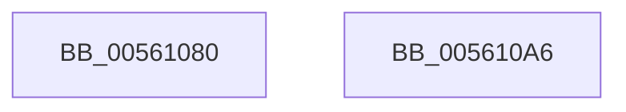

# HalpWdatStop

- RVA: `0x00561080`–`0x005610A7` (길이 `39` bytes)
- VA: `0x0000000140561080`
- 실행 섹션: `.text`
- PDB 이름 있음: `예`; PDB Function 태그: `아니요`
- unwind 정보 RVA: `0x00064C80`
- 디코드: `13`개 명령, `39/39` bytes 표시
- 미해석 바이트: `0` (있으면 어셈블리에 `.byte`로 보존)

> 이 문서는 커널 이미지의 기계어와 PDB 기호를 분석해 생성했습니다. 4번과 5번은 함수 원형과 자료형을 바이너리 사용 방식에서 추정한 C 해석이며 원본 소스 복구 결과는 아닙니다.

## 1. Dependencies

- 직접 호출 지점: **1**; 고유 호출 대상: **1**
- 직접 호출자로 확인된 함수: **0**
- RIP 상대 이미지 참조: **0**

### Outgoing calls
- `0x00561097` → [WdInstrExecuteAction](../4D/WdInstrExecuteAction_function_004D0928.md) (function, `0x004D0928`)

### Direct callers
- 이 함수 시작 RVA로 연결되는 직접 call은 확인되지 않았습니다. 간접 호출은 완전히 역산할 수 없습니다.

### Static image references
- 디코드된 RIP-relative 메모리 참조가 없습니다.

## 2. Other-region calls and transfers

- 다른 실행 섹션으로 향하는 call: **0**
- 별도 외부 분기/꼬리 이동을 확인하지 못했습니다.

## 3. Assembly (complete function range)

```asm
00561080  40 53                           push rbx
00561082  48 83 EC 30                     sub rsp, 0x30
00561086  48 8B D9                        mov rbx, rcx
00561089  45 33 C9                        xor r9d, r9d
0056108C  48 83 C1 30                     add rcx, 0x30
00561090  8B 53 2C                        mov edx, dword ptr [rbx + 0x2c]
00561093  45 8D 41 0B                     lea r8d, [r9 + 0xb]
00561097  E8 8C F8 F6 FF                  call 0x1404d0928
0056109C  C6 43 28 00                     mov byte ptr [rbx + 0x28], 0
005610A0  48 83 C4 30                     add rsp, 0x30
005610A4  5B                              pop rbx
005610A5  C3                              ret
005610A6  CC                              int3
```

## 4. C-style interpretation (structured pseudocode)

```c
__int64 __fastcall HalpWdatStop(__int64 a1, __int64 a2, __int64 a3, int a4)
{
    __int64 result;
    __int64 v_rsp;

    v_rsp = (v_rsp) - (48);
    a4 = 0;
    a1 = (a1) + (48);
    result = WdInstrExecuteAction(a1, (unsigned int)(*(unsigned int *)(a1 + 44)), a4 + 11, a4);
    *(unsigned __int8 *)(a1 + 40) = 0;
    v_rsp = (v_rsp) + (48);
    return result;
}
```

## 5. (Beta) C Style

```c
int64_t HalpWdatStop(void *Arg1, int64_t Arg2, int64_t Arg3, int32_t Arg4)
{
    uint8_t *arg1 = (uint8_t *)Arg1;

    int64_t result;
    int64_t local_rsp;

    local_rsp = (local_rsp) - (48);
    Arg4 = 0;
    Arg1 = (Arg1) + (48);
    result = WdInstrExecuteAction(Arg1, (uint32_t)(*(uint32_t *)(arg1 + 0x2C)), Arg4 + 11, Arg4);
    *(uint8_t *)(arg1 + 0x28) = 0;
    local_rsp = (local_rsp) + (48);
    return result;
}
```

### 관측된 메모리 오프셋

구조체 형식이 확인되지 않은 접근은 인자 기준의 오프셋으로만 기록했습니다.

| 기준 인자 | 오프셋 표현 | 폭 (bit) | 접근 |
|---|---:|---:|---|
| `Arg1` | `+ 0x28` | `8` | `W` |
| `Arg1` | `+ 0x2C` | `32` | `R` |

## 6. Execution-region graph

[열기: 2D/3D 그래프와 함수 탐색 컨트롤 패널](../../../control-panel.html?section=text&rva=0x00561080&view=graph)

- 2D 그래프는 위에서 아래로 흐르고, 3D 그래프는 빈 공간을 드래그해 회전합니다. Shift+드래그는 이동, 휠은 확대·축소, 함수 노드 선택은 대상 보고서 이동입니다.

### Static fallback


