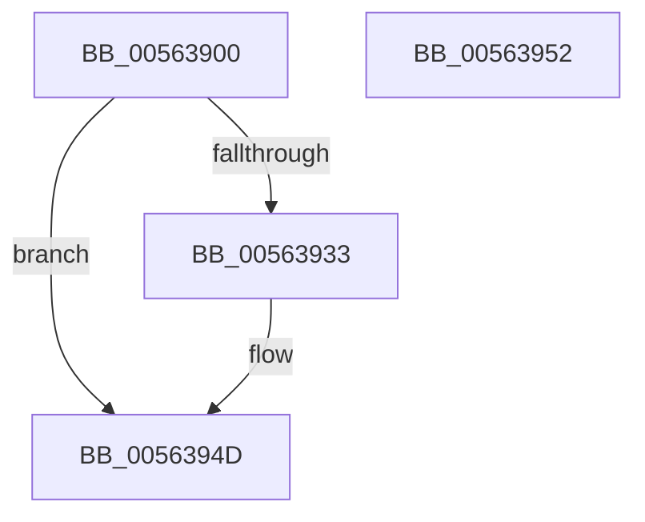

# HalpWhackICHUsbSmi

- RVA: `0x00563900`–`0x00563953` (길이 `83` bytes)
- VA: `0x0000000140563900`
- 실행 섹션: `.text`
- PDB 이름 있음: `예`; PDB Function 태그: `아니요`
- unwind 정보 RVA: `0x0005D2F4`
- 디코드: `28`개 명령, `83/83` bytes 표시
- 미해석 바이트: `0` (있으면 어셈블리에 `.byte`로 보존)

> 이 문서는 커널 이미지의 기계어와 PDB 기호를 분석해 생성했습니다. 4번과 5번은 함수 원형과 자료형을 바이너리 사용 방식에서 추정한 C 해석이며 원본 소스 복구 결과는 아닙니다.

## 1. Dependencies

- 직접 호출 지점: **1**; 고유 호출 대상: **1**
- 직접 호출자로 확인된 함수: **1**
- RIP 상대 이미지 참조: **0**

### Outgoing calls
- `0x00563926` → [HalGetBusDataByOffset](../46/HalGetBusDataByOffset_function_00461730.md) (function, `0x00461730`)

### Direct callers
- [HalpPiix4Detect](../../pagelk/B7/HalpPiix4Detect_function_00B79E00.md) at `0x00B7A144`

### Static image references
- 디코드된 RIP-relative 메모리 참조가 없습니다.

## 2. Other-region calls and transfers

- 다른 실행 섹션으로 향하는 call: **0**
- 별도 외부 분기/꼬리 이동을 확인하지 못했습니다.

## 3. Assembly (complete function range)

```asm
00563900  48 83 EC 38                     sub rsp, 0x38
00563904  83 64 24 50 00                  and dword ptr [rsp + 0x50], 0
00563909  4C 8D 4C 24 50                  lea r9, [rsp + 0x50]
0056390E  B8 04 00 00 00                  mov eax, 4
00563913  44 8B C2                        mov r8d, edx
00563916  8B D1                           mov edx, ecx
00563918  89 44 24 28                     mov dword ptr [rsp + 0x28], eax
0056391C  8B C8                           mov ecx, eax
0056391E  C7 44 24 20 40 00 00 00         mov dword ptr [rsp + 0x20], 0x40
00563926  E8 05 DE EF FF                  call 0x140461730
0056392B  8B 54 24 50                     mov edx, dword ptr [rsp + 0x50]
0056392F  85 D2                           test edx, edx
00563931  74 1A                           je 0x14056394d
00563933  83 E2 FC                        and edx, 0xfffffffc
00563936  89 54 24 50                     mov dword ptr [rsp + 0x50], edx
0056393A  90                              nop
0056393B  83 C2 30                        add edx, 0x30
0056393E  ED                              in eax, dx
0056393F  90                              nop
00563940  8B 54 24 50                     mov edx, dword ptr [rsp + 0x50]
00563944  83 C2 30                        add edx, 0x30
00563947  90                              nop
00563948  83 E0 F7                        and eax, 0xfffffff7
0056394B  EF                              out dx, eax
0056394C  90                              nop
0056394D  48 83 C4 38                     add rsp, 0x38
00563951  C3                              ret
00563952  CC                              int3
```

## 4. C-style interpretation (structured pseudocode)

```c
__int64 __fastcall HalpWhackICHUsbSmi(int a1, int a2)
{
    __int64 result;
    __int64 v_rsp;
    unsigned int v_stack_m10;
    unsigned int v_stack_m18;
    unsigned int v_stack_p18;

    v_rsp = (v_rsp) - (56);
    v_stack_m10 = 4;
    v_stack_m18 = 64;
    result = HalGetBusDataByOffset(4, (unsigned int)(a1), (unsigned int)(a2), v_stack_p18);
    if ((unsigned int)((unsigned int)(v_stack_p18)) != 0) {
        a2 = (unsigned int)(((unsigned int)(v_stack_p18)) & (0xFFFFFFFCULL));
        v_stack_p18 = a2;
        a2 = (unsigned int)((a2) + (48));
        a2 = v_stack_p18;
        a2 = (unsigned int)((a2) + (48));
        result = (unsigned int)((result) & (0xFFFFFFF7ULL));
    }
    v_rsp = (v_rsp) + (56);
    return result;
}
```

## 5. (Beta) C Style

```c
int64_t HalpWhackICHUsbSmi(int32_t Arg1, int32_t Arg2)
{
    int64_t result;
    int64_t local_rsp;
    uint32_t v_stack_m10;
    uint32_t v_stack_m18;
    uint32_t v_stack_p18;

    local_rsp = (local_rsp) - (56);
    v_stack_m10 = 4;
    v_stack_m18 = 64;
    result = HalGetBusDataByOffset(4, (uint32_t)(Arg1), (uint32_t)(Arg2), v_stack_p18);
    if ((uint32_t)((uint32_t)(v_stack_p18)) != 0) {
        Arg2 = (uint32_t)(((uint32_t)(v_stack_p18)) & (0xFFFFFFFCULL));
        v_stack_p18 = Arg2;
        Arg2 = (uint32_t)((Arg2) + (48));
        Arg2 = v_stack_p18;
        Arg2 = (uint32_t)((Arg2) + (48));
        result = (uint32_t)((result) & (0xFFFFFFF7ULL));
    }
    local_rsp = (local_rsp) + (56);
    return result;
}
```

## 6. Execution-region graph

[열기: 2D/3D 그래프와 함수 탐색 컨트롤 패널](../../../control-panel.html?section=text&rva=0x00563900&view=graph)

- 2D 그래프는 위에서 아래로 흐르고, 3D 그래프는 빈 공간을 드래그해 회전합니다. Shift+드래그는 이동, 휠은 확대·축소, 함수 노드 선택은 대상 보고서 이동입니다.

### Static fallback


