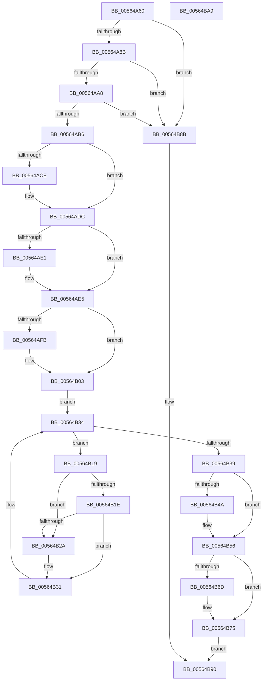

# IommuBeginDeviceReset

- RVA: `0x00564A60`–`0x00564BAA` (길이 `330` bytes)
- VA: `0x0000000140564A60`
- 실행 섹션: `.text`
- PDB 이름 있음: `예`; PDB Function 태그: `아니요`
- unwind 정보 RVA: `0x00060300`
- 디코드: `89`개 명령, `330/330` bytes 표시
- 미해석 바이트: `0` (있으면 어셈블리에 `.byte`로 보존)

> 이 문서는 커널 이미지의 기계어와 PDB 기호를 분석해 생성했습니다. 4번과 5번은 함수 원형과 자료형을 바이너리 사용 방식에서 추정한 C 해석이며 원본 소스 복구 결과는 아닙니다.

## 1. Dependencies

- 직접 호출 지점: **8**; 고유 호출 대상: **8**
- 직접 호출자로 확인된 함수: **0**
- RIP 상대 이미지 참조: **2**

### Outgoing calls
- `0x00564ABE` → [KeAbPreAcquire](../21/KeAbPreAcquire_function_00210230.md) (function, `0x00210230`)
- `0x00564AD7` → [ExfAcquirePushLockExclusiveEx](../20/ExfAcquirePushLockExclusiveEx_function_0020FC90.md) (function, `0x0020FC90`)
- `0x00564AFE` → [KiRaiseIrqlProcessIrqlFlags](../4F/KiRaiseIrqlProcessIrqlFlags_function_004F56FC.md) (function, `0x004F56FC`)
- `0x00564B0A` → [KeAcquireSpinLockAtDpcLevel](../20/KeAcquireSpinLockAtDpcLevel_function_00208430.md) (function, `0x00208430`)
- `0x00564B3C` → [KxReleaseSpinLock](../20/KxReleaseSpinLock_function_00206670.md) (function, `0x00206670`)
- `0x00564B51` → [KiLowerIrqlProcessIrqlFlags](../4F/KiLowerIrqlProcessIrqlFlags_function_004F5698.md) (function, `0x004F5698`)
- `0x00564B70` → [ExfTryToWakePushLock](../26/ExfTryToWakePushLock_function_00265DD0.md) (function, `0x00265DD0`)
- `0x00564B78` → [KeAbPostRelease](../2E/KeAbPostRelease_function_002E1600.md) (function, `0x002E1600`)

### Direct callers
- 이 함수 시작 RVA로 연결되는 직접 call은 확인되지 않았습니다. 간접 호출은 완전히 역산할 수 없습니다.

### Static image references
- `0x00564A7E` → RVA `0x00FC1710` (`.data`; read)
- `0x00564AF2` → RVA `0x00FC6D20` (`ALMOSTRO`; read)

## 2. Other-region calls and transfers

- 다른 실행 섹션으로 향하는 call: **0**
- 별도 외부 분기/꼬리 이동을 확인하지 못했습니다.

## 3. Assembly (complete function range)

```asm
00564A60  48 89 5C 24 08                  mov qword ptr [rsp + 8], rbx
00564A65  48 89 6C 24 10                  mov qword ptr [rsp + 0x10], rbp
00564A6A  48 89 74 24 18                  mov qword ptr [rsp + 0x18], rsi
00564A6F  57                              push rdi
00564A70  41 56                           push r14
00564A72  41 57                           push r15
00564A74  48 83 EC 20                     sub rsp, 0x20
00564A78  40 32 F6                        xor sil, sil
00564A7B  4C 8B FA                        mov r15, rdx
00564A7E  40 38 35 8B CC A5 00            cmp byte ptr [rip + 0xa5cc8b], sil
00564A85  0F 85 00 01 00 00               jne 0x140564b8b
00564A8B  48 8B 69 60                     mov rbp, qword ptr [rcx + 0x60]
00564A8F  48 8B 45 18                     mov rax, qword ptr [rbp + 0x18]
00564A93  48 83 B8 48 01 00 00 00         cmp qword ptr [rax + 0x148], 0
00564A9B  48 8D 98 90 01 00 00            lea rbx, [rax + 0x190]
00564AA2  0F 84 E3 00 00 00               je 0x140564b8b
00564AA8  48 83 B8 50 01 00 00 00         cmp qword ptr [rax + 0x150], 0
00564AB0  0F 84 D5 00 00 00               je 0x140564b8b
00564AB6  45 33 C0                        xor r8d, r8d
00564AB9  33 D2                           xor edx, edx
00564ABB  48 8B CB                        mov rcx, rbx
00564ABE  E8 6D B7 CA FF                  call 0x140210230
00564AC3  F0 48 0F BA 2B 00               lock bts qword ptr [rbx], 0
00564AC9  48 8B F8                        mov rdi, rax
00564ACC  73 0E                           jae 0x140564adc
00564ACE  4C 8B C3                        mov r8, rbx
00564AD1  48 8B D0                        mov rdx, rax
00564AD4  48 8B CB                        mov rcx, rbx
00564AD7  E8 B4 B1 CA FF                  call 0x14020fc90
00564ADC  48 85 FF                        test rdi, rdi
00564ADF  74 04                           je 0x140564ae5
00564AE1  C6 47 0A 01                     mov byte ptr [rdi + 0xa], 1
00564AE5  44 0F 20 C7                     mov rdi, cr8
00564AE9  BA 0F 00 00 00                  mov edx, 0xf
00564AEE  44 0F 22 C2                     mov cr8, rdx
00564AF2  83 3D 27 22 A6 00 00            cmp dword ptr [rip + 0xa62227], 0
00564AF9  74 08                           je 0x140564b03
00564AFB  40 8A CF                        mov cl, dil
00564AFE  E8 F9 0B F9 FF                  call 0x1404f56fc
00564B03  4C 8D 75 10                     lea r14, [rbp + 0x10]
00564B07  49 8B CE                        mov rcx, r14
00564B0A  E8 21 39 CA FF                  call 0x140208430
00564B0F  48 83 C5 38                     add rbp, 0x38
00564B13  48 8B 55 00                     mov rdx, qword ptr [rbp]
00564B17  EB 1B                           jmp 0x140564b34
00564B19  4D 85 FF                        test r15, r15
00564B1C  74 0C                           je 0x140564b2a
00564B1E  48 8B 4A 20                     mov rcx, qword ptr [rdx + 0x20]
00564B22  41 8B 07                        mov eax, dword ptr [r15]
00564B25  39 41 10                        cmp dword ptr [rcx + 0x10], eax
00564B28  75 07                           jne 0x140564b31
00564B2A  C6 42 28 01                     mov byte ptr [rdx + 0x28], 1
00564B2E  40 B6 01                        mov sil, 1
00564B31  48 8B 12                        mov rdx, qword ptr [rdx]
00564B34  48 3B D5                        cmp rdx, rbp
00564B37  75 E0                           jne 0x140564b19
00564B39  49 8B CE                        mov rcx, r14
00564B3C  E8 2F 1B CA FF                  call 0x140206670
00564B41  83 3D D8 21 A6 00 00            cmp dword ptr [rip + 0xa621d8], 0
00564B48  74 0C                           je 0x140564b56
00564B4A  44 0F 20 C1                     mov rcx, cr8
00564B4E  40 8A D7                        mov dl, dil
00564B51  E8 42 0B F9 FF                  call 0x1404f5698
00564B56  40 0F B6 C7                     movzx eax, dil
00564B5A  44 0F 22 C0                     mov cr8, rax
00564B5E  48 83 C8 FF                     or rax, 0xffffffffffffffff
00564B62  F0 48 0F C1 03                  lock xadd qword ptr [rbx], rax
00564B67  24 06                           and al, 6
00564B69  3C 02                           cmp al, 2
00564B6B  75 08                           jne 0x140564b75
00564B6D  48 8B CB                        mov rcx, rbx
00564B70  E8 5B 12 D0 FF                  call 0x140265dd0
00564B75  48 8B CB                        mov rcx, rbx
00564B78  E8 83 CA D7 FF                  call 0x1402e1600
00564B7D  40 F6 DE                        neg sil
00564B80  1B C0                           sbb eax, eax
00564B82  F7 D0                           not eax
00564B84  25 25 02 00 C0                  and eax, 0xc0000225
00564B89  EB 05                           jmp 0x140564b90
00564B8B  B8 BB 00 00 C0                  mov eax, 0xc00000bb
00564B90  48 8B 5C 24 40                  mov rbx, qword ptr [rsp + 0x40]
00564B95  48 8B 6C 24 48                  mov rbp, qword ptr [rsp + 0x48]
00564B9A  48 8B 74 24 50                  mov rsi, qword ptr [rsp + 0x50]
00564B9F  48 83 C4 20                     add rsp, 0x20
00564BA3  41 5F                           pop r15
00564BA5  41 5E                           pop r14
00564BA7  5F                              pop rdi
00564BA8  C3                              ret
00564BA9  CC                              int3
```

## 4. C-style interpretation (structured pseudocode)

```c
__int64 __fastcall IommuBeginDeviceReset(__int64 a1, __int64 a2, int a3)
{
    __int64 result;
    __int64 v_rbp;
    __int64 v_rsi;
    __int64 v_rsp;
    unsigned __int64 v_stack_p10;
    unsigned __int64 v_stack_p18;
    unsigned __int64 v_stack_p8;

    v_stack_p8 = v_rbx;
    v_stack_p10 = v_rbp;
    v_stack_p18 = v_rsi;
    v_rsp = (v_rsp) - (32);
    v_rsi = 0;
    if ((*(unsigned __int8 *)(v_rip + 10865803)) != 0) goto loc_00564B8B;
    if ((*(unsigned __int64 *)(*(unsigned __int64 *)(*(unsigned __int64 *)(a1 + 96) + 24) + 328)) == 0) goto loc_00564B8B;
    if ((*(unsigned __int64 *)(*(unsigned __int64 *)(*(unsigned __int64 *)(a1 + 96) + 24) + 336)) == 0) goto loc_00564B8B;
    a3 = 0;
    a2 = 0;
    result = KeAbPreAcquire(*(unsigned __int64 *)(*(unsigned __int64 *)(a1 + 96) + 24) + 400, a2, a3, a4);
    if (!(condition_is_above_or_equal)) {
        a3 = *(unsigned __int64 *)(*(unsigned __int64 *)(a1 + 96) + 24) + 400;
        a2 = result;
        a1 = *(unsigned __int64 *)(*(unsigned __int64 *)(a1 + 96) + 24) + 400;
        result = ExfAcquirePushLockExclusiveEx(a1, a2, a3, a4);
    }
    if (result != 0) {
        *(unsigned __int8 *)(result + 10) = 1;
    }
    if ((*(unsigned int *)(v_rip + 10887719)) != 0) {
        a1 = (unsigned __int8)(v_cr8);
        result = KiRaiseIrqlProcessIrqlFlags(a1, 15, a3, a4);
    }
    result = KeAcquireSpinLockAtDpcLevel(*(unsigned __int64 *)(a1 + 96) + 16, 15, a3, a4);
    v_rbp = (*(unsigned __int64 *)(a1 + 96)) + (56);
    goto loc_00564B34;
loc_00564B19:
    if (a2 == 0) goto loc_00564B2A;
    if ((*(unsigned int *)(*(unsigned __int64 *)(*(unsigned __int64 *)(v_rbp) + 32) + 16)) == ((unsigned int)((unsigned int)(*(unsigned int *)(a2))))) {
        *(unsigned __int8 *)(*(unsigned __int64 *)(v_rbp) + 40) = 1;
        v_rsi = 1;
    }
loc_00564B34:
    if ((*(unsigned __int64 *)(*(unsigned __int64 *)(v_rbp))) != v_rbp) goto loc_00564B19;
    result = KxReleaseSpinLock(*(unsigned __int64 *)(a1 + 96) + 16, *(unsigned __int64 *)(*(unsigned __int64 *)(v_rbp)), a3, a4);
    if ((*(unsigned int *)(v_rip + 10887640)) != 0) {
        a1 = 15;
        a2 = (unsigned __int8)(v_cr8);
        result = KiLowerIrqlProcessIrqlFlags(a1, a2, a3, a4);
    }
    result = ((unsigned __int8)(v_cr8)) | (-1);
    result = (unsigned __int8)((result) & (6));
    if (((unsigned __int8)(result)) == 2) {
        a1 = *(unsigned __int64 *)(*(unsigned __int64 *)(a1 + 96) + 24) + 400;
        result = ExfTryToWakePushLock(a1, a2, a3, a4);
    }
    result = KeAbPostRelease(*(unsigned __int64 *)(*(unsigned __int64 *)(a1 + 96) + 24) + 400, a2, a3, a4);
    v_rsi = (unsigned __int8)(-(v_rsi));
    result = (unsigned int)(~(result));
    result = (unsigned int)((result) & (0xC0000225ULL));
    goto loc_00564B90;
loc_00564B8B:
loc_00564B90:
    v_rsp = (v_rsp) + (32);
    return (unsigned int)(0xC00000BBULL);
}
```

## 5. (Beta) C Style

```c
int64_t IommuBeginDeviceReset(void *Arg1, int64_t Arg2, int32_t Arg3)
{
    uint8_t *arg1 = (uint8_t *)Arg1;

    int64_t result;
    int64_t local_rbp;
    int64_t local_rsi;
    int64_t local_rsp;
    uint64_t v_stack_p10;
    uint64_t v_stack_p18;
    uint64_t v_stack_p8;

    v_stack_p8 = local_rbx;
    v_stack_p10 = local_rbp;
    v_stack_p18 = local_rsi;
    local_rsp = (local_rsp) - (32);
    local_rsi = 0;
    if ((*(uint8_t *)(v_rip + 0xA5CC8B)) != 0) goto loc_00564B8B;
    if ((*(uint64_t *)(*(uint64_t *)(*(uint64_t *)(arg1 + 0x60) + 0x18) + 0x148)) == 0) goto loc_00564B8B;
    if ((*(uint64_t *)(*(uint64_t *)(*(uint64_t *)(arg1 + 0x60) + 0x18) + 0x150)) == 0) goto loc_00564B8B;
    Arg3 = 0;
    Arg2 = 0;
    result = KeAbPreAcquire(*(uint64_t *)(*(uint64_t *)(arg1 + 0x60) + 0x18) + 400, Arg2, Arg3, a4);
    if (!(condition_is_above_or_equal)) {
        Arg3 = *(uint64_t *)(*(uint64_t *)(arg1 + 0x60) + 0x18) + 400;
        Arg2 = result;
        Arg1 = *(uint64_t *)(*(uint64_t *)(arg1 + 0x60) + 0x18) + 400;
        result = ExfAcquirePushLockExclusiveEx(Arg1, Arg2, Arg3, a4);
    }
    if (result != 0) {
        *(uint8_t *)(result + 0xA) = 1;
    }
    if ((*(uint32_t *)(v_rip + 0xA62227)) != 0) {
        Arg1 = (uint8_t)(v_cr8);
        result = KiRaiseIrqlProcessIrqlFlags(Arg1, 15, Arg3, a4);
    }
    result = KeAcquireSpinLockAtDpcLevel(*(uint64_t *)(arg1 + 0x60) + 16, 15, Arg3, a4);
    local_rbp = (*(uint64_t *)(arg1 + 0x60)) + (56);
    goto loc_00564B34;
loc_00564B19:
    if (Arg2 == 0) goto loc_00564B2A;
    if ((*(uint32_t *)(*(uint64_t *)(*(uint64_t *)(local_rbp) + 0x20) + 0x10)) == ((uint32_t)((uint32_t)(*(uint32_t *)(Arg2))))) {
        *(uint8_t *)(*(uint64_t *)(local_rbp) + 0x28) = 1;
        local_rsi = 1;
    }
loc_00564B34:
    if ((*(uint64_t *)(*(uint64_t *)(local_rbp))) != local_rbp) goto loc_00564B19;
    result = KxReleaseSpinLock(*(uint64_t *)(arg1 + 0x60) + 16, *(uint64_t *)(*(uint64_t *)(local_rbp)), Arg3, a4);
    if ((*(uint32_t *)(v_rip + 0xA621D8)) != 0) {
        Arg1 = 15;
        Arg2 = (uint8_t)(v_cr8);
        result = KiLowerIrqlProcessIrqlFlags(Arg1, Arg2, Arg3, a4);
    }
    result = ((uint8_t)(v_cr8)) | (-1);
    result = (uint8_t)((result) & (6));
    if (((uint8_t)(result)) == 2) {
        Arg1 = *(uint64_t *)(*(uint64_t *)(arg1 + 0x60) + 0x18) + 400;
        result = ExfTryToWakePushLock(Arg1, Arg2, Arg3, a4);
    }
    result = KeAbPostRelease(*(uint64_t *)(*(uint64_t *)(arg1 + 0x60) + 0x18) + 400, Arg2, Arg3, a4);
    local_rsi = (uint8_t)(-(local_rsi));
    result = (uint32_t)(~(result));
    result = (uint32_t)((result) & (0xC0000225ULL));
    goto loc_00564B90;
loc_00564B8B:
loc_00564B90:
    local_rsp = (local_rsp) + (32);
    return (uint32_t)(0xC00000BBULL);
}
```

### 관측된 메모리 오프셋

구조체 형식이 확인되지 않은 접근은 인자 기준의 오프셋으로만 기록했습니다.

| 기준 인자 | 오프셋 표현 | 폭 (bit) | 접근 |
|---|---:|---:|---|
| `Arg1` | `+ 0x60` | `64` | `R` |

## 6. Execution-region graph

[열기: 2D/3D 그래프와 함수 탐색 컨트롤 패널](../../../control-panel.html?section=text&rva=0x00564A60&view=graph)

- 2D 그래프는 위에서 아래로 흐르고, 3D 그래프는 빈 공간을 드래그해 회전합니다. Shift+드래그는 이동, 휠은 확대·축소, 함수 노드 선택은 대상 보고서 이동입니다.

### Static fallback


