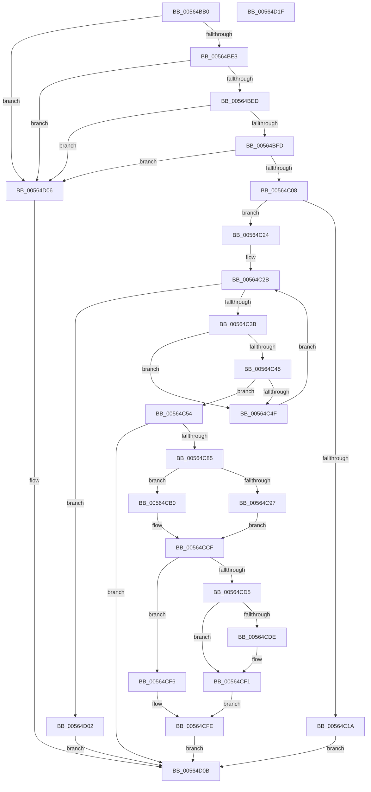

# IommuCreateAtsDevice

- RVA: `0x00564BB0`–`0x00564D20` (길이 `368` bytes)
- VA: `0x0000000140564BB0`
- 실행 섹션: `.text`
- PDB 이름 있음: `예`; PDB Function 태그: `아니요`
- unwind 정보 RVA: `0x000C4DD4`
- 디코드: `99`개 명령, `368/368` bytes 표시
- 미해석 바이트: `0` (있으면 어셈블리에 `.byte`로 보존)

> 이 문서는 커널 이미지의 기계어와 PDB 기호를 분석해 생성했습니다. 4번과 5번은 함수 원형과 자료형을 바이너리 사용 방식에서 추정한 C 해석이며 원본 소스 복구 결과는 아닙니다.

## 1. Dependencies

- 직접 호출 지점: **5**; 고유 호출 대상: **4**
- 직접 호출자로 확인된 함수: **0**
- RIP 상대 이미지 참조: **3**

### Outgoing calls
- `0x00564C0C` → [HalpIommuLocateFromDevice](../../page/70/HalpIommuLocateFromDevice_function_00708830.md) (function, `0x00708830`)
- `0x00564C78` → [HalpIommuCreateDevice](../54/HalpIommuCreateDevice_function_0054ED60.md) (function, `0x0054ED60`)
- `0x00564CA9` → [guard_dispatch_icall](../6B/guard_dispatch_icall_function_006BAAD0.md) (function, `0x006BAAD0`)
- `0x00564CCA` → [guard_dispatch_icall](../6B/guard_dispatch_icall_function_006BAAD0.md) (function, `0x006BAAD0`)
- `0x00564CF9` → [HalpIommuDeleteDevice](../54/HalpIommuDeleteDevice_function_0054F368.md) (function, `0x0054F368`)

### Direct callers
- 이 함수 시작 RVA로 연결되는 직접 call은 확인되지 않았습니다. 간접 호출은 완전히 역산할 수 없습니다.

### Static image references
- `0x00564C24` → RVA `0x00FC1900` (`.data`; read)
- `0x00564C85` → RVA `0x00FC1710` (`.data`; read)
- `0x00564CB8` → RVA `0x00FC1DC8` (`.data`; read)

## 2. Other-region calls and transfers

- 다른 실행 섹션으로 향하는 call: **1**
  - `0x00564C0C` → [HalpIommuLocateFromDevice](../../page/70/HalpIommuLocateFromDevice_function_00708830.md) (`.text` → `PAGE`)
- 별도 외부 분기/꼬리 이동을 확인하지 못했습니다.

## 3. Assembly (complete function range)

```asm
00564BB0  4C 8B DC                        mov r11, rsp
00564BB3  49 89 5B 10                     mov qword ptr [r11 + 0x10], rbx
00564BB7  49 89 73 18                     mov qword ptr [r11 + 0x18], rsi
00564BBB  57                              push rdi
00564BBC  41 54                           push r12
00564BBE  41 56                           push r14
00564BC0  48 83 EC 40                     sub rsp, 0x40
00564BC4  49 83 63 08 00                  and qword ptr [r11 + 8], 0
00564BC9  4D 8B F1                        mov r14, r9
00564BCC  49 83 63 D8 00                  and qword ptr [r11 - 0x28], 0
00564BD1  49 8B F0                        mov rsi, r8
00564BD4  83 39 01                        cmp dword ptr [rcx], 1
00564BD7  48 8B FA                        mov rdi, rdx
00564BDA  48 8B D9                        mov rbx, rcx
00564BDD  0F 85 23 01 00 00               jne 0x140564d06
00564BE3  F6 41 04 01                     test byte ptr [rcx + 4], 1
00564BE7  0F 85 19 01 00 00               jne 0x140564d06
00564BED  41 BC 03 00 00 00               mov r12d, 3
00564BF3  44 84 61 0A                     test byte ptr [rcx + 0xa], r12b
00564BF7  0F 85 09 01 00 00               jne 0x140564d06
00564BFD  41 8B 00                        mov eax, dword ptr [r8]
00564C00  A8 01                           test al, 1
00564C02  0F 84 FE 00 00 00               je 0x140564d06
00564C08  49 8D 53 D8                     lea rdx, [r11 - 0x28]
00564C0C  E8 1F 3C 1A 00                  call 0x140708830
00564C11  BA 25 02 00 C0                  mov edx, 0xc0000225
00564C16  3B C2                           cmp eax, edx
00564C18  75 0A                           jne 0x140564c24
00564C1A  B8 29 04 00 C0                  mov eax, 0xc0000429
00564C1F  E9 E7 00 00 00                  jmp 0x140564d0b
00564C24  48 8B 0D D5 CC A5 00            mov rcx, qword ptr [rip + 0xa5ccd5]
00564C2B  48 8D 05 CE CC A5 00            lea rax, [rip + 0xa5ccce]
00564C32  48 3B C8                        cmp rcx, rax
00564C35  0F 84 C7 00 00 00               je 0x140564d02
00564C3B  0F B7 43 08                     movzx eax, word ptr [rbx + 8]
00564C3F  66 39 41 18                     cmp word ptr [rcx + 0x18], ax
00564C43  75 0A                           jne 0x140564c4f
00564C45  0F B7 43 0C                     movzx eax, word ptr [rbx + 0xc]
00564C49  66 39 41 1C                     cmp word ptr [rcx + 0x1c], ax
00564C4D  74 05                           je 0x140564c54
00564C4F  48 8B 09                        mov rcx, qword ptr [rcx]
00564C52  EB D7                           jmp 0x140564c2b
00564C54  8B 06                           mov eax, dword ptr [rsi]
00564C56  41 B9 01 00 00 00               mov r9d, 1
00564C5C  83 E0 06                        and eax, 6
00564C5F  48 8B D7                        mov rdx, rdi
00564C62  3C 06                           cmp al, 6
00564C64  48 8B CB                        mov rcx, rbx
00564C67  48 8D 44 24 60                  lea rax, [rsp + 0x60]
00564C6C  45 0F 45 CC                     cmovne r9d, r12d
00564C70  48 89 44 24 20                  mov qword ptr [rsp + 0x20], rax
00564C75  45 33 C0                        xor r8d, r8d
00564C78  E8 E3 A0 FE FF                  call 0x14054ed60
00564C7D  85 C0                           test eax, eax
00564C7F  0F 88 86 00 00 00               js 0x140564d0b
00564C85  80 3D 84 CA A5 00 00            cmp byte ptr [rip + 0xa5ca84], 0
00564C8C  48 8B 5C 24 60                  mov rbx, qword ptr [rsp + 0x60]
00564C91  48 8B 4B 20                     mov rcx, qword ptr [rbx + 0x20]
00564C95  75 19                           jne 0x140564cb0
00564C97  48 8B 81 78 01 00 00            mov rax, qword ptr [rcx + 0x178]
00564C9E  41 B0 01                        mov r8b, 1
00564CA1  48 8B 49 10                     mov rcx, qword ptr [rcx + 0x10]
00564CA5  48 8B 53 28                     mov rdx, qword ptr [rbx + 0x28]
00564CA9  E8 22 5E 15 00                  call 0x1406baad0
00564CAE  EB 1F                           jmp 0x140564ccf
00564CB0  44 8B 06                        mov r8d, dword ptr [rsi]
00564CB3  BA 1A 00 00 00                  mov edx, 0x1a
00564CB8  48 8B 05 09 D1 A5 00            mov rax, qword ptr [rip + 0xa5d109]
00564CBF  41 C1 E8 07                     shr r8d, 7
00564CC3  41 81 E0 E0 03 00 00            and r8d, 0x3e0
00564CCA  E8 01 5E 15 00                  call 0x1406baad0
00564CCF  8B F8                           mov edi, eax
00564CD1  85 C0                           test eax, eax
00564CD3  78 21                           js 0x140564cf6
00564CD5  80 3D 34 CA A5 00 00            cmp byte ptr [rip + 0xa5ca34], 0
00564CDC  75 13                           jne 0x140564cf1
00564CDE  8B 06                           mov eax, dword ptr [rsi]
00564CE0  C1 E8 0C                        shr eax, 0xc
00564CE3  83 E0 1F                        and eax, 0x1f
00564CE6  89 43 3C                        mov dword ptr [rbx + 0x3c], eax
00564CE9  48 83 63 40 00                  and qword ptr [rbx + 0x40], 0
00564CEE  FF 43 38                        inc dword ptr [rbx + 0x38]
00564CF1  49 89 1E                        mov qword ptr [r14], rbx
00564CF4  EB 08                           jmp 0x140564cfe
00564CF6  48 8B CB                        mov rcx, rbx
00564CF9  E8 6A A6 FE FF                  call 0x14054f368
00564CFE  8B C7                           mov eax, edi
00564D00  EB 09                           jmp 0x140564d0b
00564D02  8B C2                           mov eax, edx
00564D04  EB 05                           jmp 0x140564d0b
00564D06  B8 BB 00 00 C0                  mov eax, 0xc00000bb
00564D0B  48 8B 5C 24 68                  mov rbx, qword ptr [rsp + 0x68]
00564D10  48 8B 74 24 70                  mov rsi, qword ptr [rsp + 0x70]
00564D15  48 83 C4 40                     add rsp, 0x40
00564D19  41 5E                           pop r14
00564D1B  41 5C                           pop r12
00564D1D  5F                              pop rdi
00564D1E  C3                              ret
00564D1F  CC                              int3
```

## 4. C-style interpretation (structured pseudocode)

```c
__int64 __fastcall IommuCreateAtsDevice(__int64 a1, __int64 a2, __int64 a3, __int64 a4)
{
    __int64 result;
    __int64 v_rsp;
    unsigned __int64 v_stack_m38;
    unsigned __int64 v_stack_p10;
    unsigned __int64 v_stack_p18;
    unsigned __int64 v_stack_p8;

    *(unsigned __int64 *)(v_rsp + 16) = v_rbx;
    *(unsigned __int64 *)(v_rsp + 24) = v_rsi;
    v_rsp = (v_rsp) - (64);
    if ((*(unsigned int *)(a1)) != 1) goto loc_00564D06;
    if (((*(unsigned __int8 *)(a1 + 4)) & (1)) != 0) goto loc_00564D06;
    if (((*(unsigned __int8 *)(a1 + 10)) & (3)) != 0) goto loc_00564D06;
    if ((((unsigned __int8)((unsigned int)(*(unsigned int *)(a3)))) & (1)) == 0) goto loc_00564D06;
    result = HalpIommuLocateFromDevice(a1, v_rsp - 40, a3, a4);
    if (((unsigned int)(result)) != ((unsigned int)((unsigned int)(0xC0000225ULL)))) goto loc_00564C24;
    goto loc_00564D0B;
loc_00564C24:
loc_00564C2B:
    if ((*(unsigned __int64 *)(v_rip + 10865877)) == (v_rip + 10865870)) goto loc_00564D02;
    if ((*(unsigned __int16 *)(*(unsigned __int64 *)(v_rip + 10865877) + 24)) != ((unsigned __int16)(*(unsigned __int16 *)(a1 + 8)))) goto loc_00564C4F;
    if ((*(unsigned __int16 *)(*(unsigned __int64 *)(v_rip + 10865877) + 28)) == ((unsigned __int16)(*(unsigned __int16 *)(a1 + 12)))) goto loc_00564C54;
loc_00564C4F:
    goto loc_00564C2B;
loc_00564C54:
    result = (unsigned int)(((unsigned int)(*(unsigned int *)(a3))) & (6));
    a4 = 1;
    if (((unsigned __int8)(result)) != 6) { a4 = 3; }
    v_stack_m38 = v_stack_p8;
    a3 = 0;
    result = HalpIommuCreateDevice(a1, a2, a3, a4);
    if (sign_flag) goto loc_00564D0B;
    if ((*(unsigned __int8 *)(v_rip + 10865284)) != 0) goto loc_00564CB0;
    result = guard_dispatch_icall(*(unsigned __int64 *)(*(unsigned __int64 *)(v_stack_p8 + 32) + 16), *(unsigned __int64 *)(v_stack_p8 + 40), 1, a4);
    goto loc_00564CCF;
loc_00564CB0:
    a3 = (unsigned int)(((unsigned int)(*(unsigned int *)(a3))) >> (7));
    a3 = (unsigned int)((a3) & (992));
    result = guard_dispatch_icall(*(unsigned __int64 *)(*(unsigned __int64 *)(v_stack_p8 + 32) + 16), 26, a3, a4);
loc_00564CCF:
    if (sign_flag) goto loc_00564CF6;
    if ((*(unsigned __int8 *)(v_rip + 10865204)) == 0) {
        result = *(unsigned int *)(a3);
        result = (unsigned int)((result) >> (12));
        result = (unsigned int)((result) & (31));
        *(unsigned int *)(v_stack_p8 + 60) = (unsigned int)(result);
    }
    *(unsigned __int64 *)(a4) = v_stack_p8;
    goto loc_00564CFE;
loc_00564CF6:
    result = HalpIommuDeleteDevice(v_stack_p8, 26, a3, a4);
loc_00564CFE:
    goto loc_00564D0B;
loc_00564D02:
    goto loc_00564D0B;
loc_00564D06:
loc_00564D0B:
    v_rsp = (v_rsp) + (64);
    return (unsigned int)(0xC00000BBULL);
}
```

## 5. (Beta) C Style

```c
int64_t IommuCreateAtsDevice(void *Arg1, int64_t Arg2, void *Arg3, void *Arg4)
{
    uint8_t *arg1 = (uint8_t *)Arg1;
    uint8_t *arg3 = (uint8_t *)Arg3;
    uint8_t *arg4 = (uint8_t *)Arg4;

    int64_t result;
    int64_t local_rsp;
    uint64_t v_stack_m38;
    uint64_t v_stack_p10;
    uint64_t v_stack_p18;
    uint64_t v_stack_p8;

    *(uint64_t *)(local_rsp + 0x10) = local_rbx;
    *(uint64_t *)(local_rsp + 0x18) = local_rsi;
    local_rsp = (local_rsp) - (64);
    if ((*(uint32_t *)(arg1)) != 1) goto loc_00564D06;
    if (((*(uint8_t *)(arg1 + 0x4)) & (1)) != 0) goto loc_00564D06;
    if (((*(uint8_t *)(arg1 + 0xA)) & (3)) != 0) goto loc_00564D06;
    if ((((uint8_t)((uint32_t)(*(uint32_t *)(arg3)))) & (1)) == 0) goto loc_00564D06;
    result = HalpIommuLocateFromDevice(Arg1, local_rsp - 40, Arg3, Arg4);
    if (((uint32_t)(result)) != ((uint32_t)((uint32_t)(0xC0000225ULL)))) goto loc_00564C24;
    goto loc_00564D0B;
loc_00564C24:
loc_00564C2B:
    if ((*(uint64_t *)(v_rip + 0xA5CCD5)) == (v_rip + 10865870)) goto loc_00564D02;
    if ((*(uint16_t *)(*(uint64_t *)(v_rip + 0xA5CCD5) + 0x18)) != ((uint16_t)(*(uint16_t *)(arg1 + 0x8)))) goto loc_00564C4F;
    if ((*(uint16_t *)(*(uint64_t *)(v_rip + 0xA5CCD5) + 0x1C)) == ((uint16_t)(*(uint16_t *)(arg1 + 0xC)))) goto loc_00564C54;
loc_00564C4F:
    goto loc_00564C2B;
loc_00564C54:
    result = (uint32_t)(((uint32_t)(*(uint32_t *)(arg3))) & (6));
    Arg4 = 1;
    if (((uint8_t)(result)) != 6) { Arg4 = 3; }
    v_stack_m38 = v_stack_p8;
    Arg3 = 0;
    result = HalpIommuCreateDevice(Arg1, Arg2, Arg3, Arg4);
    if (sign_flag) goto loc_00564D0B;
    if ((*(uint8_t *)(v_rip + 0xA5CA84)) != 0) goto loc_00564CB0;
    result = guard_dispatch_icall(*(uint64_t *)(*(uint64_t *)(v_stack_p8 + 0x20) + 0x10), *(uint64_t *)(v_stack_p8 + 0x28), 1, Arg4);
    goto loc_00564CCF;
loc_00564CB0:
    Arg3 = (uint32_t)(((uint32_t)(*(uint32_t *)(arg3))) >> (7));
    Arg3 = (uint32_t)((Arg3) & (992));
    result = guard_dispatch_icall(*(uint64_t *)(*(uint64_t *)(v_stack_p8 + 0x20) + 0x10), 26, Arg3, Arg4);
loc_00564CCF:
    if (sign_flag) goto loc_00564CF6;
    if ((*(uint8_t *)(v_rip + 0xA5CA34)) == 0) {
        result = *(uint32_t *)(arg3);
        result = (uint32_t)((result) >> (12));
        result = (uint32_t)((result) & (31));
        *(uint32_t *)(v_stack_p8 + 0x3C) = (uint32_t)(result);
    }
    *(uint64_t *)(arg4) = v_stack_p8;
    goto loc_00564CFE;
loc_00564CF6:
    result = HalpIommuDeleteDevice(v_stack_p8, 26, Arg3, Arg4);
loc_00564CFE:
    goto loc_00564D0B;
loc_00564D02:
    goto loc_00564D0B;
loc_00564D06:
loc_00564D0B:
    local_rsp = (local_rsp) + (64);
    return (uint32_t)(0xC00000BBULL);
}
```

### 관측된 메모리 오프셋

구조체 형식이 확인되지 않은 접근은 인자 기준의 오프셋으로만 기록했습니다.

| 기준 인자 | 오프셋 표현 | 폭 (bit) | 접근 |
|---|---:|---:|---|
| `Arg1` | `+ 0x0` | `32` | `R` |
| `Arg1` | `+ 0x4` | `8` | `R` |
| `Arg1` | `+ 0x8` | `16` | `R` |
| `Arg1` | `+ 0xA` | `8` | `R` |
| `Arg1` | `+ 0xC` | `16` | `R` |
| `Arg3` | `+ 0x0` | `32` | `R` |
| `Arg4` | `+ 0x0` | `64` | `W` |

## 6. Execution-region graph

[열기: 2D/3D 그래프와 함수 탐색 컨트롤 패널](../../../control-panel.html?section=text&rva=0x00564BB0&view=graph)

- 2D 그래프는 위에서 아래로 흐르고, 3D 그래프는 빈 공간을 드래그해 회전합니다. Shift+드래그는 이동, 휠은 확대·축소, 함수 노드 선택은 대상 보고서 이동입니다.

### Static fallback


