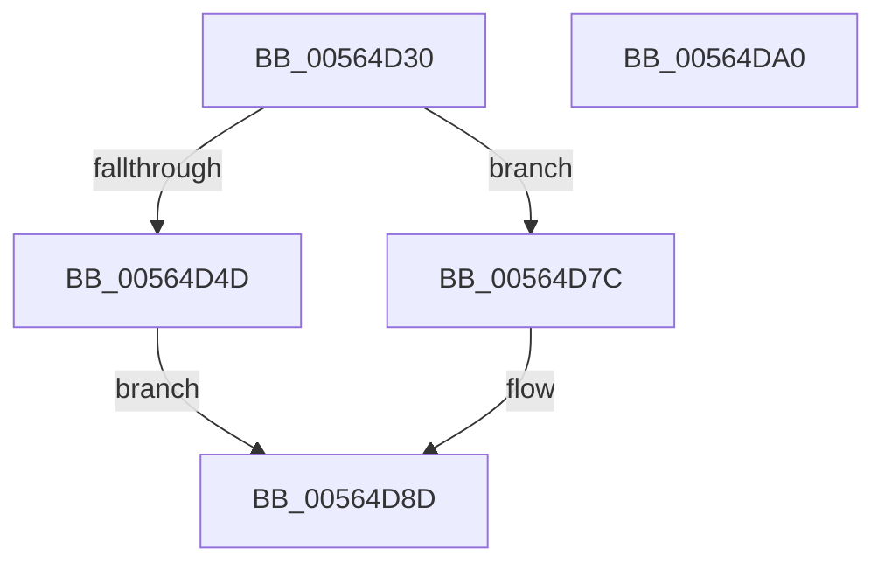

# IommuDeleteAtsDevice

- RVA: `0x00564D30`–`0x00564DA1` (길이 `113` bytes)
- VA: `0x0000000140564D30`
- 실행 섹션: `.text`
- PDB 이름 있음: `예`; PDB Function 태그: `아니요`
- unwind 정보 RVA: `0x0005CAAC`
- 디코드: `29`개 명령, `113/113` bytes 표시
- 미해석 바이트: `0` (있으면 어셈블리에 `.byte`로 보존)

> 이 문서는 커널 이미지의 기계어와 PDB 기호를 분석해 생성했습니다. 4번과 5번은 함수 원형과 자료형을 바이너리 사용 방식에서 추정한 C 해석이며 원본 소스 복구 결과는 아닙니다.

## 1. Dependencies

- 직접 호출 지점: **4**; 고유 호출 대상: **3**
- 직접 호출자로 확인된 함수: **0**
- RIP 상대 이미지 참조: **2**

### Outgoing calls
- `0x00564D5C` → [guard_dispatch_icall](../6B/guard_dispatch_icall_function_006BAAD0.md) (function, `0x006BAAD0`)
- `0x00564D6C` → [ExWaitForRundownProtectionRelease](../2A/ExWaitForRundownProtectionRelease_function_002A4CB0.md) (function, `0x002A4CB0`)
- `0x00564D88` → [guard_dispatch_icall](../6B/guard_dispatch_icall_function_006BAAD0.md) (function, `0x006BAAD0`)
- `0x00564D90` → [HalpIommuDeleteDevice](../54/HalpIommuDeleteDevice_function_0054F368.md) (function, `0x0054F368`)

### Direct callers
- 이 함수 시작 RVA로 연결되는 직접 call은 확인되지 않았습니다. 간접 호출은 완전히 역산할 수 없습니다.

### Static image references
- `0x00564D40` → RVA `0x00FC1710` (`.data`; read)
- `0x00564D7C` → RVA `0x00FC1DC8` (`.data`; read)

## 2. Other-region calls and transfers

- 다른 실행 섹션으로 향하는 call: **0**
- 별도 외부 분기/꼬리 이동을 확인하지 못했습니다.

## 3. Assembly (complete function range)

```asm
00564D30  48 89 5C 24 08                  mov qword ptr [rsp + 8], rbx
00564D35  57                              push rdi
00564D36  48 83 EC 20                     sub rsp, 0x20
00564D3A  45 33 C0                        xor r8d, r8d
00564D3D  48 8B F9                        mov rdi, rcx
00564D40  44 38 05 C9 C9 A5 00            cmp byte ptr [rip + 0xa5c9c9], r8b
00564D47  48 8B 49 20                     mov rcx, qword ptr [rcx + 0x20]
00564D4B  75 2F                           jne 0x140564d7c
00564D4D  48 8B 81 78 01 00 00            mov rax, qword ptr [rcx + 0x178]
00564D54  48 8B 49 10                     mov rcx, qword ptr [rcx + 0x10]
00564D58  48 8B 57 28                     mov rdx, qword ptr [rdi + 0x28]
00564D5C  E8 6F 5D 15 00                  call 0x1406baad0
00564D61  FF 4F 38                        dec dword ptr [rdi + 0x38]
00564D64  48 8D 4F 40                     lea rcx, [rdi + 0x40]
00564D68  83 67 3C 00                     and dword ptr [rdi + 0x3c], 0
00564D6C  E8 3F FF D3 FF                  call 0x1402a4cb0
00564D71  B8 01 00 00 00                  mov eax, 1
00564D76  48 87 47 40                     xchg qword ptr [rdi + 0x40], rax
00564D7A  EB 11                           jmp 0x140564d8d
00564D7C  48 8B 05 45 D0 A5 00            mov rax, qword ptr [rip + 0xa5d045]
00564D83  BA 11 00 00 00                  mov edx, 0x11
00564D88  E8 43 5D 15 00                  call 0x1406baad0
00564D8D  48 8B CF                        mov rcx, rdi
00564D90  E8 D3 A5 FE FF                  call 0x14054f368
00564D95  48 8B 5C 24 30                  mov rbx, qword ptr [rsp + 0x30]
00564D9A  48 83 C4 20                     add rsp, 0x20
00564D9E  5F                              pop rdi
00564D9F  C3                              ret
00564DA0  CC                              int3
```

## 4. C-style interpretation (structured pseudocode)

```c
__int64 __fastcall IommuDeleteAtsDevice(__int64 a1, __int64 a2, int a3)
{
    __int64 result;
    __int64 v_rsp;
    unsigned __int64 v_stack_p8;

    v_stack_p8 = v_rbx;
    v_rsp = (v_rsp) - (32);
    a3 = 0;
    if ((*(unsigned __int8 *)(v_rip + 10865097)) != 0) goto loc_00564D7C;
    result = guard_dispatch_icall(*(unsigned __int64 *)(*(unsigned __int64 *)(a1 + 32) + 16), *(unsigned __int64 *)(a1 + 40), a3, a4);
    result = ExWaitForRundownProtectionRelease(a1 + 64, *(unsigned __int64 *)(a1 + 40), a3, a4);
    goto loc_00564D8D;
loc_00564D7C:
    result = guard_dispatch_icall(a1 + 64, 17, a3, a4);
loc_00564D8D:
    result = HalpIommuDeleteDevice(a1, 17, a3, a4);
    v_rsp = (v_rsp) + (32);
    return result;
}
```

## 5. (Beta) C Style

```c
int64_t IommuDeleteAtsDevice(void *Arg1, int64_t Arg2, int32_t Arg3)
{
    uint8_t *arg1 = (uint8_t *)Arg1;

    int64_t result;
    int64_t local_rsp;
    uint64_t v_stack_p8;

    v_stack_p8 = local_rbx;
    local_rsp = (local_rsp) - (32);
    Arg3 = 0;
    if ((*(uint8_t *)(v_rip + 0xA5C9C9)) != 0) goto loc_00564D7C;
    result = guard_dispatch_icall(*(uint64_t *)(*(uint64_t *)(arg1 + 0x20) + 0x10), *(uint64_t *)(arg1 + 0x28), Arg3, a4);
    result = ExWaitForRundownProtectionRelease(Arg1 + 64, *(uint64_t *)(arg1 + 0x28), Arg3, a4);
    goto loc_00564D8D;
loc_00564D7C:
    result = guard_dispatch_icall(Arg1 + 64, 17, Arg3, a4);
loc_00564D8D:
    result = HalpIommuDeleteDevice(Arg1, 17, Arg3, a4);
    local_rsp = (local_rsp) + (32);
    return result;
}
```

### 관측된 메모리 오프셋

구조체 형식이 확인되지 않은 접근은 인자 기준의 오프셋으로만 기록했습니다.

| 기준 인자 | 오프셋 표현 | 폭 (bit) | 접근 |
|---|---:|---:|---|
| `Arg1` | `+ 0x20` | `64` | `R` |
| `Arg1` | `+ 0x28` | `64` | `R` |
| `Arg1` | `+ 0x38` | `32` | `R/W` |
| `Arg1` | `+ 0x3C` | `32` | `R/W` |
| `Arg1` | `+ 0x40` | `64` | `R` |
| `Arg1` | `+ 0x40` | `64` | `R/W` |

## 6. Execution-region graph

[열기: 2D/3D 그래프와 함수 탐색 컨트롤 패널](../../../control-panel.html?section=text&rva=0x00564D30&view=graph)

- 2D 그래프는 위에서 아래로 흐르고, 3D 그래프는 빈 공간을 드래그해 회전합니다. Shift+드래그는 이동, 휠은 확대·축소, 함수 노드 선택은 대상 보고서 이동입니다.

### Static fallback


