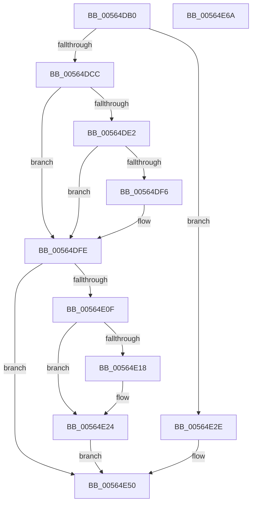

# IommuDevicePowerChange

- RVA: `0x00564DB0`–`0x00564E6B` (길이 `187` bytes)
- VA: `0x0000000140564DB0`
- 실행 섹션: `.text`
- PDB 이름 있음: `예`; PDB Function 태그: `아니요`
- unwind 정보 RVA: `0x0005C954`
- 디코드: `52`개 명령, `187/187` bytes 표시
- 미해석 바이트: `0` (있으면 어셈블리에 `.byte`로 보존)

> 이 문서는 커널 이미지의 기계어와 PDB 기호를 분석해 생성했습니다. 4번과 5번은 함수 원형과 자료형을 바이너리 사용 방식에서 추정한 C 해석이며 원본 소스 복구 결과는 아닙니다.

## 1. Dependencies

- 직접 호출 지점: **4**; 고유 호출 대상: **4**
- 직접 호출자로 확인된 함수: **0**
- RIP 상대 이미지 참조: **1**

### Outgoing calls
- `0x00564DF9` → [KiRaiseIrqlProcessIrqlFlags](../4F/KiRaiseIrqlProcessIrqlFlags_function_004F56FC.md) (function, `0x004F56FC`)
- `0x00564E05` → [ExWaitForRundownProtectionRelease](../2A/ExWaitForRundownProtectionRelease_function_002A4CB0.md) (function, `0x002A4CB0`)
- `0x00564E1F` → [KiLowerIrqlProcessIrqlFlags](../4F/KiLowerIrqlProcessIrqlFlags_function_004F5698.md) (function, `0x004F5698`)
- `0x00564E45` → [guard_dispatch_icall](../6B/guard_dispatch_icall_function_006BAAD0.md) (function, `0x006BAAD0`)

### Direct callers
- 이 함수 시작 RVA로 연결되는 직접 call은 확인되지 않았습니다. 간접 호출은 완전히 역산할 수 없습니다.

### Static image references
- `0x00564DED` → RVA `0x00FC6D20` (`ALMOSTRO`; read)

## 2. Other-region calls and transfers

- 다른 실행 섹션으로 향하는 call: **0**
- 별도 외부 분기/꼬리 이동을 확인하지 못했습니다.

## 3. Assembly (complete function range)

```asm
00564DB0  48 89 5C 24 08                  mov qword ptr [rsp + 8], rbx
00564DB5  48 89 6C 24 10                  mov qword ptr [rsp + 0x10], rbp
00564DBA  48 89 74 24 18                  mov qword ptr [rsp + 0x18], rsi
00564DBF  57                              push rdi
00564DC0  48 83 EC 20                     sub rsp, 0x20
00564DC4  48 8B DA                        mov rbx, rdx
00564DC7  45 84 C0                        test r8b, r8b
00564DCA  75 62                           jne 0x140564e2e
00564DCC  40 32 ED                        xor bpl, bpl
00564DCF  40 32 FF                        xor dil, dil
00564DD2  44 0F 20 C0                     mov rax, cr8
00564DD6  BE 01 00 00 00                  mov esi, 1
00564DDB  8D 56 01                        lea edx, [rsi + 1]
00564DDE  3A C2                           cmp al, dl
00564DE0  73 1C                           jae 0x140564dfe
00564DE2  40 8A EE                        mov bpl, sil
00564DE5  44 0F 20 C7                     mov rdi, cr8
00564DE9  44 0F 22 C2                     mov cr8, rdx
00564DED  83 3D 2C 1F A6 00 00            cmp dword ptr [rip + 0xa61f2c], 0
00564DF4  74 08                           je 0x140564dfe
00564DF6  40 8A CF                        mov cl, dil
00564DF9  E8 FE 08 F9 FF                  call 0x1404f56fc
00564DFE  48 83 C3 40                     add rbx, 0x40
00564E02  48 8B CB                        mov rcx, rbx
00564E05  E8 A6 FE D3 FF                  call 0x1402a4cb0
00564E0A  40 84 ED                        test bpl, bpl
00564E0D  74 41                           je 0x140564e50
00564E0F  83 3D 0A 1F A6 00 00            cmp dword ptr [rip + 0xa61f0a], 0
00564E16  74 0C                           je 0x140564e24
00564E18  44 0F 20 C1                     mov rcx, cr8
00564E1C  40 8A D7                        mov dl, dil
00564E1F  E8 74 08 F9 FF                  call 0x1404f5698
00564E24  40 0F B6 C7                     movzx eax, dil
00564E28  44 0F 22 C0                     mov cr8, rax
00564E2C  EB 22                           jmp 0x140564e50
00564E2E  48 8B 4A 20                     mov rcx, qword ptr [rdx + 0x20]
00564E32  44 8B 42 3C                     mov r8d, dword ptr [rdx + 0x3c]
00564E36  48 8B 52 30                     mov rdx, qword ptr [rdx + 0x30]
00564E3A  48 8B 81 00 01 00 00            mov rax, qword ptr [rcx + 0x100]
00564E41  48 8B 49 10                     mov rcx, qword ptr [rcx + 0x10]
00564E45  E8 86 5C 15 00                  call 0x1406baad0
00564E4A  48 83 C3 40                     add rbx, 0x40
00564E4E  33 F6                           xor esi, esi
00564E50  48 87 33                        xchg qword ptr [rbx], rsi
00564E53  48 8B 74 24 40                  mov rsi, qword ptr [rsp + 0x40]
00564E58  33 C0                           xor eax, eax
00564E5A  48 8B 5C 24 30                  mov rbx, qword ptr [rsp + 0x30]
00564E5F  48 8B 6C 24 38                  mov rbp, qword ptr [rsp + 0x38]
00564E64  48 83 C4 20                     add rsp, 0x20
00564E68  5F                              pop rdi
00564E69  C3                              ret
00564E6A  CC                              int3
```

## 4. C-style interpretation (structured pseudocode)

```c
__int64 __fastcall IommuDevicePowerChange(__int64 a1, __int64 a2, unsigned __int8 a3)
{
    __int64 result;
    __int64 v_rbp;
    __int64 v_rbx;
    __int64 v_rdi;
    __int64 v_rsi;
    __int64 v_rsp;
    unsigned __int64 v_stack_p10;
    unsigned __int64 v_stack_p18;
    unsigned __int64 v_stack_p8;

    v_stack_p8 = v_rbx;
    v_stack_p10 = v_rbp;
    v_stack_p18 = v_rsi;
    v_rsp = (v_rsp) - (32);
    if (a3 != 0) goto loc_00564E2E;
    v_rbp = 0;
    v_rdi = 0;
    if (((unsigned __int8)(v_cr8)) >= ((unsigned __int8)(1 + 1))) goto loc_00564DFE;
    result = v_cr8;
    if ((*(unsigned int *)(v_rip + 10886956)) != 0) {
        a1 = (unsigned __int8)(v_cr8);
        result = KiRaiseIrqlProcessIrqlFlags(a1, 1 + 1, a3, a4);
    }
    v_rbx = (a2) + (64);
    result = ExWaitForRundownProtectionRelease(v_rbx, 1 + 1, a3, a4);
    if (1 == 0) goto loc_00564E50;
    if ((*(unsigned int *)(v_rip + 10886922)) != 0) {
        a1 = 1 + 1;
        a2 = (unsigned __int8)(v_cr8);
        result = KiLowerIrqlProcessIrqlFlags(a1, a2, a3, a4);
    }
    goto loc_00564E50;
loc_00564E2E:
    result = guard_dispatch_icall(*(unsigned __int64 *)(*(unsigned __int64 *)(a2 + 32) + 16), *(unsigned __int64 *)(a2 + 48), (unsigned int)(*(unsigned int *)(a2 + 60)), a4);
    v_rbx = (v_rbx) + (64);
    v_rsi = 0;
loc_00564E50:
    result = 0;
    v_rsp = (v_rsp) + (32);
    return result;
}
```

## 5. (Beta) C Style

```c
int64_t IommuDevicePowerChange(int64_t Arg1, void *Arg2, uint8_t Arg3)
{
    uint8_t *arg2 = (uint8_t *)Arg2;

    int64_t result;
    int64_t local_rbp;
    int64_t local_rbx;
    int64_t local_rdi;
    int64_t local_rsi;
    int64_t local_rsp;
    uint64_t v_stack_p10;
    uint64_t v_stack_p18;
    uint64_t v_stack_p8;

    v_stack_p8 = local_rbx;
    v_stack_p10 = local_rbp;
    v_stack_p18 = local_rsi;
    local_rsp = (local_rsp) - (32);
    if (Arg3 != 0) goto loc_00564E2E;
    local_rbp = 0;
    local_rdi = 0;
    if (((uint8_t)(v_cr8)) >= ((uint8_t)(1 + 1))) goto loc_00564DFE;
    result = v_cr8;
    if ((*(uint32_t *)(v_rip + 0xA61F2C)) != 0) {
        Arg1 = (uint8_t)(v_cr8);
        result = KiRaiseIrqlProcessIrqlFlags(Arg1, 1 + 1, Arg3, a4);
    }
    local_rbx = (Arg2) + (64);
    result = ExWaitForRundownProtectionRelease(local_rbx, 1 + 1, Arg3, a4);
    if (1 == 0) goto loc_00564E50;
    if ((*(uint32_t *)(v_rip + 0xA61F0A)) != 0) {
        Arg1 = 1 + 1;
        Arg2 = (uint8_t)(v_cr8);
        result = KiLowerIrqlProcessIrqlFlags(Arg1, Arg2, Arg3, a4);
    }
    goto loc_00564E50;
loc_00564E2E:
    result = guard_dispatch_icall(*(uint64_t *)(*(uint64_t *)(arg2 + 0x20) + 0x10), *(uint64_t *)(arg2 + 0x30), (uint32_t)(*(uint32_t *)(arg2 + 0x3C)), a4);
    local_rbx = (local_rbx) + (64);
    local_rsi = 0;
loc_00564E50:
    result = 0;
    local_rsp = (local_rsp) + (32);
    return result;
}
```

### 관측된 메모리 오프셋

구조체 형식이 확인되지 않은 접근은 인자 기준의 오프셋으로만 기록했습니다.

| 기준 인자 | 오프셋 표현 | 폭 (bit) | 접근 |
|---|---:|---:|---|
| `Arg2` | `+ 0x0` | `64` | `R/W` |
| `Arg2` | `+ 0x20` | `64` | `R` |
| `Arg2` | `+ 0x30` | `64` | `R` |
| `Arg2` | `+ 0x3C` | `32` | `R` |

## 6. Execution-region graph

[열기: 2D/3D 그래프와 함수 탐색 컨트롤 패널](../../../control-panel.html?section=text&rva=0x00564DB0&view=graph)

- 2D 그래프는 위에서 아래로 흐르고, 3D 그래프는 빈 공간을 드래그해 회전합니다. Shift+드래그는 이동, 휠은 확대·축소, 함수 노드 선택은 대상 보고서 이동입니다.

### Static fallback


