# IommuDisableDevicePasid

- RVA: `0x00564E80`–`0x00565140` (길이 `704` bytes)
- VA: `0x0000000140564E80`
- 실행 섹션: `.text`
- PDB 이름 있음: `예`; PDB Function 태그: `아니요`
- unwind 정보 RVA: `0x000C4DB8`
- 디코드: `184`개 명령, `704/704` bytes 표시
- 미해석 바이트: `0` (있으면 어셈블리에 `.byte`로 보존)

> 이 문서는 커널 이미지의 기계어와 PDB 기호를 분석해 생성했습니다. 4번과 5번은 함수 원형과 자료형을 바이너리 사용 방식에서 추정한 C 해석이며 원본 소스 복구 결과는 아닙니다.

## 1. Dependencies

- 직접 호출 지점: **17**; 고유 호출 대상: **10**
- 직접 호출자로 확인된 함수: **4**
- RIP 상대 이미지 참조: **4**

### Outgoing calls
- `0x00564EBF` → [KeAcquireSpinLockRaiseToDpc](../20/KeAcquireSpinLockRaiseToDpc_function_00208470.md) (function, `0x00208470`)
- `0x00564EE9` → [KiRaiseIrqlProcessIrqlFlags](../4F/KiRaiseIrqlProcessIrqlFlags_function_004F56FC.md) (function, `0x004F56FC`)
- `0x00564EF3` → [KeAcquireSpinLockAtDpcLevel](../20/KeAcquireSpinLockAtDpcLevel_function_00208430.md) (function, `0x00208430`)
- `0x00564F70` → [guard_dispatch_icall](../6B/guard_dispatch_icall_function_006BAAD0.md) (function, `0x006BAAD0`)
- `0x00564F92` → [KeBugCheckEx](../4F/KeBugCheckEx_function_004FD660.md) (function, `0x004FD660`)
- `0x00564FD0` → [guard_dispatch_icall](../6B/guard_dispatch_icall_function_006BAAD0.md) (function, `0x006BAAD0`)
- `0x00565017` → [IommuHvSetAddressSpace](IommuHvSetAddressSpace_function_00566A50.md) (function, `0x00566A50`)
- `0x00565020` → [KeAcquireSpinLockAtDpcLevel](../20/KeAcquireSpinLockAtDpcLevel_function_00208430.md) (function, `0x00208430`)
- `0x00565078` → [guard_dispatch_icall](../6B/guard_dispatch_icall_function_006BAAD0.md) (function, `0x006BAAD0`)
- `0x00565081` → [KxReleaseSpinLock](../20/KxReleaseSpinLock_function_00206670.md) (function, `0x00206670`)
- `0x0056508B` → [KxReleaseSpinLock](../20/KxReleaseSpinLock_function_00206670.md) (function, `0x00206670`)
- `0x005650A9` → [KeAcquireSpinLockAtDpcLevel](../20/KeAcquireSpinLockAtDpcLevel_function_00208430.md) (function, `0x00208430`)
- `0x005650DC` → [KxReleaseSpinLock](../20/KxReleaseSpinLock_function_00206670.md) (function, `0x00206670`)
- `0x005650F0` → [KiLowerIrqlProcessIrqlFlags](../4F/KiLowerIrqlProcessIrqlFlags_function_004F5698.md) (function, `0x004F5698`)
- `0x00565100` → [HalpMmAllocCtxFree](../3E/HalpMmAllocCtxFree_function_003E1904.md) (function, `0x003E1904`)
- `0x00565113` → [KeReleaseSpinLock](../39/KeReleaseSpinLock_function_00392BA0.md) (function, `0x00392BA0`)
- `0x00565120` → [HalpMmAllocCtxFree](../3E/HalpMmAllocCtxFree_function_003E1904.md) (function, `0x003E1904`)

### Direct callers
- [IommupDomainAttachPasidDevice](../54/IommupDomainAttachPasidDevice_function_0054F984.md) at `0x0054FD17`
- [IommupDomainDetachPasidDevice](../54/IommupDomainDetachPasidDevice_function_0054FD50.md) at `0x0054FE6F`
- [IommupDeviceDisableSvm](../../page/70/IommupDeviceDisableSvm_function_00708A28.md) at `0x00708AA6`
- [IommupDeviceEnableSvm](../../page/70/IommupDeviceEnableSvm_function_00708CC4.md) at `0x00708E76`

### Static image references
- `0x00564EAC` → RVA `0x00F8FAF8` (`.data`; read)
- `0x00564EDD` → RVA `0x00FC6D20` (`ALMOSTRO`; read)
- `0x00564F4B` → RVA `0x00FC1710` (`.data`; read)
- `0x00564F66` → RVA `0x00FC1D98` (`.data`; read)

## 2. Other-region calls and transfers

- 다른 실행 섹션으로 향하는 call: **0**
- 별도 외부 분기/꼬리 이동을 확인하지 못했습니다.

## 3. Assembly (complete function range)

```asm
00564E80  48 89 54 24 10                  mov qword ptr [rsp + 0x10], rdx
00564E85  48 89 4C 24 08                  mov qword ptr [rsp + 8], rcx
00564E8A  53                              push rbx
00564E8B  55                              push rbp
00564E8C  56                              push rsi
00564E8D  57                              push rdi
00564E8E  41 54                           push r12
00564E90  41 55                           push r13
00564E92  41 56                           push r14
00564E94  41 57                           push r15
00564E96  48 83 EC 48                     sub rsp, 0x48
00564E9A  4C 8B 6A 60                     mov r13, qword ptr [rdx + 0x60]
00564E9E  48 8B EA                        mov rbp, rdx
00564EA1  83 BA 88 01 00 00 01            cmp dword ptr [rdx + 0x188], 1
00564EA8  4C 8B 61 08                     mov r12, qword ptr [rcx + 8]
00564EAC  48 8D 0D 45 AC A2 00            lea rcx, [rip + 0xa2ac45]
00564EB3  0F 94 84 24 A0 00 00 00         sete byte ptr [rsp + 0xa0]
00564EBB  4D 8B 7D 18                     mov r15, qword ptr [r13 + 0x18]
00564EBF  E8 AC 35 CA FF                  call 0x140208470
00564EC4  88 84 24 A8 00 00 00            mov byte ptr [rsp + 0xa8], al
00564ECB  45 0F 20 C6                     mov r14, cr8
00564ECF  4C 89 74 24 30                  mov qword ptr [rsp + 0x30], r14
00564ED4  BA 0F 00 00 00                  mov edx, 0xf
00564ED9  44 0F 22 C2                     mov cr8, rdx
00564EDD  83 3D 3C 1E A6 00 00            cmp dword ptr [rip + 0xa61e3c], 0
00564EE4  74 08                           je 0x140564eee
00564EE6  41 8A CE                        mov cl, r14b
00564EE9  E8 0E 08 F9 FF                  call 0x1404f56fc
00564EEE  49 8D 4C 24 18                  lea rcx, [r12 + 0x18]
00564EF3  E8 38 35 CA FF                  call 0x140208430
00564EF8  49 8D 4C 24 28                  lea rcx, [r12 + 0x28]
00564EFD  33 DB                           xor ebx, ebx
00564EFF  48 8B 01                        mov rax, qword ptr [rcx]
00564F02  EB 0C                           jmp 0x140564f10
00564F04  48 8B D8                        mov rbx, rax
00564F07  4C 39 78 10                     cmp qword ptr [rax + 0x10], r15
00564F0B  74 08                           je 0x140564f15
00564F0D  48 8B 00                        mov rax, qword ptr [rax]
00564F10  48 3B C1                        cmp rax, rcx
00564F13  75 EF                           jne 0x140564f04
00564F15  48 8D 7B 18                     lea rdi, [rbx + 0x18]
00564F19  33 F6                           xor esi, esi
00564F1B  48 8B 07                        mov rax, qword ptr [rdi]
00564F1E  EB 0C                           jmp 0x140564f2c
00564F20  48 8B F0                        mov rsi, rax
00564F23  4C 39 68 28                     cmp qword ptr [rax + 0x28], r13
00564F27  74 08                           je 0x140564f31
00564F29  48 8B 00                        mov rax, qword ptr [rax]
00564F2C  48 3B C7                        cmp rax, rdi
00564F2F  75 EF                           jne 0x140564f20
00564F31  48 8B 0E                        mov rcx, qword ptr [rsi]
00564F34  48 39 71 08                     cmp qword ptr [rcx + 8], rsi
00564F38  0F 85 FB 01 00 00               jne 0x140565139
00564F3E  48 8B 46 08                     mov rax, qword ptr [rsi + 8]
00564F42  48 39 30                        cmp qword ptr [rax], rsi
00564F45  0F 85 EE 01 00 00               jne 0x140565139
00564F4B  80 3D BE C7 A5 00 00            cmp byte ptr [rip + 0xa5c7be], 0
00564F52  48 89 08                        mov qword ptr [rax], rcx
00564F55  48 89 41 08                     mov qword ptr [rcx + 8], rax
00564F59  74 4A                           je 0x140564fa5
00564F5B  41 8B 6C 24 10                  mov ebp, dword ptr [r12 + 0x10]
00564F60  4D 8B 75 28                     mov r14, qword ptr [r13 + 0x28]
00564F64  8B D5                           mov edx, ebp
00564F66  48 8B 05 2B CE A5 00            mov rax, qword ptr [rip + 0xa5ce2b]
00564F6D  49 8B CE                        mov rcx, r14
00564F70  E8 5B 5B 15 00                  call 0x1406baad0
00564F75  3D 59 00 35 00                  cmp eax, 0x350059
00564F7A  75 1C                           jne 0x140564f98
00564F7C  48 83 64 24 20 00               and qword ptr [rsp + 0x20], 0
00564F82  44 8B CD                        mov r9d, ebp
00564F85  4D 8B C6                        mov r8, r14
00564F88  BA 01 30 00 00                  mov edx, 0x3001
00564F8D  B9 59 01 00 00                  mov ecx, 0x159
00564F92  E8 C9 86 F9 FF                  call 0x1404fd660
00564F97  CC                              int3
00564F98  48 8B AC 24 98 00 00 00         mov rbp, qword ptr [rsp + 0x98]
00564FA0  4C 8B 74 24 30                  mov r14, qword ptr [rsp + 0x30]
00564FA5  48 39 3F                        cmp qword ptr [rdi], rdi
00564FA8  75 4E                           jne 0x140564ff8
00564FAA  80 3D 5F C7 A5 00 00            cmp byte ptr [rip + 0xa5c75f], 0
00564FB1  75 22                           jne 0x140564fd5
00564FB3  49 8B 87 F0 00 00 00            mov rax, qword ptr [r15 + 0xf0]
00564FBA  45 33 C9                        xor r9d, r9d
00564FBD  48 83 64 24 20 00               and qword ptr [rsp + 0x20], 0
00564FC3  45 8B 44 24 10                  mov r8d, dword ptr [r12 + 0x10]
00564FC8  48 8B 55 28                     mov rdx, qword ptr [rbp + 0x28]
00564FCC  49 8B 4F 10                     mov rcx, qword ptr [r15 + 0x10]
00564FD0  E8 FB 5A 15 00                  call 0x1406baad0
00564FD5  48 8B 0B                        mov rcx, qword ptr [rbx]
00564FD8  48 39 59 08                     cmp qword ptr [rcx + 8], rbx
00564FDC  0F 85 57 01 00 00               jne 0x140565139
00564FE2  48 8B 43 08                     mov rax, qword ptr [rbx + 8]
00564FE6  48 39 18                        cmp qword ptr [rax], rbx
00564FE9  0F 85 4A 01 00 00               jne 0x140565139
00564FEF  48 89 08                        mov qword ptr [rax], rcx
00564FF2  48 89 41 08                     mov qword ptr [rcx + 8], rax
00564FF6  EB 02                           jmp 0x140564ffa
00564FF8  33 DB                           xor ebx, ebx
00564FFA  80 3D 0F C7 A5 00 00            cmp byte ptr [rip + 0xa5c70f], 0
00565001  74 19                           je 0x14056501c
00565003  49 8D 44 24 28                  lea rax, [r12 + 0x28]
00565008  48 39 00                        cmp qword ptr [rax], rax
0056500B  75 0F                           jne 0x14056501c
0056500D  48 8B 8C 24 90 00 00 00         mov rcx, qword ptr [rsp + 0x90]
00565015  33 D2                           xor edx, edx
00565017  E8 34 1A 00 00                  call 0x140566a50
0056501C  49 8D 4D 10                     lea rcx, [r13 + 0x10]
00565020  E8 0B 34 CA FF                  call 0x140208430
00565025  41 FF 4D 24                     dec dword ptr [r13 + 0x24]
00565029  48 8D 4E 10                     lea rcx, [rsi + 0x10]
0056502D  48 8B 11                        mov rdx, qword ptr [rcx]
00565030  48 39 4A 08                     cmp qword ptr [rdx + 8], rcx
00565034  0F 85 FF 00 00 00               jne 0x140565139
0056503A  48 8B 41 08                     mov rax, qword ptr [rcx + 8]
0056503E  48 39 08                        cmp qword ptr [rax], rcx
00565041  0F 85 F2 00 00 00               jne 0x140565139
00565047  48 89 10                        mov qword ptr [rax], rdx
0056504A  48 89 42 08                     mov qword ptr [rdx + 8], rax
0056504E  41 83 7D 24 00                  cmp dword ptr [r13 + 0x24], 0
00565053  75 28                           jne 0x14056507d
00565055  80 3D B4 C6 A5 00 00            cmp byte ptr [rip + 0xa5c6b4], 0
0056505C  75 1F                           jne 0x14056507d
0056505E  49 8B 87 E0 00 00 00            mov rax, qword ptr [r15 + 0xe0]
00565065  41 B0 01                        mov r8b, 1
00565068  44 8A 8C 24 A0 00 00 00         mov r9b, byte ptr [rsp + 0xa0]
00565070  48 8B 55 28                     mov rdx, qword ptr [rbp + 0x28]
00565074  49 8B 4F 10                     mov rcx, qword ptr [r15 + 0x10]
00565078  E8 53 5A 15 00                  call 0x1406baad0
0056507D  49 8D 4D 10                     lea rcx, [r13 + 0x10]
00565081  E8 EA 15 CA FF                  call 0x140206670
00565086  49 8D 4C 24 18                  lea rcx, [r12 + 0x18]
0056508B  E8 E0 15 CA FF                  call 0x140206670
00565090  33 ED                           xor ebp, ebp
00565092  49 8D BF 98 01 00 00            lea rdi, [r15 + 0x198]
00565099  40 38 2D 70 C6 A5 00            cmp byte ptr [rip + 0xa5c670], bpl
005650A0  74 04                           je 0x1405650a6
005650A2  49 8D 7F 20                     lea rdi, [r15 + 0x20]
005650A6  48 8B CF                        mov rcx, rdi
005650A9  E8 82 33 CA FF                  call 0x140208430
005650AE  49 8D 55 58                     lea rdx, [r13 + 0x58]
005650B2  B9 00 02 00 00                  mov ecx, 0x200
005650B7  8B 42 04                        mov eax, dword ptr [rdx + 4]
005650BA  A8 01                           test al, 1
005650BC  74 11                           je 0x1405650cf
005650BE  D1 E8                           shr eax, 1
005650C0  25 FF FF 0F 00                  and eax, 0xfffff
005650C5  41 3B 44 24 10                  cmp eax, dword ptr [r12 + 0x10]
005650CA  75 03                           jne 0x1405650cf
005650CC  48 89 2A                        mov qword ptr [rdx], rbp
005650CF  48 83 C2 08                     add rdx, 8
005650D3  48 83 E9 01                     sub rcx, 1
005650D7  75 DE                           jne 0x1405650b7
005650D9  48 8B CF                        mov rcx, rdi
005650DC  E8 8F 15 CA FF                  call 0x140206670
005650E1  39 2D 39 1C A6 00               cmp dword ptr [rip + 0xa61c39], ebp
005650E7  74 0C                           je 0x1405650f5
005650E9  44 0F 20 C1                     mov rcx, cr8
005650ED  41 8A D6                        mov dl, r14b
005650F0  E8 A3 05 F9 FF                  call 0x1404f5698
005650F5  41 0F B6 C6                     movzx eax, r14b
005650F9  44 0F 22 C0                     mov cr8, rax
005650FD  48 8B D6                        mov rdx, rsi
00565100  E8 FF C7 E7 FF                  call 0x1403e1904
00565105  8A 94 24 A8 00 00 00            mov dl, byte ptr [rsp + 0xa8]
0056510C  48 8D 0D E5 A9 A2 00            lea rcx, [rip + 0xa2a9e5]
00565113  E8 88 DA E2 FF                  call 0x140392ba0
00565118  48 85 DB                        test rbx, rbx
0056511B  74 08                           je 0x140565125
0056511D  48 8B D3                        mov rdx, rbx
00565120  E8 DF C7 E7 FF                  call 0x1403e1904
00565125  33 C0                           xor eax, eax
00565127  48 83 C4 48                     add rsp, 0x48
0056512B  41 5F                           pop r15
0056512D  41 5E                           pop r14
0056512F  41 5D                           pop r13
00565131  41 5C                           pop r12
00565133  5F                              pop rdi
00565134  5E                              pop rsi
00565135  5D                              pop rbp
00565136  5B                              pop rbx
00565137  C3                              ret
00565138  CC                              int3
00565139  B9 03 00 00 00                  mov ecx, 3
0056513E  CD 29                           int 0x29
```

## 4. C-style interpretation (structured pseudocode)

```c
__int64 __fastcall IommuDisableDevicePasid(__int64 a1, __int64 a2)
{
    __int64 result;
    __int64 v_rbp;
    __int64 v_rbx;
    __int64 v_rdi;
    __int64 v_rsi;
    __int64 v_rsp;
    unsigned __int64 v_stack_m58;
    unsigned __int64 v_stack_m68;
    unsigned __int64 v_stack_p10;
    unsigned __int8 v_stack_p18;
    unsigned __int8 v_stack_p20;
    unsigned __int64 v_stack_p8;

    v_stack_p10 = a2;
    v_stack_p8 = a1;
    v_rsp = (v_rsp) - (72);
    result = KeAcquireSpinLockRaiseToDpc(v_rip + 10660933, a2, a3, a4);
    v_stack_p20 = (unsigned __int8)(result);
    v_stack_m58 = v_cr8;
    if ((*(unsigned int *)(v_rip + 10886716)) != 0) {
        a1 = (unsigned __int8)(v_cr8);
        result = KiRaiseIrqlProcessIrqlFlags(a1, 15, a3, a4);
    }
    result = KeAcquireSpinLockAtDpcLevel(*(unsigned __int64 *)(a1 + 8) + 24, 15, a3, a4);
    v_rbx = 0;
    goto loc_00564F10;
loc_00564F04:
    if ((*(unsigned __int64 *)(*(unsigned __int64 *)(*(unsigned __int64 *)(a1 + 8) + 40) + 16)) == (*(unsigned __int64 *)(*(unsigned __int64 *)(a2 + 96) + 24))) goto loc_00564F15;
loc_00564F10:
    if ((*(unsigned __int64 *)(*(unsigned __int64 *)(*(unsigned __int64 *)(a1 + 8) + 40))) != (*(unsigned __int64 *)(a1 + 8) + 40)) goto loc_00564F04;
loc_00564F15:
    v_rsi = 0;
    goto loc_00564F2C;
loc_00564F20:
    if ((*(unsigned __int64 *)(*(unsigned __int64 *)(*(unsigned __int64 *)(*(unsigned __int64 *)(a1 + 8) + 40) + 24) + 40)) == (*(unsigned __int64 *)(a2 + 96))) goto loc_00564F31;
loc_00564F2C:
    if ((*(unsigned __int64 *)(*(unsigned __int64 *)(*(unsigned __int64 *)(*(unsigned __int64 *)(a1 + 8) + 40) + 24))) != (*(unsigned __int64 *)(*(unsigned __int64 *)(a1 + 8) + 40) + 24)) goto loc_00564F20;
loc_00564F31:
    if ((*(unsigned __int64 *)(*(unsigned __int64 *)(*(unsigned __int64 *)(*(unsigned __int64 *)(*(unsigned __int64 *)(a1 + 8) + 40) + 24)) + 8)) != (*(unsigned __int64 *)(*(unsigned __int64 *)(*(unsigned __int64 *)(a1 + 8) + 40) + 24))) goto loc_00565139;
    if ((*(unsigned __int64 *)(*(unsigned __int64 *)(*(unsigned __int64 *)(*(unsigned __int64 *)(*(unsigned __int64 *)(a1 + 8) + 40) + 24) + 8))) != (*(unsigned __int64 *)(*(unsigned __int64 *)(*(unsigned __int64 *)(a1 + 8) + 40) + 24))) goto loc_00565139;
    *(unsigned __int64 *)(*(unsigned __int64 *)(*(unsigned __int64 *)(*(unsigned __int64 *)(*(unsigned __int64 *)(a1 + 8) + 40) + 24) + 8)) = *(unsigned __int64 *)(*(unsigned __int64 *)(*(unsigned __int64 *)(*(unsigned __int64 *)(a1 + 8) + 40) + 24));
    *(unsigned __int64 *)(*(unsigned __int64 *)(*(unsigned __int64 *)(*(unsigned __int64 *)(*(unsigned __int64 *)(a1 + 8) + 40) + 24)) + 8) = *(unsigned __int64 *)(*(unsigned __int64 *)(*(unsigned __int64 *)(*(unsigned __int64 *)(a1 + 8) + 40) + 24) + 8);
    if ((*(unsigned __int8 *)(v_rip + 10864574)) == 0) goto loc_00564FA5;
    result = guard_dispatch_icall(*(unsigned __int64 *)(*(unsigned __int64 *)(a2 + 96) + 40), (unsigned int)((unsigned int)((unsigned int)(*(unsigned int *)(*(unsigned __int64 *)(a1 + 8) + 16)))), a3, a4);
    if (((unsigned int)(result)) == 0x350059ULL) {
        a4 = (unsigned int)((unsigned int)(*(unsigned int *)(*(unsigned __int64 *)(a1 + 8) + 16)));
        a3 = *(unsigned __int64 *)(*(unsigned __int64 *)(a2 + 96) + 40);
        a2 = 0x3001ULL;
        a1 = 345;
        result = KeBugCheckEx(a1, a2, a3, a4);
    }
loc_00564FA5:
    if ((*(unsigned __int64 *)(*(unsigned __int64 *)(*(unsigned __int64 *)(a1 + 8) + 40) + 24)) != (*(unsigned __int64 *)(*(unsigned __int64 *)(a1 + 8) + 40) + 24)) goto loc_00564FF8;
    if ((*(unsigned __int8 *)(v_rip + 10864479)) == 0) {
        result = *(unsigned __int64 *)(*(unsigned __int64 *)(*(unsigned __int64 *)(a2 + 96) + 24) + 240);
        a4 = 0;
        a3 = *(unsigned int *)(*(unsigned __int64 *)(a1 + 8) + 16);
        a2 = *(unsigned __int64 *)(v_stack_p10 + 40);
        a1 = *(unsigned __int64 *)(*(unsigned __int64 *)(*(unsigned __int64 *)(a2 + 96) + 24) + 16);
        result = guard_dispatch_icall(a1, a2, a3, a4);
    }
    if ((*(unsigned __int64 *)(*(unsigned __int64 *)(*(unsigned __int64 *)(*(unsigned __int64 *)(a1 + 8) + 40)) + 8)) != (*(unsigned __int64 *)(*(unsigned __int64 *)(a1 + 8) + 40))) goto loc_00565139;
    if ((*(unsigned __int64 *)(*(unsigned __int64 *)(*(unsigned __int64 *)(*(unsigned __int64 *)(a1 + 8) + 40) + 8))) != (*(unsigned __int64 *)(*(unsigned __int64 *)(a1 + 8) + 40))) goto loc_00565139;
    *(unsigned __int64 *)(*(unsigned __int64 *)(*(unsigned __int64 *)(*(unsigned __int64 *)(a1 + 8) + 40) + 8)) = *(unsigned __int64 *)(*(unsigned __int64 *)(*(unsigned __int64 *)(a1 + 8) + 40));
    *(unsigned __int64 *)(*(unsigned __int64 *)(*(unsigned __int64 *)(*(unsigned __int64 *)(a1 + 8) + 40)) + 8) = *(unsigned __int64 *)(*(unsigned __int64 *)(*(unsigned __int64 *)(a1 + 8) + 40) + 8);
    goto loc_00564FFA;
loc_00564FF8:
    v_rbx = 0;
loc_00564FFA:
    if ((*(unsigned __int8 *)(v_rip + 10864399)) == 0) goto loc_0056501C;
    result = *(unsigned __int64 *)(a1 + 8) + 40;
    if ((*(unsigned __int64 *)(*(unsigned __int64 *)(a1 + 8) + 40)) == (*(unsigned __int64 *)(a1 + 8) + 40)) {
        a1 = v_stack_p8;
        a2 = 0;
        result = IommuHvSetAddressSpace(a1, a2, a3, a4);
    }
    result = KeAcquireSpinLockAtDpcLevel(*(unsigned __int64 *)(a2 + 96) + 16, a2, a3, a4);
    if ((*(unsigned __int64 *)(*(unsigned __int64 *)(*(unsigned __int64 *)(*(unsigned __int64 *)(*(unsigned __int64 *)(a1 + 8) + 40) + 24) + 16) + 8)) != (*(unsigned __int64 *)(*(unsigned __int64 *)(*(unsigned __int64 *)(a1 + 8) + 40) + 24) + 16)) goto loc_00565139;
    if ((*(unsigned __int64 *)(*(unsigned __int64 *)(*(unsigned __int64 *)(*(unsigned __int64 *)(*(unsigned __int64 *)(a1 + 8) + 40) + 24) + 16 + 8))) != (*(unsigned __int64 *)(*(unsigned __int64 *)(*(unsigned __int64 *)(a1 + 8) + 40) + 24) + 16)) goto loc_00565139;
    *(unsigned __int64 *)(*(unsigned __int64 *)(*(unsigned __int64 *)(*(unsigned __int64 *)(*(unsigned __int64 *)(a1 + 8) + 40) + 24) + 16 + 8)) = *(unsigned __int64 *)(*(unsigned __int64 *)(*(unsigned __int64 *)(*(unsigned __int64 *)(a1 + 8) + 40) + 24) + 16);
    *(unsigned __int64 *)(*(unsigned __int64 *)(*(unsigned __int64 *)(*(unsigned __int64 *)(*(unsigned __int64 *)(a1 + 8) + 40) + 24) + 16) + 8) = *(unsigned __int64 *)(*(unsigned __int64 *)(*(unsigned __int64 *)(*(unsigned __int64 *)(a1 + 8) + 40) + 24) + 16 + 8);
    if ((*(unsigned int *)(*(unsigned __int64 *)(a2 + 96) + 36)) != 0) goto loc_0056507D;
    result = *(unsigned __int64 *)(*(unsigned __int64 *)(*(unsigned __int64 *)(*(unsigned __int64 *)(a1 + 8) + 40) + 24) + 16 + 8);
    if ((*(unsigned __int8 *)(v_rip + 10864308)) == 0) {
        result = *(unsigned __int64 *)(*(unsigned __int64 *)(*(unsigned __int64 *)(a2 + 96) + 24) + 224);
        a3 = 1;
        a4 = v_stack_p18;
        a2 = *(unsigned __int64 *)(v_stack_p10 + 40);
        a1 = *(unsigned __int64 *)(*(unsigned __int64 *)(*(unsigned __int64 *)(a2 + 96) + 24) + 16);
        result = guard_dispatch_icall(a1, a2, a3, a4);
    }
    result = KxReleaseSpinLock(*(unsigned __int64 *)(a2 + 96) + 16, a2, a3, a4);
    result = KxReleaseSpinLock(*(unsigned __int64 *)(a1 + 8) + 24, a2, a3, a4);
    v_rbp = 0;
    v_rdi = *(unsigned __int64 *)(*(unsigned __int64 *)(a2 + 96) + 24) + 408;
    if ((*(unsigned __int8 *)(v_rip + 10864240)) != 0) {
        v_rdi = *(unsigned __int64 *)(*(unsigned __int64 *)(a2 + 96) + 24) + 32;
    }
    result = KeAcquireSpinLockAtDpcLevel(v_rdi, a2, a3, a4);
loc_005650B7:
    if ((((unsigned __int8)((unsigned int)(*(unsigned int *)(*(unsigned __int64 *)(a2 + 96) + 88 + 4)))) & (1)) == 0) goto loc_005650CF;
    result = (unsigned int)(((unsigned int)(*(unsigned int *)(*(unsigned __int64 *)(a2 + 96) + 88 + 4))) >> (1));
    result = (unsigned int)((result) & (0xFFFFFULL));
    if (((unsigned int)(result)) == (*(unsigned int *)(*(unsigned __int64 *)(a1 + 8) + 16))) {
        *(unsigned __int64 *)(*(unsigned __int64 *)(a2 + 96) + 88) = 0;
    }
    a2 = (*(unsigned __int64 *)(a2 + 96) + 88) + (8);
    a1 = (512) - (1);
    if (condition_is_not_equal) goto loc_005650B7;
    result = KxReleaseSpinLock(v_rdi, a2, a3, a4);
    if ((*(unsigned int *)(v_rip + 10886201)) != 0) {
        a1 = 15;
        a2 = (unsigned __int8)(v_stack_m58);
        result = KiLowerIrqlProcessIrqlFlags(a1, a2, a3, a4);
    }
    result = HalpMmAllocCtxFree(a1, *(unsigned __int64 *)(*(unsigned __int64 *)(*(unsigned __int64 *)(a1 + 8) + 40) + 24), a3, a4);
    result = KeReleaseSpinLock(v_rip + 10660325, v_stack_p20, a3, a4);
    if (0 != 0) {
        a2 = 0;
        result = HalpMmAllocCtxFree(v_rip + 10660325, a2, a3, a4);
    }
    result = 0;
    v_rsp = (v_rsp) + (72);
    return result;
loc_00565139:
    return result;
}
```

## 5. (Beta) C Style

```c
int64_t IommuDisableDevicePasid(void *Arg1, void *Arg2)
{
    uint8_t *arg1 = (uint8_t *)Arg1;
    uint8_t *arg2 = (uint8_t *)Arg2;

    int64_t result;
    int64_t local_rbp;
    int64_t local_rbx;
    int64_t local_rdi;
    int64_t local_rsi;
    int64_t local_rsp;
    uint64_t v_stack_m58;
    uint64_t v_stack_m68;
    uint64_t v_stack_p10;
    uint8_t v_stack_p18;
    uint8_t v_stack_p20;
    uint64_t v_stack_p8;

    v_stack_p10 = Arg2;
    v_stack_p8 = Arg1;
    local_rsp = (local_rsp) - (72);
    result = KeAcquireSpinLockRaiseToDpc(v_rip + 10660933, Arg2, a3, a4);
    v_stack_p20 = (uint8_t)(result);
    v_stack_m58 = v_cr8;
    if ((*(uint32_t *)(v_rip + 0xA61E3C)) != 0) {
        Arg1 = (uint8_t)(v_cr8);
        result = KiRaiseIrqlProcessIrqlFlags(Arg1, 15, a3, a4);
    }
    result = KeAcquireSpinLockAtDpcLevel(*(uint64_t *)(arg1 + 0x8) + 24, 15, a3, a4);
    local_rbx = 0;
    goto loc_00564F10;
loc_00564F04:
    if ((*(uint64_t *)(*(uint64_t *)(*(uint64_t *)(arg1 + 0x8) + 0x28) + 0x10)) == (*(uint64_t *)(*(uint64_t *)(arg2 + 0x60) + 0x18))) goto loc_00564F15;
loc_00564F10:
    if ((*(uint64_t *)(*(uint64_t *)(*(uint64_t *)(arg1 + 0x8) + 0x28))) != (*(uint64_t *)(arg1 + 0x8) + 40)) goto loc_00564F04;
loc_00564F15:
    local_rsi = 0;
    goto loc_00564F2C;
loc_00564F20:
    if ((*(uint64_t *)(*(uint64_t *)(*(uint64_t *)(*(uint64_t *)(arg1 + 0x8) + 0x28) + 0x18) + 0x28)) == (*(uint64_t *)(arg2 + 0x60))) goto loc_00564F31;
loc_00564F2C:
    if ((*(uint64_t *)(*(uint64_t *)(*(uint64_t *)(*(uint64_t *)(arg1 + 0x8) + 0x28) + 0x18))) != (*(uint64_t *)(*(uint64_t *)(arg1 + 0x8) + 0x28) + 24)) goto loc_00564F20;
loc_00564F31:
    if ((*(uint64_t *)(*(uint64_t *)(*(uint64_t *)(*(uint64_t *)(*(uint64_t *)(arg1 + 0x8) + 0x28) + 0x18)) + 0x8)) != (*(uint64_t *)(*(uint64_t *)(*(uint64_t *)(arg1 + 0x8) + 0x28) + 0x18))) goto loc_00565139;
    if ((*(uint64_t *)(*(uint64_t *)(*(uint64_t *)(*(uint64_t *)(*(uint64_t *)(arg1 + 0x8) + 0x28) + 0x18) + 0x8))) != (*(uint64_t *)(*(uint64_t *)(*(uint64_t *)(arg1 + 0x8) + 0x28) + 0x18))) goto loc_00565139;
    *(uint64_t *)(*(uint64_t *)(*(uint64_t *)(*(uint64_t *)(*(uint64_t *)(arg1 + 0x8) + 0x28) + 0x18) + 0x8)) = *(uint64_t *)(*(uint64_t *)(*(uint64_t *)(*(uint64_t *)(arg1 + 0x8) + 0x28) + 0x18));
    *(uint64_t *)(*(uint64_t *)(*(uint64_t *)(*(uint64_t *)(*(uint64_t *)(arg1 + 0x8) + 0x28) + 0x18)) + 0x8) = *(uint64_t *)(*(uint64_t *)(*(uint64_t *)(*(uint64_t *)(arg1 + 0x8) + 0x28) + 0x18) + 0x8);
    if ((*(uint8_t *)(v_rip + 0xA5C7BE)) == 0) goto loc_00564FA5;
    result = guard_dispatch_icall(*(uint64_t *)(*(uint64_t *)(arg2 + 0x60) + 0x28), (uint32_t)((uint32_t)((uint32_t)(*(uint32_t *)(*(uint64_t *)(arg1 + 0x8) + 0x10)))), a3, a4);
    if (((uint32_t)(result)) == 0x350059ULL) {
        a4 = (uint32_t)((uint32_t)(*(uint32_t *)(*(uint64_t *)(arg1 + 0x8) + 0x10)));
        a3 = *(uint64_t *)(*(uint64_t *)(arg2 + 0x60) + 0x28);
        Arg2 = 0x3001ULL;
        Arg1 = 345;
        result = KeBugCheckEx(Arg1, Arg2, a3, a4);
    }
loc_00564FA5:
    if ((*(uint64_t *)(*(uint64_t *)(*(uint64_t *)(arg1 + 0x8) + 0x28) + 0x18)) != (*(uint64_t *)(*(uint64_t *)(arg1 + 0x8) + 0x28) + 24)) goto loc_00564FF8;
    if ((*(uint8_t *)(v_rip + 0xA5C75F)) == 0) {
        result = *(uint64_t *)(*(uint64_t *)(*(uint64_t *)(arg2 + 0x60) + 0x18) + 0xF0);
        a4 = 0;
        a3 = *(uint32_t *)(*(uint64_t *)(arg1 + 0x8) + 0x10);
        Arg2 = *(uint64_t *)(v_stack_p10 + 0x28);
        Arg1 = *(uint64_t *)(*(uint64_t *)(*(uint64_t *)(arg2 + 0x60) + 0x18) + 0x10);
        result = guard_dispatch_icall(Arg1, Arg2, a3, a4);
    }
    if ((*(uint64_t *)(*(uint64_t *)(*(uint64_t *)(*(uint64_t *)(arg1 + 0x8) + 0x28)) + 0x8)) != (*(uint64_t *)(*(uint64_t *)(arg1 + 0x8) + 0x28))) goto loc_00565139;
    if ((*(uint64_t *)(*(uint64_t *)(*(uint64_t *)(*(uint64_t *)(arg1 + 0x8) + 0x28) + 0x8))) != (*(uint64_t *)(*(uint64_t *)(arg1 + 0x8) + 0x28))) goto loc_00565139;
    *(uint64_t *)(*(uint64_t *)(*(uint64_t *)(*(uint64_t *)(arg1 + 0x8) + 0x28) + 0x8)) = *(uint64_t *)(*(uint64_t *)(*(uint64_t *)(arg1 + 0x8) + 0x28));
    *(uint64_t *)(*(uint64_t *)(*(uint64_t *)(*(uint64_t *)(arg1 + 0x8) + 0x28)) + 0x8) = *(uint64_t *)(*(uint64_t *)(*(uint64_t *)(arg1 + 0x8) + 0x28) + 0x8);
    goto loc_00564FFA;
loc_00564FF8:
    local_rbx = 0;
loc_00564FFA:
    if ((*(uint8_t *)(v_rip + 0xA5C70F)) == 0) goto loc_0056501C;
    result = *(uint64_t *)(arg1 + 0x8) + 40;
    if ((*(uint64_t *)(*(uint64_t *)(arg1 + 0x8) + 0x28)) == (*(uint64_t *)(arg1 + 0x8) + 40)) {
        Arg1 = v_stack_p8;
        Arg2 = 0;
        result = IommuHvSetAddressSpace(Arg1, Arg2, a3, a4);
    }
    result = KeAcquireSpinLockAtDpcLevel(*(uint64_t *)(arg2 + 0x60) + 16, Arg2, a3, a4);
    if ((*(uint64_t *)(*(uint64_t *)(*(uint64_t *)(*(uint64_t *)(*(uint64_t *)(arg1 + 0x8) + 0x28) + 0x18) + 0x10) + 0x8)) != (*(uint64_t *)(*(uint64_t *)(*(uint64_t *)(arg1 + 0x8) + 0x28) + 0x18) + 16)) goto loc_00565139;
    if ((*(uint64_t *)(*(uint64_t *)(*(uint64_t *)(*(uint64_t *)(*(uint64_t *)(arg1 + 0x8) + 0x28) + 0x18) + 0x10 + 0x8))) != (*(uint64_t *)(*(uint64_t *)(*(uint64_t *)(arg1 + 0x8) + 0x28) + 0x18) + 16)) goto loc_00565139;
    *(uint64_t *)(*(uint64_t *)(*(uint64_t *)(*(uint64_t *)(*(uint64_t *)(arg1 + 0x8) + 0x28) + 0x18) + 0x10 + 0x8)) = *(uint64_t *)(*(uint64_t *)(*(uint64_t *)(*(uint64_t *)(arg1 + 0x8) + 0x28) + 0x18) + 0x10);
    *(uint64_t *)(*(uint64_t *)(*(uint64_t *)(*(uint64_t *)(*(uint64_t *)(arg1 + 0x8) + 0x28) + 0x18) + 0x10) + 0x8) = *(uint64_t *)(*(uint64_t *)(*(uint64_t *)(*(uint64_t *)(arg1 + 0x8) + 0x28) + 0x18) + 0x10 + 0x8);
    if ((*(uint32_t *)(*(uint64_t *)(arg2 + 0x60) + 0x24)) != 0) goto loc_0056507D;
    result = *(uint64_t *)(*(uint64_t *)(*(uint64_t *)(*(uint64_t *)(arg1 + 0x8) + 0x28) + 0x18) + 0x10 + 0x8);
    if ((*(uint8_t *)(v_rip + 0xA5C6B4)) == 0) {
        result = *(uint64_t *)(*(uint64_t *)(*(uint64_t *)(arg2 + 0x60) + 0x18) + 0xE0);
        a3 = 1;
        a4 = v_stack_p18;
        Arg2 = *(uint64_t *)(v_stack_p10 + 0x28);
        Arg1 = *(uint64_t *)(*(uint64_t *)(*(uint64_t *)(arg2 + 0x60) + 0x18) + 0x10);
        result = guard_dispatch_icall(Arg1, Arg2, a3, a4);
    }
    result = KxReleaseSpinLock(*(uint64_t *)(arg2 + 0x60) + 16, Arg2, a3, a4);
    result = KxReleaseSpinLock(*(uint64_t *)(arg1 + 0x8) + 24, Arg2, a3, a4);
    local_rbp = 0;
    local_rdi = *(uint64_t *)(*(uint64_t *)(arg2 + 0x60) + 0x18) + 408;
    if ((*(uint8_t *)(v_rip + 0xA5C670)) != 0) {
        local_rdi = *(uint64_t *)(*(uint64_t *)(arg2 + 0x60) + 0x18) + 32;
    }
    result = KeAcquireSpinLockAtDpcLevel(local_rdi, Arg2, a3, a4);
loc_005650B7:
    if ((((uint8_t)((uint32_t)(*(uint32_t *)(*(uint64_t *)(arg2 + 0x60) + 0x58 + 0x4)))) & (1)) == 0) goto loc_005650CF;
    result = (uint32_t)(((uint32_t)(*(uint32_t *)(*(uint64_t *)(arg2 + 0x60) + 0x58 + 0x4))) >> (1));
    result = (uint32_t)((result) & (0xFFFFFULL));
    if (((uint32_t)(result)) == (*(uint32_t *)(*(uint64_t *)(arg1 + 0x8) + 0x10))) {
        *(uint64_t *)(*(uint64_t *)(arg2 + 0x60) + 0x58) = 0;
    }
    Arg2 = (*(uint64_t *)(arg2 + 0x60) + 88) + (8);
    Arg1 = (512) - (1);
    if (condition_is_not_equal) goto loc_005650B7;
    result = KxReleaseSpinLock(local_rdi, Arg2, a3, a4);
    if ((*(uint32_t *)(v_rip + 0xA61C39)) != 0) {
        Arg1 = 15;
        Arg2 = (uint8_t)(v_stack_m58);
        result = KiLowerIrqlProcessIrqlFlags(Arg1, Arg2, a3, a4);
    }
    result = HalpMmAllocCtxFree(Arg1, *(uint64_t *)(*(uint64_t *)(*(uint64_t *)(arg1 + 0x8) + 0x28) + 0x18), a3, a4);
    result = KeReleaseSpinLock(v_rip + 10660325, v_stack_p20, a3, a4);
    if (0 != 0) {
        Arg2 = 0;
        result = HalpMmAllocCtxFree(v_rip + 10660325, Arg2, a3, a4);
    }
    result = 0;
    local_rsp = (local_rsp) + (72);
    return result;
loc_00565139:
    return result;
}
```

### 관측된 메모리 오프셋

구조체 형식이 확인되지 않은 접근은 인자 기준의 오프셋으로만 기록했습니다.

| 기준 인자 | 오프셋 표현 | 폭 (bit) | 접근 |
|---|---:|---:|---|
| `Arg1` | `+ 0x8` | `64` | `R` |
| `Arg2` | `+ 0x60` | `64` | `R` |
| `Arg2` | `+ 0x188` | `32` | `R` |

## 6. Execution-region graph

[열기: 2D/3D 그래프와 함수 탐색 컨트롤 패널](../../../control-panel.html?section=text&rva=0x00564E80&view=graph)

- 2D 그래프는 위에서 아래로 흐르고, 3D 그래프는 빈 공간을 드래그해 회전합니다. Shift+드래그는 이동, 휠은 확대·축소, 함수 노드 선택은 대상 보고서 이동입니다.

### Static fallback

```mermaid
flowchart TD
  bb_00564E80[BB_00564E80]
  bb_00564EE6[BB_00564EE6]
  bb_00564EEE[BB_00564EEE]
  bb_00564F04[BB_00564F04]
  bb_00564F0D[BB_00564F0D]
  bb_00564F10[BB_00564F10]
  bb_00564F15[BB_00564F15]
  bb_00564F20[BB_00564F20]
  bb_00564F29[BB_00564F29]
  bb_00564F2C[BB_00564F2C]
  bb_00564F31[BB_00564F31]
  bb_00564F3E[BB_00564F3E]
  bb_00564F4B[BB_00564F4B]
  bb_00564F5B[BB_00564F5B]
  bb_00564F7C[BB_00564F7C]
  bb_00564F98[BB_00564F98]
  bb_00564FA5[BB_00564FA5]
  bb_00564FAA[BB_00564FAA]
  bb_00564FB3[BB_00564FB3]
  bb_00564FD5[BB_00564FD5]
  bb_00564FE2[BB_00564FE2]
  bb_00564FEF[BB_00564FEF]
  bb_00564FF8[BB_00564FF8]
  bb_00564FFA[BB_00564FFA]
  bb_00565003[BB_00565003]
  bb_0056500D[BB_0056500D]
  bb_0056501C[BB_0056501C]
  bb_0056503A[BB_0056503A]
  bb_00565047[BB_00565047]
  bb_00565055[BB_00565055]
  bb_0056505E[BB_0056505E]
  bb_0056507D[BB_0056507D]
  bb_005650A2[BB_005650A2]
  bb_005650A6[BB_005650A6]
  bb_005650B7[BB_005650B7]
  bb_005650BE[BB_005650BE]
  bb_005650CC[BB_005650CC]
  bb_005650CF[BB_005650CF]
  bb_005650D9[BB_005650D9]
  bb_005650E9[BB_005650E9]
  bb_005650F5[BB_005650F5]
  bb_0056511D[BB_0056511D]
  bb_00565125[BB_00565125]
  bb_00565138[BB_00565138]
  bb_00565139[BB_00565139]
  bb_00564E80 -->|branch| bb_00564EEE
  bb_00564E80 -->|fallthrough| bb_00564EE6
  bb_00564EE6 -->|flow| bb_00564EEE
  bb_00564EEE -->|branch| bb_00564F10
  bb_00564F04 -->|branch| bb_00564F15
  bb_00564F04 -->|fallthrough| bb_00564F0D
  bb_00564F0D -->|flow| bb_00564F10
  bb_00564F10 -->|branch| bb_00564F04
  bb_00564F10 -->|fallthrough| bb_00564F15
  bb_00564F15 -->|branch| bb_00564F2C
  bb_00564F20 -->|branch| bb_00564F31
  bb_00564F20 -->|fallthrough| bb_00564F29
  bb_00564F29 -->|flow| bb_00564F2C
  bb_00564F2C -->|branch| bb_00564F20
  bb_00564F2C -->|fallthrough| bb_00564F31
  bb_00564F31 -->|branch| bb_00565139
  bb_00564F31 -->|fallthrough| bb_00564F3E
  bb_00564F3E -->|branch| bb_00565139
  bb_00564F3E -->|fallthrough| bb_00564F4B
  bb_00564F4B -->|branch| bb_00564FA5
  bb_00564F4B -->|fallthrough| bb_00564F5B
  bb_00564F5B -->|branch| bb_00564F98
  bb_00564F5B -->|fallthrough| bb_00564F7C
  bb_00564F7C -->|flow| bb_00564F98
  bb_00564F98 -->|flow| bb_00564FA5
  bb_00564FA5 -->|branch| bb_00564FF8
  bb_00564FA5 -->|fallthrough| bb_00564FAA
  bb_00564FAA -->|branch| bb_00564FD5
  bb_00564FAA -->|fallthrough| bb_00564FB3
  bb_00564FB3 -->|flow| bb_00564FD5
  bb_00564FD5 -->|branch| bb_00565139
  bb_00564FD5 -->|fallthrough| bb_00564FE2
  bb_00564FE2 -->|branch| bb_00565139
  bb_00564FE2 -->|fallthrough| bb_00564FEF
  bb_00564FEF -->|branch| bb_00564FFA
  bb_00564FF8 -->|flow| bb_00564FFA
  bb_00564FFA -->|branch| bb_0056501C
  bb_00564FFA -->|fallthrough| bb_00565003
  bb_00565003 -->|branch| bb_0056501C
  bb_00565003 -->|fallthrough| bb_0056500D
  bb_0056500D -->|flow| bb_0056501C
  bb_0056501C -->|branch| bb_00565139
  bb_0056501C -->|fallthrough| bb_0056503A
  bb_0056503A -->|branch| bb_00565139
  bb_0056503A -->|fallthrough| bb_00565047
  bb_00565047 -->|branch| bb_0056507D
  bb_00565047 -->|fallthrough| bb_00565055
  bb_00565055 -->|branch| bb_0056507D
  bb_00565055 -->|fallthrough| bb_0056505E
  bb_0056505E -->|flow| bb_0056507D
  bb_0056507D -->|branch| bb_005650A6
  bb_0056507D -->|fallthrough| bb_005650A2
  bb_005650A2 -->|flow| bb_005650A6
  bb_005650A6 -->|flow| bb_005650B7
  bb_005650B7 -->|branch| bb_005650CF
  bb_005650B7 -->|fallthrough| bb_005650BE
  bb_005650BE -->|branch| bb_005650CF
  bb_005650BE -->|fallthrough| bb_005650CC
  bb_005650CC -->|flow| bb_005650CF
  bb_005650CF -->|branch| bb_005650B7
  bb_005650CF -->|fallthrough| bb_005650D9
  bb_005650D9 -->|branch| bb_005650F5
  bb_005650D9 -->|fallthrough| bb_005650E9
  bb_005650E9 -->|flow| bb_005650F5
  bb_005650F5 -->|branch| bb_00565125
  bb_005650F5 -->|fallthrough| bb_0056511D
  bb_0056511D -->|flow| bb_00565125
  bb_00565138 -->|flow| bb_00565139
```


