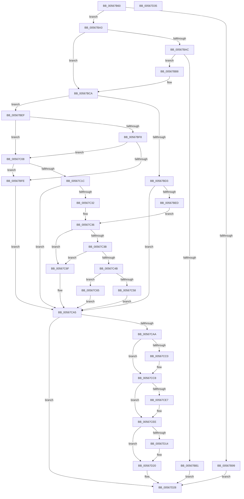

# IommuDomainAttachDeviceEx

- RVA: `0x00567B60`–`0x00567D36` (길이 `470` bytes)
- VA: `0x0000000140567B60`
- 실행 섹션: `.text`
- PDB 이름 있음: `예`; PDB Function 태그: `아니요`
- unwind 정보 RVA: `0x000BE5C8`
- 디코드: `133`개 명령, `470/470` bytes 표시
- 미해석 바이트: `0` (있으면 어셈블리에 `.byte`로 보존)

> 이 문서는 커널 이미지의 기계어와 PDB 기호를 분석해 생성했습니다. 4번과 5번은 함수 원형과 자료형을 바이너리 사용 방식에서 추정한 C 해석이며 원본 소스 복구 결과는 아닙니다.

## 1. Dependencies

- 직접 호출 지점: **13**; 고유 호출 대상: **13**
- 직접 호출자로 확인된 함수: **0**
- RIP 상대 이미지 참조: **5**

### Outgoing calls
- `0x00567B88` → [HalpIommuDeviceGetDomainTypes](../54/HalpIommuDeviceGetDomainTypes_function_0054F538.md) (function, `0x0054F538`)
- `0x00567BC0` → [IommupFindAndPopCachedDevice](IommupFindAndPopCachedDevice_function_005688DC.md) (function, `0x005688DC`)
- `0x00567BDE` → [HalpIommuJoinDmaDomain](../55/HalpIommuJoinDmaDomain_function_005554E8.md) (function, `0x005554E8`)
- `0x00567BEF` → [Feature_DmaAdapterStage1DirectAttach__private_IsEnabledDeviceUsageNoInline](../54/Feature_DmaAdapterStage1DirectAttach__private_IsEnabledDeviceUsageNoInline_function_0054EB38.md) (function, `0x0054EB38`)
- `0x00567C13` → [IommupDeviceGetPasidDevice](../54/IommupDeviceGetPasidDevice_function_0054F82C.md) (function, `0x0054F82C`)
- `0x00567C27` → [IommupDomainAttachPasidDevice](../54/IommupDomainAttachPasidDevice_function_0054F984.md) (function, `0x0054F984`)
- `0x00567C3E` → [HalpMmAllocCtxAlloc](../3E/HalpMmAllocCtxAlloc_function_003E10B8.md) (function, `0x003E10B8`)
- `0x00567C5E` → [HalpIommuLeaveDmaDomain](../4B/HalpIommuLeaveDmaDomain_function_004BF220.md) (function, `0x004BF220`)
- `0x00567C68` → [IommupDomainDetachPasidDevice](../54/IommupDomainDetachPasidDevice_function_0054FD50.md) (function, `0x0054FD50`)
- `0x00567CC3` → [KiRaiseIrqlProcessIrqlFlags](../4F/KiRaiseIrqlProcessIrqlFlags_function_004F56FC.md) (function, `0x004F56FC`)
- `0x00567CCF` → [KeAcquireSpinLockAtDpcLevel](../20/KeAcquireSpinLockAtDpcLevel_function_00208430.md) (function, `0x00208430`)
- `0x00567D06` → [KxReleaseSpinLock](../20/KxReleaseSpinLock_function_00206670.md) (function, `0x00206670`)
- `0x00567D1B` → [KiLowerIrqlProcessIrqlFlags](../4F/KiLowerIrqlProcessIrqlFlags_function_004F5698.md) (function, `0x004F5698`)

### Direct callers
- 이 함수 시작 RVA로 연결되는 직접 call은 확인되지 않았습니다. 간접 호출은 완전히 역산할 수 없습니다.

### Static image references
- `0x00567CB7` → RVA `0x00FC6D20` (`ALMOSTRO`; read)
- `0x00567CC8` → RVA `0x00F8FAC0` (`.data`; read)
- `0x00567CD4` → RVA `0x00F8FAB8` (`.data`; read)
- `0x00567CDB` → RVA `0x00F8FAB0` (`.data`; read)
- `0x00567CFF` → RVA `0x00F8FAB8` (`.data`; write)

## 2. Other-region calls and transfers

- 다른 실행 섹션으로 향하는 call: **0**
- 별도 외부 분기/꼬리 이동을 확인하지 못했습니다.

## 3. Assembly (complete function range)

```asm
00567B60  40 53                           push rbx
00567B62  55                              push rbp
00567B63  56                              push rsi
00567B64  57                              push rdi
00567B65  41 56                           push r14
00567B67  48 83 EC 20                     sub rsp, 0x20
00567B6B  48 8B E9                        mov rbp, rcx
00567B6E  C6 44 24 50 00                  mov byte ptr [rsp + 0x50], 0
00567B73  33 DB                           xor ebx, ebx
00567B75  45 33 F6                        xor r14d, r14d
00567B78  48 8B CA                        mov rcx, rdx
00567B7B  48 89 5C 24 60                  mov qword ptr [rsp + 0x60], rbx
00567B80  4C 89 74 24 68                  mov qword ptr [rsp + 0x68], r14
00567B85  48 8B F2                        mov rsi, rdx
00567B88  E8 AB 79 FE FF                  call 0x14054f538
00567B8D  44 8B C0                        mov r8d, eax
00567B90  8B 45 08                        mov eax, dword ptr [rbp + 8]
00567B93  41 0F A3 C0                     bt r8d, eax
00567B97  72 0A                           jb 0x140567ba3
00567B99  BF 22 00 00 C0                  mov edi, 0xc0000022
00567B9E  E9 85 01 00 00                  jmp 0x140567d28
00567BA3  48 8B 46 18                     mov rax, qword ptr [rsi + 0x18]
00567BA7  48 85 C0                        test rax, rax
00567BAA  74 1E                           je 0x140567bca
00567BAC  48 3B C5                        cmp rax, rbp
00567BAF  75 07                           jne 0x140567bb8
00567BB1  33 FF                           xor edi, edi
00567BB3  E9 70 01 00 00                  jmp 0x140567d28
00567BB8  48 8D 54 24 60                  lea rdx, [rsp + 0x60]
00567BBD  48 8B CE                        mov rcx, rsi
00567BC0  E8 17 0D 00 00                  call 0x1405688dc
00567BC5  48 8B 5C 24 60                  mov rbx, qword ptr [rsp + 0x60]
00567BCA  44 38 B6 12 01 00 00            cmp byte ptr [rsi + 0x112], r14b
00567BD1  75 1C                           jne 0x140567bef
00567BD3  4C 8D 44 24 50                  lea r8, [rsp + 0x50]
00567BD8  48 8B D5                        mov rdx, rbp
00567BDB  48 8B CE                        mov rcx, rsi
00567BDE  E8 05 D9 FE FF                  call 0x1405554e8
00567BE3  8B F8                           mov edi, eax
00567BE5  85 C0                           test eax, eax
00567BE7  0F 88 B8 00 00 00               js 0x140567ca5
00567BED  EB 47                           jmp 0x140567c36
00567BEF  E8 44 6F FE FF                  call 0x14054eb38
00567BF4  85 C0                           test eax, eax
00567BF6  75 10                           jne 0x140567c08
00567BF8  4C 39 76 18                     cmp qword ptr [rsi + 0x18], r14
00567BFC  74 0A                           je 0x140567c08
00567BFE  BF 01 00 00 C0                  mov edi, 0xc0000001
00567C03  E9 9D 00 00 00                  jmp 0x140567ca5
00567C08  4C 8D 4C 24 68                  lea r9, [rsp + 0x68]
00567C0D  45 33 C0                        xor r8d, r8d
00567C10  48 8B CE                        mov rcx, rsi
00567C13  E8 14 7C FE FF                  call 0x14054f82c
00567C18  84 C0                           test al, al
00567C1A  74 E2                           je 0x140567bfe
00567C1C  4C 8B 74 24 68                  mov r14, qword ptr [rsp + 0x68]
00567C21  48 8B CD                        mov rcx, rbp
00567C24  49 8B D6                        mov rdx, r14
00567C27  E8 58 7D FE FF                  call 0x14054f984
00567C2C  8B F8                           mov edi, eax
00567C2E  85 C0                           test eax, eax
00567C30  78 73                           js 0x140567ca5
00567C32  48 89 6E 18                     mov qword ptr [rsi + 0x18], rbp
00567C36  48 85 DB                        test rbx, rbx
00567C39  75 34                           jne 0x140567c6f
00567C3B  8D 53 38                        lea edx, [rbx + 0x38]
00567C3E  E8 75 94 E7 FF                  call 0x1403e10b8
00567C43  48 8B D8                        mov rbx, rax
00567C46  48 85 C0                        test rax, rax
00567C49  75 24                           jne 0x140567c6f
00567C4B  BF 9A 00 00 C0                  mov edi, 0xc000009a
00567C50  38 86 12 01 00 00               cmp byte ptr [rsi + 0x112], al
00567C56  75 0D                           jne 0x140567c65
00567C58  48 8B D5                        mov rdx, rbp
00567C5B  48 8B CE                        mov rcx, rsi
00567C5E  E8 BD 75 F5 FF                  call 0x1404bf220
00567C63  EB 40                           jmp 0x140567ca5
00567C65  49 8B CE                        mov rcx, r14
00567C68  E8 E3 80 FE FF                  call 0x14054fd50
00567C6D  EB 36                           jmp 0x140567ca5
00567C6F  33 C0                           xor eax, eax
00567C71  0F 57 C0                        xorps xmm0, xmm0
00567C74  0F 11 03                        movups xmmword ptr [rbx], xmm0
00567C77  0F 11 43 10                     movups xmmword ptr [rbx + 0x10], xmm0
00567C7B  0F 11 43 20                     movups xmmword ptr [rbx + 0x20], xmm0
00567C7F  48 89 43 30                     mov qword ptr [rbx + 0x30], rax
00567C83  48 89 73 20                     mov qword ptr [rbx + 0x20], rsi
00567C87  48 8B 46 08                     mov rax, qword ptr [rsi + 8]
00567C8B  48 89 43 10                     mov qword ptr [rbx + 0x10], rax
00567C8F  83 63 18 00                     and dword ptr [rbx + 0x18], 0
00567C93  C7 43 1C 01 00 00 00            mov dword ptr [rbx + 0x1c], 1
00567C9A  48 89 6B 28                     mov qword ptr [rbx + 0x28], rbp
00567C9E  48 8B 06                        mov rax, qword ptr [rsi]
00567CA1  48 89 43 30                     mov qword ptr [rbx + 0x30], rax
00567CA5  48 85 DB                        test rbx, rbx
00567CA8  74 7E                           je 0x140567d28
00567CAA  44 0F 20 C6                     mov rsi, cr8
00567CAE  BA 0C 00 00 00                  mov edx, 0xc
00567CB3  44 0F 22 C2                     mov cr8, rdx
00567CB7  83 3D 62 F0 A5 00 00            cmp dword ptr [rip + 0xa5f062], 0
00567CBE  74 08                           je 0x140567cc8
00567CC0  40 8A CE                        mov cl, sil
00567CC3  E8 34 DA F8 FF                  call 0x1404f56fc
00567CC8  48 8D 0D F1 7D A2 00            lea rcx, [rip + 0xa27df1]
00567CCF  E8 5C 07 CA FF                  call 0x140208430
00567CD4  48 8B 05 DD 7D A2 00            mov rax, qword ptr [rip + 0xa27ddd]
00567CDB  48 8D 0D CE 7D A2 00            lea rcx, [rip + 0xa27dce]
00567CE2  48 39 08                        cmp qword ptr [rax], rcx
00567CE5  74 07                           je 0x140567cee
00567CE7  B9 03 00 00 00                  mov ecx, 3
00567CEC  CD 29                           int 0x29
00567CEE  48 89 0B                        mov qword ptr [rbx], rcx
00567CF1  48 8D 0D C8 7D A2 00            lea rcx, [rip + 0xa27dc8]
00567CF8  48 89 43 08                     mov qword ptr [rbx + 8], rax
00567CFC  48 89 18                        mov qword ptr [rax], rbx
00567CFF  48 89 1D B2 7D A2 00            mov qword ptr [rip + 0xa27db2], rbx
00567D06  E8 65 E9 C9 FF                  call 0x140206670
00567D0B  83 3D 0E F0 A5 00 00            cmp dword ptr [rip + 0xa5f00e], 0
00567D12  74 0C                           je 0x140567d20
00567D14  44 0F 20 C1                     mov rcx, cr8
00567D18  40 8A D6                        mov dl, sil
00567D1B  E8 78 D9 F8 FF                  call 0x1404f5698
00567D20  40 0F B6 C6                     movzx eax, sil
00567D24  44 0F 22 C0                     mov cr8, rax
00567D28  8B C7                           mov eax, edi
00567D2A  48 83 C4 20                     add rsp, 0x20
00567D2E  41 5E                           pop r14
00567D30  5F                              pop rdi
00567D31  5E                              pop rsi
00567D32  5D                              pop rbp
00567D33  5B                              pop rbx
00567D34  C3                              ret
00567D35  CC                              int3
```

## 4. C-style interpretation (structured pseudocode)

```c
__int64 __fastcall IommuDomainAttachDeviceEx(__int64 a1, __int64 a2)
{
    __int64 result;
    __int64 v_r14;
    __int64 v_rbx;
    __int64 v_rdi;
    __int64 v_rsp;
    unsigned __int64 v_stack_p18;
    unsigned __int64 v_stack_p20;
    unsigned __int8 v_stack_p8;

    v_rsp = (v_rsp) - (32);
    v_stack_p8 = 0;
    v_rbx = 0;
    v_r14 = 0;
    v_stack_p18 = 0;
    v_stack_p20 = 0;
    result = HalpIommuDeviceGetDomainTypes(a2, a2, a3, a4);
    if (condition_is_below) goto loc_00567BA3;
    goto loc_00567D28;
loc_00567BA3:
    if (*(unsigned __int64 *)(a2 + 24) == 0) goto loc_00567BCA;
    if ((*(unsigned __int64 *)(a2 + 24)) != a1) goto loc_00567BB8;
    v_rdi = 0;
    goto loc_00567D28;
loc_00567BB8:
    result = IommupFindAndPopCachedDevice(a2, v_stack_p18, (unsigned int)((unsigned int)(result)), a4);
loc_00567BCA:
    if ((*(unsigned __int8 *)(a2 + 274)) != 0) goto loc_00567BEF;
    result = HalpIommuJoinDmaDomain(a2, a1, v_stack_p8, a4);
    if (sign_flag) goto loc_00567CA5;
    goto loc_00567C36;
loc_00567BEF:
    result = Feature_DmaAdapterStage1DirectAttach__private_IsEnabledDeviceUsageNoInline(a2, a1, v_stack_p8, a4);
    if ((unsigned int)(result) != 0) goto loc_00567C08;
    if ((*(unsigned __int64 *)(a2 + 24)) == 0) goto loc_00567C08;
loc_00567BFE:
    goto loc_00567CA5;
loc_00567C08:
    a3 = 0;
    result = IommupDeviceGetPasidDevice(a2, a1, a3, v_stack_p20);
    if ((unsigned __int8)(result) == 0) goto loc_00567BFE;
    result = IommupDomainAttachPasidDevice(a1, v_stack_p20, a3, v_stack_p20);
    if (sign_flag) goto loc_00567CA5;
    *(unsigned __int64 *)(a2 + 24) = a1;
loc_00567C36:
    if (v_stack_p18 != 0) goto loc_00567C6F;
    result = HalpMmAllocCtxAlloc(a1, v_stack_p18 + 56, a3, v_stack_p20);
    if (result != 0) goto loc_00567C6F;
    if ((*(unsigned __int8 *)(a2 + 274)) != ((unsigned __int8)(result))) goto loc_00567C65;
    result = HalpIommuLeaveDmaDomain(a2, a1, a3, v_stack_p20);
    goto loc_00567CA5;
loc_00567C65:
    result = IommupDomainDetachPasidDevice(v_stack_p20, a1, a3, v_stack_p20);
    goto loc_00567CA5;
loc_00567C6F:
    result = 0;
    *(unsigned __int64 *)(result) = v_xmm0;
    *(unsigned __int64 *)(result + 16) = v_xmm0;
    *(unsigned __int64 *)(result + 32) = v_xmm0;
    *(unsigned __int64 *)(result + 48) = 0;
    *(unsigned __int64 *)(result + 32) = a2;
    *(unsigned __int64 *)(result + 16) = *(unsigned __int64 *)(a2 + 8);
    *(unsigned int *)(result + 28) = 1;
    *(unsigned __int64 *)(result + 40) = a1;
    *(unsigned __int64 *)(result + 48) = *(unsigned __int64 *)(a2);
loc_00567CA5:
    if (0 == 0) goto loc_00567D28;
    result = *(unsigned __int64 *)(a2);
    if ((*(unsigned int *)(v_rip + 10874978)) != 0) {
        a1 = (unsigned __int8)(v_cr8);
        result = KiRaiseIrqlProcessIrqlFlags(a1, 12, a3, v_stack_p20);
    }
    result = KeAcquireSpinLockAtDpcLevel(v_rip + 10649073, 12, a3, v_stack_p20);
    if ((*(unsigned __int64 *)(*(unsigned __int64 *)(v_rip + 10649053))) != (v_rip + 10649038)) {
        a1 = 3;
    }
    *(unsigned __int64 *)(result) = a1;
    *(unsigned __int64 *)(result + 8) = *(unsigned __int64 *)(v_rip + 10649053);
    *(unsigned __int64 *)(*(unsigned __int64 *)(v_rip + 10649053)) = result;
    *(unsigned __int64 *)(v_rip + 10649010) = result;
    result = KxReleaseSpinLock(v_rip + 10649032, 12, a3, v_stack_p20);
    if ((*(unsigned int *)(v_rip + 10874894)) != 0) {
        a1 = 12;
        a2 = (unsigned __int8)(v_cr8);
        result = KiLowerIrqlProcessIrqlFlags(a1, a2, a3, v_stack_p20);
    }
loc_00567D28:
    v_rsp = (v_rsp) + (32);
    return (unsigned int)((unsigned int)((unsigned int)(0xC000009AULL)));
}
```

## 5. (Beta) C Style

```c
int64_t IommuDomainAttachDeviceEx(void *Arg1, void *Arg2)
{
    uint8_t *arg1 = (uint8_t *)Arg1;
    uint8_t *arg2 = (uint8_t *)Arg2;

    int64_t result;
    int64_t local_r14;
    int64_t local_rbx;
    int64_t local_rdi;
    int64_t local_rsp;
    uint64_t v_stack_p18;
    uint64_t v_stack_p20;
    uint8_t v_stack_p8;

    local_rsp = (local_rsp) - (32);
    v_stack_p8 = 0;
    local_rbx = 0;
    local_r14 = 0;
    v_stack_p18 = 0;
    v_stack_p20 = 0;
    result = HalpIommuDeviceGetDomainTypes(Arg2, Arg2, a3, a4);
    if (condition_is_below) goto loc_00567BA3;
    goto loc_00567D28;
loc_00567BA3:
    if (*(uint64_t *)(arg2 + 0x18) == 0) goto loc_00567BCA;
    if ((*(uint64_t *)(arg2 + 0x18)) != Arg1) goto loc_00567BB8;
    local_rdi = 0;
    goto loc_00567D28;
loc_00567BB8:
    result = IommupFindAndPopCachedDevice(Arg2, v_stack_p18, (uint32_t)((uint32_t)(result)), a4);
loc_00567BCA:
    if ((*(uint8_t *)(arg2 + 0x112)) != 0) goto loc_00567BEF;
    result = HalpIommuJoinDmaDomain(Arg2, Arg1, v_stack_p8, a4);
    if (sign_flag) goto loc_00567CA5;
    goto loc_00567C36;
loc_00567BEF:
    result = Feature_DmaAdapterStage1DirectAttach__private_IsEnabledDeviceUsageNoInline(Arg2, Arg1, v_stack_p8, a4);
    if ((uint32_t)(result) != 0) goto loc_00567C08;
    if ((*(uint64_t *)(arg2 + 0x18)) == 0) goto loc_00567C08;
loc_00567BFE:
    goto loc_00567CA5;
loc_00567C08:
    a3 = 0;
    result = IommupDeviceGetPasidDevice(Arg2, Arg1, a3, v_stack_p20);
    if ((uint8_t)(result) == 0) goto loc_00567BFE;
    result = IommupDomainAttachPasidDevice(Arg1, v_stack_p20, a3, v_stack_p20);
    if (sign_flag) goto loc_00567CA5;
    *(void **)(arg2 + 0x18) = Arg1;
loc_00567C36:
    if (v_stack_p18 != 0) goto loc_00567C6F;
    result = HalpMmAllocCtxAlloc(Arg1, v_stack_p18 + 56, a3, v_stack_p20);
    if (result != 0) goto loc_00567C6F;
    if ((*(uint8_t *)(arg2 + 0x112)) != ((uint8_t)(result))) goto loc_00567C65;
    result = HalpIommuLeaveDmaDomain(Arg2, Arg1, a3, v_stack_p20);
    goto loc_00567CA5;
loc_00567C65:
    result = IommupDomainDetachPasidDevice(v_stack_p20, Arg1, a3, v_stack_p20);
    goto loc_00567CA5;
loc_00567C6F:
    result = 0;
    *(uint64_t *)(result) = v_xmm0;
    *(uint64_t *)(result + 0x10) = v_xmm0;
    *(uint64_t *)(result + 0x20) = v_xmm0;
    *(uint64_t *)(result + 0x30) = 0;
    *(void **)(result + 0x20) = Arg2;
    *(uint64_t *)(result + 0x10) = *(uint64_t *)(arg2 + 0x8);
    *(uint32_t *)(result + 0x1C) = 1;
    *(void **)(result + 0x28) = Arg1;
    *(uint64_t *)(result + 0x30) = *(uint64_t *)(arg2);
loc_00567CA5:
    if (0 == 0) goto loc_00567D28;
    result = *(uint64_t *)(arg2);
    if ((*(uint32_t *)(v_rip + 0xA5F062)) != 0) {
        Arg1 = (uint8_t)(v_cr8);
        result = KiRaiseIrqlProcessIrqlFlags(Arg1, 12, a3, v_stack_p20);
    }
    result = KeAcquireSpinLockAtDpcLevel(v_rip + 10649073, 12, a3, v_stack_p20);
    if ((*(uint64_t *)(*(uint64_t *)(v_rip + 0xA27DDD))) != (v_rip + 10649038)) {
        Arg1 = 3;
    }
    *(void **)(result) = Arg1;
    *(uint64_t *)(result + 0x8) = *(uint64_t *)(v_rip + 0xA27DDD);
    *(uint64_t *)(*(uint64_t *)(v_rip + 0xA27DDD)) = result;
    *(uint64_t *)(v_rip + 0xA27DB2) = result;
    result = KxReleaseSpinLock(v_rip + 10649032, 12, a3, v_stack_p20);
    if ((*(uint32_t *)(v_rip + 0xA5F00E)) != 0) {
        Arg1 = 12;
        Arg2 = (uint8_t)(v_cr8);
        result = KiLowerIrqlProcessIrqlFlags(Arg1, Arg2, a3, v_stack_p20);
    }
loc_00567D28:
    local_rsp = (local_rsp) + (32);
    return (uint32_t)((uint32_t)((uint32_t)(0xC000009AULL)));
}
```

### 관측된 메모리 오프셋

구조체 형식이 확인되지 않은 접근은 인자 기준의 오프셋으로만 기록했습니다.

| 기준 인자 | 오프셋 표현 | 폭 (bit) | 접근 |
|---|---:|---:|---|
| `Arg1` | `+ 0x8` | `32` | `R` |
| `Arg2` | `+ 0x0` | `64` | `R` |
| `Arg2` | `+ 0x8` | `64` | `R` |
| `Arg2` | `+ 0x18` | `64` | `R` |
| `Arg2` | `+ 0x18` | `64` | `W` |
| `Arg2` | `+ 0x112` | `8` | `R` |

## 6. Execution-region graph

[열기: 2D/3D 그래프와 함수 탐색 컨트롤 패널](../../../control-panel.html?section=text&rva=0x00567B60&view=graph)

- 2D 그래프는 위에서 아래로 흐르고, 3D 그래프는 빈 공간을 드래그해 회전합니다. Shift+드래그는 이동, 휠은 확대·축소, 함수 노드 선택은 대상 보고서 이동입니다.

### Static fallback


