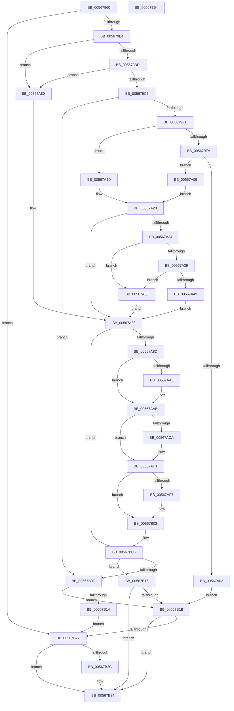

# IommuDomainAttachDevice

- RVA: `0x00567960`–`0x00567B55` (길이 `501` bytes)
- VA: `0x0000000140567960`
- 실행 섹션: `.text`
- PDB 이름 있음: `예`; PDB Function 태그: `아니요`
- unwind 정보 RVA: `0x000C3AF8`
- 디코드: `144`개 명령, `501/501` bytes 표시
- 미해석 바이트: `0` (있으면 어셈블리에 `.byte`로 보존)

> 이 문서는 커널 이미지의 기계어와 PDB 기호를 분석해 생성했습니다. 4번과 5번은 함수 원형과 자료형을 바이너리 사용 방식에서 추정한 C 해석이며 원본 소스 복구 결과는 아닙니다.

## 1. Dependencies

- 직접 호출 지점: **11**; 고유 호출 대상: **11**
- 직접 호출자로 확인된 함수: **0**
- RIP 상대 이미지 참조: **5**

### Outgoing calls
- `0x005679A0` → [HalpIommuGetDeviceId](../55/HalpIommuGetDeviceId_function_005536C0.md) (function, `0x005536C0`)
- `0x005679DD` → [HalpIommuCreateDevice](../54/HalpIommuCreateDevice_function_0054ED60.md) (function, `0x0054ED60`)
- `0x00567A11` → [IommupFindAndPopCachedDevice](IommupFindAndPopCachedDevice_function_005688DC.md) (function, `0x005688DC`)
- `0x00567A29` → [HalpIommuJoinDmaDomain](../55/HalpIommuJoinDmaDomain_function_005554E8.md) (function, `0x005554E8`)
- `0x00567A3C` → [HalpMmAllocCtxAlloc](../3E/HalpMmAllocCtxAlloc_function_003E10B8.md) (function, `0x003E10B8`)
- `0x00567AA6` → [KiRaiseIrqlProcessIrqlFlags](../4F/KiRaiseIrqlProcessIrqlFlags_function_004F56FC.md) (function, `0x004F56FC`)
- `0x00567AB2` → [KeAcquireSpinLockAtDpcLevel](../20/KeAcquireSpinLockAtDpcLevel_function_00208430.md) (function, `0x00208430`)
- `0x00567AE9` → [KxReleaseSpinLock](../20/KxReleaseSpinLock_function_00206670.md) (function, `0x00206670`)
- `0x00567AFE` → [KiLowerIrqlProcessIrqlFlags](../4F/KiLowerIrqlProcessIrqlFlags_function_004F5698.md) (function, `0x004F5698`)
- `0x00567B1E` → [HalpIommuDeleteDevice](../54/HalpIommuDeleteDevice_function_0054F368.md) (function, `0x0054F368`)
- `0x00567B2F` → [HalpMmAllocCtxFree](../3E/HalpMmAllocCtxFree_function_003E1904.md) (function, `0x003E1904`)

### Direct callers
- 이 함수 시작 RVA로 연결되는 직접 call은 확인되지 않았습니다. 간접 호출은 완전히 역산할 수 없습니다.

### Static image references
- `0x00567A9A` → RVA `0x00FC6D20` (`ALMOSTRO`; read)
- `0x00567AAB` → RVA `0x00F8FAC0` (`.data`; read)
- `0x00567AB7` → RVA `0x00F8FAB8` (`.data`; read)
- `0x00567ABE` → RVA `0x00F8FAB0` (`.data`; read)
- `0x00567AE2` → RVA `0x00F8FAB8` (`.data`; write)

## 2. Other-region calls and transfers

- 다른 실행 섹션으로 향하는 call: **0**
- 별도 외부 분기/꼬리 이동을 확인하지 못했습니다.

## 3. Assembly (complete function range)

```asm
00567960  48 8B C4                        mov rax, rsp
00567963  48 89 58 08                     mov qword ptr [rax + 8], rbx
00567967  48 89 68 10                     mov qword ptr [rax + 0x10], rbp
0056796B  48 89 70 18                     mov qword ptr [rax + 0x18], rsi
0056796F  57                              push rdi
00567970  41 54                           push r12
00567972  41 55                           push r13
00567974  41 56                           push r14
00567976  41 57                           push r15
00567978  48 83 EC 50                     sub rsp, 0x50
0056797C  48 83 60 C8 00                  and qword ptr [rax - 0x38], 0
00567981  4C 8B EA                        mov r13, rdx
00567984  48 8B E9                        mov rbp, rcx
00567987  48 8D 50 C8                     lea rdx, [rax - 0x38]
0056798B  33 F6                           xor esi, esi
0056798D  33 DB                           xor ebx, ebx
0056798F  49 8B CD                        mov rcx, r13
00567992  48 89 70 C0                     mov qword ptr [rax - 0x40], rsi
00567996  45 8B E1                        mov r12d, r9d
00567999  48 89 58 D0                     mov qword ptr [rax - 0x30], rbx
0056799D  45 8B F8                        mov r15d, r8d
005679A0  E8 1B BD FE FF                  call 0x1405536c0
005679A5  4C 8B 74 24 40                  mov r14, qword ptr [rsp + 0x40]
005679AA  8B F8                           mov edi, eax
005679AC  85 C0                           test eax, eax
005679AE  0F 88 73 01 00 00               js 0x140567b27
005679B4  45 85 FF                        test r15d, r15d
005679B7  0F 85 C3 00 00 00               jne 0x140567a80
005679BD  41 83 FC 01                     cmp r12d, 1
005679C1  0F 85 B9 00 00 00               jne 0x140567a80
005679C7  48 8D 44 24 38                  lea rax, [rsp + 0x38]
005679CC  45 33 C9                        xor r9d, r9d
005679CF  45 33 C0                        xor r8d, r8d
005679D2  48 89 44 24 20                  mov qword ptr [rsp + 0x20], rax
005679D7  49 8B D5                        mov rdx, r13
005679DA  49 8B CE                        mov rcx, r14
005679DD  E8 7E 73 FE FF                  call 0x14054ed60
005679E2  48 8B 74 24 38                  mov rsi, qword ptr [rsp + 0x38]
005679E7  8B F8                           mov edi, eax
005679E9  85 C0                           test eax, eax
005679EB  0F 88 1E 01 00 00               js 0x140567b0f
005679F1  48 8B 46 18                     mov rax, qword ptr [rsi + 0x18]
005679F5  48 85 C0                        test rax, rax
005679F8  74 23                           je 0x140567a1d
005679FA  45 8A FC                        mov r15b, r12b
005679FD  48 3B C5                        cmp rax, rbp
00567A00  75 07                           jne 0x140567a09
00567A02  33 FF                           xor edi, edi
00567A04  E9 12 01 00 00                  jmp 0x140567b1b
00567A09  48 8D 54 24 48                  lea rdx, [rsp + 0x48]
00567A0E  48 8B CE                        mov rcx, rsi
00567A11  E8 C6 0E 00 00                  call 0x1405688dc
00567A16  48 8B 5C 24 48                  mov rbx, qword ptr [rsp + 0x48]
00567A1B  EB 03                           jmp 0x140567a20
00567A1D  44 8A FB                        mov r15b, bl
00567A20  45 33 C0                        xor r8d, r8d
00567A23  48 8B D5                        mov rdx, rbp
00567A26  48 8B CE                        mov rcx, rsi
00567A29  E8 BA DA FE FF                  call 0x1405554e8
00567A2E  8B F8                           mov edi, eax
00567A30  85 C0                           test eax, eax
00567A32  78 54                           js 0x140567a88
00567A34  48 85 DB                        test rbx, rbx
00567A37  75 17                           jne 0x140567a50
00567A39  8D 53 38                        lea edx, [rbx + 0x38]
00567A3C  E8 77 96 E7 FF                  call 0x1403e10b8
00567A41  48 8B D8                        mov rbx, rax
00567A44  48 85 C0                        test rax, rax
00567A47  75 07                           jne 0x140567a50
00567A49  BF 9A 00 00 C0                  mov edi, 0xc000009a
00567A4E  EB 38                           jmp 0x140567a88
00567A50  0F 57 C0                        xorps xmm0, xmm0
00567A53  33 C0                           xor eax, eax
00567A55  0F 11 03                        movups xmmword ptr [rbx], xmm0
00567A58  0F 11 43 10                     movups xmmword ptr [rbx + 0x10], xmm0
00567A5C  0F 11 43 20                     movups xmmword ptr [rbx + 0x20], xmm0
00567A60  48 89 43 30                     mov qword ptr [rbx + 0x30], rax
00567A64  48 89 73 20                     mov qword ptr [rbx + 0x20], rsi
00567A68  4C 89 6B 10                     mov qword ptr [rbx + 0x10], r13
00567A6C  21 43 18                        and dword ptr [rbx + 0x18], eax
00567A6F  C7 43 1C 01 00 00 00            mov dword ptr [rbx + 0x1c], 1
00567A76  48 89 6B 28                     mov qword ptr [rbx + 0x28], rbp
00567A7A  4C 89 73 30                     mov qword ptr [rbx + 0x30], r14
00567A7E  EB 08                           jmp 0x140567a88
00567A80  BF F1 00 00 C0                  mov edi, 0xc00000f1
00567A85  44 8A FB                        mov r15b, bl
00567A88  48 85 DB                        test rbx, rbx
00567A8B  74 7E                           je 0x140567b0b
00567A8D  44 0F 20 C5                     mov rbp, cr8
00567A91  BA 0C 00 00 00                  mov edx, 0xc
00567A96  44 0F 22 C2                     mov cr8, rdx
00567A9A  83 3D 7F F2 A5 00 00            cmp dword ptr [rip + 0xa5f27f], 0
00567AA1  74 08                           je 0x140567aab
00567AA3  40 8A CD                        mov cl, bpl
00567AA6  E8 51 DC F8 FF                  call 0x1404f56fc
00567AAB  48 8D 0D 0E 80 A2 00            lea rcx, [rip + 0xa2800e]
00567AB2  E8 79 09 CA FF                  call 0x140208430
00567AB7  48 8B 05 FA 7F A2 00            mov rax, qword ptr [rip + 0xa27ffa]
00567ABE  48 8D 0D EB 7F A2 00            lea rcx, [rip + 0xa27feb]
00567AC5  48 39 08                        cmp qword ptr [rax], rcx
00567AC8  74 07                           je 0x140567ad1
00567ACA  B9 03 00 00 00                  mov ecx, 3
00567ACF  CD 29                           int 0x29
00567AD1  48 89 0B                        mov qword ptr [rbx], rcx
00567AD4  48 8D 0D E5 7F A2 00            lea rcx, [rip + 0xa27fe5]
00567ADB  48 89 43 08                     mov qword ptr [rbx + 8], rax
00567ADF  48 89 18                        mov qword ptr [rax], rbx
00567AE2  48 89 1D CF 7F A2 00            mov qword ptr [rip + 0xa27fcf], rbx
00567AE9  E8 82 EB C9 FF                  call 0x140206670
00567AEE  83 3D 2B F2 A5 00 00            cmp dword ptr [rip + 0xa5f22b], 0
00567AF5  74 0C                           je 0x140567b03
00567AF7  44 0F 20 C1                     mov rcx, cr8
00567AFB  40 8A D5                        mov dl, bpl
00567AFE  E8 95 DB F8 FF                  call 0x1404f5698
00567B03  40 0F B6 C5                     movzx eax, bpl
00567B07  44 0F 22 C0                     mov cr8, rax
00567B0B  85 FF                           test edi, edi
00567B0D  79 07                           jns 0x140567b16
00567B0F  48 85 F6                        test rsi, rsi
00567B12  75 07                           jne 0x140567b1b
00567B14  EB 11                           jmp 0x140567b27
00567B16  45 84 FF                        test r15b, r15b
00567B19  74 19                           je 0x140567b34
00567B1B  48 8B CE                        mov rcx, rsi
00567B1E  E8 45 78 FE FF                  call 0x14054f368
00567B23  85 FF                           test edi, edi
00567B25  79 0D                           jns 0x140567b34
00567B27  4D 85 F6                        test r14, r14
00567B2A  74 08                           je 0x140567b34
00567B2C  49 8B D6                        mov rdx, r14
00567B2F  E8 D0 9D E7 FF                  call 0x1403e1904
00567B34  4C 8D 5C 24 50                  lea r11, [rsp + 0x50]
00567B39  8B C7                           mov eax, edi
00567B3B  49 8B 5B 30                     mov rbx, qword ptr [r11 + 0x30]
00567B3F  49 8B 6B 38                     mov rbp, qword ptr [r11 + 0x38]
00567B43  49 8B 73 40                     mov rsi, qword ptr [r11 + 0x40]
00567B47  49 8B E3                        mov rsp, r11
00567B4A  41 5F                           pop r15
00567B4C  41 5E                           pop r14
00567B4E  41 5D                           pop r13
00567B50  41 5C                           pop r12
00567B52  5F                              pop rdi
00567B53  C3                              ret
00567B54  CC                              int3
```

## 4. C-style interpretation (structured pseudocode)

```c
__int64 __fastcall IommuDomainAttachDevice(__int64 a1, __int64 a2, int a3, int a4)
{
    __int64 result;
    __int64 v_rbx;
    __int64 v_rdi;
    __int64 v_rsi;
    __int64 v_rsp;
    unsigned __int64 v_stack_m28;
    unsigned __int64 v_stack_m30;
    unsigned __int64 v_stack_m38;
    unsigned __int64 v_stack_m40;
    unsigned __int64 v_stack_m58;

    *(unsigned __int64 *)(v_rsp + 8) = v_rbx;
    *(unsigned __int64 *)(v_rsp + 16) = v_rbp;
    *(unsigned __int64 *)(v_rsp + 24) = v_rsi;
    v_rsp = (v_rsp) - (80);
    v_rsi = 0;
    v_rbx = 0;
    *(unsigned __int64 *)(v_rsp - 64) = 0;
    *(unsigned __int64 *)(v_rsp - 48) = 0;
    result = HalpIommuGetDeviceId(a2, v_rsp - 56, a3, a4);
    if (sign_flag) goto loc_00567B27;
    if ((unsigned int)((unsigned int)(a3)) != 0) goto loc_00567A80;
    if (((unsigned int)((unsigned int)(a4))) != 1) goto loc_00567A80;
    a4 = 0;
    a3 = 0;
    v_stack_m58 = v_stack_m40;
    result = HalpIommuCreateDevice(v_stack_m38, a2, a3, a4);
    if (sign_flag) goto loc_00567B0F;
    if (*(unsigned __int64 *)(v_stack_m40 + 24) == 0) goto loc_00567A1D;
    if ((*(unsigned __int64 *)(v_stack_m40 + 24)) != a1) goto loc_00567A09;
    v_rdi = 0;
    goto loc_00567B1B;
loc_00567A09:
    result = IommupFindAndPopCachedDevice(v_stack_m40, v_stack_m30, a3, a4);
    goto loc_00567A20;
loc_00567A1D:
loc_00567A20:
    a3 = 0;
    result = HalpIommuJoinDmaDomain(v_stack_m40, a1, a3, a4);
    if (sign_flag) goto loc_00567A88;
    if (v_stack_m30 != 0) goto loc_00567A50;
    result = HalpMmAllocCtxAlloc(v_stack_m40, v_stack_m30 + 56, a3, a4);
    if (result != 0) goto loc_00567A50;
    goto loc_00567A88;
loc_00567A50:
    result = 0;
    *(unsigned __int64 *)(result) = v_xmm0;
    *(unsigned __int64 *)(result + 16) = v_xmm0;
    *(unsigned __int64 *)(result + 32) = v_xmm0;
    *(unsigned __int64 *)(result + 48) = 0;
    *(unsigned __int64 *)(result + 32) = v_stack_m40;
    *(unsigned __int64 *)(result + 16) = a2;
    *(unsigned int *)(result + 28) = 1;
    *(unsigned __int64 *)(result + 40) = a1;
    *(unsigned __int64 *)(result + 48) = v_stack_m38;
    goto loc_00567A88;
loc_00567A80:
loc_00567A88:
    if (0 == 0) goto loc_00567B0B;
    if ((*(unsigned int *)(v_rip + 10875519)) != 0) {
        a1 = (unsigned __int8)(v_cr8);
        result = KiRaiseIrqlProcessIrqlFlags(a1, 12, a3, a4);
    }
    result = KeAcquireSpinLockAtDpcLevel(v_rip + 10649614, 12, a3, a4);
    if ((*(unsigned __int64 *)(*(unsigned __int64 *)(v_rip + 10649594))) != (v_rip + 10649579)) {
        a1 = 3;
    }
    *(unsigned __int64 *)(result) = a1;
    *(unsigned __int64 *)(result + 8) = *(unsigned __int64 *)(v_rip + 10649594);
    *(unsigned __int64 *)(*(unsigned __int64 *)(v_rip + 10649594)) = result;
    *(unsigned __int64 *)(v_rip + 10649551) = result;
    result = KxReleaseSpinLock(v_rip + 10649573, 12, a3, a4);
    if ((*(unsigned int *)(v_rip + 10875435)) != 0) {
        a1 = 12;
        a2 = (unsigned __int8)(v_cr8);
        result = KiLowerIrqlProcessIrqlFlags(a1, a2, a3, a4);
    }
loc_00567B0B:
    if (!sign_flag) goto loc_00567B16;
loc_00567B0F:
    if (v_stack_m40 != 0) goto loc_00567B1B;
    goto loc_00567B27;
loc_00567B16:
    if (0 == 0) goto loc_00567B34;
loc_00567B1B:
    result = HalpIommuDeleteDevice(v_stack_m40, a2, a3, a4);
    if (!sign_flag) goto loc_00567B34;
loc_00567B27:
    if (v_stack_m38 != 0) {
        a2 = v_stack_m38;
        result = HalpMmAllocCtxFree(v_stack_m40, a2, a3, a4);
    }
    return (unsigned int)((unsigned int)((unsigned int)(0xC00000F1ULL)));
}
```

## 5. (Beta) C Style

```c
int64_t IommuDomainAttachDevice(int64_t Arg1, int64_t Arg2, int32_t Arg3, int32_t Arg4)
{
    int64_t result;
    int64_t local_rbx;
    int64_t local_rdi;
    int64_t local_rsi;
    int64_t local_rsp;
    uint64_t v_stack_m28;
    uint64_t v_stack_m30;
    uint64_t v_stack_m38;
    uint64_t v_stack_m40;
    uint64_t v_stack_m58;

    *(uint64_t *)(local_rsp + 0x8) = local_rbx;
    *(uint64_t *)(local_rsp + 0x10) = local_rbp;
    *(uint64_t *)(local_rsp + 0x18) = local_rsi;
    local_rsp = (local_rsp) - (80);
    local_rsi = 0;
    local_rbx = 0;
    *(uint64_t *)(local_rsp - 0x40) = 0;
    *(uint64_t *)(local_rsp - 0x30) = 0;
    result = HalpIommuGetDeviceId(Arg2, local_rsp - 56, Arg3, Arg4);
    if (sign_flag) goto loc_00567B27;
    if ((uint32_t)((uint32_t)(Arg3)) != 0) goto loc_00567A80;
    if (((uint32_t)((uint32_t)(Arg4))) != 1) goto loc_00567A80;
    Arg4 = 0;
    Arg3 = 0;
    v_stack_m58 = v_stack_m40;
    result = HalpIommuCreateDevice(v_stack_m38, Arg2, Arg3, Arg4);
    if (sign_flag) goto loc_00567B0F;
    if (*(uint64_t *)(v_stack_m40 + 0x18) == 0) goto loc_00567A1D;
    if ((*(uint64_t *)(v_stack_m40 + 0x18)) != Arg1) goto loc_00567A09;
    local_rdi = 0;
    goto loc_00567B1B;
loc_00567A09:
    result = IommupFindAndPopCachedDevice(v_stack_m40, v_stack_m30, Arg3, Arg4);
    goto loc_00567A20;
loc_00567A1D:
loc_00567A20:
    Arg3 = 0;
    result = HalpIommuJoinDmaDomain(v_stack_m40, Arg1, Arg3, Arg4);
    if (sign_flag) goto loc_00567A88;
    if (v_stack_m30 != 0) goto loc_00567A50;
    result = HalpMmAllocCtxAlloc(v_stack_m40, v_stack_m30 + 56, Arg3, Arg4);
    if (result != 0) goto loc_00567A50;
    goto loc_00567A88;
loc_00567A50:
    result = 0;
    *(uint64_t *)(result) = v_xmm0;
    *(uint64_t *)(result + 0x10) = v_xmm0;
    *(uint64_t *)(result + 0x20) = v_xmm0;
    *(uint64_t *)(result + 0x30) = 0;
    *(uint64_t *)(result + 0x20) = v_stack_m40;
    *(uint64_t *)(result + 0x10) = Arg2;
    *(uint32_t *)(result + 0x1C) = 1;
    *(uint64_t *)(result + 0x28) = Arg1;
    *(uint64_t *)(result + 0x30) = v_stack_m38;
    goto loc_00567A88;
loc_00567A80:
loc_00567A88:
    if (0 == 0) goto loc_00567B0B;
    if ((*(uint32_t *)(v_rip + 0xA5F27F)) != 0) {
        Arg1 = (uint8_t)(v_cr8);
        result = KiRaiseIrqlProcessIrqlFlags(Arg1, 12, Arg3, Arg4);
    }
    result = KeAcquireSpinLockAtDpcLevel(v_rip + 10649614, 12, Arg3, Arg4);
    if ((*(uint64_t *)(*(uint64_t *)(v_rip + 0xA27FFA))) != (v_rip + 10649579)) {
        Arg1 = 3;
    }
    *(uint64_t *)(result) = Arg1;
    *(uint64_t *)(result + 0x8) = *(uint64_t *)(v_rip + 0xA27FFA);
    *(uint64_t *)(*(uint64_t *)(v_rip + 0xA27FFA)) = result;
    *(uint64_t *)(v_rip + 0xA27FCF) = result;
    result = KxReleaseSpinLock(v_rip + 10649573, 12, Arg3, Arg4);
    if ((*(uint32_t *)(v_rip + 0xA5F22B)) != 0) {
        Arg1 = 12;
        Arg2 = (uint8_t)(v_cr8);
        result = KiLowerIrqlProcessIrqlFlags(Arg1, Arg2, Arg3, Arg4);
    }
loc_00567B0B:
    if (!sign_flag) goto loc_00567B16;
loc_00567B0F:
    if (v_stack_m40 != 0) goto loc_00567B1B;
    goto loc_00567B27;
loc_00567B16:
    if (0 == 0) goto loc_00567B34;
loc_00567B1B:
    result = HalpIommuDeleteDevice(v_stack_m40, Arg2, Arg3, Arg4);
    if (!sign_flag) goto loc_00567B34;
loc_00567B27:
    if (v_stack_m38 != 0) {
        Arg2 = v_stack_m38;
        result = HalpMmAllocCtxFree(v_stack_m40, Arg2, Arg3, Arg4);
    }
    return (uint32_t)((uint32_t)((uint32_t)(0xC00000F1ULL)));
}
```

## 6. Execution-region graph

[열기: 2D/3D 그래프와 함수 탐색 컨트롤 패널](../../../control-panel.html?section=text&rva=0x00567960&view=graph)

- 2D 그래프는 위에서 아래로 흐르고, 3D 그래프는 빈 공간을 드래그해 회전합니다. Shift+드래그는 이동, 휠은 확대·축소, 함수 노드 선택은 대상 보고서 이동입니다.

### Static fallback


