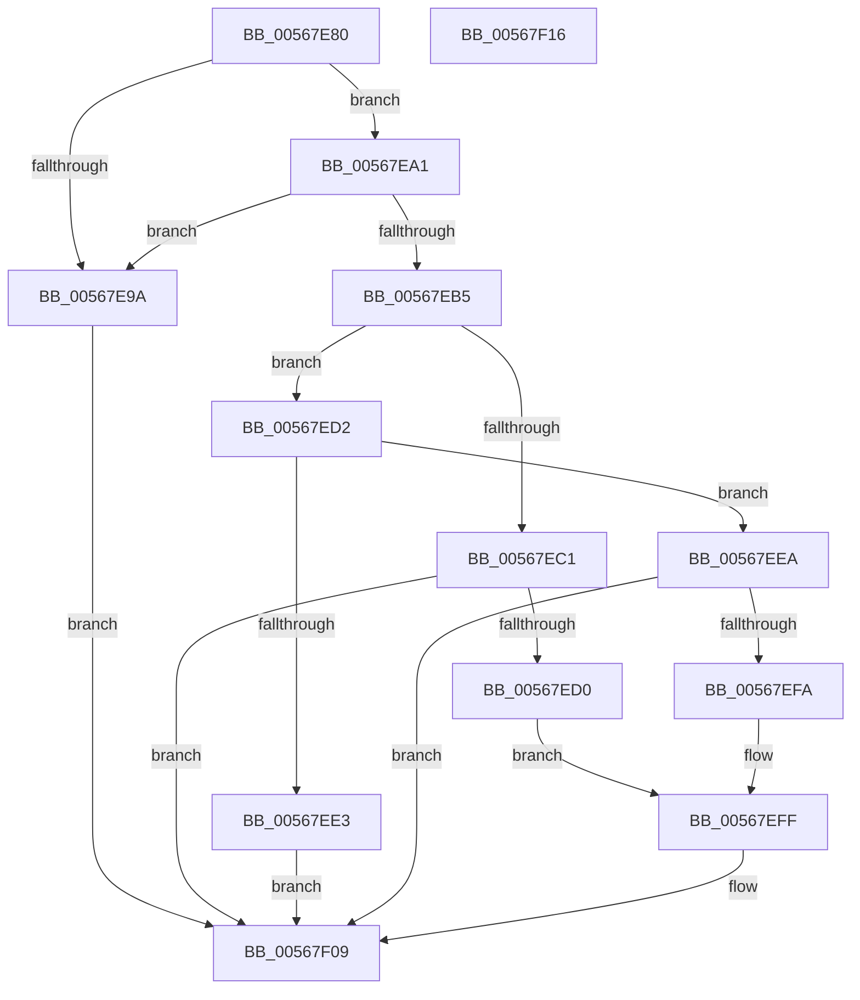

# IommuDomainDetachDeviceEx

- RVA: `0x00567E80`–`0x00567F17` (길이 `151` bytes)
- VA: `0x0000000140567E80`
- 실행 섹션: `.text`
- PDB 이름 있음: `예`; PDB Function 태그: `아니요`
- unwind 정보 RVA: `0x000C4ED8`
- 디코드: `44`개 명령, `151/151` bytes 표시
- 미해석 바이트: `0` (있으면 어셈블리에 `.byte`로 보존)

> 이 문서는 커널 이미지의 기계어와 PDB 기호를 분석해 생성했습니다. 4번과 5번은 함수 원형과 자료형을 바이너리 사용 방식에서 추정한 C 해석이며 원본 소스 복구 결과는 아닙니다.

## 1. Dependencies

- 직접 호출 지점: **5**; 고유 호출 대상: **5**
- 직접 호출자로 확인된 함수: **0**
- RIP 상대 이미지 참조: **0**

### Outgoing calls
- `0x00567EAC` → [IommupFindAndPopCachedDevice](IommupFindAndPopCachedDevice_function_005688DC.md) (function, `0x005688DC`)
- `0x00567EC5` → [HalpIommuLeaveDmaDomain](../4B/HalpIommuLeaveDmaDomain_function_004BF220.md) (function, `0x004BF220`)
- `0x00567EDA` → [IommupDeviceGetPasidDevice](../54/IommupDeviceGetPasidDevice_function_0054F82C.md) (function, `0x0054F82C`)
- `0x00567EEF` → [IommupDomainDetachPasidDevice](../54/IommupDomainDetachPasidDevice_function_0054FD50.md) (function, `0x0054FD50`)
- `0x00567F04` → [HalpMmAllocCtxFree](../3E/HalpMmAllocCtxFree_function_003E1904.md) (function, `0x003E1904`)

### Direct callers
- 이 함수 시작 RVA로 연결되는 직접 call은 확인되지 않았습니다. 간접 호출은 완전히 역산할 수 없습니다.

### Static image references
- 디코드된 RIP-relative 메모리 참조가 없습니다.

## 2. Other-region calls and transfers

- 다른 실행 섹션으로 향하는 call: **0**
- 별도 외부 분기/꼬리 이동을 확인하지 못했습니다.

## 3. Assembly (complete function range)

```asm
00567E80  48 89 5C 24 18                  mov qword ptr [rsp + 0x18], rbx
00567E85  57                              push rdi
00567E86  48 83 EC 20                     sub rsp, 0x20
00567E8A  48 83 64 24 30 00               and qword ptr [rsp + 0x30], 0
00567E90  48 8B F9                        mov rdi, rcx
00567E93  48 83 79 18 00                  cmp qword ptr [rcx + 0x18], 0
00567E98  75 07                           jne 0x140567ea1
00567E9A  BB EF 00 00 C0                  mov ebx, 0xc00000ef
00567E9F  EB 68                           jmp 0x140567f09
00567EA1  48 83 64 24 38 00               and qword ptr [rsp + 0x38], 0
00567EA7  48 8D 54 24 38                  lea rdx, [rsp + 0x38]
00567EAC  E8 2B 0A 00 00                  call 0x1405688dc
00567EB1  84 C0                           test al, al
00567EB3  74 E5                           je 0x140567e9a
00567EB5  80 BF 12 01 00 00 00            cmp byte ptr [rdi + 0x112], 0
00567EBC  48 8B CF                        mov rcx, rdi
00567EBF  75 11                           jne 0x140567ed2
00567EC1  48 8B 57 18                     mov rdx, qword ptr [rdi + 0x18]
00567EC5  E8 56 73 F5 FF                  call 0x1404bf220
00567ECA  8B D8                           mov ebx, eax
00567ECC  85 C0                           test eax, eax
00567ECE  78 39                           js 0x140567f09
00567ED0  EB 2D                           jmp 0x140567eff
00567ED2  4C 8D 4C 24 30                  lea r9, [rsp + 0x30]
00567ED7  45 33 C0                        xor r8d, r8d
00567EDA  E8 4D 79 FE FF                  call 0x14054f82c
00567EDF  84 C0                           test al, al
00567EE1  75 07                           jne 0x140567eea
00567EE3  BB 01 00 00 C0                  mov ebx, 0xc0000001
00567EE8  EB 1F                           jmp 0x140567f09
00567EEA  48 8B 4C 24 30                  mov rcx, qword ptr [rsp + 0x30]
00567EEF  E8 5C 7E FE FF                  call 0x14054fd50
00567EF4  8B D8                           mov ebx, eax
00567EF6  85 C0                           test eax, eax
00567EF8  78 0F                           js 0x140567f09
00567EFA  48 83 67 18 00                  and qword ptr [rdi + 0x18], 0
00567EFF  48 8B 54 24 38                  mov rdx, qword ptr [rsp + 0x38]
00567F04  E8 FB 99 E7 FF                  call 0x1403e1904
00567F09  8B C3                           mov eax, ebx
00567F0B  48 8B 5C 24 40                  mov rbx, qword ptr [rsp + 0x40]
00567F10  48 83 C4 20                     add rsp, 0x20
00567F14  5F                              pop rdi
00567F15  C3                              ret
00567F16  CC                              int3
```

## 4. C-style interpretation (structured pseudocode)

```c
__int64 __fastcall IommuDomainDetachDeviceEx(__int64 a1, __int64 a2, int a3)
{
    __int64 result;
    __int64 v_rsp;
    unsigned __int64 v_stack_p10;
    unsigned __int64 v_stack_p18;
    unsigned __int64 v_stack_p8;

    v_stack_p18 = v_rbx;
    v_rsp = (v_rsp) - (32);
    if ((*(unsigned __int64 *)(a1 + 24)) != 0) goto loc_00567EA1;
loc_00567E9A:
    goto loc_00567F09;
loc_00567EA1:
    result = IommupFindAndPopCachedDevice(a1, v_stack_p10, a3, a4);
    if ((unsigned __int8)(result) == 0) goto loc_00567E9A;
    if ((*(unsigned __int8 *)(a1 + 274)) != 0) goto loc_00567ED2;
    result = HalpIommuLeaveDmaDomain(a1, *(unsigned __int64 *)(a1 + 24), a3, a4);
    if (sign_flag) goto loc_00567F09;
    goto loc_00567EFF;
loc_00567ED2:
    a3 = 0;
    result = IommupDeviceGetPasidDevice(a1, *(unsigned __int64 *)(a1 + 24), a3, v_stack_p8);
    if ((unsigned __int8)(result) != 0) goto loc_00567EEA;
    goto loc_00567F09;
loc_00567EEA:
    result = IommupDomainDetachPasidDevice(v_stack_p8, *(unsigned __int64 *)(a1 + 24), a3, v_stack_p8);
    if (sign_flag) goto loc_00567F09;
loc_00567EFF:
    result = HalpMmAllocCtxFree(v_stack_p8, v_stack_p10, a3, v_stack_p8);
loc_00567F09:
    v_rsp = (v_rsp) + (32);
    return (unsigned int)((unsigned int)((unsigned int)((unsigned int)(result))));
}
```

## 5. (Beta) C Style

```c
int64_t IommuDomainDetachDeviceEx(void *Arg1, int64_t Arg2, int32_t Arg3)
{
    uint8_t *arg1 = (uint8_t *)Arg1;

    int64_t result;
    int64_t local_rsp;
    uint64_t v_stack_p10;
    uint64_t v_stack_p18;
    uint64_t v_stack_p8;

    v_stack_p18 = local_rbx;
    local_rsp = (local_rsp) - (32);
    if ((*(uint64_t *)(arg1 + 0x18)) != 0) goto loc_00567EA1;
loc_00567E9A:
    goto loc_00567F09;
loc_00567EA1:
    result = IommupFindAndPopCachedDevice(Arg1, v_stack_p10, Arg3, a4);
    if ((uint8_t)(result) == 0) goto loc_00567E9A;
    if ((*(uint8_t *)(arg1 + 0x112)) != 0) goto loc_00567ED2;
    result = HalpIommuLeaveDmaDomain(Arg1, *(uint64_t *)(arg1 + 0x18), Arg3, a4);
    if (sign_flag) goto loc_00567F09;
    goto loc_00567EFF;
loc_00567ED2:
    Arg3 = 0;
    result = IommupDeviceGetPasidDevice(Arg1, *(uint64_t *)(arg1 + 0x18), Arg3, v_stack_p8);
    if ((uint8_t)(result) != 0) goto loc_00567EEA;
    goto loc_00567F09;
loc_00567EEA:
    result = IommupDomainDetachPasidDevice(v_stack_p8, *(uint64_t *)(arg1 + 0x18), Arg3, v_stack_p8);
    if (sign_flag) goto loc_00567F09;
loc_00567EFF:
    result = HalpMmAllocCtxFree(v_stack_p8, v_stack_p10, Arg3, v_stack_p8);
loc_00567F09:
    local_rsp = (local_rsp) + (32);
    return (uint32_t)((uint32_t)((uint32_t)((uint32_t)(result))));
}
```

### 관측된 메모리 오프셋

구조체 형식이 확인되지 않은 접근은 인자 기준의 오프셋으로만 기록했습니다.

| 기준 인자 | 오프셋 표현 | 폭 (bit) | 접근 |
|---|---:|---:|---|
| `Arg1` | `+ 0x18` | `64` | `R` |
| `Arg1` | `+ 0x18` | `64` | `R/W` |
| `Arg1` | `+ 0x112` | `8` | `R` |

## 6. Execution-region graph

[열기: 2D/3D 그래프와 함수 탐색 컨트롤 패널](../../../control-panel.html?section=text&rva=0x00567E80&view=graph)

- 2D 그래프는 위에서 아래로 흐르고, 3D 그래프는 빈 공간을 드래그해 회전합니다. Shift+드래그는 이동, 휠은 확대·축소, 함수 노드 선택은 대상 보고서 이동입니다.

### Static fallback


