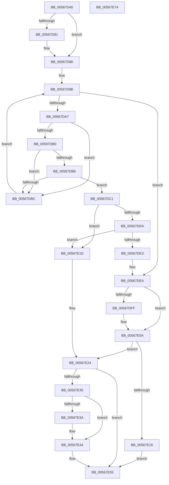

# IommuDomainDetachDevice

- RVA: `0x00567D40`–`0x00567E75` (길이 `309` bytes)
- VA: `0x0000000140567D40`
- 실행 섹션: `.text`
- PDB 이름 있음: `예`; PDB Function 태그: `아니요`
- unwind 정보 RVA: `0x00075C18`
- 디코드: `92`개 명령, `309/309` bytes 표시
- 미해석 바이트: `0` (있으면 어셈블리에 `.byte`로 보존)

> 이 문서는 커널 이미지의 기계어와 PDB 기호를 분석해 생성했습니다. 4번과 5번은 함수 원형과 자료형을 바이너리 사용 방식에서 추정한 C 해석이며 원본 소스 복구 결과는 아닙니다.

## 1. Dependencies

- 직접 호출 지점: **8**; 고유 호출 대상: **7**
- 직접 호출자로 확인된 함수: **0**
- RIP 상대 이미지 참조: **3**

### Outgoing calls
- `0x00567D83` → [KiRaiseIrqlProcessIrqlFlags](../4F/KiRaiseIrqlProcessIrqlFlags_function_004F56FC.md) (function, `0x004F56FC`)
- `0x00567D8F` → [KeAcquireSpinLockAtDpcLevel](../20/KeAcquireSpinLockAtDpcLevel_function_00208430.md) (function, `0x00208430`)
- `0x00567DF1` → [KxReleaseSpinLock](../20/KxReleaseSpinLock_function_00206670.md) (function, `0x00206670`)
- `0x00567E05` → [KiLowerIrqlProcessIrqlFlags](../4F/KiLowerIrqlProcessIrqlFlags_function_004F5698.md) (function, `0x004F5698`)
- `0x00567E2A` → [HalpIommuLeaveDmaDomain](../4B/HalpIommuLeaveDmaDomain_function_004BF220.md) (function, `0x004BF220`)
- `0x00567E3D` → [HalpIommuDeleteDevice](../54/HalpIommuDeleteDevice_function_0054F368.md) (function, `0x0054F368`)
- `0x00567E48` → [HalpMmAllocCtxFree](../3E/HalpMmAllocCtxFree_function_003E1904.md) (function, `0x003E1904`)
- `0x00567E50` → [HalpMmAllocCtxFree](../3E/HalpMmAllocCtxFree_function_003E1904.md) (function, `0x003E1904`)

### Direct callers
- 이 함수 시작 RVA로 연결되는 직접 call은 확인되지 않았습니다. 간접 호출은 완전히 역산할 수 없습니다.

### Static image references
- `0x00567D79` → RVA `0x00FC6D20` (`ALMOSTRO`; read)
- `0x00567D88` → RVA `0x00F8FAC0` (`.data`; read)
- `0x00567D94` → RVA `0x00F8FAB0` (`.data`; read)

## 2. Other-region calls and transfers

- 다른 실행 섹션으로 향하는 call: **0**
- 별도 외부 분기/꼬리 이동을 확인하지 못했습니다.

## 3. Assembly (complete function range)

```asm
00567D40  48 89 5C 24 08                  mov qword ptr [rsp + 8], rbx
00567D45  48 89 6C 24 10                  mov qword ptr [rsp + 0x10], rbp
00567D4A  48 89 74 24 18                  mov qword ptr [rsp + 0x18], rsi
00567D4F  57                              push rdi
00567D50  41 54                           push r12
00567D52  41 55                           push r13
00567D54  41 56                           push r14
00567D56  41 57                           push r15
00567D58  48 83 EC 20                     sub rsp, 0x20
00567D5C  45 32 F6                        xor r14b, r14b
00567D5F  33 ED                           xor ebp, ebp
00567D61  33 F6                           xor esi, esi
00567D63  45 8B E0                        mov r12d, r8d
00567D66  33 FF                           xor edi, edi
00567D68  4C 8B EA                        mov r13, rdx
00567D6B  4C 8B F9                        mov r15, rcx
00567D6E  44 0F 20 C3                     mov rbx, cr8
00567D72  8D 55 0C                        lea edx, [rbp + 0xc]
00567D75  44 0F 22 C2                     mov cr8, rdx
00567D79  39 35 A1 EF A5 00               cmp dword ptr [rip + 0xa5efa1], esi
00567D7F  74 07                           je 0x140567d88
00567D81  8A CB                           mov cl, bl
00567D83  E8 74 D9 F8 FF                  call 0x1404f56fc
00567D88  48 8D 0D 31 7D A2 00            lea rcx, [rip + 0xa27d31]
00567D8F  E8 9C 06 CA FF                  call 0x140208430
00567D94  48 8B 05 15 7D A2 00            mov rax, qword ptr [rip + 0xa27d15]
00567D9B  48 8D 0D 0E 7D A2 00            lea rcx, [rip + 0xa27d0e]
00567DA2  48 3B C1                        cmp rax, rcx
00567DA5  74 43                           je 0x140567dea
00567DA7  48 8B F0                        mov rsi, rax
00567DAA  4C 39 78 28                     cmp qword ptr [rax + 0x28], r15
00567DAE  75 0C                           jne 0x140567dbc
00567DB0  4C 39 68 10                     cmp qword ptr [rax + 0x10], r13
00567DB4  75 06                           jne 0x140567dbc
00567DB6  44 39 60 18                     cmp dword ptr [rax + 0x18], r12d
00567DBA  74 05                           je 0x140567dc1
00567DBC  48 8B 00                        mov rax, qword ptr [rax]
00567DBF  EB DA                           jmp 0x140567d9b
00567DC1  48 8B 78 20                     mov rdi, qword ptr [rax + 0x20]
00567DC5  41 BE 01 00 00 00               mov r14d, 1
00567DCB  41 8B EE                        mov ebp, r14d
00567DCE  87 6F 10                        xchg dword ptr [rdi + 0x10], ebp
00567DD1  48 8B 10                        mov rdx, qword ptr [rax]
00567DD4  48 39 42 08                     cmp qword ptr [rdx + 8], rax
00567DD8  75 43                           jne 0x140567e1d
00567DDA  48 8B 48 08                     mov rcx, qword ptr [rax + 8]
00567DDE  48 39 01                        cmp qword ptr [rcx], rax
00567DE1  75 3A                           jne 0x140567e1d
00567DE3  48 89 11                        mov qword ptr [rcx], rdx
00567DE6  48 89 4A 08                     mov qword ptr [rdx + 8], rcx
00567DEA  48 8D 0D CF 7C A2 00            lea rcx, [rip + 0xa27ccf]
00567DF1  E8 7A E8 C9 FF                  call 0x140206670
00567DF6  83 3D 23 EF A5 00 00            cmp dword ptr [rip + 0xa5ef23], 0
00567DFD  74 0B                           je 0x140567e0a
00567DFF  44 0F 20 C1                     mov rcx, cr8
00567E03  8A D3                           mov dl, bl
00567E05  E8 8E D8 F8 FF                  call 0x1404f5698
00567E0A  0F B6 C3                        movzx eax, bl
00567E0D  44 0F 22 C0                     mov cr8, rax
00567E11  45 84 F6                        test r14b, r14b
00567E14  75 0E                           jne 0x140567e24
00567E16  BB F0 00 00 C0                  mov ebx, 0xc00000f0
00567E1B  EB 38                           jmp 0x140567e55
00567E1D  B9 03 00 00 00                  mov ecx, 3
00567E22  CD 29                           int 0x29
00567E24  49 8B D7                        mov rdx, r15
00567E27  48 8B CF                        mov rcx, rdi
00567E2A  E8 F1 73 F5 FF                  call 0x1404bf220
00567E2F  8B D8                           mov ebx, eax
00567E31  85 C0                           test eax, eax
00567E33  78 20                           js 0x140567e55
00567E35  83 FD 02                        cmp ebp, 2
00567E38  74 0A                           je 0x140567e44
00567E3A  48 8B CF                        mov rcx, rdi
00567E3D  E8 26 75 FE FF                  call 0x14054f368
00567E42  8B D8                           mov ebx, eax
00567E44  48 8B 56 30                     mov rdx, qword ptr [rsi + 0x30]
00567E48  E8 B7 9A E7 FF                  call 0x1403e1904
00567E4D  48 8B D6                        mov rdx, rsi
00567E50  E8 AF 9A E7 FF                  call 0x1403e1904
00567E55  48 8B 6C 24 58                  mov rbp, qword ptr [rsp + 0x58]
00567E5A  8B C3                           mov eax, ebx
00567E5C  48 8B 5C 24 50                  mov rbx, qword ptr [rsp + 0x50]
00567E61  48 8B 74 24 60                  mov rsi, qword ptr [rsp + 0x60]
00567E66  48 83 C4 20                     add rsp, 0x20
00567E6A  41 5F                           pop r15
00567E6C  41 5E                           pop r14
00567E6E  41 5D                           pop r13
00567E70  41 5C                           pop r12
00567E72  5F                              pop rdi
00567E73  C3                              ret
00567E74  CC                              int3
```

## 4. C-style interpretation (structured pseudocode)

```c
__int64 __fastcall IommuDomainDetachDevice(__int64 a1, __int64 a2, int a3)
{
    __int64 result;
    __int64 v_r14;
    __int64 v_rbp;
    __int64 v_rbx;
    __int64 v_rdi;
    __int64 v_rsi;
    __int64 v_rsp;
    unsigned __int64 v_stack_p10;
    unsigned __int64 v_stack_p18;
    unsigned __int64 v_stack_p8;

    v_stack_p8 = v_rbx;
    v_stack_p10 = v_rbp;
    v_stack_p18 = v_rsi;
    v_rsp = (v_rsp) - (32);
    v_r14 = 0;
    v_rbp = 0;
    v_rsi = 0;
    v_rdi = 0;
    if ((*(unsigned int *)(v_rip + 10874785)) != 0) {
        a1 = (unsigned __int8)(v_cr8);
        result = KiRaiseIrqlProcessIrqlFlags(a1, v_rbp + 12, a3, a4);
    }
    result = KeAcquireSpinLockAtDpcLevel(v_rip + 10648881, v_rbp + 12, a3, a4);
loc_00567D9B:
    if ((*(unsigned __int64 *)(v_rip + 10648853)) == (v_rip + 10648846)) goto loc_00567DEA;
    if ((*(unsigned __int64 *)(*(unsigned __int64 *)(v_rip + 10648853) + 40)) != a1) goto loc_00567DBC;
    if ((*(unsigned __int64 *)(*(unsigned __int64 *)(v_rip + 10648853) + 16)) != a2) goto loc_00567DBC;
    if ((*(unsigned int *)(*(unsigned __int64 *)(v_rip + 10648853) + 24)) == ((unsigned int)((unsigned int)(a3)))) goto loc_00567DC1;
loc_00567DBC:
    goto loc_00567D9B;
loc_00567DC1:
    if ((*(unsigned __int64 *)(*(unsigned __int64 *)(*(unsigned __int64 *)(*(unsigned __int64 *)(v_rip + 10648853))) + 8)) != (*(unsigned __int64 *)(*(unsigned __int64 *)(v_rip + 10648853)))) goto loc_00567E1D;
    if ((*(unsigned __int64 *)(*(unsigned __int64 *)(*(unsigned __int64 *)(*(unsigned __int64 *)(v_rip + 10648853)) + 8))) != (*(unsigned __int64 *)(*(unsigned __int64 *)(v_rip + 10648853)))) goto loc_00567E1D;
    *(unsigned __int64 *)(*(unsigned __int64 *)(*(unsigned __int64 *)(*(unsigned __int64 *)(v_rip + 10648853)) + 8)) = *(unsigned __int64 *)(*(unsigned __int64 *)(*(unsigned __int64 *)(v_rip + 10648853)));
    *(unsigned __int64 *)(*(unsigned __int64 *)(*(unsigned __int64 *)(*(unsigned __int64 *)(v_rip + 10648853))) + 8) = *(unsigned __int64 *)(*(unsigned __int64 *)(*(unsigned __int64 *)(v_rip + 10648853)) + 8);
loc_00567DEA:
    result = KxReleaseSpinLock(v_rip + 10648783, *(unsigned __int64 *)(*(unsigned __int64 *)(*(unsigned __int64 *)(v_rip + 10648853))), a3, a4);
    if ((*(unsigned int *)(v_rip + 10874659)) != 0) {
        a1 = v_rbp + 12;
        a2 = (unsigned __int8)(v_cr8);
        result = KiLowerIrqlProcessIrqlFlags(a1, a2, a3, a4);
    }
    if (1 != 0) goto loc_00567E24;
    goto loc_00567E55;
loc_00567E1D:
loc_00567E24:
    result = HalpIommuLeaveDmaDomain(*(unsigned __int64 *)(*(unsigned __int64 *)(*(unsigned __int64 *)(v_rip + 10648853)) + 32), a1, a3, a4);
    if (sign_flag) goto loc_00567E55;
    v_rbx = (unsigned int)((unsigned int)(result));
    if (1 != 2) {
        a1 = *(unsigned __int64 *)(*(unsigned __int64 *)(*(unsigned __int64 *)(v_rip + 10648853)) + 32);
        result = HalpIommuDeleteDevice(a1, a1, a3, a4);
        v_rbx = (unsigned int)(result);
    }
    result = HalpMmAllocCtxFree(a1, *(unsigned __int64 *)(*(unsigned __int64 *)(v_rip + 10648853) + 48), a3, a4);
    result = HalpMmAllocCtxFree(a1, *(unsigned __int64 *)(v_rip + 10648853), a3, a4);
loc_00567E55:
    v_rsp = (v_rsp) + (32);
    return (unsigned int)((unsigned int)(v_rbx));
}
```

## 5. (Beta) C Style

```c
int64_t IommuDomainDetachDevice(int64_t Arg1, int64_t Arg2, int32_t Arg3)
{
    int64_t result;
    int64_t local_r14;
    int64_t local_rbp;
    int64_t local_rbx;
    int64_t local_rdi;
    int64_t local_rsi;
    int64_t local_rsp;
    uint64_t v_stack_p10;
    uint64_t v_stack_p18;
    uint64_t v_stack_p8;

    v_stack_p8 = local_rbx;
    v_stack_p10 = local_rbp;
    v_stack_p18 = local_rsi;
    local_rsp = (local_rsp) - (32);
    local_r14 = 0;
    local_rbp = 0;
    local_rsi = 0;
    local_rdi = 0;
    if ((*(uint32_t *)(v_rip + 0xA5EFA1)) != 0) {
        Arg1 = (uint8_t)(v_cr8);
        result = KiRaiseIrqlProcessIrqlFlags(Arg1, local_rbp + 12, Arg3, a4);
    }
    result = KeAcquireSpinLockAtDpcLevel(v_rip + 10648881, local_rbp + 12, Arg3, a4);
loc_00567D9B:
    if ((*(uint64_t *)(v_rip + 0xA27D15)) == (v_rip + 10648846)) goto loc_00567DEA;
    if ((*(uint64_t *)(*(uint64_t *)(v_rip + 0xA27D15) + 0x28)) != Arg1) goto loc_00567DBC;
    if ((*(uint64_t *)(*(uint64_t *)(v_rip + 0xA27D15) + 0x10)) != Arg2) goto loc_00567DBC;
    if ((*(uint32_t *)(*(uint64_t *)(v_rip + 0xA27D15) + 0x18)) == ((uint32_t)((uint32_t)(Arg3)))) goto loc_00567DC1;
loc_00567DBC:
    goto loc_00567D9B;
loc_00567DC1:
    if ((*(uint64_t *)(*(uint64_t *)(*(uint64_t *)(*(uint64_t *)(v_rip + 0xA27D15))) + 0x8)) != (*(uint64_t *)(*(uint64_t *)(v_rip + 0xA27D15)))) goto loc_00567E1D;
    if ((*(uint64_t *)(*(uint64_t *)(*(uint64_t *)(*(uint64_t *)(v_rip + 0xA27D15)) + 0x8))) != (*(uint64_t *)(*(uint64_t *)(v_rip + 0xA27D15)))) goto loc_00567E1D;
    *(uint64_t *)(*(uint64_t *)(*(uint64_t *)(*(uint64_t *)(v_rip + 0xA27D15)) + 0x8)) = *(uint64_t *)(*(uint64_t *)(*(uint64_t *)(v_rip + 0xA27D15)));
    *(uint64_t *)(*(uint64_t *)(*(uint64_t *)(*(uint64_t *)(v_rip + 0xA27D15))) + 0x8) = *(uint64_t *)(*(uint64_t *)(*(uint64_t *)(v_rip + 0xA27D15)) + 0x8);
loc_00567DEA:
    result = KxReleaseSpinLock(v_rip + 10648783, *(uint64_t *)(*(uint64_t *)(*(uint64_t *)(v_rip + 0xA27D15))), Arg3, a4);
    if ((*(uint32_t *)(v_rip + 0xA5EF23)) != 0) {
        Arg1 = local_rbp + 12;
        Arg2 = (uint8_t)(v_cr8);
        result = KiLowerIrqlProcessIrqlFlags(Arg1, Arg2, Arg3, a4);
    }
    if (1 != 0) goto loc_00567E24;
    goto loc_00567E55;
loc_00567E1D:
loc_00567E24:
    result = HalpIommuLeaveDmaDomain(*(uint64_t *)(*(uint64_t *)(*(uint64_t *)(v_rip + 0xA27D15)) + 0x20), Arg1, Arg3, a4);
    if (sign_flag) goto loc_00567E55;
    local_rbx = (uint32_t)((uint32_t)(result));
    if (1 != 2) {
        Arg1 = *(uint64_t *)(*(uint64_t *)(*(uint64_t *)(v_rip + 0xA27D15)) + 0x20);
        result = HalpIommuDeleteDevice(Arg1, Arg1, Arg3, a4);
        local_rbx = (uint32_t)(result);
    }
    result = HalpMmAllocCtxFree(Arg1, *(uint64_t *)(*(uint64_t *)(v_rip + 0xA27D15) + 0x30), Arg3, a4);
    result = HalpMmAllocCtxFree(Arg1, *(uint64_t *)(v_rip + 0xA27D15), Arg3, a4);
loc_00567E55:
    local_rsp = (local_rsp) + (32);
    return (uint32_t)((uint32_t)(local_rbx));
}
```

## 6. Execution-region graph

[열기: 2D/3D 그래프와 함수 탐색 컨트롤 패널](../../../control-panel.html?section=text&rva=0x00567D40&view=graph)

- 2D 그래프는 위에서 아래로 흐르고, 3D 그래프는 빈 공간을 드래그해 회전합니다. Shift+드래그는 이동, 휠은 확대·축소, 함수 노드 선택은 대상 보고서 이동입니다.

### Static fallback


