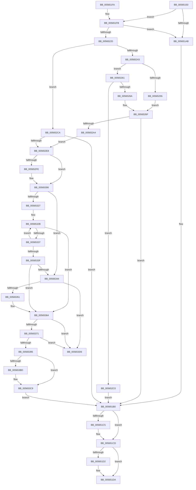

# IommuEnableDevicePasid

- RVA: `0x00565150`–`0x005653DD` (길이 `653` bytes)
- VA: `0x0000000140565150`
- 실행 섹션: `.text`
- PDB 이름 있음: `예`; PDB Function 태그: `아니요`
- unwind 정보 RVA: `0x000C4DEC`
- 디코드: `181`개 명령, `653/653` bytes 표시
- 미해석 바이트: `0` (있으면 어셈블리에 `.byte`로 보존)

> 이 문서는 커널 이미지의 기계어와 PDB 기호를 분석해 생성했습니다. 4번과 5번은 함수 원형과 자료형을 바이너리 사용 방식에서 추정한 C 해석이며 원본 소스 복구 결과는 아닙니다.

## 1. Dependencies

- 직접 호출 지점: **16**; 고유 호출 대상: **10**
- 직접 호출자로 확인된 함수: **2**
- RIP 상대 이미지 참조: **4**

### Outgoing calls
- `0x00565192` → [KeAcquireSpinLockRaiseToDpc](../20/KeAcquireSpinLockRaiseToDpc_function_00208470.md) (function, `0x00208470`)
- `0x0056519E` → [HalpMmAllocCtxAlloc](../3E/HalpMmAllocCtxAlloc_function_003E10B8.md) (function, `0x003E10B8`)
- `0x005651BB` → [KeReleaseSpinLock](../39/KeReleaseSpinLock_function_00392BA0.md) (function, `0x00392BA0`)
- `0x005651C8` → [HalpMmAllocCtxFree](../3E/HalpMmAllocCtxFree_function_003E1904.md) (function, `0x003E1904`)
- `0x005651D5` → [HalpMmAllocCtxFree](../3E/HalpMmAllocCtxFree_function_003E1904.md) (function, `0x003E1904`)
- `0x00565213` → [HalpMmAllocCtxAlloc](../3E/HalpMmAllocCtxAlloc_function_003E10B8.md) (function, `0x003E10B8`)
- `0x00565229` → [memset](../6C/memset_function_006C6C40.md) (function, `0x006C6C40`)
- `0x00565295` → [guard_dispatch_icall](../6B/guard_dispatch_icall_function_006BAAD0.md) (function, `0x006BAAD0`)
- `0x005652B9` → [guard_dispatch_icall](../6B/guard_dispatch_icall_function_006BAAD0.md) (function, `0x006BAAD0`)
- `0x005652D9` → [guard_dispatch_icall](../6B/guard_dispatch_icall_function_006BAAD0.md) (function, `0x006BAAD0`)
- `0x00565301` → [KiRaiseIrqlProcessIrqlFlags](../4F/KiRaiseIrqlProcessIrqlFlags_function_004F56FC.md) (function, `0x004F56FC`)
- `0x0056530A` → [KeAcquireSpinLockAtDpcLevel](../20/KeAcquireSpinLockAtDpcLevel_function_00208430.md) (function, `0x00208430`)
- `0x00565313` → [KeAcquireSpinLockAtDpcLevel](../20/KeAcquireSpinLockAtDpcLevel_function_00208430.md) (function, `0x00208430`)
- `0x005653A7` → [KxReleaseSpinLock](../20/KxReleaseSpinLock_function_00206670.md) (function, `0x00206670`)
- `0x005653B0` → [KxReleaseSpinLock](../20/KxReleaseSpinLock_function_00206670.md) (function, `0x00206670`)
- `0x005653C4` → [KiLowerIrqlProcessIrqlFlags](../4F/KiLowerIrqlProcessIrqlFlags_function_004F5698.md) (function, `0x004F5698`)

### Direct callers
- [IommupDomainAttachPasidDevice](../54/IommupDomainAttachPasidDevice_function_0054F984.md) at `0x0054FB45`
- [IommupDeviceEnableSvm](../../page/70/IommupDeviceEnableSvm_function_00708CC4.md) at `0x00708E1C`

### Static image references
- `0x0056518B` → RVA `0x00F8FAF8` (`.data`; read)
- `0x0056522E` → RVA `0x00FC1710` (`.data`; read)
- `0x005652D2` → RVA `0x00FC1D90` (`.data`; read)
- `0x005652F5` → RVA `0x00FC6D20` (`ALMOSTRO`; read)

## 2. Other-region calls and transfers

- 다른 실행 섹션으로 향하는 call: **0**
- 별도 외부 분기/꼬리 이동을 확인하지 못했습니다.

## 3. Assembly (complete function range)

```asm
00565150  48 89 5C 24 10                  mov qword ptr [rsp + 0x10], rbx
00565155  48 89 6C 24 18                  mov qword ptr [rsp + 0x18], rbp
0056515A  48 89 74 24 20                  mov qword ptr [rsp + 0x20], rsi
0056515F  57                              push rdi
00565160  41 54                           push r12
00565162  41 55                           push r13
00565164  41 56                           push r14
00565166  41 57                           push r15
00565168  48 83 EC 40                     sub rsp, 0x40
0056516C  48 8B 6A 60                     mov rbp, qword ptr [rdx + 0x60]
00565170  33 DB                           xor ebx, ebx
00565172  83 BA 88 01 00 00 01            cmp dword ptr [rdx + 0x188], 1
00565179  4C 8B FA                        mov r15, rdx
0056517C  4C 8B 71 08                     mov r14, qword ptr [rcx + 8]
00565180  48 8B 31                        mov rsi, qword ptr [rcx]
00565183  41 0F 94 C4                     sete r12b
00565187  4C 8B 6D 18                     mov r13, qword ptr [rbp + 0x18]
0056518B  48 8D 0D 66 A9 A2 00            lea rcx, [rip + 0xa2a966]
00565192  E8 D9 32 CA FF                  call 0x140208470
00565197  8D 53 28                        lea edx, [rbx + 0x28]
0056519A  88 44 24 70                     mov byte ptr [rsp + 0x70], al
0056519E  E8 15 BF E7 FF                  call 0x1403e10b8
005651A3  48 8B F8                        mov rdi, rax
005651A6  48 85 C0                        test rax, rax
005651A9  75 50                           jne 0x1405651fb
005651AB  BE 9A 00 00 C0                  mov esi, 0xc000009a
005651B0  8A 54 24 70                     mov dl, byte ptr [rsp + 0x70]
005651B4  48 8D 0D 3D A9 A2 00            lea rcx, [rip + 0xa2a93d]
005651BB  E8 E0 D9 E2 FF                  call 0x140392ba0
005651C0  48 85 FF                        test rdi, rdi
005651C3  74 08                           je 0x1405651cd
005651C5  48 8B D7                        mov rdx, rdi
005651C8  E8 37 C7 E7 FF                  call 0x1403e1904
005651CD  48 85 DB                        test rbx, rbx
005651D0  74 08                           je 0x1405651da
005651D2  48 8B D3                        mov rdx, rbx
005651D5  E8 2A C7 E7 FF                  call 0x1403e1904
005651DA  4C 8D 5C 24 40                  lea r11, [rsp + 0x40]
005651DF  8B C6                           mov eax, esi
005651E1  49 8B 5B 38                     mov rbx, qword ptr [r11 + 0x38]
005651E5  49 8B 6B 40                     mov rbp, qword ptr [r11 + 0x40]
005651E9  49 8B 73 48                     mov rsi, qword ptr [r11 + 0x48]
005651ED  49 8B E3                        mov rsp, r11
005651F0  41 5F                           pop r15
005651F2  41 5E                           pop r14
005651F4  41 5D                           pop r13
005651F6  41 5C                           pop r12
005651F8  5F                              pop rdi
005651F9  C3                              ret
005651FA  CC                              int3
005651FB  48 8B 45 18                     mov rax, qword ptr [rbp + 0x18]
005651FF  BA 40 00 00 00                  mov edx, 0x40
00565204  48 89 47 10                     mov qword ptr [rdi + 0x10], rax
00565208  48 8D 47 18                     lea rax, [rdi + 0x18]
0056520C  48 89 40 08                     mov qword ptr [rax + 8], rax
00565210  48 89 00                        mov qword ptr [rax], rax
00565213  E8 A0 BE E7 FF                  call 0x1403e10b8
00565218  48 8B D8                        mov rbx, rax
0056521B  48 85 C0                        test rax, rax
0056521E  74 8B                           je 0x1405651ab
00565220  33 D2                           xor edx, edx
00565222  48 8B C8                        mov rcx, rax
00565225  44 8D 42 40                     lea r8d, [rdx + 0x40]
00565229  E8 12 1A 16 00                  call 0x1406c6c40
0056522E  80 3D DB C4 A5 00 00            cmp byte ptr [rip + 0xa5c4db], 0
00565235  48 89 6B 28                     mov qword ptr [rbx + 0x28], rbp
00565239  4C 89 73 30                     mov qword ptr [rbx + 0x30], r14
0056523D  0F 85 87 00 00 00               jne 0x1405652ca
00565243  8B 55 30                        mov edx, dword ptr [rbp + 0x30]
00565246  8B CA                           mov ecx, edx
00565248  83 E1 04                        and ecx, 4
0056524B  41 80 BF 12 01 00 00 00         cmp byte ptr [r15 + 0x112], 0
00565253  74 0C                           je 0x140565261
00565255  F7 D9                           neg ecx
00565257  1B C9                           sbb ecx, ecx
00565259  83 E1 FE                        and ecx, 0xfffffffe
0056525C  83 C1 03                        add ecx, 3
0056525F  EB 0E                           jmp 0x14056526f
00565261  85 C9                           test ecx, ecx
00565263  0F 95 C0                        setne al
00565266  84 C0                           test al, al
00565268  74 56                           je 0x1405652c0
0056526A  B9 02 00 00 00                  mov ecx, 2
0056526F  49 8B 85 E8 00 00 00            mov rax, qword ptr [r13 + 0xe8]
00565276  F7 D2                           not edx
00565278  45 8B 4E 10                     mov r9d, dword ptr [r14 + 0x10]
0056527C  83 E2 01                        and edx, 1
0056527F  44 8B 46 10                     mov r8d, dword ptr [rsi + 0x10]
00565283  FF C2                           inc edx
00565285  89 54 24 28                     mov dword ptr [rsp + 0x28], edx
00565289  49 8B 57 28                     mov rdx, qword ptr [r15 + 0x28]
0056528D  89 4C 24 20                     mov dword ptr [rsp + 0x20], ecx
00565291  49 8B 4D 10                     mov rcx, qword ptr [r13 + 0x10]
00565295  E8 36 58 15 00                  call 0x1406baad0
0056529A  8B F0                           mov esi, eax
0056529C  85 C0                           test eax, eax
0056529E  0F 88 0C FF FF FF               js 0x1405651b0
005652A4  49 8B 85 E0 00 00 00            mov rax, qword ptr [r13 + 0xe0]
005652AB  45 8A CC                        mov r9b, r12b
005652AE  49 8B 57 28                     mov rdx, qword ptr [r15 + 0x28]
005652B2  45 33 C0                        xor r8d, r8d
005652B5  49 8B 4D 10                     mov rcx, qword ptr [r13 + 0x10]
005652B9  E8 12 58 15 00                  call 0x1406baad0
005652BE  EB 28                           jmp 0x1405652e8
005652C0  BE 84 01 00 C0                  mov esi, 0xc0000184
005652C5  E9 E6 FE FF FF                  jmp 0x1405651b0
005652CA  41 8B 56 10                     mov edx, dword ptr [r14 + 0x10]
005652CE  48 8B 4D 28                     mov rcx, qword ptr [rbp + 0x28]
005652D2  48 8B 05 B7 CA A5 00            mov rax, qword ptr [rip + 0xa5cab7]
005652D9  E8 F2 57 15 00                  call 0x1406baad0
005652DE  8B F0                           mov esi, eax
005652E0  85 C0                           test eax, eax
005652E2  0F 88 C8 FE FF FF               js 0x1405651b0
005652E8  45 0F 20 C7                     mov r15, cr8
005652EC  BA 0F 00 00 00                  mov edx, 0xf
005652F1  44 0F 22 C2                     mov cr8, rdx
005652F5  83 3D 24 1A A6 00 00            cmp dword ptr [rip + 0xa61a24], 0
005652FC  74 08                           je 0x140565306
005652FE  41 8A CF                        mov cl, r15b
00565301  E8 F6 03 F9 FF                  call 0x1404f56fc
00565306  49 8D 4E 18                     lea rcx, [r14 + 0x18]
0056530A  E8 21 31 CA FF                  call 0x140208430
0056530F  48 8D 4D 10                     lea rcx, [rbp + 0x10]
00565313  E8 18 31 CA FF                  call 0x140208430
00565318  FF 45 24                        inc dword ptr [rbp + 0x24]
0056531B  49 8D 46 28                     lea rax, [r14 + 0x28]
0056531F  48 8B 08                        mov rcx, qword ptr [rax]
00565322  48 3B C8                        cmp rcx, rax
00565325  74 1D                           je 0x140565344
00565327  4C 8B 45 18                     mov r8, qword ptr [rbp + 0x18]
0056532B  4C 8B 49 10                     mov r9, qword ptr [rcx + 0x10]
0056532F  48 8B D1                        mov rdx, rcx
00565332  4D 3B C8                        cmp r9, r8
00565335  74 2D                           je 0x140565364
00565337  48 8B 09                        mov rcx, qword ptr [rcx]
0056533A  48 3B C8                        cmp rcx, rax
0056533D  75 EC                           jne 0x14056532b
0056533F  4D 3B C8                        cmp r9, r8
00565342  74 20                           je 0x140565364
00565344  48 8B 08                        mov rcx, qword ptr [rax]
00565347  48 39 41 08                     cmp qword ptr [rcx + 8], rax
0056534B  0F 85 85 00 00 00               jne 0x1405653d6
00565351  48 89 0F                        mov qword ptr [rdi], rcx
00565354  48 8B D7                        mov rdx, rdi
00565357  48 89 47 08                     mov qword ptr [rdi + 8], rax
0056535B  48 89 79 08                     mov qword ptr [rcx + 8], rdi
0056535F  48 89 38                        mov qword ptr [rax], rdi
00565362  33 FF                           xor edi, edi
00565364  48 8D 42 18                     lea rax, [rdx + 0x18]
00565368  48 8B 08                        mov rcx, qword ptr [rax]
0056536B  48 39 41 08                     cmp qword ptr [rcx + 8], rax
0056536F  75 65                           jne 0x1405653d6
00565371  48 89 43 08                     mov qword ptr [rbx + 8], rax
00565375  48 89 0B                        mov qword ptr [rbx], rcx
00565378  48 89 59 08                     mov qword ptr [rcx + 8], rbx
0056537C  48 8D 4D 38                     lea rcx, [rbp + 0x38]
00565380  48 89 18                        mov qword ptr [rax], rbx
00565383  48 8B C3                        mov rax, rbx
00565386  48 8B 11                        mov rdx, qword ptr [rcx]
00565389  33 DB                           xor ebx, ebx
0056538B  48 83 C0 10                     add rax, 0x10
0056538F  48 39 4A 08                     cmp qword ptr [rdx + 8], rcx
00565393  75 41                           jne 0x1405653d6
00565395  48 89 48 08                     mov qword ptr [rax + 8], rcx
00565399  48 89 10                        mov qword ptr [rax], rdx
0056539C  48 89 42 08                     mov qword ptr [rdx + 8], rax
005653A0  48 89 01                        mov qword ptr [rcx], rax
005653A3  48 8D 4D 10                     lea rcx, [rbp + 0x10]
005653A7  E8 C4 12 CA FF                  call 0x140206670
005653AC  49 8D 4E 18                     lea rcx, [r14 + 0x18]
005653B0  E8 BB 12 CA FF                  call 0x140206670
005653B5  39 1D 65 19 A6 00               cmp dword ptr [rip + 0xa61965], ebx
005653BB  74 0C                           je 0x1405653c9
005653BD  44 0F 20 C1                     mov rcx, cr8
005653C1  41 8A D7                        mov dl, r15b
005653C4  E8 CF 02 F9 FF                  call 0x1404f5698
005653C9  41 0F B6 C7                     movzx eax, r15b
005653CD  44 0F 22 C0                     mov cr8, rax
005653D1  E9 DA FD FF FF                  jmp 0x1405651b0
005653D6  B9 03 00 00 00                  mov ecx, 3
005653DB  CD 29                           int 0x29
```

## 4. C-style interpretation (structured pseudocode)

```c
__int64 __fastcall IommuEnableDevicePasid(__int64 a1, __int64 a2)
{
    __int64 result;
    __int64 v_r12;
    __int64 v_rbx;
    __int64 v_rdi;
    __int64 v_rsp;
    unsigned int v_stack_m18;
    unsigned int v_stack_m20;
    unsigned __int64 v_stack_m28;
    unsigned __int64 v_stack_p10;
    unsigned __int64 v_stack_p18;
    unsigned __int64 v_stack_p20;
    unsigned __int8 v_stack_p8;

    v_stack_p10 = v_rbx;
    v_stack_p18 = v_rbp;
    v_stack_p20 = v_rsi;
    v_rsp = (v_rsp) - (64);
    v_rbx = 0;
    v_r12 = ((*(unsigned int *)(a2 + 392)) == 1) ? 1 : 0;
    result = KeAcquireSpinLockRaiseToDpc(v_rip + 10660198, a2, a3, a4);
    v_stack_p8 = (unsigned __int8)(result);
    result = HalpMmAllocCtxAlloc(v_rip + 10660198, v_rbx + 40, a3, a4);
    if (result != 0) goto loc_005651FB;
loc_005651AB:
loc_005651B0:
    result = KeReleaseSpinLock(v_rip + 10660157, v_stack_p8, a3, a4);
    if (result != 0) {
        a2 = result;
        result = HalpMmAllocCtxFree(v_rip + 10660157, a2, a3, a4);
    }
    if (0 != 0) {
        a2 = 0;
        result = HalpMmAllocCtxFree(v_rip + 10660157, a2, a3, a4);
    }
    return (unsigned int)((unsigned int)((unsigned int)(0xC000009AULL)));
loc_005651FB:
    *(unsigned __int64 *)(result + 16) = *(unsigned __int64 *)(*(unsigned __int64 *)(v_stack_m28 + 64) + 24);
    *(unsigned __int64 *)(result + 24 + 8) = result + 24;
    *(unsigned __int64 *)(result + 24) = result + 24;
    result = HalpMmAllocCtxAlloc(v_rip + 10660157, 64, a3, a4);
    if (result == 0) goto loc_005651AB;
    a2 = 0;
    result = memset(result, a2, a2 + 64, a4);
    *(unsigned __int64 *)(result + 40) = *(unsigned __int64 *)(v_stack_m28 + 64);
    *(unsigned __int64 *)(result + 48) = *(unsigned __int64 *)(a1 + 8);
    if ((*(unsigned __int8 *)(v_rip + 10863835)) != 0) goto loc_005652CA;
    a1 = (unsigned int)(((unsigned int)((unsigned int)((unsigned int)(*(unsigned int *)(*(unsigned __int64 *)(v_stack_m28 + 64) + 48))))) & (4));
    if ((*(unsigned __int8 *)(a2 + 274)) == 0) goto loc_00565261;
    a1 = (unsigned int)(-(a1));
    a1 = (unsigned int)((a1) & (0xFFFFFFFEULL));
    a1 = (unsigned int)((a1) + (3));
    goto loc_0056526F;
loc_00565261:
    result = ((unsigned int)(a1) != 0) ? 1 : 0;
    if ((unsigned __int8)(result) == 0) goto loc_005652C0;
loc_0056526F:
    a2 = (unsigned int)(~((unsigned int)(*(unsigned int *)(*(unsigned __int64 *)(v_stack_m28 + 64) + 48))));
    a2 = (unsigned int)((a2) & (1));
    a2 = (unsigned int)((a2) + 1);
    v_stack_m18 = (unsigned int)(a2);
    v_stack_m20 = 2;
    result = guard_dispatch_icall(*(unsigned __int64 *)(*(unsigned __int64 *)(*(unsigned __int64 *)(a2 + 96) + 24) + 16), *(unsigned __int64 *)(a2 + 40), (unsigned int)(*(unsigned int *)(*(unsigned __int64 *)(v_stack_m28 + 72) + 16)), (unsigned int)(*(unsigned int *)(*(unsigned __int64 *)(a1 + 8) + 16)));
    if (sign_flag) goto loc_005651B0;
    a3 = 0;
    result = guard_dispatch_icall(*(unsigned __int64 *)(*(unsigned __int64 *)(*(unsigned __int64 *)(a2 + 96) + 24) + 16), *(unsigned __int64 *)(a2 + 40), a3, (unsigned __int8)(v_r12));
    goto loc_005652E8;
loc_005652C0:
    goto loc_005651B0;
loc_005652CA:
    result = guard_dispatch_icall(*(unsigned __int64 *)(*(unsigned __int64 *)(v_stack_m28 + 64) + 40), (unsigned int)(*(unsigned int *)(*(unsigned __int64 *)(a1 + 8) + 16)), a3, (unsigned __int8)(v_r12));
    if (sign_flag) goto loc_005651B0;
loc_005652E8:
    if ((*(unsigned int *)(v_rip + 10885668)) != 0) {
        a1 = (unsigned __int8)(v_cr8);
        result = KiRaiseIrqlProcessIrqlFlags(a1, 15, a3, (unsigned __int8)(v_r12));
    }
    result = KeAcquireSpinLockAtDpcLevel(*(unsigned __int64 *)(a1 + 8) + 24, 15, a3, (unsigned __int8)(v_r12));
    result = KeAcquireSpinLockAtDpcLevel(*(unsigned __int64 *)(v_stack_m28 + 64) + 16, 15, a3, (unsigned __int8)(v_r12));
    if ((*(unsigned __int64 *)(*(unsigned __int64 *)(a1 + 8) + 40)) == (*(unsigned __int64 *)(a1 + 8) + 40)) goto loc_00565344;
loc_0056532B:
    if ((*(unsigned __int64 *)(*(unsigned __int64 *)(*(unsigned __int64 *)(a1 + 8) + 40) + 16)) == (*(unsigned __int64 *)(*(unsigned __int64 *)(v_stack_m28 + 64) + 24))) goto loc_00565364;
    if ((*(unsigned __int64 *)(*(unsigned __int64 *)(*(unsigned __int64 *)(a1 + 8) + 40))) != (*(unsigned __int64 *)(a1 + 8) + 40)) goto loc_0056532B;
    if ((*(unsigned __int64 *)(*(unsigned __int64 *)(*(unsigned __int64 *)(a1 + 8) + 40) + 16)) == (*(unsigned __int64 *)(*(unsigned __int64 *)(v_stack_m28 + 64) + 24))) goto loc_00565364;
loc_00565344:
    if ((*(unsigned __int64 *)(*(unsigned __int64 *)(*(unsigned __int64 *)(a1 + 8) + 40) + 8)) != (*(unsigned __int64 *)(a1 + 8) + 40)) goto loc_005653D6;
    *(unsigned __int64 *)(result) = *(unsigned __int64 *)(*(unsigned __int64 *)(a1 + 8) + 40);
    *(unsigned __int64 *)(result + 8) = *(unsigned __int64 *)(a1 + 8) + 40;
    *(unsigned __int64 *)(*(unsigned __int64 *)(*(unsigned __int64 *)(a1 + 8) + 40) + 8) = result;
    *(unsigned __int64 *)(*(unsigned __int64 *)(a1 + 8) + 40) = result;
    v_rdi = 0;
loc_00565364:
    if ((*(unsigned __int64 *)(*(unsigned __int64 *)(result + 24) + 8)) != (result + 24)) goto loc_005653D6;
    *(unsigned __int64 *)(result + 8) = result + 24;
    *(unsigned __int64 *)(result) = *(unsigned __int64 *)(result + 24);
    *(unsigned __int64 *)(*(unsigned __int64 *)(result + 24) + 8) = result;
    *(unsigned __int64 *)(result + 24) = result;
    v_rbx = 0;
    result = (result) + (16);
    if ((*(unsigned __int64 *)(*(unsigned __int64 *)(*(unsigned __int64 *)(v_stack_m28 + 64) + 56) + 8)) != (*(unsigned __int64 *)(v_stack_m28 + 64) + 56)) goto loc_005653D6;
    *(unsigned __int64 *)(result + 8) = *(unsigned __int64 *)(v_stack_m28 + 64) + 56;
    *(unsigned __int64 *)(result) = *(unsigned __int64 *)(*(unsigned __int64 *)(v_stack_m28 + 64) + 56);
    *(unsigned __int64 *)(*(unsigned __int64 *)(*(unsigned __int64 *)(v_stack_m28 + 64) + 56) + 8) = result;
    *(unsigned __int64 *)(*(unsigned __int64 *)(v_stack_m28 + 64) + 56) = result;
    result = KxReleaseSpinLock(*(unsigned __int64 *)(v_stack_m28 + 64) + 16, *(unsigned __int64 *)(*(unsigned __int64 *)(v_stack_m28 + 64) + 56), *(unsigned __int64 *)(*(unsigned __int64 *)(v_stack_m28 + 64) + 24), *(unsigned __int64 *)(*(unsigned __int64 *)(*(unsigned __int64 *)(a1 + 8) + 40) + 16));
    result = KxReleaseSpinLock(*(unsigned __int64 *)(a1 + 8) + 24, *(unsigned __int64 *)(*(unsigned __int64 *)(v_stack_m28 + 64) + 56), *(unsigned __int64 *)(*(unsigned __int64 *)(v_stack_m28 + 64) + 24), *(unsigned __int64 *)(*(unsigned __int64 *)(*(unsigned __int64 *)(a1 + 8) + 40) + 16));
    if ((*(unsigned int *)(v_rip + 10885477)) != 0) {
        a1 = 15;
        a2 = (unsigned __int8)(v_cr8);
        result = KiLowerIrqlProcessIrqlFlags(a1, a2, *(unsigned __int64 *)(*(unsigned __int64 *)(v_stack_m28 + 64) + 24), *(unsigned __int64 *)(*(unsigned __int64 *)(*(unsigned __int64 *)(a1 + 8) + 40) + 16));
    }
    goto loc_005651B0;
loc_005653D6:
    return (unsigned __int8)(v_cr8);
}
```

## 5. (Beta) C Style

```c
int64_t IommuEnableDevicePasid(void *Arg1, void *Arg2)
{
    uint8_t *arg1 = (uint8_t *)Arg1;
    uint8_t *arg2 = (uint8_t *)Arg2;

    int64_t result;
    int64_t local_r12;
    int64_t local_rbx;
    int64_t local_rdi;
    int64_t local_rsp;
    uint32_t v_stack_m18;
    uint32_t v_stack_m20;
    uint64_t v_stack_m28;
    uint64_t v_stack_p10;
    uint64_t v_stack_p18;
    uint64_t v_stack_p20;
    uint8_t v_stack_p8;

    v_stack_p10 = local_rbx;
    v_stack_p18 = local_rbp;
    v_stack_p20 = local_rsi;
    local_rsp = (local_rsp) - (64);
    local_rbx = 0;
    local_r12 = ((*(uint32_t *)(arg2 + 0x188)) == 1) ? 1 : 0;
    result = KeAcquireSpinLockRaiseToDpc(v_rip + 10660198, Arg2, a3, a4);
    v_stack_p8 = (uint8_t)(result);
    result = HalpMmAllocCtxAlloc(v_rip + 10660198, local_rbx + 40, a3, a4);
    if (result != 0) goto loc_005651FB;
loc_005651AB:
loc_005651B0:
    result = KeReleaseSpinLock(v_rip + 10660157, v_stack_p8, a3, a4);
    if (result != 0) {
        Arg2 = result;
        result = HalpMmAllocCtxFree(v_rip + 10660157, Arg2, a3, a4);
    }
    if (0 != 0) {
        Arg2 = 0;
        result = HalpMmAllocCtxFree(v_rip + 10660157, Arg2, a3, a4);
    }
    return (uint32_t)((uint32_t)((uint32_t)(0xC000009AULL)));
loc_005651FB:
    *(uint64_t *)(result + 0x10) = *(uint64_t *)(*(uint64_t *)(v_stack_m28 + 0x40) + 0x18);
    *(uint64_t *)(result + 0x18 + 0x8) = result + 24;
    *(uint64_t *)(result + 0x18) = result + 24;
    result = HalpMmAllocCtxAlloc(v_rip + 10660157, 64, a3, a4);
    if (result == 0) goto loc_005651AB;
    Arg2 = 0;
    result = memset(result, Arg2, Arg2 + 64, a4);
    *(uint64_t *)(result + 0x28) = *(uint64_t *)(v_stack_m28 + 0x40);
    *(uint64_t *)(result + 0x30) = *(uint64_t *)(arg1 + 0x8);
    if ((*(uint8_t *)(v_rip + 0xA5C4DB)) != 0) goto loc_005652CA;
    Arg1 = (uint32_t)(((uint32_t)((uint32_t)((uint32_t)(*(uint32_t *)(*(uint64_t *)(v_stack_m28 + 0x40) + 0x30))))) & (4));
    if ((*(uint8_t *)(arg2 + 0x112)) == 0) goto loc_00565261;
    Arg1 = (uint32_t)(-(Arg1));
    Arg1 = (uint32_t)((Arg1) & (0xFFFFFFFEULL));
    Arg1 = (uint32_t)((Arg1) + (3));
    goto loc_0056526F;
loc_00565261:
    result = ((uint32_t)(Arg1) != 0) ? 1 : 0;
    if ((uint8_t)(result) == 0) goto loc_005652C0;
loc_0056526F:
    Arg2 = (uint32_t)(~((uint32_t)(*(uint32_t *)(*(uint64_t *)(v_stack_m28 + 0x40) + 0x30))));
    Arg2 = (uint32_t)((Arg2) & (1));
    Arg2 = (uint32_t)((Arg2) + 1);
    v_stack_m18 = (uint32_t)(Arg2);
    v_stack_m20 = 2;
    result = guard_dispatch_icall(*(uint64_t *)(*(uint64_t *)(*(uint64_t *)(arg2 + 0x60) + 0x18) + 0x10), *(uint64_t *)(arg2 + 0x28), (uint32_t)(*(uint32_t *)(*(uint64_t *)(v_stack_m28 + 0x48) + 0x10)), (uint32_t)(*(uint32_t *)(*(uint64_t *)(arg1 + 0x8) + 0x10)));
    if (sign_flag) goto loc_005651B0;
    a3 = 0;
    result = guard_dispatch_icall(*(uint64_t *)(*(uint64_t *)(*(uint64_t *)(arg2 + 0x60) + 0x18) + 0x10), *(uint64_t *)(arg2 + 0x28), a3, (uint8_t)(local_r12));
    goto loc_005652E8;
loc_005652C0:
    goto loc_005651B0;
loc_005652CA:
    result = guard_dispatch_icall(*(uint64_t *)(*(uint64_t *)(v_stack_m28 + 0x40) + 0x28), (uint32_t)(*(uint32_t *)(*(uint64_t *)(arg1 + 0x8) + 0x10)), a3, (uint8_t)(local_r12));
    if (sign_flag) goto loc_005651B0;
loc_005652E8:
    if ((*(uint32_t *)(v_rip + 0xA61A24)) != 0) {
        Arg1 = (uint8_t)(v_cr8);
        result = KiRaiseIrqlProcessIrqlFlags(Arg1, 15, a3, (uint8_t)(local_r12));
    }
    result = KeAcquireSpinLockAtDpcLevel(*(uint64_t *)(arg1 + 0x8) + 24, 15, a3, (uint8_t)(local_r12));
    result = KeAcquireSpinLockAtDpcLevel(*(uint64_t *)(v_stack_m28 + 0x40) + 16, 15, a3, (uint8_t)(local_r12));
    if ((*(uint64_t *)(*(uint64_t *)(arg1 + 0x8) + 0x28)) == (*(uint64_t *)(arg1 + 0x8) + 40)) goto loc_00565344;
loc_0056532B:
    if ((*(uint64_t *)(*(uint64_t *)(*(uint64_t *)(arg1 + 0x8) + 0x28) + 0x10)) == (*(uint64_t *)(*(uint64_t *)(v_stack_m28 + 0x40) + 0x18))) goto loc_00565364;
    if ((*(uint64_t *)(*(uint64_t *)(*(uint64_t *)(arg1 + 0x8) + 0x28))) != (*(uint64_t *)(arg1 + 0x8) + 40)) goto loc_0056532B;
    if ((*(uint64_t *)(*(uint64_t *)(*(uint64_t *)(arg1 + 0x8) + 0x28) + 0x10)) == (*(uint64_t *)(*(uint64_t *)(v_stack_m28 + 0x40) + 0x18))) goto loc_00565364;
loc_00565344:
    if ((*(uint64_t *)(*(uint64_t *)(*(uint64_t *)(arg1 + 0x8) + 0x28) + 0x8)) != (*(uint64_t *)(arg1 + 0x8) + 40)) goto loc_005653D6;
    *(uint64_t *)(result) = *(uint64_t *)(*(uint64_t *)(arg1 + 0x8) + 0x28);
    *(uint64_t *)(result + 0x8) = *(uint64_t *)(arg1 + 0x8) + 40;
    *(uint64_t *)(*(uint64_t *)(*(uint64_t *)(arg1 + 0x8) + 0x28) + 0x8) = result;
    *(uint64_t *)(*(uint64_t *)(arg1 + 0x8) + 0x28) = result;
    local_rdi = 0;
loc_00565364:
    if ((*(uint64_t *)(*(uint64_t *)(result + 0x18) + 0x8)) != (result + 24)) goto loc_005653D6;
    *(uint64_t *)(result + 0x8) = result + 24;
    *(uint64_t *)(result) = *(uint64_t *)(result + 0x18);
    *(uint64_t *)(*(uint64_t *)(result + 0x18) + 0x8) = result;
    *(uint64_t *)(result + 0x18) = result;
    local_rbx = 0;
    result = (result) + (16);
    if ((*(uint64_t *)(*(uint64_t *)(*(uint64_t *)(v_stack_m28 + 0x40) + 0x38) + 0x8)) != (*(uint64_t *)(v_stack_m28 + 0x40) + 56)) goto loc_005653D6;
    *(uint64_t *)(result + 0x8) = *(uint64_t *)(v_stack_m28 + 0x40) + 56;
    *(uint64_t *)(result) = *(uint64_t *)(*(uint64_t *)(v_stack_m28 + 0x40) + 0x38);
    *(uint64_t *)(*(uint64_t *)(*(uint64_t *)(v_stack_m28 + 0x40) + 0x38) + 0x8) = result;
    *(uint64_t *)(*(uint64_t *)(v_stack_m28 + 0x40) + 0x38) = result;
    result = KxReleaseSpinLock(*(uint64_t *)(v_stack_m28 + 0x40) + 16, *(uint64_t *)(*(uint64_t *)(v_stack_m28 + 0x40) + 0x38), *(uint64_t *)(*(uint64_t *)(v_stack_m28 + 0x40) + 0x18), *(uint64_t *)(*(uint64_t *)(*(uint64_t *)(arg1 + 0x8) + 0x28) + 0x10));
    result = KxReleaseSpinLock(*(uint64_t *)(arg1 + 0x8) + 24, *(uint64_t *)(*(uint64_t *)(v_stack_m28 + 0x40) + 0x38), *(uint64_t *)(*(uint64_t *)(v_stack_m28 + 0x40) + 0x18), *(uint64_t *)(*(uint64_t *)(*(uint64_t *)(arg1 + 0x8) + 0x28) + 0x10));
    if ((*(uint32_t *)(v_rip + 0xA61965)) != 0) {
        Arg1 = 15;
        Arg2 = (uint8_t)(v_cr8);
        result = KiLowerIrqlProcessIrqlFlags(Arg1, Arg2, *(uint64_t *)(*(uint64_t *)(v_stack_m28 + 0x40) + 0x18), *(uint64_t *)(*(uint64_t *)(*(uint64_t *)(arg1 + 0x8) + 0x28) + 0x10));
    }
    goto loc_005651B0;
loc_005653D6:
    return (uint8_t)(v_cr8);
}
```

### 관측된 메모리 오프셋

구조체 형식이 확인되지 않은 접근은 인자 기준의 오프셋으로만 기록했습니다.

| 기준 인자 | 오프셋 표현 | 폭 (bit) | 접근 |
|---|---:|---:|---|
| `Arg1` | `+ 0x0` | `64` | `R` |
| `Arg1` | `+ 0x8` | `64` | `R` |
| `Arg2` | `+ 0x28` | `64` | `R` |
| `Arg2` | `+ 0x60` | `64` | `R` |
| `Arg2` | `+ 0x112` | `8` | `R` |
| `Arg2` | `+ 0x188` | `32` | `R` |

## 6. Execution-region graph

[열기: 2D/3D 그래프와 함수 탐색 컨트롤 패널](../../../control-panel.html?section=text&rva=0x00565150&view=graph)

- 2D 그래프는 위에서 아래로 흐르고, 3D 그래프는 빈 공간을 드래그해 회전합니다. Shift+드래그는 이동, 휠은 확대·축소, 함수 노드 선택은 대상 보고서 이동입니다.

### Static fallback


