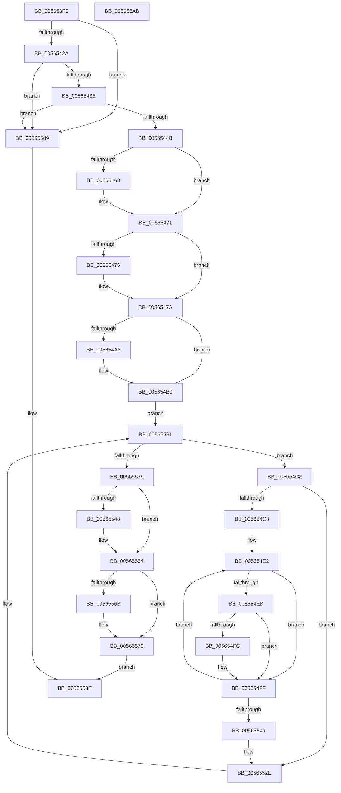

# IommuFinalizeDeviceReset

- RVA: `0x005653F0`–`0x005655AC` (길이 `444` bytes)
- VA: `0x00000001405653F0`
- 실행 섹션: `.text`
- PDB 이름 있음: `예`; PDB Function 태그: `아니요`
- unwind 정보 RVA: `0x00075C18`
- 디코드: `118`개 명령, `444/444` bytes 표시
- 미해석 바이트: `0` (있으면 어셈블리에 `.byte`로 보존)

> 이 문서는 커널 이미지의 기계어와 PDB 기호를 분석해 생성했습니다. 4번과 5번은 함수 원형과 자료형을 바이너리 사용 방식에서 추정한 C 해석이며 원본 소스 복구 결과는 아닙니다.

## 1. Dependencies

- 직접 호출 지점: **12**; 고유 호출 대상: **9**
- 직접 호출자로 확인된 함수: **0**
- RIP 상대 이미지 참조: **2**

### Outgoing calls
- `0x00565453` → [KeAbPreAcquire](../21/KeAbPreAcquire_function_00210230.md) (function, `0x00210230`)
- `0x0056546C` → [ExfAcquirePushLockExclusiveEx](../20/ExfAcquirePushLockExclusiveEx_function_0020FC90.md) (function, `0x0020FC90`)
- `0x0056548D` → [guard_dispatch_icall](../6B/guard_dispatch_icall_function_006BAAD0.md) (function, `0x006BAAD0`)
- `0x005654AB` → [KiRaiseIrqlProcessIrqlFlags](../4F/KiRaiseIrqlProcessIrqlFlags_function_004F56FC.md) (function, `0x004F56FC`)
- `0x005654B4` → [KeAcquireSpinLockAtDpcLevel](../20/KeAcquireSpinLockAtDpcLevel_function_00208430.md) (function, `0x00208430`)
- `0x005654D3` → [KeAcquireSpinLockAtDpcLevel](../20/KeAcquireSpinLockAtDpcLevel_function_00208430.md) (function, `0x00208430`)
- `0x0056550D` → [KxReleaseSpinLock](../20/KxReleaseSpinLock_function_00206670.md) (function, `0x00206670`)
- `0x00565529` → [guard_dispatch_icall](../6B/guard_dispatch_icall_function_006BAAD0.md) (function, `0x006BAAD0`)
- `0x0056553A` → [KxReleaseSpinLock](../20/KxReleaseSpinLock_function_00206670.md) (function, `0x00206670`)
- `0x0056554F` → [KiLowerIrqlProcessIrqlFlags](../4F/KiLowerIrqlProcessIrqlFlags_function_004F5698.md) (function, `0x004F5698`)
- `0x0056556E` → [ExfTryToWakePushLock](../26/ExfTryToWakePushLock_function_00265DD0.md) (function, `0x00265DD0`)
- `0x00565576` → [KeAbPostRelease](../2E/KeAbPostRelease_function_002E1600.md) (function, `0x002E1600`)

### Direct callers
- 이 함수 시작 RVA로 연결되는 직접 call은 확인되지 않았습니다. 간접 호출은 완전히 역산할 수 없습니다.

### Static image references
- `0x00565413` → RVA `0x00FC1710` (`.data`; read)
- `0x0056549F` → RVA `0x00FC6D20` (`ALMOSTRO`; read)

## 2. Other-region calls and transfers

- 다른 실행 섹션으로 향하는 call: **0**
- 별도 외부 분기/꼬리 이동을 확인하지 못했습니다.

## 3. Assembly (complete function range)

```asm
005653F0  48 89 5C 24 08                  mov qword ptr [rsp + 8], rbx
005653F5  48 89 6C 24 10                  mov qword ptr [rsp + 0x10], rbp
005653FA  48 89 74 24 18                  mov qword ptr [rsp + 0x18], rsi
005653FF  57                              push rdi
00565400  41 54                           push r12
00565402  41 55                           push r13
00565404  41 56                           push r14
00565406  41 57                           push r15
00565408  48 83 EC 20                     sub rsp, 0x20
0056540C  48 8B 69 60                     mov rbp, qword ptr [rcx + 0x60]
00565410  45 33 ED                        xor r13d, r13d
00565413  44 38 2D F6 C2 A5 00            cmp byte ptr [rip + 0xa5c2f6], r13b
0056541A  4C 8B F9                        mov r15, rcx
0056541D  45 8A F5                        mov r14b, r13b
00565420  48 8B 75 18                     mov rsi, qword ptr [rbp + 0x18]
00565424  0F 85 5F 01 00 00               jne 0x140565589
0056542A  48 8D 9E 90 01 00 00            lea rbx, [rsi + 0x190]
00565431  4C 39 AE 48 01 00 00            cmp qword ptr [rsi + 0x148], r13
00565438  0F 84 4B 01 00 00               je 0x140565589
0056543E  4C 39 AE 50 01 00 00            cmp qword ptr [rsi + 0x150], r13
00565445  0F 84 3E 01 00 00               je 0x140565589
0056544B  45 33 C0                        xor r8d, r8d
0056544E  33 D2                           xor edx, edx
00565450  48 8B CB                        mov rcx, rbx
00565453  E8 D8 AD CA FF                  call 0x140210230
00565458  F0 48 0F BA 2B 00               lock bts qword ptr [rbx], 0
0056545E  48 8B F8                        mov rdi, rax
00565461  73 0E                           jae 0x140565471
00565463  4C 8B C3                        mov r8, rbx
00565466  48 8B D0                        mov rdx, rax
00565469  48 8B CB                        mov rcx, rbx
0056546C  E8 1F A8 CA FF                  call 0x14020fc90
00565471  48 85 FF                        test rdi, rdi
00565474  74 04                           je 0x14056547a
00565476  C6 47 0A 01                     mov byte ptr [rdi + 0xa], 1
0056547A  48 8B 86 48 01 00 00            mov rax, qword ptr [rsi + 0x148]
00565481  45 8B 47 3C                     mov r8d, dword ptr [r15 + 0x3c]
00565485  48 8B 55 28                     mov rdx, qword ptr [rbp + 0x28]
00565489  48 8B 4E 10                     mov rcx, qword ptr [rsi + 0x10]
0056548D  E8 3E 56 15 00                  call 0x1406baad0
00565492  45 0F 20 C4                     mov r12, cr8
00565496  BA 0F 00 00 00                  mov edx, 0xf
0056549B  44 0F 22 C2                     mov cr8, rdx
0056549F  44 39 2D 7A 18 A6 00            cmp dword ptr [rip + 0xa6187a], r13d
005654A6  74 08                           je 0x1405654b0
005654A8  41 8A CC                        mov cl, r12b
005654AB  E8 4C 02 F9 FF                  call 0x1404f56fc
005654B0  48 8D 4D 10                     lea rcx, [rbp + 0x10]
005654B4  E8 77 2F CA FF                  call 0x140208430
005654B9  4C 8D 7D 38                     lea r15, [rbp + 0x38]
005654BD  49 8B 3F                        mov rdi, qword ptr [r15]
005654C0  EB 6F                           jmp 0x140565531
005654C2  44 38 6F 28                     cmp byte ptr [rdi + 0x28], r13b
005654C6  74 66                           je 0x14056552e
005654C8  48 8D 4B 08                     lea rcx, [rbx + 8]
005654CC  44 88 6F 28                     mov byte ptr [rdi + 0x28], r13b
005654D0  41 B6 01                        mov r14b, 1
005654D3  E8 58 2F CA FF                  call 0x140208430
005654D8  4C 8D 45 58                     lea r8, [rbp + 0x58]
005654DC  41 B9 00 02 00 00               mov r9d, 0x200
005654E2  41 8B 50 04                     mov edx, dword ptr [r8 + 4]
005654E6  41 84 D6                        test r14b, dl
005654E9  74 14                           je 0x1405654ff
005654EB  48 8B 47 20                     mov rax, qword ptr [rdi + 0x20]
005654EF  D1 EA                           shr edx, 1
005654F1  81 E2 FF FF 0F 00               and edx, 0xfffff
005654F7  3B 50 10                        cmp edx, dword ptr [rax + 0x10]
005654FA  75 03                           jne 0x1405654ff
005654FC  4D 21 28                        and qword ptr [r8], r13
005654FF  49 83 C0 08                     add r8, 8
00565503  49 83 E9 01                     sub r9, 1
00565507  75 D9                           jne 0x1405654e2
00565509  48 8D 4B 08                     lea rcx, [rbx + 8]
0056550D  E8 5E 11 CA FF                  call 0x140206670
00565512  4C 8B 47 20                     mov r8, qword ptr [rdi + 0x20]
00565516  48 8B 86 50 01 00 00            mov rax, qword ptr [rsi + 0x150]
0056551D  48 8B 55 28                     mov rdx, qword ptr [rbp + 0x28]
00565521  48 8B 4E 10                     mov rcx, qword ptr [rsi + 0x10]
00565525  45 8B 40 10                     mov r8d, dword ptr [r8 + 0x10]
00565529  E8 A2 55 15 00                  call 0x1406baad0
0056552E  48 8B 3F                        mov rdi, qword ptr [rdi]
00565531  49 3B FF                        cmp rdi, r15
00565534  75 8C                           jne 0x1405654c2
00565536  48 8D 4D 10                     lea rcx, [rbp + 0x10]
0056553A  E8 31 11 CA FF                  call 0x140206670
0056553F  44 39 2D DA 17 A6 00            cmp dword ptr [rip + 0xa617da], r13d
00565546  74 0C                           je 0x140565554
00565548  44 0F 20 C1                     mov rcx, cr8
0056554C  41 8A D4                        mov dl, r12b
0056554F  E8 44 01 F9 FF                  call 0x1404f5698
00565554  41 0F B6 C4                     movzx eax, r12b
00565558  44 0F 22 C0                     mov cr8, rax
0056555C  48 83 C8 FF                     or rax, 0xffffffffffffffff
00565560  F0 48 0F C1 03                  lock xadd qword ptr [rbx], rax
00565565  24 06                           and al, 6
00565567  3C 02                           cmp al, 2
00565569  75 08                           jne 0x140565573
0056556B  48 8B CB                        mov rcx, rbx
0056556E  E8 5D 08 D0 FF                  call 0x140265dd0
00565573  48 8B CB                        mov rcx, rbx
00565576  E8 85 C0 D7 FF                  call 0x1402e1600
0056557B  41 F6 DE                        neg r14b
0056557E  1B C0                           sbb eax, eax
00565580  F7 D0                           not eax
00565582  25 25 02 00 C0                  and eax, 0xc0000225
00565587  EB 05                           jmp 0x14056558e
00565589  B8 BB 00 00 C0                  mov eax, 0xc00000bb
0056558E  48 8B 5C 24 50                  mov rbx, qword ptr [rsp + 0x50]
00565593  48 8B 6C 24 58                  mov rbp, qword ptr [rsp + 0x58]
00565598  48 8B 74 24 60                  mov rsi, qword ptr [rsp + 0x60]
0056559D  48 83 C4 20                     add rsp, 0x20
005655A1  41 5F                           pop r15
005655A3  41 5E                           pop r14
005655A5  41 5D                           pop r13
005655A7  41 5C                           pop r12
005655A9  5F                              pop rdi
005655AA  C3                              ret
005655AB  CC                              int3
```

## 4. C-style interpretation (structured pseudocode)

```c
__int64 __fastcall IommuFinalizeDeviceReset(__int64 a1, int a2, int a3)
{
    __int64 result;
    __int64 v_r13;
    __int64 v_r14;
    __int64 v_rsp;
    unsigned __int64 v_stack_p10;
    unsigned __int64 v_stack_p18;
    unsigned __int64 v_stack_p8;

    v_stack_p8 = v_rbx;
    v_stack_p10 = v_rbp;
    v_stack_p18 = v_rsi;
    v_rsp = (v_rsp) - (32);
    v_r13 = 0;
    if ((*(unsigned __int8 *)(v_rip + 10863350)) != 0) goto loc_00565589;
    if ((*(unsigned __int64 *)(*(unsigned __int64 *)(*(unsigned __int64 *)(a1 + 96) + 24) + 328)) == 0) goto loc_00565589;
    if ((*(unsigned __int64 *)(*(unsigned __int64 *)(*(unsigned __int64 *)(a1 + 96) + 24) + 336)) == 0) goto loc_00565589;
    a3 = 0;
    a2 = 0;
    result = KeAbPreAcquire(*(unsigned __int64 *)(*(unsigned __int64 *)(a1 + 96) + 24) + 400, a2, a3, a4);
    if (!(condition_is_above_or_equal)) {
        a3 = *(unsigned __int64 *)(*(unsigned __int64 *)(a1 + 96) + 24) + 400;
        a2 = result;
        a1 = *(unsigned __int64 *)(*(unsigned __int64 *)(a1 + 96) + 24) + 400;
        result = ExfAcquirePushLockExclusiveEx(a1, a2, a3, a4);
    }
    if (result != 0) {
        *(unsigned __int8 *)(result + 10) = 1;
    }
    result = guard_dispatch_icall(*(unsigned __int64 *)(*(unsigned __int64 *)(*(unsigned __int64 *)(a1 + 96) + 24) + 16), *(unsigned __int64 *)(*(unsigned __int64 *)(a1 + 96) + 40), (unsigned int)(*(unsigned int *)(a1 + 60)), a4);
    if ((*(unsigned int *)(v_rip + 10885242)) != 0) {
        a1 = (unsigned __int8)(v_cr8);
        result = KiRaiseIrqlProcessIrqlFlags(a1, 15, (unsigned int)(*(unsigned int *)(a1 + 60)), a4);
    }
    result = KeAcquireSpinLockAtDpcLevel(*(unsigned __int64 *)(a1 + 96) + 16, 15, (unsigned int)(*(unsigned int *)(a1 + 60)), a4);
    goto loc_00565531;
loc_005654C2:
    if ((*(unsigned __int8 *)(*(unsigned __int64 *)(*(unsigned __int64 *)(a1 + 96) + 56) + 40)) == 0) goto loc_0056552E;
    *(unsigned __int8 *)(*(unsigned __int64 *)(*(unsigned __int64 *)(a1 + 96) + 56) + 40) = 0;
    result = KeAcquireSpinLockAtDpcLevel(*(unsigned __int64 *)(*(unsigned __int64 *)(a1 + 96) + 24) + 400 + 8, 15, (unsigned int)(*(unsigned int *)(a1 + 60)), a4);
loc_005654E2:
    if (((1) & ((unsigned __int8)((unsigned int)(*(unsigned int *)(*(unsigned __int64 *)(a1 + 96) + 88 + 4))))) == 0) goto loc_005654FF;
    a2 = (unsigned int)(((unsigned int)(*(unsigned int *)(*(unsigned __int64 *)(a1 + 96) + 88 + 4))) >> (1));
    a2 = (unsigned int)((a2) & (0xFFFFFULL));
    if (a2 == (*(unsigned int *)(*(unsigned __int64 *)(*(unsigned __int64 *)(*(unsigned __int64 *)(a1 + 96) + 56) + 32) + 16))) {
    }
    a3 = (*(unsigned __int64 *)(a1 + 96) + 88) + (8);
    a4 = (512) - (1);
    if (condition_is_not_equal) goto loc_005654E2;
    result = KxReleaseSpinLock(*(unsigned __int64 *)(*(unsigned __int64 *)(a1 + 96) + 24) + 400 + 8, a2, a3, a4);
    result = guard_dispatch_icall(*(unsigned __int64 *)(*(unsigned __int64 *)(*(unsigned __int64 *)(a1 + 96) + 24) + 16), *(unsigned __int64 *)(*(unsigned __int64 *)(a1 + 96) + 40), (unsigned int)(*(unsigned int *)(*(unsigned __int64 *)(*(unsigned __int64 *)(*(unsigned __int64 *)(a1 + 96) + 56) + 32) + 16)), a4);
loc_0056552E:
loc_00565531:
    if ((*(unsigned __int64 *)(*(unsigned __int64 *)(*(unsigned __int64 *)(a1 + 96) + 56))) != (*(unsigned __int64 *)(a1 + 96) + 56)) goto loc_005654C2;
    result = KxReleaseSpinLock(*(unsigned __int64 *)(a1 + 96) + 16, *(unsigned __int64 *)(*(unsigned __int64 *)(a1 + 96) + 40), (unsigned int)(*(unsigned int *)(*(unsigned __int64 *)(*(unsigned __int64 *)(*(unsigned __int64 *)(a1 + 96) + 56) + 32) + 16)), a4);
    if ((*(unsigned int *)(v_rip + 10885082)) != 0) {
        a1 = 15;
        a2 = (unsigned __int8)(v_cr8);
        result = KiLowerIrqlProcessIrqlFlags(a1, a2, (unsigned int)(*(unsigned int *)(*(unsigned __int64 *)(*(unsigned __int64 *)(*(unsigned __int64 *)(a1 + 96) + 56) + 32) + 16)), a4);
    }
    result = ((unsigned __int8)(v_cr8)) | (-1);
    result = (unsigned __int8)((result) & (6));
    if (((unsigned __int8)(result)) == 2) {
        a1 = *(unsigned __int64 *)(*(unsigned __int64 *)(a1 + 96) + 24) + 400;
        result = ExfTryToWakePushLock(a1, a2, (unsigned int)(*(unsigned int *)(*(unsigned __int64 *)(*(unsigned __int64 *)(*(unsigned __int64 *)(a1 + 96) + 56) + 32) + 16)), a4);
    }
    result = KeAbPostRelease(*(unsigned __int64 *)(*(unsigned __int64 *)(a1 + 96) + 24) + 400, a2, (unsigned int)(*(unsigned int *)(*(unsigned __int64 *)(*(unsigned __int64 *)(*(unsigned __int64 *)(a1 + 96) + 56) + 32) + 16)), a4);
    v_r14 = (unsigned __int8)(-(1));
    result = (unsigned int)(~(result));
    result = (unsigned int)((result) & (0xC0000225ULL));
    goto loc_0056558E;
loc_00565589:
loc_0056558E:
    v_rsp = (v_rsp) + (32);
    return (unsigned int)(0xC00000BBULL);
}
```

## 5. (Beta) C Style

```c
int64_t IommuFinalizeDeviceReset(void *Arg1, int32_t Arg2, int32_t Arg3)
{
    uint8_t *arg1 = (uint8_t *)Arg1;

    int64_t result;
    int64_t local_r13;
    int64_t local_r14;
    int64_t local_rsp;
    uint64_t v_stack_p10;
    uint64_t v_stack_p18;
    uint64_t v_stack_p8;

    v_stack_p8 = local_rbx;
    v_stack_p10 = local_rbp;
    v_stack_p18 = local_rsi;
    local_rsp = (local_rsp) - (32);
    local_r13 = 0;
    if ((*(uint8_t *)(v_rip + 0xA5C2F6)) != 0) goto loc_00565589;
    if ((*(uint64_t *)(*(uint64_t *)(*(uint64_t *)(arg1 + 0x60) + 0x18) + 0x148)) == 0) goto loc_00565589;
    if ((*(uint64_t *)(*(uint64_t *)(*(uint64_t *)(arg1 + 0x60) + 0x18) + 0x150)) == 0) goto loc_00565589;
    Arg3 = 0;
    Arg2 = 0;
    result = KeAbPreAcquire(*(uint64_t *)(*(uint64_t *)(arg1 + 0x60) + 0x18) + 400, Arg2, Arg3, a4);
    if (!(condition_is_above_or_equal)) {
        Arg3 = *(uint64_t *)(*(uint64_t *)(arg1 + 0x60) + 0x18) + 400;
        Arg2 = result;
        Arg1 = *(uint64_t *)(*(uint64_t *)(arg1 + 0x60) + 0x18) + 400;
        result = ExfAcquirePushLockExclusiveEx(Arg1, Arg2, Arg3, a4);
    }
    if (result != 0) {
        *(uint8_t *)(result + 0xA) = 1;
    }
    result = guard_dispatch_icall(*(uint64_t *)(*(uint64_t *)(*(uint64_t *)(arg1 + 0x60) + 0x18) + 0x10), *(uint64_t *)(*(uint64_t *)(arg1 + 0x60) + 0x28), (uint32_t)(*(uint32_t *)(arg1 + 0x3C)), a4);
    if ((*(uint32_t *)(v_rip + 0xA6187A)) != 0) {
        Arg1 = (uint8_t)(v_cr8);
        result = KiRaiseIrqlProcessIrqlFlags(Arg1, 15, (uint32_t)(*(uint32_t *)(arg1 + 0x3C)), a4);
    }
    result = KeAcquireSpinLockAtDpcLevel(*(uint64_t *)(arg1 + 0x60) + 16, 15, (uint32_t)(*(uint32_t *)(arg1 + 0x3C)), a4);
    goto loc_00565531;
loc_005654C2:
    if ((*(uint8_t *)(*(uint64_t *)(*(uint64_t *)(arg1 + 0x60) + 0x38) + 0x28)) == 0) goto loc_0056552E;
    *(uint8_t *)(*(uint64_t *)(*(uint64_t *)(arg1 + 0x60) + 0x38) + 0x28) = 0;
    result = KeAcquireSpinLockAtDpcLevel(*(uint64_t *)(*(uint64_t *)(arg1 + 0x60) + 0x18) + 400 + 8, 15, (uint32_t)(*(uint32_t *)(arg1 + 0x3C)), a4);
loc_005654E2:
    if (((1) & ((uint8_t)((uint32_t)(*(uint32_t *)(*(uint64_t *)(arg1 + 0x60) + 0x58 + 0x4))))) == 0) goto loc_005654FF;
    Arg2 = (uint32_t)(((uint32_t)(*(uint32_t *)(*(uint64_t *)(arg1 + 0x60) + 0x58 + 0x4))) >> (1));
    Arg2 = (uint32_t)((Arg2) & (0xFFFFFULL));
    if (Arg2 == (*(uint32_t *)(*(uint64_t *)(*(uint64_t *)(*(uint64_t *)(arg1 + 0x60) + 0x38) + 0x20) + 0x10))) {
    }
    Arg3 = (*(uint64_t *)(arg1 + 0x60) + 88) + (8);
    a4 = (512) - (1);
    if (condition_is_not_equal) goto loc_005654E2;
    result = KxReleaseSpinLock(*(uint64_t *)(*(uint64_t *)(arg1 + 0x60) + 0x18) + 400 + 8, Arg2, Arg3, a4);
    result = guard_dispatch_icall(*(uint64_t *)(*(uint64_t *)(*(uint64_t *)(arg1 + 0x60) + 0x18) + 0x10), *(uint64_t *)(*(uint64_t *)(arg1 + 0x60) + 0x28), (uint32_t)(*(uint32_t *)(*(uint64_t *)(*(uint64_t *)(*(uint64_t *)(arg1 + 0x60) + 0x38) + 0x20) + 0x10)), a4);
loc_0056552E:
loc_00565531:
    if ((*(uint64_t *)(*(uint64_t *)(*(uint64_t *)(arg1 + 0x60) + 0x38))) != (*(uint64_t *)(arg1 + 0x60) + 56)) goto loc_005654C2;
    result = KxReleaseSpinLock(*(uint64_t *)(arg1 + 0x60) + 16, *(uint64_t *)(*(uint64_t *)(arg1 + 0x60) + 0x28), (uint32_t)(*(uint32_t *)(*(uint64_t *)(*(uint64_t *)(*(uint64_t *)(arg1 + 0x60) + 0x38) + 0x20) + 0x10)), a4);
    if ((*(uint32_t *)(v_rip + 0xA617DA)) != 0) {
        Arg1 = 15;
        Arg2 = (uint8_t)(v_cr8);
        result = KiLowerIrqlProcessIrqlFlags(Arg1, Arg2, (uint32_t)(*(uint32_t *)(*(uint64_t *)(*(uint64_t *)(*(uint64_t *)(arg1 + 0x60) + 0x38) + 0x20) + 0x10)), a4);
    }
    result = ((uint8_t)(v_cr8)) | (-1);
    result = (uint8_t)((result) & (6));
    if (((uint8_t)(result)) == 2) {
        Arg1 = *(uint64_t *)(*(uint64_t *)(arg1 + 0x60) + 0x18) + 400;
        result = ExfTryToWakePushLock(Arg1, Arg2, (uint32_t)(*(uint32_t *)(*(uint64_t *)(*(uint64_t *)(*(uint64_t *)(arg1 + 0x60) + 0x38) + 0x20) + 0x10)), a4);
    }
    result = KeAbPostRelease(*(uint64_t *)(*(uint64_t *)(arg1 + 0x60) + 0x18) + 400, Arg2, (uint32_t)(*(uint32_t *)(*(uint64_t *)(*(uint64_t *)(*(uint64_t *)(arg1 + 0x60) + 0x38) + 0x20) + 0x10)), a4);
    local_r14 = (uint8_t)(-(1));
    result = (uint32_t)(~(result));
    result = (uint32_t)((result) & (0xC0000225ULL));
    goto loc_0056558E;
loc_00565589:
loc_0056558E:
    local_rsp = (local_rsp) + (32);
    return (uint32_t)(0xC00000BBULL);
}
```

### 관측된 메모리 오프셋

구조체 형식이 확인되지 않은 접근은 인자 기준의 오프셋으로만 기록했습니다.

| 기준 인자 | 오프셋 표현 | 폭 (bit) | 접근 |
|---|---:|---:|---|
| `Arg1` | `+ 0x3C` | `32` | `R` |
| `Arg1` | `+ 0x60` | `64` | `R` |

## 6. Execution-region graph

[열기: 2D/3D 그래프와 함수 탐색 컨트롤 패널](../../../control-panel.html?section=text&rva=0x005653F0&view=graph)

- 2D 그래프는 위에서 아래로 흐르고, 3D 그래프는 빈 공간을 드래그해 회전합니다. Shift+드래그는 이동, 휠은 확대·축소, 함수 노드 선택은 대상 보고서 이동입니다.

### Static fallback


