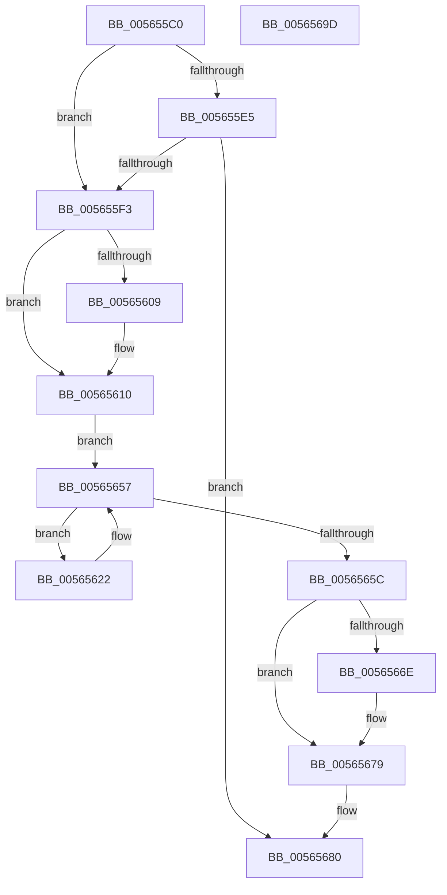

# IommuFlushAllPasid

- RVA: `0x005655C0`–`0x0056569E` (길이 `222` bytes)
- VA: `0x00000001405655C0`
- 실행 섹션: `.text`
- PDB 이름 있음: `예`; PDB Function 태그: `아니요`
- unwind 정보 RVA: `0x00060130`
- 디코드: `57`개 명령, `222/222` bytes 표시
- 미해석 바이트: `0` (있으면 어셈블리에 `.byte`로 보존)

> 이 문서는 커널 이미지의 기계어와 PDB 기호를 분석해 생성했습니다. 4번과 5번은 함수 원형과 자료형을 바이너리 사용 방식에서 추정한 C 해석이며 원본 소스 복구 결과는 아닙니다.

## 1. Dependencies

- 직접 호출 지점: **5**; 고유 호출 대상: **5**
- 직접 호출자로 확인된 함수: **0**
- RIP 상대 이미지 참조: **3**

### Outgoing calls
- `0x0056560B` → [KiRaiseIrqlProcessIrqlFlags](../4F/KiRaiseIrqlProcessIrqlFlags_function_004F56FC.md) (function, `0x004F56FC`)
- `0x00565614` → [KeAcquireSpinLockAtDpcLevel](../20/KeAcquireSpinLockAtDpcLevel_function_00208430.md) (function, `0x00208430`)
- `0x0056564F` → [guard_dispatch_icall](../6B/guard_dispatch_icall_function_006BAAD0.md) (function, `0x006BAAD0`)
- `0x00565660` → [KxReleaseSpinLock](../20/KxReleaseSpinLock_function_00206670.md) (function, `0x00206670`)
- `0x00565674` → [KiLowerIrqlProcessIrqlFlags](../4F/KiLowerIrqlProcessIrqlFlags_function_004F5698.md) (function, `0x004F5698`)

### Direct callers
- 이 함수 시작 RVA로 연결되는 직접 call은 확인되지 않았습니다. 간접 호출은 완전히 역산할 수 없습니다.

### Static image references
- `0x005655D9` → RVA `0x00F475DC` (`.data`; read)
- `0x005655E5` → RVA `0x00FC4060` (`.data`; read)
- `0x00565600` → RVA `0x00FC6D20` (`ALMOSTRO`; read)

## 2. Other-region calls and transfers

- 다른 실행 섹션으로 향하는 call: **0**
- 별도 외부 분기/꼬리 이동을 확인하지 못했습니다.

## 3. Assembly (complete function range)

```asm
005655C0  48 8B C4                        mov rax, rsp
005655C3  48 89 58 08                     mov qword ptr [rax + 8], rbx
005655C7  48 89 68 10                     mov qword ptr [rax + 0x10], rbp
005655CB  48 89 70 18                     mov qword ptr [rax + 0x18], rsi
005655CF  48 89 78 20                     mov qword ptr [rax + 0x20], rdi
005655D3  41 56                           push r14
005655D5  48 83 EC 40                     sub rsp, 0x40
005655D9  80 3D FC 1F 9E 00 00            cmp byte ptr [rip + 0x9e1ffc], 0
005655E0  48 8B F1                        mov rsi, rcx
005655E3  75 0E                           jne 0x1405655f3
005655E5  8B 05 75 EA A5 00               mov eax, dword ptr [rip + 0xa5ea75]
005655EB  85 C0                           test eax, eax
005655ED  0F 8F 8D 00 00 00               jg 0x140565680
005655F3  44 0F 20 C3                     mov rbx, cr8
005655F7  BA 0F 00 00 00                  mov edx, 0xf
005655FC  44 0F 22 C2                     mov cr8, rdx
00565600  83 3D 19 17 A6 00 00            cmp dword ptr [rip + 0xa61719], 0
00565607  74 07                           je 0x140565610
00565609  8A CB                           mov cl, bl
0056560B  E8 EC 00 F9 FF                  call 0x1404f56fc
00565610  48 8D 4E 18                     lea rcx, [rsi + 0x18]
00565614  E8 17 2E CA FF                  call 0x140208430
00565619  4C 8D 76 20                     lea r14, [rsi + 0x20]
0056561D  49 8B 3E                        mov rdi, qword ptr [r14]
00565620  EB 35                           jmp 0x140565657
00565622  48 8B 4F 10                     mov rcx, qword ptr [rdi + 0x10]
00565626  48 8D 57 18                     lea rdx, [rdi + 0x18]
0056562A  48 83 64 24 30 00               and qword ptr [rsp + 0x30], 0
00565630  45 33 C9                        xor r9d, r9d
00565633  83 64 24 28 00                  and dword ptr [rsp + 0x28], 0
00565638  44 8B 46 10                     mov r8d, dword ptr [rsi + 0x10]
0056563C  48 8B 81 F8 00 00 00            mov rax, qword ptr [rcx + 0xf8]
00565643  48 8B 49 10                     mov rcx, qword ptr [rcx + 0x10]
00565647  48 89 54 24 20                  mov qword ptr [rsp + 0x20], rdx
0056564C  83 CA FF                        or edx, 0xffffffff
0056564F  E8 7C 54 15 00                  call 0x1406baad0
00565654  48 8B 3F                        mov rdi, qword ptr [rdi]
00565657  49 3B FE                        cmp rdi, r14
0056565A  75 C6                           jne 0x140565622
0056565C  48 8D 4E 18                     lea rcx, [rsi + 0x18]
00565660  E8 0B 10 CA FF                  call 0x140206670
00565665  83 3D B4 16 A6 00 00            cmp dword ptr [rip + 0xa616b4], 0
0056566C  74 0B                           je 0x140565679
0056566E  44 0F 20 C1                     mov rcx, cr8
00565672  8A D3                           mov dl, bl
00565674  E8 1F 00 F9 FF                  call 0x1404f5698
00565679  0F B6 C3                        movzx eax, bl
0056567C  44 0F 22 C0                     mov cr8, rax
00565680  48 8B 5C 24 50                  mov rbx, qword ptr [rsp + 0x50]
00565685  33 C0                           xor eax, eax
00565687  48 8B 6C 24 58                  mov rbp, qword ptr [rsp + 0x58]
0056568C  48 8B 74 24 60                  mov rsi, qword ptr [rsp + 0x60]
00565691  48 8B 7C 24 68                  mov rdi, qword ptr [rsp + 0x68]
00565696  48 83 C4 40                     add rsp, 0x40
0056569A  41 5E                           pop r14
0056569C  C3                              ret
0056569D  CC                              int3
```

## 4. C-style interpretation (structured pseudocode)

```c
__int64 __fastcall IommuFlushAllPasid(__int64 a1, __int64 a2, __int64 a3, int a4)
{
    __int64 result;
    __int64 v_rsp;
    unsigned __int64 v_stack_m18;
    unsigned int v_stack_m20;
    unsigned __int64 v_stack_m28;
    unsigned __int64 v_stack_p10;
    unsigned __int64 v_stack_p18;
    unsigned __int64 v_stack_p20;
    unsigned __int64 v_stack_p8;

    *(unsigned __int64 *)(v_rsp + 8) = v_rbx;
    *(unsigned __int64 *)(v_rsp + 16) = v_rbp;
    *(unsigned __int64 *)(v_rsp + 24) = v_rsi;
    *(unsigned __int64 *)(v_rsp + 32) = v_rdi;
    v_rsp = (v_rsp) - (64);
    if ((*(unsigned __int8 *)(v_rip + 10362876)) != 0) goto loc_005655F3;
    if (condition_is_greater) goto loc_00565680;
loc_005655F3:
    result = (unsigned int)(*(unsigned int *)(v_rip + 10873461));
    if ((*(unsigned int *)(v_rip + 10884889)) != 0) {
        a1 = (unsigned __int8)(v_cr8);
        result = KiRaiseIrqlProcessIrqlFlags(a1, 15, a3, a4);
    }
    result = KeAcquireSpinLockAtDpcLevel(a1 + 24, 15, a3, a4);
    goto loc_00565657;
loc_00565622:
    a4 = 0;
    v_stack_m28 = *(unsigned __int64 *)(a1 + 32) + 24;
    a2 = (unsigned int)((*(unsigned __int64 *)(a1 + 32) + 24) | (0xFFFFFFFFULL));
    result = guard_dispatch_icall(*(unsigned __int64 *)(*(unsigned __int64 *)(*(unsigned __int64 *)(a1 + 32) + 16) + 16), a2, (unsigned int)(*(unsigned int *)(a1 + 16)), a4);
loc_00565657:
    if ((*(unsigned __int64 *)(*(unsigned __int64 *)(a1 + 32))) != (a1 + 32)) goto loc_00565622;
    result = KxReleaseSpinLock(a1 + 24, a2, (unsigned int)(*(unsigned int *)(a1 + 16)), a4);
    if ((*(unsigned int *)(v_rip + 10884788)) != 0) {
        a1 = 15;
        a2 = (unsigned __int8)(v_cr8);
        result = KiLowerIrqlProcessIrqlFlags(a1, a2, (unsigned int)(*(unsigned int *)(a1 + 16)), a4);
    }
loc_00565680:
    result = 0;
    v_rsp = (v_rsp) + (64);
    return result;
}
```

## 5. (Beta) C Style

```c
int64_t IommuFlushAllPasid(void *Arg1, int64_t Arg2, int64_t Arg3, int32_t Arg4)
{
    uint8_t *arg1 = (uint8_t *)Arg1;

    int64_t result;
    int64_t local_rsp;
    uint64_t v_stack_m18;
    uint32_t v_stack_m20;
    uint64_t v_stack_m28;
    uint64_t v_stack_p10;
    uint64_t v_stack_p18;
    uint64_t v_stack_p20;
    uint64_t v_stack_p8;

    *(uint64_t *)(local_rsp + 0x8) = local_rbx;
    *(uint64_t *)(local_rsp + 0x10) = local_rbp;
    *(uint64_t *)(local_rsp + 0x18) = local_rsi;
    *(uint64_t *)(local_rsp + 0x20) = local_rdi;
    local_rsp = (local_rsp) - (64);
    if ((*(uint8_t *)(v_rip + 0x9E1FFC)) != 0) goto loc_005655F3;
    if (condition_is_greater) goto loc_00565680;
loc_005655F3:
    result = (uint32_t)(*(uint32_t *)(v_rip + 0xA5EA75));
    if ((*(uint32_t *)(v_rip + 0xA61719)) != 0) {
        Arg1 = (uint8_t)(v_cr8);
        result = KiRaiseIrqlProcessIrqlFlags(Arg1, 15, Arg3, Arg4);
    }
    result = KeAcquireSpinLockAtDpcLevel(Arg1 + 24, 15, Arg3, Arg4);
    goto loc_00565657;
loc_00565622:
    Arg4 = 0;
    v_stack_m28 = *(uint64_t *)(arg1 + 0x20) + 24;
    Arg2 = (uint32_t)((*(uint64_t *)(arg1 + 0x20) + 24) | (0xFFFFFFFFULL));
    result = guard_dispatch_icall(*(uint64_t *)(*(uint64_t *)(*(uint64_t *)(arg1 + 0x20) + 0x10) + 0x10), Arg2, (uint32_t)(*(uint32_t *)(arg1 + 0x10)), Arg4);
loc_00565657:
    if ((*(uint64_t *)(*(uint64_t *)(arg1 + 0x20))) != (Arg1 + 32)) goto loc_00565622;
    result = KxReleaseSpinLock(Arg1 + 24, Arg2, (uint32_t)(*(uint32_t *)(arg1 + 0x10)), Arg4);
    if ((*(uint32_t *)(v_rip + 0xA616B4)) != 0) {
        Arg1 = 15;
        Arg2 = (uint8_t)(v_cr8);
        result = KiLowerIrqlProcessIrqlFlags(Arg1, Arg2, (uint32_t)(*(uint32_t *)(arg1 + 0x10)), Arg4);
    }
loc_00565680:
    result = 0;
    local_rsp = (local_rsp) + (64);
    return result;
}
```

### 관측된 메모리 오프셋

구조체 형식이 확인되지 않은 접근은 인자 기준의 오프셋으로만 기록했습니다.

| 기준 인자 | 오프셋 표현 | 폭 (bit) | 접근 |
|---|---:|---:|---|
| `Arg1` | `+ 0x0` | `64` | `R` |
| `Arg1` | `+ 0x10` | `32` | `R` |
| `Arg1` | `+ 0x18` | `64` | `R` |
| `Arg1` | `+ 0x20` | `64` | `R` |

## 6. Execution-region graph

[열기: 2D/3D 그래프와 함수 탐색 컨트롤 패널](../../../control-panel.html?section=text&rva=0x005655C0&view=graph)

- 2D 그래프는 위에서 아래로 흐르고, 3D 그래프는 빈 공간을 드래그해 회전합니다. Shift+드래그는 이동, 휠은 확대·축소, 함수 노드 선택은 대상 보고서 이동입니다.

### Static fallback


