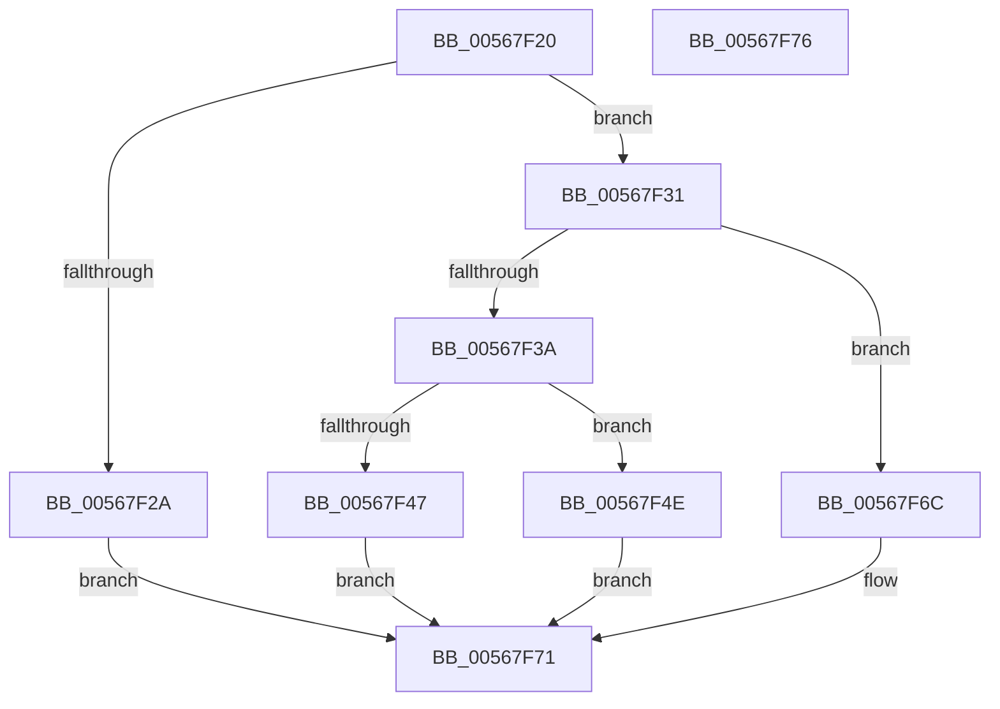

# IommuFlushDomain

- RVA: `0x00567F20`–`0x00567F77` (길이 `87` bytes)
- VA: `0x0000000140567F20`
- 실행 섹션: `.text`
- PDB 이름 있음: `예`; PDB Function 태그: `아니요`
- unwind 정보 RVA: `0x0005C788`
- 디코드: `24`개 명령, `87/87` bytes 표시
- 미해석 바이트: `0` (있으면 어셈블리에 `.byte`로 보존)

> 이 문서는 커널 이미지의 기계어와 PDB 기호를 분석해 생성했습니다. 4번과 5번은 함수 원형과 자료형을 바이너리 사용 방식에서 추정한 C 해석이며 원본 소스 복구 결과는 아닙니다.

## 1. Dependencies

- 직접 호출 지점: **1**; 고유 호출 대상: **1**
- 직접 호출자로 확인된 함수: **0**
- RIP 상대 이미지 참조: **2**

### Outgoing calls
- `0x00567F65` → [guard_dispatch_icall](../6B/guard_dispatch_icall_function_006BAAD0.md) (function, `0x006BAAD0`)

### Direct callers
- 이 함수 시작 RVA로 연결되는 직접 call은 확인되지 않았습니다. 간접 호출은 완전히 역산할 수 없습니다.

### Static image references
- `0x00567F31` → RVA `0x00FC1710` (`.data`; read)
- `0x00567F5A` → RVA `0x00FC1EA0` (`.data`; read)

## 2. Other-region calls and transfers

- 다른 실행 섹션으로 향하는 call: **0**
- 별도 외부 분기/꼬리 이동을 확인하지 못했습니다.

## 3. Assembly (complete function range)

```asm
00567F20  48 83 EC 28                     sub rsp, 0x28
00567F24  83 79 08 02                     cmp dword ptr [rcx + 8], 2
00567F28  74 07                           je 0x140567f31
00567F2A  B8 EF 00 00 C0                  mov eax, 0xc00000ef
00567F2F  EB 40                           jmp 0x140567f71
00567F31  80 3D D8 97 A5 00 00            cmp byte ptr [rip + 0xa597d8], 0
00567F38  74 32                           je 0x140567f6c
00567F3A  8A 51 34                        mov dl, byte ptr [rcx + 0x34]
00567F3D  48 83 64 24 30 00               and qword ptr [rsp + 0x30], 0
00567F43  84 D2                           test dl, dl
00567F45  75 07                           jne 0x140567f4e
00567F47  B8 BB 00 00 C0                  mov eax, 0xc00000bb
00567F4C  EB 23                           jmp 0x140567f71
00567F4E  8B 41 30                        mov eax, dword ptr [rcx + 0x30]
00567F51  48 8D 4C 24 30                  lea rcx, [rsp + 0x30]
00567F56  89 44 24 30                     mov dword ptr [rsp + 0x30], eax
00567F5A  48 8B 05 3F 9F A5 00            mov rax, qword ptr [rip + 0xa59f3f]
00567F61  88 54 24 34                     mov byte ptr [rsp + 0x34], dl
00567F65  E8 66 2B 15 00                  call 0x1406baad0
00567F6A  EB 05                           jmp 0x140567f71
00567F6C  B8 02 00 00 C0                  mov eax, 0xc0000002
00567F71  48 83 C4 28                     add rsp, 0x28
00567F75  C3                              ret
00567F76  CC                              int3
```

## 4. C-style interpretation (structured pseudocode)

```c
__int64 __fastcall IommuFlushDomain(__int64 a1)
{
    __int64 result;
    __int64 v_rsp;
    unsigned __int64 v_stack_p8;
    unsigned __int8 v_stack_pC;

    v_rsp = (v_rsp) - (40);
    if ((*(unsigned int *)(a1 + 8)) == 2) goto loc_00567F31;
    goto loc_00567F71;
loc_00567F31:
    if ((*(unsigned __int8 *)(v_rip + 10852312)) == 0) goto loc_00567F6C;
    if ((unsigned __int8)(*(unsigned __int8 *)(a1 + 52)) != 0) goto loc_00567F4E;
    goto loc_00567F71;
loc_00567F4E:
    v_stack_p8 = (unsigned int)((unsigned int)(*(unsigned int *)(a1 + 48)));
    v_stack_pC = (unsigned __int8)(*(unsigned __int8 *)(a1 + 52));
    result = guard_dispatch_icall(v_stack_p8, *(unsigned __int8 *)(a1 + 52), a3, a4);
    goto loc_00567F71;
loc_00567F6C:
loc_00567F71:
    v_rsp = (v_rsp) + (40);
    return (unsigned int)(0xC0000002ULL);
}
```

## 5. (Beta) C Style

```c
int64_t IommuFlushDomain(void *Arg1)
{
    uint8_t *arg1 = (uint8_t *)Arg1;

    int64_t result;
    int64_t local_rsp;
    uint64_t v_stack_p8;
    uint8_t v_stack_pC;

    local_rsp = (local_rsp) - (40);
    if ((*(uint32_t *)(arg1 + 0x8)) == 2) goto loc_00567F31;
    goto loc_00567F71;
loc_00567F31:
    if ((*(uint8_t *)(v_rip + 0xA597D8)) == 0) goto loc_00567F6C;
    if ((uint8_t)(*(uint8_t *)(arg1 + 0x34)) != 0) goto loc_00567F4E;
    goto loc_00567F71;
loc_00567F4E:
    v_stack_p8 = (uint32_t)((uint32_t)(*(uint32_t *)(arg1 + 0x30)));
    v_stack_pC = (uint8_t)(*(uint8_t *)(arg1 + 0x34));
    result = guard_dispatch_icall(v_stack_p8, *(uint8_t *)(arg1 + 0x34), a3, a4);
    goto loc_00567F71;
loc_00567F6C:
loc_00567F71:
    local_rsp = (local_rsp) + (40);
    return (uint32_t)(0xC0000002ULL);
}
```

### 관측된 메모리 오프셋

구조체 형식이 확인되지 않은 접근은 인자 기준의 오프셋으로만 기록했습니다.

| 기준 인자 | 오프셋 표현 | 폭 (bit) | 접근 |
|---|---:|---:|---|
| `Arg1` | `+ 0x8` | `32` | `R` |
| `Arg1` | `+ 0x30` | `32` | `R` |
| `Arg1` | `+ 0x34` | `8` | `R` |

## 6. Execution-region graph

[열기: 2D/3D 그래프와 함수 탐색 컨트롤 패널](../../../control-panel.html?section=text&rva=0x00567F20&view=graph)

- 2D 그래프는 위에서 아래로 흐르고, 3D 그래프는 빈 공간을 드래그해 회전합니다. Shift+드래그는 이동, 휠은 확대·축소, 함수 노드 선택은 대상 보고서 이동입니다.

### Static fallback


