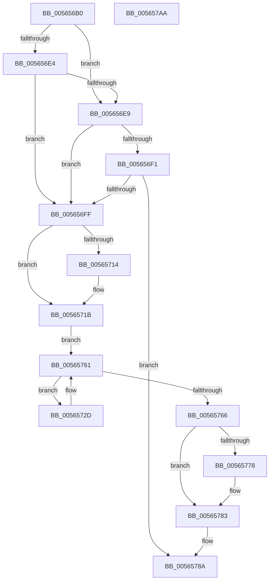

# IommuFlushTb

- RVA: `0x005656B0`–`0x005657AB` (길이 `251` bytes)
- VA: `0x00000001405656B0`
- 실행 섹션: `.text`
- PDB 이름 있음: `예`; PDB Function 태그: `아니요`
- unwind 정보 RVA: `0x000AC264`
- 디코드: `72`개 명령, `251/251` bytes 표시
- 미해석 바이트: `0` (있으면 어셈블리에 `.byte`로 보존)

> 이 문서는 커널 이미지의 기계어와 PDB 기호를 분석해 생성했습니다. 4번과 5번은 함수 원형과 자료형을 바이너리 사용 방식에서 추정한 C 해석이며 원본 소스 복구 결과는 아닙니다.

## 1. Dependencies

- 직접 호출 지점: **6**; 고유 호출 대상: **6**
- 직접 호출자로 확인된 함수: **1**
- RIP 상대 이미지 참조: **3**

### Outgoing calls
- `0x005656D9` → [Feature_Test57481295__private_IsEnabledDeviceUsageNoInline](../4F/Feature_Test57481295__private_IsEnabledDeviceUsageNoInline_function_004F7B90.md) (function, `0x004F7B90`)
- `0x00565716` → [KiRaiseIrqlProcessIrqlFlags](../4F/KiRaiseIrqlProcessIrqlFlags_function_004F56FC.md) (function, `0x004F56FC`)
- `0x0056571F` → [KeAcquireSpinLockAtDpcLevel](../20/KeAcquireSpinLockAtDpcLevel_function_00208430.md) (function, `0x00208430`)
- `0x00565759` → [guard_dispatch_icall](../6B/guard_dispatch_icall_function_006BAAD0.md) (function, `0x006BAAD0`)
- `0x0056576A` → [KxReleaseSpinLock](../20/KxReleaseSpinLock_function_00206670.md) (function, `0x00206670`)
- `0x0056577E` → [KiLowerIrqlProcessIrqlFlags](../4F/KiLowerIrqlProcessIrqlFlags_function_004F5698.md) (function, `0x004F5698`)

### Direct callers
- [sub_006E0B80](../6E/Unknown_function_006E0B80.md) at `0x006E0B97`

### Static image references
- `0x005656E9` → RVA `0x00F475DC` (`.data`; read)
- `0x005656F1` → RVA `0x00FC4060` (`.data`; read)
- `0x0056570C` → RVA `0x00FC6D20` (`ALMOSTRO`; read)

## 2. Other-region calls and transfers

- 다른 실행 섹션으로 향하는 call: **0**
- 별도 외부 분기/꼬리 이동을 확인하지 못했습니다.

## 3. Assembly (complete function range)

```asm
005656B0  48 89 5C 24 08                  mov qword ptr [rsp + 8], rbx
005656B5  48 89 6C 24 10                  mov qword ptr [rsp + 0x10], rbp
005656BA  48 89 74 24 18                  mov qword ptr [rsp + 0x18], rsi
005656BF  57                              push rdi
005656C0  41 54                           push r12
005656C2  41 55                           push r13
005656C4  41 56                           push r14
005656C6  41 57                           push r15
005656C8  48 83 EC 40                     sub rsp, 0x40
005656CC  48 8B 79 08                     mov rdi, qword ptr [rcx + 8]
005656D0  4D 8B F8                        mov r15, r8
005656D3  4C 8B 29                        mov r13, qword ptr [rcx]
005656D6  44 8B E2                        mov r12d, edx
005656D9  E8 B2 24 F9 FF                  call 0x1404f7b90
005656DE  33 C9                           xor ecx, ecx
005656E0  85 C0                           test eax, eax
005656E2  74 05                           je 0x1405656e9
005656E4  38 4F 38                        cmp byte ptr [rdi + 0x38], cl
005656E7  74 16                           je 0x1405656ff
005656E9  38 0D ED 1E 9E 00               cmp byte ptr [rip + 0x9e1eed], cl
005656EF  75 0E                           jne 0x1405656ff
005656F1  8B 05 69 E9 A5 00               mov eax, dword ptr [rip + 0xa5e969]
005656F7  85 C0                           test eax, eax
005656F9  0F 8F 8B 00 00 00               jg 0x14056578a
005656FF  44 0F 20 C3                     mov rbx, cr8
00565703  BA 0F 00 00 00                  mov edx, 0xf
00565708  44 0F 22 C2                     mov cr8, rdx
0056570C  39 0D 0E 16 A6 00               cmp dword ptr [rip + 0xa6160e], ecx
00565712  74 07                           je 0x14056571b
00565714  8A CB                           mov cl, bl
00565716  E8 E1 FF F8 FF                  call 0x1404f56fc
0056571B  48 8D 4F 18                     lea rcx, [rdi + 0x18]
0056571F  E8 0C 2D CA FF                  call 0x140208430
00565724  4C 8D 77 28                     lea r14, [rdi + 0x28]
00565728  49 8B 36                        mov rsi, qword ptr [r14]
0056572B  EB 34                           jmp 0x140565761
0056572D  48 8B 4E 10                     mov rcx, qword ptr [rsi + 0x10]
00565731  48 8D 56 18                     lea rdx, [rsi + 0x18]
00565735  45 8B 45 10                     mov r8d, dword ptr [r13 + 0x10]
00565739  45 33 C9                        xor r9d, r9d
0056573C  4C 89 7C 24 30                  mov qword ptr [rsp + 0x30], r15
00565741  44 89 64 24 28                  mov dword ptr [rsp + 0x28], r12d
00565746  48 8B 81 F8 00 00 00            mov rax, qword ptr [rcx + 0xf8]
0056574D  48 8B 49 10                     mov rcx, qword ptr [rcx + 0x10]
00565751  48 89 54 24 20                  mov qword ptr [rsp + 0x20], rdx
00565756  8B 57 10                        mov edx, dword ptr [rdi + 0x10]
00565759  E8 72 53 15 00                  call 0x1406baad0
0056575E  48 8B 36                        mov rsi, qword ptr [rsi]
00565761  49 3B F6                        cmp rsi, r14
00565764  75 C7                           jne 0x14056572d
00565766  48 8D 4F 18                     lea rcx, [rdi + 0x18]
0056576A  E8 01 0F CA FF                  call 0x140206670
0056576F  83 3D AA 15 A6 00 00            cmp dword ptr [rip + 0xa615aa], 0
00565776  74 0B                           je 0x140565783
00565778  44 0F 20 C1                     mov rcx, cr8
0056577C  8A D3                           mov dl, bl
0056577E  E8 15 FF F8 FF                  call 0x1404f5698
00565783  0F B6 C3                        movzx eax, bl
00565786  44 0F 22 C0                     mov cr8, rax
0056578A  4C 8D 5C 24 40                  lea r11, [rsp + 0x40]
0056578F  33 C0                           xor eax, eax
00565791  49 8B 5B 30                     mov rbx, qword ptr [r11 + 0x30]
00565795  49 8B 6B 38                     mov rbp, qword ptr [r11 + 0x38]
00565799  49 8B 73 40                     mov rsi, qword ptr [r11 + 0x40]
0056579D  49 8B E3                        mov rsp, r11
005657A0  41 5F                           pop r15
005657A2  41 5E                           pop r14
005657A4  41 5D                           pop r13
005657A6  41 5C                           pop r12
005657A8  5F                              pop rdi
005657A9  C3                              ret
005657AA  CC                              int3
```

## 4. C-style interpretation (structured pseudocode)

```c
__int64 __fastcall IommuFlushTb(__int64 a1, int a2, __int64 a3, int a4)
{
    __int64 result;
    __int64 v_rsp;
    unsigned __int64 v_stack_m28;
    unsigned __int64 v_stack_m38;
    unsigned int v_stack_m40;
    unsigned __int64 v_stack_m48;
    unsigned __int64 v_stack_p10;
    unsigned __int64 v_stack_p18;
    unsigned __int64 v_stack_p8;

    v_stack_p8 = v_rbx;
    v_stack_p10 = v_rbp;
    v_stack_p18 = v_rsi;
    v_rsp = (v_rsp) - (64);
    result = Feature_Test57481295__private_IsEnabledDeviceUsageNoInline(a1, a2, a3, a4);
    a1 = 0;
    if ((unsigned int)(result) == 0) goto loc_005656E9;
    if ((*(unsigned __int8 *)(*(unsigned __int64 *)(a1 + 8) + 56)) == 0) goto loc_005656FF;
loc_005656E9:
    if ((*(unsigned __int8 *)(v_rip + 10362605)) != 0) goto loc_005656FF;
    if (condition_is_greater) goto loc_0056578A;
loc_005656FF:
    result = (unsigned int)(*(unsigned int *)(v_rip + 10873193));
    if ((*(unsigned int *)(v_rip + 10884622)) != 0) {
        a1 = (unsigned __int8)(v_cr8);
        result = KiRaiseIrqlProcessIrqlFlags(a1, 15, a3, a4);
    }
    result = KeAcquireSpinLockAtDpcLevel(*(unsigned __int64 *)(a1 + 8) + 24, 15, a3, a4);
    goto loc_00565761;
loc_0056572D:
    a4 = 0;
    v_stack_m38 = a3;
    v_stack_m40 = (unsigned int)((unsigned int)(a2));
    v_stack_m48 = *(unsigned __int64 *)(*(unsigned __int64 *)(a1 + 8) + 40) + 24;
    result = guard_dispatch_icall(*(unsigned __int64 *)(*(unsigned __int64 *)(*(unsigned __int64 *)(*(unsigned __int64 *)(a1 + 8) + 40) + 16) + 16), (unsigned int)(*(unsigned int *)(*(unsigned __int64 *)(a1 + 8) + 16)), (unsigned int)(*(unsigned int *)(*(unsigned __int64 *)(a1) + 16)), a4);
loc_00565761:
    if ((*(unsigned __int64 *)(*(unsigned __int64 *)(*(unsigned __int64 *)(a1 + 8) + 40))) != (*(unsigned __int64 *)(a1 + 8) + 40)) goto loc_0056572D;
    result = KxReleaseSpinLock(*(unsigned __int64 *)(a1 + 8) + 24, (unsigned int)(*(unsigned int *)(*(unsigned __int64 *)(a1 + 8) + 16)), (unsigned int)(*(unsigned int *)(*(unsigned __int64 *)(a1) + 16)), a4);
    if ((*(unsigned int *)(v_rip + 10884522)) != 0) {
        a1 = 15;
        a2 = (unsigned __int8)(v_cr8);
        result = KiLowerIrqlProcessIrqlFlags(a1, a2, (unsigned int)(*(unsigned int *)(*(unsigned __int64 *)(a1) + 16)), a4);
    }
loc_0056578A:
    result = 0;
    return result;
}
```

## 5. (Beta) C Style

```c
int64_t IommuFlushTb(void *Arg1, int32_t Arg2, int64_t Arg3, int32_t Arg4)
{
    uint8_t *arg1 = (uint8_t *)Arg1;

    int64_t result;
    int64_t local_rsp;
    uint64_t v_stack_m28;
    uint64_t v_stack_m38;
    uint32_t v_stack_m40;
    uint64_t v_stack_m48;
    uint64_t v_stack_p10;
    uint64_t v_stack_p18;
    uint64_t v_stack_p8;

    v_stack_p8 = local_rbx;
    v_stack_p10 = local_rbp;
    v_stack_p18 = local_rsi;
    local_rsp = (local_rsp) - (64);
    result = Feature_Test57481295__private_IsEnabledDeviceUsageNoInline(Arg1, Arg2, Arg3, Arg4);
    Arg1 = 0;
    if ((uint32_t)(result) == 0) goto loc_005656E9;
    if ((*(uint8_t *)(*(uint64_t *)(arg1 + 0x8) + 0x38)) == 0) goto loc_005656FF;
loc_005656E9:
    if ((*(uint8_t *)(v_rip + 0x9E1EED)) != 0) goto loc_005656FF;
    if (condition_is_greater) goto loc_0056578A;
loc_005656FF:
    result = (uint32_t)(*(uint32_t *)(v_rip + 0xA5E969));
    if ((*(uint32_t *)(v_rip + 0xA6160E)) != 0) {
        Arg1 = (uint8_t)(v_cr8);
        result = KiRaiseIrqlProcessIrqlFlags(Arg1, 15, Arg3, Arg4);
    }
    result = KeAcquireSpinLockAtDpcLevel(*(uint64_t *)(arg1 + 0x8) + 24, 15, Arg3, Arg4);
    goto loc_00565761;
loc_0056572D:
    Arg4 = 0;
    v_stack_m38 = Arg3;
    v_stack_m40 = (uint32_t)((uint32_t)(Arg2));
    v_stack_m48 = *(uint64_t *)(*(uint64_t *)(arg1 + 0x8) + 0x28) + 24;
    result = guard_dispatch_icall(*(uint64_t *)(*(uint64_t *)(*(uint64_t *)(*(uint64_t *)(arg1 + 0x8) + 0x28) + 0x10) + 0x10), (uint32_t)(*(uint32_t *)(*(uint64_t *)(arg1 + 0x8) + 0x10)), (uint32_t)(*(uint32_t *)(*(uint64_t *)(arg1) + 0x10)), Arg4);
loc_00565761:
    if ((*(uint64_t *)(*(uint64_t *)(*(uint64_t *)(arg1 + 0x8) + 0x28))) != (*(uint64_t *)(arg1 + 0x8) + 40)) goto loc_0056572D;
    result = KxReleaseSpinLock(*(uint64_t *)(arg1 + 0x8) + 24, (uint32_t)(*(uint32_t *)(*(uint64_t *)(arg1 + 0x8) + 0x10)), (uint32_t)(*(uint32_t *)(*(uint64_t *)(arg1) + 0x10)), Arg4);
    if ((*(uint32_t *)(v_rip + 0xA615AA)) != 0) {
        Arg1 = 15;
        Arg2 = (uint8_t)(v_cr8);
        result = KiLowerIrqlProcessIrqlFlags(Arg1, Arg2, (uint32_t)(*(uint32_t *)(*(uint64_t *)(arg1) + 0x10)), Arg4);
    }
loc_0056578A:
    result = 0;
    return result;
}
```

### 관측된 메모리 오프셋

구조체 형식이 확인되지 않은 접근은 인자 기준의 오프셋으로만 기록했습니다.

| 기준 인자 | 오프셋 표현 | 폭 (bit) | 접근 |
|---|---:|---:|---|
| `Arg1` | `+ 0x0` | `64` | `R` |
| `Arg1` | `+ 0x8` | `64` | `R` |

## 6. Execution-region graph

[열기: 2D/3D 그래프와 함수 탐색 컨트롤 패널](../../../control-panel.html?section=text&rva=0x005656B0&view=graph)

- 2D 그래프는 위에서 아래로 흐르고, 3D 그래프는 빈 공간을 드래그해 회전합니다. Shift+드래그는 이동, 휠은 확대·축소, 함수 노드 선택은 대상 보고서 이동입니다.

### Static fallback


