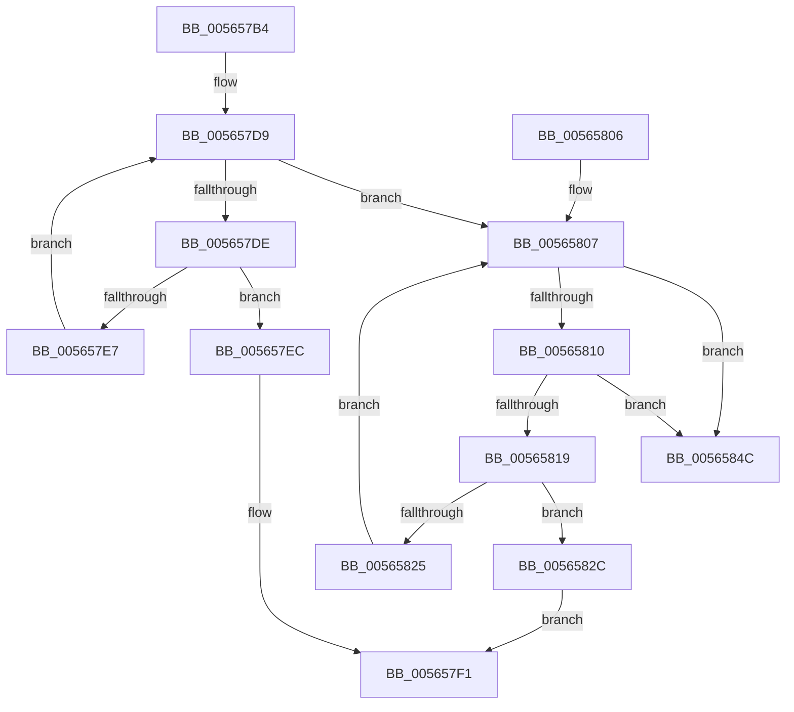

# IommuFreeLibraryContext

- RVA: `0x005657B4`–`0x00565853` (길이 `159` bytes)
- VA: `0x00000001405657B4`
- 실행 섹션: `.text`
- PDB 이름 있음: `예`; PDB Function 태그: `아니요`
- unwind 정보 RVA: `0x00066C70`
- 디코드: `48`개 명령, `159/159` bytes 표시
- 미해석 바이트: `0` (있으면 어셈블리에 `.byte`로 보존)

> 이 문서는 커널 이미지의 기계어와 PDB 기호를 분석해 생성했습니다. 4번과 5번은 함수 원형과 자료형을 바이너리 사용 방식에서 추정한 C 해석이며 원본 소스 복구 결과는 아닙니다.

## 1. Dependencies

- 직접 호출 지점: **4**; 고유 호출 대상: **2**
- 직접 호출자로 확인된 함수: **1**
- RIP 상대 이미지 참조: **0**

### Outgoing calls
- `0x00565825` → [HalpMmAllocCtxFree](../3E/HalpMmAllocCtxFree_function_003E1904.md) (function, `0x003E1904`)
- `0x0056582F` → [HalpMmAllocCtxFree](../3E/HalpMmAllocCtxFree_function_003E1904.md) (function, `0x003E1904`)
- `0x0056583B` → [IommupFreeSystemContext](IommupFreeSystemContext_function_00566234.md) (function, `0x00566234`)
- `0x00565843` → [HalpMmAllocCtxFree](../3E/HalpMmAllocCtxFree_function_003E1904.md) (function, `0x003E1904`)

### Direct callers
- [IommupPasidDeviceDelete](../55/IommupPasidDeviceDelete_function_00550030.md) at `0x005500E9`

### Static image references
- 디코드된 RIP-relative 메모리 참조가 없습니다.

## 2. Other-region calls and transfers

- 다른 실행 섹션으로 향하는 call: **0**
- 별도 외부 분기/꼬리 이동을 확인하지 못했습니다.

## 3. Assembly (complete function range)

```asm
005657B4  48 89 5C 24 08                  mov qword ptr [rsp + 8], rbx
005657B9  48 89 6C 24 10                  mov qword ptr [rsp + 0x10], rbp
005657BE  48 89 74 24 18                  mov qword ptr [rsp + 0x18], rsi
005657C3  57                              push rdi
005657C4  48 83 EC 20                     sub rsp, 0x20
005657C8  48 8B 71 08                     mov rsi, qword ptr [rcx + 8]
005657CC  48 8B F9                        mov rdi, rcx
005657CF  48 8B 29                        mov rbp, qword ptr [rcx]
005657D2  48 8D 5E 28                     lea rbx, [rsi + 0x28]
005657D6  48 8B 13                        mov rdx, qword ptr [rbx]
005657D9  48 3B D3                        cmp rdx, rbx
005657DC  74 29                           je 0x140565807
005657DE  48 8D 42 18                     lea rax, [rdx + 0x18]
005657E2  48 39 00                        cmp qword ptr [rax], rax
005657E5  75 05                           jne 0x1405657ec
005657E7  48 8B 12                        mov rdx, qword ptr [rdx]
005657EA  EB ED                           jmp 0x1405657d9
005657EC  B8 01 00 00 C0                  mov eax, 0xc0000001
005657F1  48 8B 5C 24 30                  mov rbx, qword ptr [rsp + 0x30]
005657F6  48 8B 6C 24 38                  mov rbp, qword ptr [rsp + 0x38]
005657FB  48 8B 74 24 40                  mov rsi, qword ptr [rsp + 0x40]
00565800  48 83 C4 20                     add rsp, 0x20
00565804  5F                              pop rdi
00565805  C3                              ret
00565806  CC                              int3
00565807  48 8B 13                        mov rdx, qword ptr [rbx]
0056580A  48 39 5A 08                     cmp qword ptr [rdx + 8], rbx
0056580E  75 3C                           jne 0x14056584c
00565810  48 8B 02                        mov rax, qword ptr [rdx]
00565813  48 39 50 08                     cmp qword ptr [rax + 8], rdx
00565817  75 33                           jne 0x14056584c
00565819  48 89 03                        mov qword ptr [rbx], rax
0056581C  48 89 58 08                     mov qword ptr [rax + 8], rbx
00565820  48 3B D3                        cmp rdx, rbx
00565823  74 07                           je 0x14056582c
00565825  E8 DA C0 E7 FF                  call 0x1403e1904
0056582A  EB DB                           jmp 0x140565807
0056582C  48 8B D6                        mov rdx, rsi
0056582F  E8 D0 C0 E7 FF                  call 0x1403e1904
00565834  48 83 27 00                     and qword ptr [rdi], 0
00565838  48 8B CD                        mov rcx, rbp
0056583B  E8 F4 09 00 00                  call 0x140566234
00565840  48 8B D7                        mov rdx, rdi
00565843  E8 BC C0 E7 FF                  call 0x1403e1904
00565848  33 C0                           xor eax, eax
0056584A  EB A5                           jmp 0x1405657f1
0056584C  B9 03 00 00 00                  mov ecx, 3
00565851  CD 29                           int 0x29
```

## 4. C-style interpretation (structured pseudocode)

```c
__int64 __fastcall IommuFreeLibraryContext(__int64 a1)
{
    __int64 result;
    __int64 v_rsp;
    unsigned __int64 v_stack_p10;
    unsigned __int64 v_stack_p18;
    unsigned __int64 v_stack_p8;

    v_stack_p8 = v_rbx;
    v_stack_p10 = v_rbp;
    v_stack_p18 = v_rsi;
    v_rsp = (v_rsp) - (32);
loc_005657D9:
    if ((*(unsigned __int64 *)(*(unsigned __int64 *)(a1 + 8) + 40)) == (*(unsigned __int64 *)(a1 + 8) + 40)) goto loc_00565807;
    if ((*(unsigned __int64 *)(*(unsigned __int64 *)(*(unsigned __int64 *)(a1 + 8) + 40) + 24)) != (*(unsigned __int64 *)(*(unsigned __int64 *)(a1 + 8) + 40) + 24)) goto loc_005657EC;
    goto loc_005657D9;
loc_005657EC:
loc_005657F1:
    v_rsp = (v_rsp) + (32);
    return (unsigned int)(0xC0000001ULL);
loc_00565807:
    if ((*(unsigned __int64 *)(*(unsigned __int64 *)(v_stack_p8) + 8)) != v_stack_p8) goto loc_0056584C;
    if ((*(unsigned __int64 *)(*(unsigned __int64 *)(*(unsigned __int64 *)(v_stack_p8)) + 8)) != (*(unsigned __int64 *)(v_stack_p8))) goto loc_0056584C;
    *(unsigned __int64 *)(v_stack_p8) = *(unsigned __int64 *)(*(unsigned __int64 *)(v_stack_p8));
    *(unsigned __int64 *)(*(unsigned __int64 *)(*(unsigned __int64 *)(v_stack_p8)) + 8) = v_stack_p8;
    if ((*(unsigned __int64 *)(v_stack_p8)) == v_stack_p8) goto loc_0056582C;
    result = HalpMmAllocCtxFree(a1, *(unsigned __int64 *)(v_stack_p8), a3, a4);
    goto loc_00565807;
loc_0056582C:
    result = HalpMmAllocCtxFree(a1, v_stack_p18, a3, a4);
    result = IommupFreeSystemContext(v_stack_p10, v_stack_p18, a3, a4);
    result = HalpMmAllocCtxFree(v_stack_p10, a1, a3, a4);
    result = 0;
    goto loc_005657F1;
loc_0056584C:
    return result;
}
```

## 5. (Beta) C Style

```c
int64_t IommuFreeLibraryContext(void *Arg1)
{
    uint8_t *arg1 = (uint8_t *)Arg1;

    int64_t result;
    int64_t local_rsp;
    uint64_t v_stack_p10;
    uint64_t v_stack_p18;
    uint64_t v_stack_p8;

    v_stack_p8 = local_rbx;
    v_stack_p10 = local_rbp;
    v_stack_p18 = local_rsi;
    local_rsp = (local_rsp) - (32);
loc_005657D9:
    if ((*(uint64_t *)(*(uint64_t *)(arg1 + 0x8) + 0x28)) == (*(uint64_t *)(arg1 + 0x8) + 40)) goto loc_00565807;
    if ((*(uint64_t *)(*(uint64_t *)(*(uint64_t *)(arg1 + 0x8) + 0x28) + 0x18)) != (*(uint64_t *)(*(uint64_t *)(arg1 + 0x8) + 0x28) + 24)) goto loc_005657EC;
    goto loc_005657D9;
loc_005657EC:
loc_005657F1:
    local_rsp = (local_rsp) + (32);
    return (uint32_t)(0xC0000001ULL);
loc_00565807:
    if ((*(uint64_t *)(*(uint64_t *)(v_stack_p8) + 0x8)) != v_stack_p8) goto loc_0056584C;
    if ((*(uint64_t *)(*(uint64_t *)(*(uint64_t *)(v_stack_p8)) + 0x8)) != (*(uint64_t *)(v_stack_p8))) goto loc_0056584C;
    *(uint64_t *)(v_stack_p8) = *(uint64_t *)(*(uint64_t *)(v_stack_p8));
    *(uint64_t *)(*(uint64_t *)(*(uint64_t *)(v_stack_p8)) + 0x8) = v_stack_p8;
    if ((*(uint64_t *)(v_stack_p8)) == v_stack_p8) goto loc_0056582C;
    result = HalpMmAllocCtxFree(Arg1, *(uint64_t *)(v_stack_p8), a3, a4);
    goto loc_00565807;
loc_0056582C:
    result = HalpMmAllocCtxFree(Arg1, v_stack_p18, a3, a4);
    result = IommupFreeSystemContext(v_stack_p10, v_stack_p18, a3, a4);
    result = HalpMmAllocCtxFree(v_stack_p10, Arg1, a3, a4);
    result = 0;
    goto loc_005657F1;
loc_0056584C:
    return result;
}
```

### 관측된 메모리 오프셋

구조체 형식이 확인되지 않은 접근은 인자 기준의 오프셋으로만 기록했습니다.

| 기준 인자 | 오프셋 표현 | 폭 (bit) | 접근 |
|---|---:|---:|---|
| `Arg1` | `+ 0x0` | `64` | `R` |
| `Arg1` | `+ 0x0` | `64` | `R/W` |
| `Arg1` | `+ 0x8` | `64` | `R` |

## 6. Execution-region graph

[열기: 2D/3D 그래프와 함수 탐색 컨트롤 패널](../../../control-panel.html?section=text&rva=0x005657B4&view=graph)

- 2D 그래프는 위에서 아래로 흐르고, 3D 그래프는 빈 공간을 드래그해 회전합니다. Shift+드래그는 이동, 휠은 확대·축소, 함수 노드 선택은 대상 보고서 이동입니다.

### Static fallback


