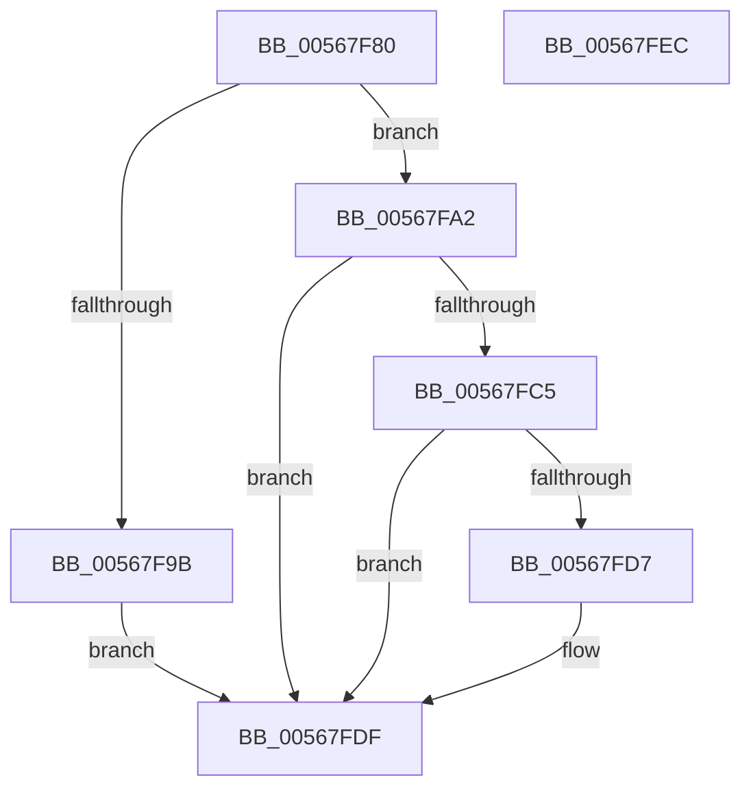

# IommuFreeReservedLogicalAddressRange

- RVA: `0x00567F80`–`0x00567FED` (길이 `109` bytes)
- VA: `0x0000000140567F80`
- 실행 섹션: `.text`
- PDB 이름 있음: `예`; PDB Function 태그: `아니요`
- unwind 정보 RVA: `0x00068D5C`
- 디코드: `34`개 명령, `109/109` bytes 표시
- 미해석 바이트: `0` (있으면 어셈블리에 `.byte`로 보존)

> 이 문서는 커널 이미지의 기계어와 PDB 기호를 분석해 생성했습니다. 4번과 5번은 함수 원형과 자료형을 바이너리 사용 방식에서 추정한 C 해석이며 원본 소스 복구 결과는 아닙니다.

## 1. Dependencies

- 직접 호출 지점: **3**; 고유 호출 대상: **3**
- 직접 호출자로 확인된 함수: **0**
- RIP 상대 이미지 참조: **0**

### Outgoing calls
- `0x00567FBA` → [HalpIommuDomainUnmapLogicalRange](../30/HalpIommuDomainUnmapLogicalRange_function_00307258.md) (function, `0x00307258`)
- `0x00567FCC` → [HalpIommuDomainFreeLogicalAddressRange](../30/HalpIommuDomainFreeLogicalAddressRange_function_003070EC.md) (function, `0x003070EC`)
- `0x00567FDA` → [HalpMmAllocCtxFree](../3E/HalpMmAllocCtxFree_function_003E1904.md) (function, `0x003E1904`)

### Direct callers
- 이 함수 시작 RVA로 연결되는 직접 call은 확인되지 않았습니다. 간접 호출은 완전히 역산할 수 없습니다.

### Static image references
- 디코드된 RIP-relative 메모리 참조가 없습니다.

## 2. Other-region calls and transfers

- 다른 실행 섹션으로 향하는 call: **0**
- 별도 외부 분기/꼬리 이동을 확인하지 못했습니다.

## 3. Assembly (complete function range)

```asm
00567F80  48 89 5C 24 10                  mov qword ptr [rsp + 0x10], rbx
00567F85  57                              push rdi
00567F86  48 83 EC 20                     sub rsp, 0x20
00567F8A  48 8B D9                        mov rbx, rcx
00567F8D  33 C0                           xor eax, eax
00567F8F  B9 00 00 00 40                  mov ecx, 0x40000000
00567F94  F0 0F B1 4B 18                  lock cmpxchg dword ptr [rbx + 0x18], ecx
00567F99  74 07                           je 0x140567fa2
00567F9B  BF 08 07 00 C0                  mov edi, 0xc0000708
00567FA0  EB 3D                           jmp 0x140567fdf
00567FA2  48 8B 43 08                     mov rax, qword ptr [rbx + 8]
00567FA6  4C 8D 44 24 30                  lea r8, [rsp + 0x30]
00567FAB  48 8B 13                        mov rdx, qword ptr [rbx]
00567FAE  45 33 C9                        xor r9d, r9d
00567FB1  48 8B 4B 10                     mov rcx, qword ptr [rbx + 0x10]
00567FB5  48 89 44 24 30                  mov qword ptr [rsp + 0x30], rax
00567FBA  E8 99 F2 D9 FF                  call 0x140307258
00567FBF  8B F8                           mov edi, eax
00567FC1  85 C0                           test eax, eax
00567FC3  78 1A                           js 0x140567fdf
00567FC5  48 8B 13                        mov rdx, qword ptr [rbx]
00567FC8  48 8B 4B 10                     mov rcx, qword ptr [rbx + 0x10]
00567FCC  E8 1B F1 D9 FF                  call 0x1403070ec
00567FD1  8B F8                           mov edi, eax
00567FD3  85 C0                           test eax, eax
00567FD5  78 08                           js 0x140567fdf
00567FD7  48 8B D3                        mov rdx, rbx
00567FDA  E8 25 99 E7 FF                  call 0x1403e1904
00567FDF  48 8B 5C 24 38                  mov rbx, qword ptr [rsp + 0x38]
00567FE4  8B C7                           mov eax, edi
00567FE6  48 83 C4 20                     add rsp, 0x20
00567FEA  5F                              pop rdi
00567FEB  C3                              ret
00567FEC  CC                              int3
```

## 4. C-style interpretation (structured pseudocode)

```c
__int64 __fastcall IommuFreeReservedLogicalAddressRange(__int64 a1, __int64 a2, __int64 a3, int a4)
{
    __int64 result;
    __int64 v_rsp;
    unsigned __int64 v_stack_p10;
    unsigned __int64 v_stack_p8;

    v_stack_p10 = v_rbx;
    v_rsp = (v_rsp) - (32);
    result = 0;
    if (condition_is_equal) goto loc_00567FA2;
    goto loc_00567FDF;
loc_00567FA2:
    a4 = 0;
    v_stack_p8 = *(unsigned __int64 *)(a1 + 8);
    result = HalpIommuDomainUnmapLogicalRange(*(unsigned __int64 *)(a1 + 16), *(unsigned __int64 *)(a1), v_stack_p8, a4);
    if (sign_flag) goto loc_00567FDF;
    result = HalpIommuDomainFreeLogicalAddressRange(*(unsigned __int64 *)(a1 + 16), *(unsigned __int64 *)(a1), v_stack_p8, a4);
    if (!(sign_flag)) {
        a2 = a1;
        result = HalpMmAllocCtxFree(*(unsigned __int64 *)(a1 + 16), a2, v_stack_p8, a4);
    }
    v_rsp = (v_rsp) + (32);
    return (unsigned int)((unsigned int)((unsigned int)((unsigned int)(result))));
}
```

## 5. (Beta) C Style

```c
int64_t IommuFreeReservedLogicalAddressRange(void *Arg1, int64_t Arg2, int64_t Arg3, int32_t Arg4)
{
    uint8_t *arg1 = (uint8_t *)Arg1;

    int64_t result;
    int64_t local_rsp;
    uint64_t v_stack_p10;
    uint64_t v_stack_p8;

    v_stack_p10 = local_rbx;
    local_rsp = (local_rsp) - (32);
    result = 0;
    if (condition_is_equal) goto loc_00567FA2;
    goto loc_00567FDF;
loc_00567FA2:
    Arg4 = 0;
    v_stack_p8 = *(uint64_t *)(arg1 + 0x8);
    result = HalpIommuDomainUnmapLogicalRange(*(uint64_t *)(arg1 + 0x10), *(uint64_t *)(arg1), v_stack_p8, Arg4);
    if (sign_flag) goto loc_00567FDF;
    result = HalpIommuDomainFreeLogicalAddressRange(*(uint64_t *)(arg1 + 0x10), *(uint64_t *)(arg1), v_stack_p8, Arg4);
    if (!(sign_flag)) {
        Arg2 = Arg1;
        result = HalpMmAllocCtxFree(*(uint64_t *)(arg1 + 0x10), Arg2, v_stack_p8, Arg4);
    }
    local_rsp = (local_rsp) + (32);
    return (uint32_t)((uint32_t)((uint32_t)((uint32_t)(result))));
}
```

### 관측된 메모리 오프셋

구조체 형식이 확인되지 않은 접근은 인자 기준의 오프셋으로만 기록했습니다.

| 기준 인자 | 오프셋 표현 | 폭 (bit) | 접근 |
|---|---:|---:|---|
| `Arg1` | `+ 0x0` | `64` | `R` |
| `Arg1` | `+ 0x8` | `64` | `R` |
| `Arg1` | `+ 0x10` | `64` | `R` |
| `Arg1` | `+ 0x18` | `32` | `R` |

## 6. Execution-region graph

[열기: 2D/3D 그래프와 함수 탐색 컨트롤 패널](../../../control-panel.html?section=text&rva=0x00567F80&view=graph)

- 2D 그래프는 위에서 아래로 흐르고, 3D 그래프는 빈 공간을 드래그해 회전합니다. Shift+드래그는 이동, 휠은 확대·축소, 함수 노드 선택은 대상 보고서 이동입니다.

### Static fallback


