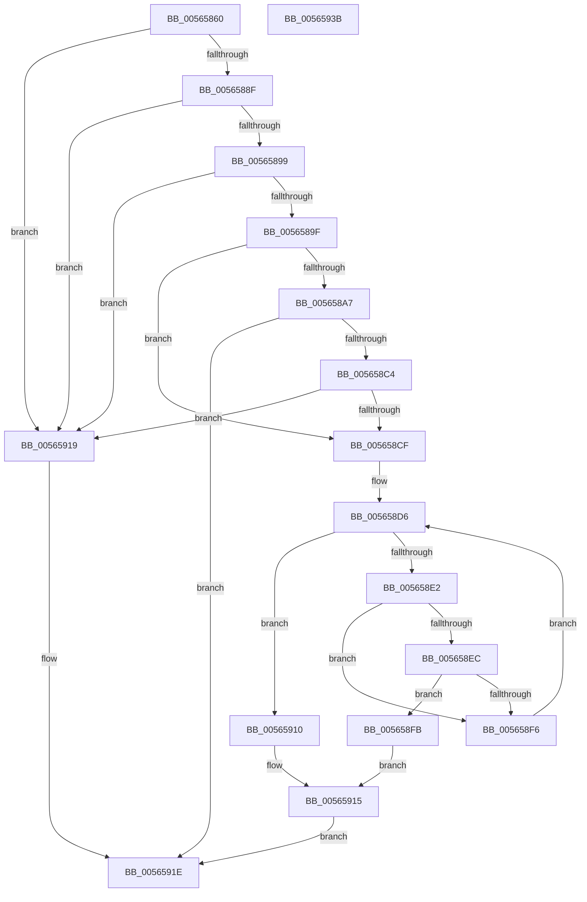

# IommuGetAtsSettings

- RVA: `0x00565860`–`0x0056593C` (길이 `220` bytes)
- VA: `0x0000000140565860`
- 실행 섹션: `.text`
- PDB 이름 있음: `예`; PDB Function 태그: `아니요`
- unwind 정보 RVA: `0x000C4D64`
- 디코드: `63`개 명령, `220/220` bytes 표시
- 미해석 바이트: `0` (있으면 어셈블리에 `.byte`로 보존)

> 이 문서는 커널 이미지의 기계어와 PDB 기호를 분석해 생성했습니다. 4번과 5번은 함수 원형과 자료형을 바이너리 사용 방식에서 추정한 C 해석이며 원본 소스 복구 결과는 아닙니다.

## 1. Dependencies

- 직접 호출 지점: **2**; 고유 호출 대상: **2**
- 직접 호출자로 확인된 함수: **0**
- RIP 상대 이미지 참조: **4**

### Outgoing calls
- `0x005658BB` → [guard_dispatch_icall](../6B/guard_dispatch_icall_function_006BAAD0.md) (function, `0x006BAAD0`)
- `0x00565926` → [_security_check_cookie](../6A/_security_check_cookie_function_006AC640.md) (function, `0x006AC640`)

### Direct callers
- 이 함수 시작 RVA로 연결되는 직접 call은 확인되지 않았습니다. 간접 호출은 완전히 역산할 수 없습니다.

### Static image references
- `0x0056586F` → RVA `0x00E0A740` (`.data`; read)
- `0x0056589F` → RVA `0x00FC1710` (`.data`; read)
- `0x005658A7` → RVA `0x00FC1D60` (`.data`; read)
- `0x005658CF` → RVA `0x00FC1900` (`.data`; read)

## 2. Other-region calls and transfers

- 다른 실행 섹션으로 향하는 call: **0**
- 별도 외부 분기/꼬리 이동을 확인하지 못했습니다.

## 3. Assembly (complete function range)

```asm
00565860  48 89 5C 24 18                  mov qword ptr [rsp + 0x18], rbx
00565865  48 89 74 24 20                  mov qword ptr [rsp + 0x20], rsi
0056586A  57                              push rdi
0056586B  48 83 EC 40                     sub rsp, 0x40
0056586F  48 8B 05 CA 4E 8A 00            mov rax, qword ptr [rip + 0x8a4eca]
00565876  48 33 C4                        xor rax, rsp
00565879  48 89 44 24 38                  mov qword ptr [rsp + 0x38], rax
0056587E  33 DB                           xor ebx, ebx
00565880  48 8B F2                        mov rsi, rdx
00565883  83 39 01                        cmp dword ptr [rcx], 1
00565886  48 8B F9                        mov rdi, rcx
00565889  0F 85 8A 00 00 00               jne 0x140565919
0056588F  F6 41 04 01                     test byte ptr [rcx + 4], 1
00565893  0F 85 80 00 00 00               jne 0x140565919
00565899  F6 41 0A 03                     test byte ptr [rcx + 0xa], 3
0056589D  75 7A                           jne 0x140565919
0056589F  38 1D 6B BE A5 00               cmp byte ptr [rip + 0xa5be6b], bl
005658A5  74 28                           je 0x1405658cf
005658A7  48 8B 05 B2 C4 A5 00            mov rax, qword ptr [rip + 0xa5c4b2]
005658AE  48 8D 54 24 28                  lea rdx, [rsp + 0x28]
005658B3  0F 57 C0                        xorps xmm0, xmm0
005658B6  0F 11 44 24 28                  movups xmmword ptr [rsp + 0x28], xmm0
005658BB  E8 10 52 15 00                  call 0x1406baad0
005658C0  85 C0                           test eax, eax
005658C2  78 5A                           js 0x14056591e
005658C4  8B 44 24 28                     mov eax, dword ptr [rsp + 0x28]
005658C8  C1 E8 06                        shr eax, 6
005658CB  A8 01                           test al, 1
005658CD  74 4A                           je 0x140565919
005658CF  48 8B 0D 2A C0 A5 00            mov rcx, qword ptr [rip + 0xa5c02a]
005658D6  48 8D 05 23 C0 A5 00            lea rax, [rip + 0xa5c023]
005658DD  48 3B C8                        cmp rcx, rax
005658E0  74 2E                           je 0x140565910
005658E2  0F B7 47 08                     movzx eax, word ptr [rdi + 8]
005658E6  66 39 41 18                     cmp word ptr [rcx + 0x18], ax
005658EA  75 0A                           jne 0x1405658f6
005658EC  0F B7 47 0C                     movzx eax, word ptr [rdi + 0xc]
005658F0  66 39 41 1C                     cmp word ptr [rcx + 0x1c], ax
005658F4  74 05                           je 0x1405658fb
005658F6  48 8B 09                        mov rcx, qword ptr [rcx]
005658F9  EB DB                           jmp 0x1405658d6
005658FB  80 0E 01                        or byte ptr [rsi], 1
005658FE  8A 49 28                        mov cl, byte ptr [rcx + 0x28]
00565901  8A 06                           mov al, byte ptr [rsi]
00565903  80 E1 01                        and cl, 1
00565906  02 C9                           add cl, cl
00565908  24 FD                           and al, 0xfd
0056590A  0A C8                           or cl, al
0056590C  88 0E                           mov byte ptr [rsi], cl
0056590E  EB 05                           jmp 0x140565915
00565910  BB 25 02 00 C0                  mov ebx, 0xc0000225
00565915  8B C3                           mov eax, ebx
00565917  EB 05                           jmp 0x14056591e
00565919  B8 BB 00 00 C0                  mov eax, 0xc00000bb
0056591E  48 8B 4C 24 38                  mov rcx, qword ptr [rsp + 0x38]
00565923  48 33 CC                        xor rcx, rsp
00565926  E8 15 6D 14 00                  call 0x1406ac640
0056592B  48 8B 5C 24 60                  mov rbx, qword ptr [rsp + 0x60]
00565930  48 8B 74 24 68                  mov rsi, qword ptr [rsp + 0x68]
00565935  48 83 C4 40                     add rsp, 0x40
00565939  5F                              pop rdi
0056593A  C3                              ret
0056593B  CC                              int3
```

## 4. C-style interpretation (structured pseudocode)

```c
__int64 __fastcall IommuGetAtsSettings(__int64 a1, __int64 a2)
{
    __int64 result;
    __int64 v_rbx;
    __int64 v_rsp;
    unsigned __int64 v_stack_m10;
    unsigned __int64 v_stack_m20;
    unsigned __int64 v_stack_p18;
    unsigned __int64 v_stack_p20;

    v_stack_p18 = v_rbx;
    v_stack_p20 = v_rsi;
    v_rsp = (v_rsp) - (64);
    result = (*(unsigned __int64 *)(v_rip + 9064138)) ^ (v_rsp);
    v_stack_m10 = result;
    v_rbx = 0;
    if ((*(unsigned int *)(a1)) != 1) goto loc_00565919;
    if (((*(unsigned __int8 *)(a1 + 4)) & (1)) != 0) goto loc_00565919;
    if (((*(unsigned __int8 *)(a1 + 10)) & (3)) != 0) goto loc_00565919;
    if ((*(unsigned __int8 *)(v_rip + 10862187)) == 0) goto loc_005658CF;
    v_stack_m20 = v_xmm0;
    result = guard_dispatch_icall(a1, v_stack_m20, a3, a4);
    if (sign_flag) goto loc_0056591E;
    result = (unsigned int)(((unsigned int)(v_stack_m20)) >> (6));
    if ((((unsigned __int8)(result)) & (1)) == 0) goto loc_00565919;
loc_005658CF:
loc_005658D6:
    if ((*(unsigned __int64 *)(v_rip + 10862634)) == (v_rip + 10862627)) goto loc_00565910;
    if ((*(unsigned __int16 *)(*(unsigned __int64 *)(v_rip + 10862634) + 24)) != ((unsigned __int16)(*(unsigned __int16 *)(a1 + 8)))) goto loc_005658F6;
    if ((*(unsigned __int16 *)(*(unsigned __int64 *)(v_rip + 10862634) + 28)) == ((unsigned __int16)(*(unsigned __int16 *)(a1 + 12)))) goto loc_005658FB;
loc_005658F6:
    goto loc_005658D6;
loc_005658FB:
    a1 = (unsigned __int8)((*(unsigned __int8 *)(*(unsigned __int64 *)(*(unsigned __int64 *)(v_rip + 10862634)) + 40)) & (1));
    a1 = (unsigned __int8)((a1) + ((unsigned __int8)(a1)));
    result = (unsigned __int8)((*(unsigned __int8 *)(a2)) & (253));
    a1 = (unsigned __int8)((a1) | ((unsigned __int8)(result)));
    *(unsigned __int8 *)(a2) = (unsigned __int8)(a1);
    goto loc_00565915;
loc_00565910:
loc_00565915:
    goto loc_0056591E;
loc_00565919:
loc_0056591E:
    a1 = (v_stack_m10) ^ (v_rsp);
    result = _security_check_cookie(a1, v_stack_m20, a3, a4);
    v_rsp = (v_rsp) + (64);
    return result;
}
```

## 5. (Beta) C Style

```c
int64_t IommuGetAtsSettings(void *Arg1, void *Arg2)
{
    uint8_t *arg1 = (uint8_t *)Arg1;
    uint8_t *arg2 = (uint8_t *)Arg2;

    int64_t result;
    int64_t local_rbx;
    int64_t local_rsp;
    uint64_t v_stack_m10;
    uint64_t v_stack_m20;
    uint64_t v_stack_p18;
    uint64_t v_stack_p20;

    v_stack_p18 = local_rbx;
    v_stack_p20 = local_rsi;
    local_rsp = (local_rsp) - (64);
    result = (*(uint64_t *)(v_rip + 0x8A4ECA)) ^ (local_rsp);
    v_stack_m10 = result;
    local_rbx = 0;
    if ((*(uint32_t *)(arg1)) != 1) goto loc_00565919;
    if (((*(uint8_t *)(arg1 + 0x4)) & (1)) != 0) goto loc_00565919;
    if (((*(uint8_t *)(arg1 + 0xA)) & (3)) != 0) goto loc_00565919;
    if ((*(uint8_t *)(v_rip + 0xA5BE6B)) == 0) goto loc_005658CF;
    v_stack_m20 = v_xmm0;
    result = guard_dispatch_icall(Arg1, v_stack_m20, a3, a4);
    if (sign_flag) goto loc_0056591E;
    result = (uint32_t)(((uint32_t)(v_stack_m20)) >> (6));
    if ((((uint8_t)(result)) & (1)) == 0) goto loc_00565919;
loc_005658CF:
loc_005658D6:
    if ((*(uint64_t *)(v_rip + 0xA5C02A)) == (v_rip + 10862627)) goto loc_00565910;
    if ((*(uint16_t *)(*(uint64_t *)(v_rip + 0xA5C02A) + 0x18)) != ((uint16_t)(*(uint16_t *)(arg1 + 0x8)))) goto loc_005658F6;
    if ((*(uint16_t *)(*(uint64_t *)(v_rip + 0xA5C02A) + 0x1C)) == ((uint16_t)(*(uint16_t *)(arg1 + 0xC)))) goto loc_005658FB;
loc_005658F6:
    goto loc_005658D6;
loc_005658FB:
    Arg1 = (uint8_t)((*(uint8_t *)(*(uint64_t *)(*(uint64_t *)(v_rip + 0xA5C02A)) + 0x28)) & (1));
    Arg1 = (uint8_t)((Arg1) + ((uint8_t)(Arg1)));
    result = (uint8_t)((*(uint8_t *)(arg2)) & (253));
    Arg1 = (uint8_t)((Arg1) | ((uint8_t)(result)));
    *(uint8_t *)(arg2) = (uint8_t)(Arg1);
    goto loc_00565915;
loc_00565910:
loc_00565915:
    goto loc_0056591E;
loc_00565919:
loc_0056591E:
    Arg1 = (v_stack_m10) ^ (local_rsp);
    result = _security_check_cookie(Arg1, v_stack_m20, a3, a4);
    local_rsp = (local_rsp) + (64);
    return result;
}
```

### 관측된 메모리 오프셋

구조체 형식이 확인되지 않은 접근은 인자 기준의 오프셋으로만 기록했습니다.

| 기준 인자 | 오프셋 표현 | 폭 (bit) | 접근 |
|---|---:|---:|---|
| `Arg1` | `+ 0x0` | `32` | `R` |
| `Arg1` | `+ 0x4` | `8` | `R` |
| `Arg1` | `+ 0x8` | `16` | `R` |
| `Arg1` | `+ 0xA` | `8` | `R` |
| `Arg1` | `+ 0xC` | `16` | `R` |
| `Arg2` | `+ 0x0` | `8` | `R` |
| `Arg2` | `+ 0x0` | `8` | `R/W` |
| `Arg2` | `+ 0x0` | `8` | `W` |

## 6. Execution-region graph

[열기: 2D/3D 그래프와 함수 탐색 컨트롤 패널](../../../control-panel.html?section=text&rva=0x00565860&view=graph)

- 2D 그래프는 위에서 아래로 흐르고, 3D 그래프는 빈 공간을 드래그해 회전합니다. Shift+드래그는 이동, 휠은 확대·축소, 함수 노드 선택은 대상 보고서 이동입니다.

### Static fallback


