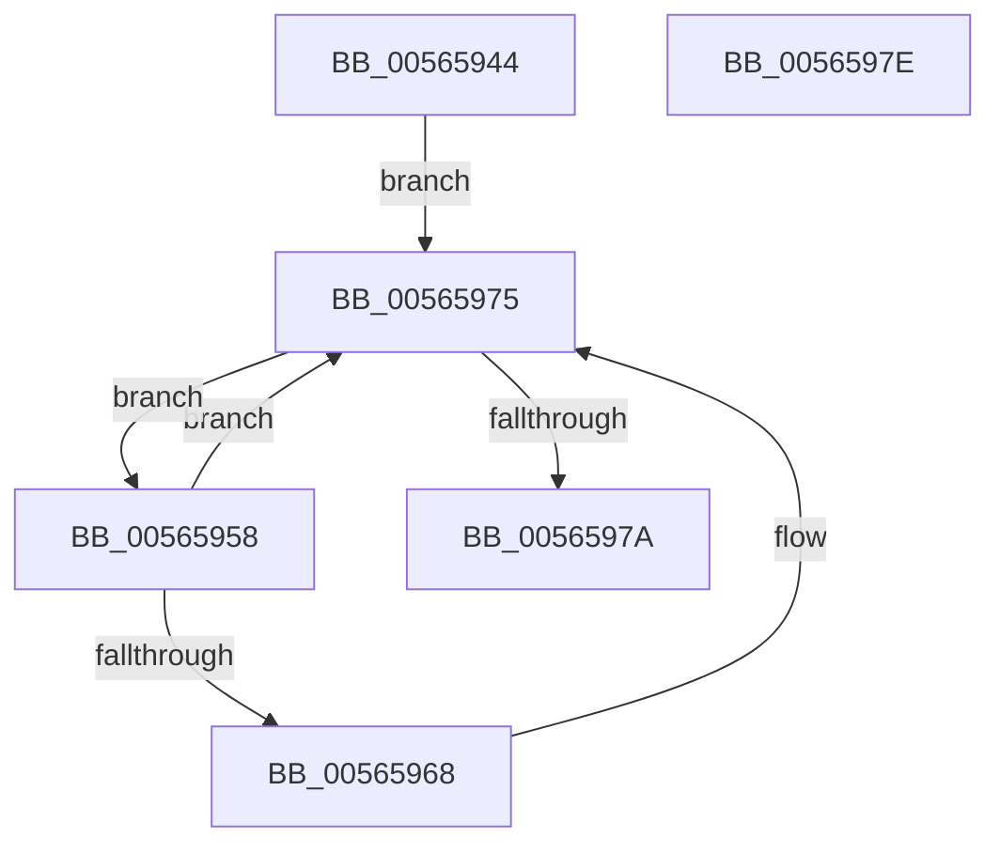

# IommuGetLeastMaximumSupportedAsidValue

- RVA: `0x00565944`–`0x0056597F` (길이 `59` bytes)
- VA: `0x0000000140565944`
- 실행 섹션: `.text`
- PDB 이름 있음: `예`; PDB Function 태그: `아니요`
- unwind 정보 RVA: `0x000DB714`
- 디코드: `17`개 명령, `59/59` bytes 표시
- 미해석 바이트: `0` (있으면 어셈블리에 `.byte`로 보존)

> 이 문서는 커널 이미지의 기계어와 PDB 기호를 분석해 생성했습니다. 4번과 5번은 함수 원형과 자료형을 바이너리 사용 방식에서 추정한 C 해석이며 원본 소스 복구 결과는 아닙니다.

## 1. Dependencies

- 직접 호출 지점: **0**; 고유 호출 대상: **0**
- 직접 호출자로 확인된 함수: **2**
- RIP 상대 이미지 참조: **1**

### Outgoing calls
- 직접 디코드된 call 명령이 없습니다.

### Direct callers
- [IommupDeviceEnableSvm](../../page/70/IommupDeviceEnableSvm_function_00708CC4.md) at `0x00708CFE`
- [IommuGetConfiguration](../../init/C2/IommuGetConfiguration_function_00C24F80.md) at `0x00C24F97`

### Static image references
- `0x00565944` → RVA `0x00FC1740` (`.data`; read)

## 2. Other-region calls and transfers

- 다른 실행 섹션으로 향하는 call: **0**
- 별도 외부 분기/꼬리 이동을 확인하지 못했습니다.

## 3. Assembly (complete function range)

```asm
00565944  48 8B 15 F5 BD A5 00            mov rdx, qword ptr [rip + 0xa5bdf5]
0056594B  4C 8D 0D EE BD A5 00            lea r9, [rip + 0xa5bdee]
00565952  41 83 C8 FF                     or r8d, 0xffffffff
00565956  EB 1D                           jmp 0x140565975
00565958  48 8D 0A                        lea rcx, [rdx]
0056595B  48 8B 12                        mov rdx, qword ptr [rdx]
0056595E  8B 81 D8 01 00 00               mov eax, dword ptr [rcx + 0x1d8]
00565964  A8 A0                           test al, 0xa0
00565966  74 0D                           je 0x140565975
00565968  8B 89 00 02 00 00               mov ecx, dword ptr [rcx + 0x200]
0056596E  41 3B C8                        cmp ecx, r8d
00565971  44 0F 42 C1                     cmovb r8d, ecx
00565975  49 3B D1                        cmp rdx, r9
00565978  75 DE                           jne 0x140565958
0056597A  41 8B C0                        mov eax, r8d
0056597D  C3                              ret
0056597E  CC                              int3
```

## 4. C-style interpretation (structured pseudocode)

```c
__int64 __fastcall IommuGetLeastMaximumSupportedAsidValue(__int64 a1, __int64 a2, int a3)
{
    a3 = (unsigned int)((a3) | (0xFFFFFFFFULL));
    goto loc_00565975;
loc_00565958:
    if ((((unsigned __int8)((unsigned int)(*(unsigned int *)(*(unsigned __int64 *)(v_rip + 10862069) + 472)))) & (160)) != 0) {
        a1 = *(unsigned int *)(*(unsigned __int64 *)(v_rip + 10862069) + 512);
        if (((unsigned int)(a1)) < a3) { a3 = (unsigned int)(a1); }
    }
    if ((*(unsigned __int64 *)(*(unsigned __int64 *)(v_rip + 10862069))) != (v_rip + 10862062)) goto loc_00565958;
    return (unsigned int)(a3);
}
```

## 5. (Beta) C Style

```c
int64_t IommuGetLeastMaximumSupportedAsidValue(int64_t Arg1, int64_t Arg2, int32_t Arg3)
{
    Arg3 = (uint32_t)((Arg3) | (0xFFFFFFFFULL));
    goto loc_00565975;
loc_00565958:
    if ((((uint8_t)((uint32_t)(*(uint32_t *)(*(uint64_t *)(v_rip + 0xA5BDF5) + 0x1D8)))) & (160)) != 0) {
        Arg1 = *(uint32_t *)(*(uint64_t *)(v_rip + 0xA5BDF5) + 0x200);
        if (((uint32_t)(Arg1)) < Arg3) { Arg3 = (uint32_t)(Arg1); }
    }
    if ((*(uint64_t *)(*(uint64_t *)(v_rip + 0xA5BDF5))) != (v_rip + 10862062)) goto loc_00565958;
    return (uint32_t)(Arg3);
}
```

## 6. Execution-region graph

[열기: 2D/3D 그래프와 함수 탐색 컨트롤 패널](../../../control-panel.html?section=text&rva=0x00565944&view=graph)

- 2D 그래프는 위에서 아래로 흐르고, 3D 그래프는 빈 공간을 드래그해 회전합니다. Shift+드래그는 이동, 휠은 확대·축소, 함수 노드 선택은 대상 보고서 이동입니다.

### Static fallback


