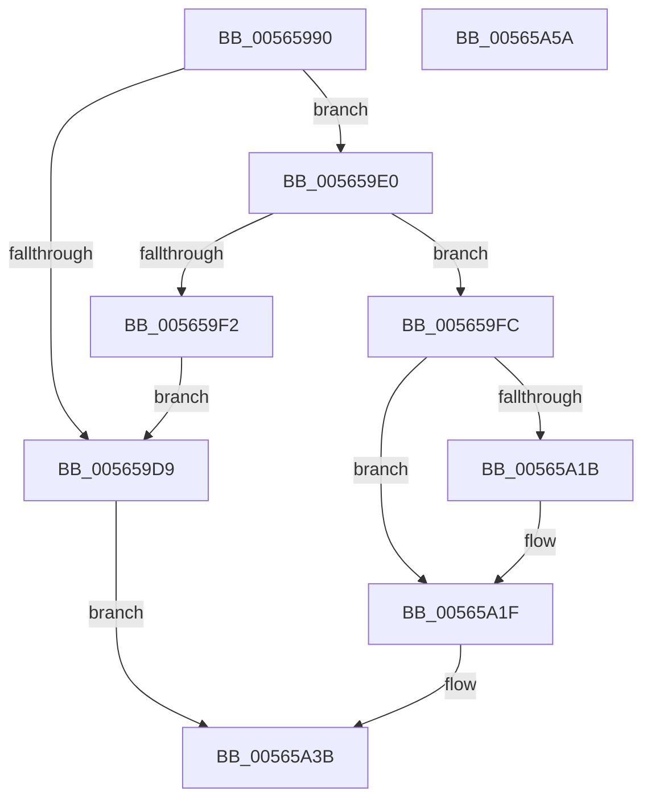

# IommuGetLibraryContext

- RVA: `0x00565990`–`0x00565A5B` (길이 `203` bytes)
- VA: `0x0000000140565990`
- 실행 섹션: `.text`
- PDB 이름 있음: `예`; PDB Function 태그: `아니요`
- unwind 정보 RVA: `0x0005FEF8`
- 디코드: `60`개 명령, `203/203` bytes 표시
- 미해석 바이트: `0` (있으면 어셈블리에 `.byte`로 보존)

> 이 문서는 커널 이미지의 기계어와 PDB 기호를 분석해 생성했습니다. 4번과 5번은 함수 원형과 자료형을 바이너리 사용 방식에서 추정한 C 해석이며 원본 소스 복구 결과는 아닙니다.

## 1. Dependencies

- 직접 호출 지점: **6**; 고유 호출 대상: **5**
- 직접 호출자로 확인된 함수: **1**
- RIP 상대 이미지 참조: **0**

### Outgoing calls
- `0x005659BF` → [IommupGetSystemContext](IommupGetSystemContext_function_00566310.md) (function, `0x00566310`)
- `0x005659CC` → [HalpMmAllocCtxAlloc](../3E/HalpMmAllocCtxAlloc_function_003E10B8.md) (function, `0x003E10B8`)
- `0x005659E5` → [HalpMmAllocCtxAlloc](../3E/HalpMmAllocCtxAlloc_function_003E10B8.md) (function, `0x003E10B8`)
- `0x005659F5` → [HalpMmAllocCtxFree](../3E/HalpMmAllocCtxFree_function_003E1904.md) (function, `0x003E1904`)
- `0x00565A05` → [memset](../6C/memset_function_006C6C40.md) (function, `0x006C6C40`)
- `0x00565A12` → [Feature_Test57481295__private_IsEnabledDeviceUsageNoInline](../4F/Feature_Test57481295__private_IsEnabledDeviceUsageNoInline_function_004F7B90.md) (function, `0x004F7B90`)

### Direct callers
- [IommupPasidDeviceCreate](../54/IommupPasidDeviceCreate_function_0054FEEC.md) at `0x0054FF6C`

### Static image references
- 디코드된 RIP-relative 메모리 참조가 없습니다.

## 2. Other-region calls and transfers

- 다른 실행 섹션으로 향하는 call: **0**
- 별도 외부 분기/꼬리 이동을 확인하지 못했습니다.

## 3. Assembly (complete function range)

```asm
00565990  48 8B C4                        mov rax, rsp
00565993  48 89 58 08                     mov qword ptr [rax + 8], rbx
00565997  48 89 68 10                     mov qword ptr [rax + 0x10], rbp
0056599B  48 89 70 18                     mov qword ptr [rax + 0x18], rsi
0056599F  48 89 78 20                     mov qword ptr [rax + 0x20], rdi
005659A3  41 54                           push r12
005659A5  41 56                           push r14
005659A7  41 57                           push r15
005659A9  48 83 EC 20                     sub rsp, 0x20
005659AD  49 83 21 00                     and qword ptr [r9], 0
005659B1  44 8B E1                        mov r12d, ecx
005659B4  8B CA                           mov ecx, edx
005659B6  49 8B F1                        mov rsi, r9
005659B9  41 8A E8                        mov bpl, r8b
005659BC  44 8B FA                        mov r15d, edx
005659BF  E8 4C 09 00 00                  call 0x140566310
005659C4  BA 40 00 00 00                  mov edx, 0x40
005659C9  4C 8B F0                        mov r14, rax
005659CC  E8 E7 B6 E7 FF                  call 0x1403e10b8
005659D1  48 8B D8                        mov rbx, rax
005659D4  48 85 C0                        test rax, rax
005659D7  75 07                           jne 0x1405659e0
005659D9  B8 9A 00 00 C0                  mov eax, 0xc000009a
005659DE  EB 5B                           jmp 0x140565a3b
005659E0  BA 10 00 00 00                  mov edx, 0x10
005659E5  E8 CE B6 E7 FF                  call 0x1403e10b8
005659EA  48 8B F8                        mov rdi, rax
005659ED  48 85 C0                        test rax, rax
005659F0  75 0A                           jne 0x1405659fc
005659F2  48 8B D3                        mov rdx, rbx
005659F5  E8 0A BF E7 FF                  call 0x1403e1904
005659FA  EB DD                           jmp 0x1405659d9
005659FC  33 D2                           xor edx, edx
005659FE  48 8B CB                        mov rcx, rbx
00565A01  44 8D 42 40                     lea r8d, [rdx + 0x40]
00565A05  E8 36 12 16 00                  call 0x1406c6c40
00565A0A  44 89 63 10                     mov dword ptr [rbx + 0x10], r12d
00565A0E  44 89 7B 14                     mov dword ptr [rbx + 0x14], r15d
00565A12  E8 79 21 F9 FF                  call 0x1404f7b90
00565A17  85 C0                           test eax, eax
00565A19  74 04                           je 0x140565a1f
00565A1B  40 88 6B 38                     mov byte ptr [rbx + 0x38], bpl
00565A1F  48 8D 43 28                     lea rax, [rbx + 0x28]
00565A23  48 89 40 08                     mov qword ptr [rax + 8], rax
00565A27  48 89 00                        mov qword ptr [rax], rax
00565A2A  48 83 63 18 00                  and qword ptr [rbx + 0x18], 0
00565A2F  4C 89 37                        mov qword ptr [rdi], r14
00565A32  33 C0                           xor eax, eax
00565A34  48 89 5F 08                     mov qword ptr [rdi + 8], rbx
00565A38  48 89 3E                        mov qword ptr [rsi], rdi
00565A3B  48 8B 5C 24 40                  mov rbx, qword ptr [rsp + 0x40]
00565A40  48 8B 6C 24 48                  mov rbp, qword ptr [rsp + 0x48]
00565A45  48 8B 74 24 50                  mov rsi, qword ptr [rsp + 0x50]
00565A4A  48 8B 7C 24 58                  mov rdi, qword ptr [rsp + 0x58]
00565A4F  48 83 C4 20                     add rsp, 0x20
00565A53  41 5F                           pop r15
00565A55  41 5E                           pop r14
00565A57  41 5C                           pop r12
00565A59  C3                              ret
00565A5A  CC                              int3
```

## 4. C-style interpretation (structured pseudocode)

```c
__int64 __fastcall IommuGetLibraryContext(int a1, int a2, unsigned __int8 a3, __int64 a4)
{
    __int64 result;
    __int64 v_rsp;
    unsigned __int64 v_stack_p10;
    unsigned __int64 v_stack_p18;
    unsigned __int64 v_stack_p20;
    unsigned __int64 v_stack_p8;

    *(unsigned __int64 *)(v_rsp + 8) = v_rbx;
    *(unsigned __int64 *)(v_rsp + 16) = v_rbp;
    *(unsigned __int64 *)(v_rsp + 24) = v_rsi;
    *(unsigned __int64 *)(v_rsp + 32) = v_rdi;
    v_rsp = (v_rsp) - (32);
    result = IommupGetSystemContext((unsigned int)(a2), a2, a3, a4);
    result = HalpMmAllocCtxAlloc((unsigned int)(a2), 64, a3, a4);
    if (result != 0) goto loc_005659E0;
loc_005659D9:
    goto loc_00565A3B;
loc_005659E0:
    result = HalpMmAllocCtxAlloc((unsigned int)(a2), 16, a3, a4);
    if (result != 0) goto loc_005659FC;
    result = HalpMmAllocCtxFree((unsigned int)(a2), result, a3, a4);
    goto loc_005659D9;
loc_005659FC:
    a2 = 0;
    result = memset(result, a2, a2 + 64, a4);
    *(unsigned int *)(result + 16) = (unsigned int)((unsigned int)(a1));
    *(unsigned int *)(result + 20) = (unsigned int)((unsigned int)(a2));
    result = Feature_Test57481295__private_IsEnabledDeviceUsageNoInline(result, a2, a2 + 64, a4);
    if ((unsigned int)(result) != 0) {
        *(unsigned __int8 *)(result + 56) = a3;
    }
    *(unsigned __int64 *)(result + 40 + 8) = result + 40;
    *(unsigned __int64 *)(result + 40) = result + 40;
    *(unsigned __int64 *)(result) = result;
    result = 0;
    *(unsigned __int64 *)(result + 8) = 0;
    *(unsigned __int64 *)(a4) = 0;
loc_00565A3B:
    v_rsp = (v_rsp) + (32);
    return result;
}
```

## 5. (Beta) C Style

```c
int64_t IommuGetLibraryContext(int32_t Arg1, int32_t Arg2, uint8_t Arg3, void *Arg4)
{
    uint8_t *arg4 = (uint8_t *)Arg4;

    int64_t result;
    int64_t local_rsp;
    uint64_t v_stack_p10;
    uint64_t v_stack_p18;
    uint64_t v_stack_p20;
    uint64_t v_stack_p8;

    *(uint64_t *)(local_rsp + 0x8) = local_rbx;
    *(uint64_t *)(local_rsp + 0x10) = local_rbp;
    *(uint64_t *)(local_rsp + 0x18) = local_rsi;
    *(uint64_t *)(local_rsp + 0x20) = local_rdi;
    local_rsp = (local_rsp) - (32);
    result = IommupGetSystemContext((uint32_t)(Arg2), Arg2, Arg3, Arg4);
    result = HalpMmAllocCtxAlloc((uint32_t)(Arg2), 64, Arg3, Arg4);
    if (result != 0) goto loc_005659E0;
loc_005659D9:
    goto loc_00565A3B;
loc_005659E0:
    result = HalpMmAllocCtxAlloc((uint32_t)(Arg2), 16, Arg3, Arg4);
    if (result != 0) goto loc_005659FC;
    result = HalpMmAllocCtxFree((uint32_t)(Arg2), result, Arg3, Arg4);
    goto loc_005659D9;
loc_005659FC:
    Arg2 = 0;
    result = memset(result, Arg2, Arg2 + 64, Arg4);
    *(uint32_t *)(result + 0x10) = (uint32_t)((uint32_t)(Arg1));
    *(uint32_t *)(result + 0x14) = (uint32_t)((uint32_t)(Arg2));
    result = Feature_Test57481295__private_IsEnabledDeviceUsageNoInline(result, Arg2, Arg2 + 64, Arg4);
    if ((uint32_t)(result) != 0) {
        *(uint8_t *)(result + 0x38) = Arg3;
    }
    *(uint64_t *)(result + 0x28 + 0x8) = result + 40;
    *(uint64_t *)(result + 0x28) = result + 40;
    *(uint64_t *)(result) = result;
    result = 0;
    *(uint64_t *)(result + 0x8) = 0;
    *(uint64_t *)(arg4) = 0;
loc_00565A3B:
    local_rsp = (local_rsp) + (32);
    return result;
}
```

### 관측된 메모리 오프셋

구조체 형식이 확인되지 않은 접근은 인자 기준의 오프셋으로만 기록했습니다.

| 기준 인자 | 오프셋 표현 | 폭 (bit) | 접근 |
|---|---:|---:|---|
| `Arg4` | `+ 0x0` | `64` | `R/W` |
| `Arg4` | `+ 0x0` | `64` | `W` |

## 6. Execution-region graph

[열기: 2D/3D 그래프와 함수 탐색 컨트롤 패널](../../../control-panel.html?section=text&rva=0x00565990&view=graph)

- 2D 그래프는 위에서 아래로 흐르고, 3D 그래프는 빈 공간을 드래그해 회전합니다. Shift+드래그는 이동, 휠은 확대·축소, 함수 노드 선택은 대상 보고서 이동입니다.

### Static fallback


