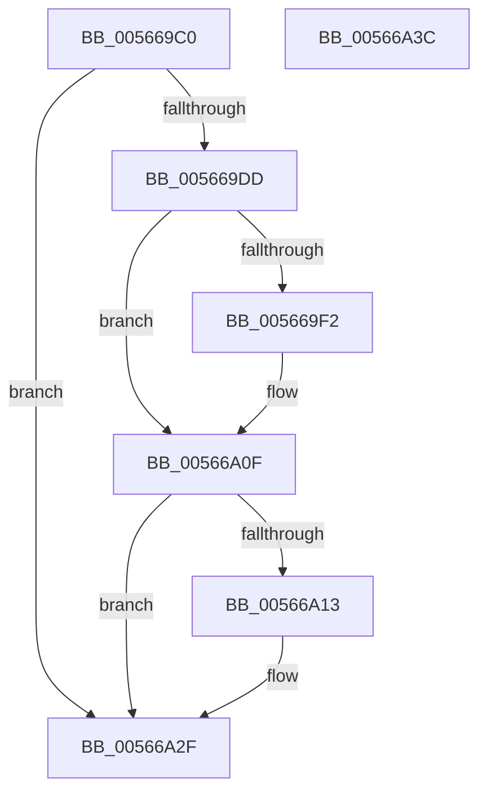

# IommuHvDevicePowerChange

- RVA: `0x005669C0`–`0x00566A3D` (길이 `125` bytes)
- VA: `0x00000001405669C0`
- 실행 섹션: `.text`
- PDB 이름 있음: `예`; PDB Function 태그: `아니요`
- unwind 정보 RVA: `0x0006E5F8`
- 디코드: `36`개 명령, `125/125` bytes 표시
- 미해석 바이트: `0` (있으면 어셈블리에 `.byte`로 보존)

> 이 문서는 커널 이미지의 기계어와 PDB 기호를 분석해 생성했습니다. 4번과 5번은 함수 원형과 자료형을 바이너리 사용 방식에서 추정한 C 해석이며 원본 소스 복구 결과는 아닙니다.

## 1. Dependencies

- 직접 호출 지점: **3**; 고유 호출 대상: **2**
- 직접 호출자로 확인된 함수: **0**
- RIP 상대 이미지 참조: **1**

### Outgoing calls
- `0x005669E2` → [guard_dispatch_icall](../6B/guard_dispatch_icall_function_006BAAD0.md) (function, `0x006BAAD0`)
- `0x00566A09` → [KeBugCheckEx](../4F/KeBugCheckEx_function_004FD660.md) (function, `0x004FD660`)
- `0x00566A29` → [KeBugCheckEx](../4F/KeBugCheckEx_function_004FD660.md) (function, `0x004FD660`)

### Direct callers
- 이 함수 시작 RVA로 연결되는 직접 call은 확인되지 않았습니다. 간접 호출은 완전히 역산할 수 없습니다.

### Static image references
- `0x005669CA` → RVA `0x00FC1DC0` (`.data`; read)

## 2. Other-region calls and transfers

- 다른 실행 섹션으로 향하는 call: **0**
- 별도 외부 분기/꼬리 이동을 확인하지 못했습니다.

## 3. Assembly (complete function range)

```asm
005669C0  48 89 5C 24 08                  mov qword ptr [rsp + 8], rbx
005669C5  57                              push rdi
005669C6  48 83 EC 30                     sub rsp, 0x30
005669CA  48 8B 05 EF B3 A5 00            mov rax, qword ptr [rip + 0xa5b3ef]
005669D1  48 8B FA                        mov rdi, rdx
005669D4  41 0F B6 D8                     movzx ebx, r8b
005669D8  48 85 C0                        test rax, rax
005669DB  74 52                           je 0x140566a2f
005669DD  48 8B 0F                        mov rcx, qword ptr [rdi]
005669E0  8A D3                           mov dl, bl
005669E2  E8 E9 40 15 00                  call 0x1406baad0
005669E7  48 63 C8                        movsxd rcx, eax
005669EA  81 F9 59 00 35 00               cmp ecx, 0x350059
005669F0  75 1D                           jne 0x140566a0f
005669F2  48 83 64 24 20 00               and qword ptr [rsp + 0x20], 0
005669F8  44 8B CB                        mov r9d, ebx
005669FB  4C 8B 47 20                     mov r8, qword ptr [rdi + 0x20]
005669FF  BA 02 30 00 00                  mov edx, 0x3002
00566A04  B9 59 01 00 00                  mov ecx, 0x159
00566A09  E8 52 6C F9 FF                  call 0x1404fd660
00566A0E  CC                              int3
00566A0F  85 C0                           test eax, eax
00566A11  79 1C                           jns 0x140566a2f
00566A13  4C 8B 4F 20                     mov r9, qword ptr [rdi + 0x20]
00566A17  4C 8B C1                        mov r8, rcx
00566A1A  B9 59 01 00 00                  mov ecx, 0x159
00566A1F  48 89 5C 24 20                  mov qword ptr [rsp + 0x20], rbx
00566A24  BA 01 32 00 00                  mov edx, 0x3201
00566A29  E8 32 6C F9 FF                  call 0x1404fd660
00566A2E  CC                              int3
00566A2F  48 8B 5C 24 40                  mov rbx, qword ptr [rsp + 0x40]
00566A34  33 C0                           xor eax, eax
00566A36  48 83 C4 30                     add rsp, 0x30
00566A3A  5F                              pop rdi
00566A3B  C3                              ret
00566A3C  CC                              int3
```

## 4. C-style interpretation (structured pseudocode)

```c
__int64 __fastcall IommuHvDevicePowerChange(__int64 a1, __int64 a2, unsigned __int8 a3)
{
    __int64 result;
    __int64 v_rsp;
    unsigned __int64 v_stack_m18;
    unsigned __int64 v_stack_p8;

    v_stack_p8 = v_rbx;
    v_rsp = (v_rsp) - (48);
    if (*(unsigned __int64 *)(v_rip + 10859503) == 0) goto loc_00566A2F;
    result = guard_dispatch_icall(*(unsigned __int64 *)(a2), a3, a3, a4);
    if (((unsigned int)((int)((unsigned int)(result)))) == 0x350059ULL) {
        a4 = a3;
        a3 = *(unsigned __int64 *)(a2 + 32);
        a2 = 0x3002ULL;
        a1 = 345;
        result = KeBugCheckEx(a1, a2, a3, a4);
    }
    if (sign_flag) {
        a4 = *(unsigned __int64 *)(a2 + 32);
        a3 = a1;
        a1 = 345;
        v_stack_m18 = a3;
        a2 = 0x3201ULL;
        result = KeBugCheckEx(a1, a2, a3, a4);
    }
    result = 0;
    v_rsp = (v_rsp) + (48);
    return result;
}
```

## 5. (Beta) C Style

```c
int64_t IommuHvDevicePowerChange(int64_t Arg1, void *Arg2, uint8_t Arg3)
{
    uint8_t *arg2 = (uint8_t *)Arg2;

    int64_t result;
    int64_t local_rsp;
    uint64_t v_stack_m18;
    uint64_t v_stack_p8;

    v_stack_p8 = local_rbx;
    local_rsp = (local_rsp) - (48);
    if (*(uint64_t *)(v_rip + 0xA5B3EF) == 0) goto loc_00566A2F;
    result = guard_dispatch_icall(*(uint64_t *)(arg2), Arg3, Arg3, a4);
    if (((uint32_t)((int32_t)((uint32_t)(result)))) == 0x350059ULL) {
        a4 = Arg3;
        Arg3 = *(uint64_t *)(arg2 + 0x20);
        Arg2 = 0x3002ULL;
        Arg1 = 345;
        result = KeBugCheckEx(Arg1, Arg2, Arg3, a4);
    }
    if (sign_flag) {
        a4 = *(uint64_t *)(arg2 + 0x20);
        Arg3 = Arg1;
        Arg1 = 345;
        v_stack_m18 = Arg3;
        Arg2 = 0x3201ULL;
        result = KeBugCheckEx(Arg1, Arg2, Arg3, a4);
    }
    result = 0;
    local_rsp = (local_rsp) + (48);
    return result;
}
```

### 관측된 메모리 오프셋

구조체 형식이 확인되지 않은 접근은 인자 기준의 오프셋으로만 기록했습니다.

| 기준 인자 | 오프셋 표현 | 폭 (bit) | 접근 |
|---|---:|---:|---|
| `Arg2` | `+ 0x0` | `64` | `R` |
| `Arg2` | `+ 0x20` | `64` | `R` |

## 6. Execution-region graph

[열기: 2D/3D 그래프와 함수 탐색 컨트롤 패널](../../../control-panel.html?section=text&rva=0x005669C0&view=graph)

- 2D 그래프는 위에서 아래로 흐르고, 3D 그래프는 빈 공간을 드래그해 회전합니다. Shift+드래그는 이동, 휠은 확대·축소, 함수 노드 선택은 대상 보고서 이동입니다.

### Static fallback


