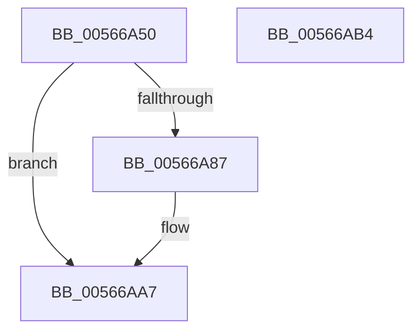

# IommuHvSetAddressSpace

- RVA: `0x00566A50`–`0x00566AB5` (길이 `101` bytes)
- VA: `0x0000000140566A50`
- 실행 섹션: `.text`
- PDB 이름 있음: `예`; PDB Function 태그: `아니요`
- unwind 정보 RVA: `0x0006E5F8`
- 디코드: `30`개 명령, `101/101` bytes 표시
- 미해석 바이트: `0` (있으면 어셈블리에 `.byte`로 보존)

> 이 문서는 커널 이미지의 기계어와 PDB 기호를 분석해 생성했습니다. 4번과 5번은 함수 원형과 자료형을 바이너리 사용 방식에서 추정한 C 해석이며 원본 소스 복구 결과는 아닙니다.

## 1. Dependencies

- 직접 호출 지점: **2**; 고유 호출 대상: **2**
- 직접 호출자로 확인된 함수: **1**
- RIP 상대 이미지 참조: **1**

### Outgoing calls
- `0x00566A7E` → [guard_dispatch_icall](../6B/guard_dispatch_icall_function_006BAAD0.md) (function, `0x006BAAD0`)
- `0x00566AA1` → [KeBugCheckEx](../4F/KeBugCheckEx_function_004FD660.md) (function, `0x004FD660`)

### Direct callers
- [IommuDisableDevicePasid](IommuDisableDevicePasid_function_00564E80.md) at `0x00565017`

### Static image references
- `0x00566A71` → RVA `0x00FC1D70` (`.data`; read)

## 2. Other-region calls and transfers

- 다른 실행 섹션으로 향하는 call: **0**
- 별도 외부 분기/꼬리 이동을 확인하지 못했습니다.

## 3. Assembly (complete function range)

```asm
00566A50  48 89 5C 24 08                  mov qword ptr [rsp + 8], rbx
00566A55  57                              push rdi
00566A56  48 83 EC 30                     sub rsp, 0x30
00566A5A  48 8B 41 08                     mov rax, qword ptr [rcx + 8]
00566A5E  48 8B DA                        mov rbx, rdx
00566A61  48 8B F9                        mov rdi, rcx
00566A64  4C 8B C3                        mov r8, rbx
00566A67  49 83 C8 01                     or r8, 1
00566A6B  48 85 DB                        test rbx, rbx
00566A6E  8B 50 10                        mov edx, dword ptr [rax + 0x10]
00566A71  48 8B 05 F8 B2 A5 00            mov rax, qword ptr [rip + 0xa5b2f8]
00566A78  4C 0F 44 C3                     cmove r8, rbx
00566A7C  33 C9                           xor ecx, ecx
00566A7E  E8 4D 40 15 00                  call 0x1406baad0
00566A83  85 C0                           test eax, eax
00566A85  79 20                           jns 0x140566aa7
00566A87  48 8B 4F 08                     mov rcx, qword ptr [rdi + 8]
00566A8B  BA 00 32 00 00                  mov edx, 0x3200
00566A90  4C 63 C0                        movsxd r8, eax
00566A93  48 89 5C 24 20                  mov qword ptr [rsp + 0x20], rbx
00566A98  44 8B 49 10                     mov r9d, dword ptr [rcx + 0x10]
00566A9C  B9 59 01 00 00                  mov ecx, 0x159
00566AA1  E8 BA 6B F9 FF                  call 0x1404fd660
00566AA6  CC                              int3
00566AA7  48 8B 5C 24 40                  mov rbx, qword ptr [rsp + 0x40]
00566AAC  33 C0                           xor eax, eax
00566AAE  48 83 C4 30                     add rsp, 0x30
00566AB2  5F                              pop rdi
00566AB3  C3                              ret
00566AB4  CC                              int3
```

## 4. C-style interpretation (structured pseudocode)

```c
__int64 __fastcall IommuHvSetAddressSpace(__int64 a1, __int64 a2)
{
    __int64 result;
    __int64 v_rsp;
    unsigned __int64 v_stack_m18;
    unsigned __int64 v_stack_p8;

    v_stack_p8 = v_rbx;
    v_rsp = (v_rsp) - (48);
    a3 = (a2) | (1);
    if (a2 == 0) { a3 = a2; }
    a1 = 0;
    result = guard_dispatch_icall(a1, (unsigned int)(*(unsigned int *)(*(unsigned __int64 *)(a1 + 8) + 16)), a3, a4);
    if (sign_flag) {
        a1 = *(unsigned __int64 *)(a1 + 8);
        a2 = 0x3200ULL;
        a3 = (int)((unsigned int)(result));
        v_stack_m18 = a2;
        a4 = *(unsigned int *)(a1 + 16);
        a1 = 345;
        result = KeBugCheckEx(a1, a2, a3, a4);
    }
    result = 0;
    v_rsp = (v_rsp) + (48);
    return result;
}
```

## 5. (Beta) C Style

```c
int64_t IommuHvSetAddressSpace(void *Arg1, int64_t Arg2)
{
    uint8_t *arg1 = (uint8_t *)Arg1;

    int64_t result;
    int64_t local_rsp;
    uint64_t v_stack_m18;
    uint64_t v_stack_p8;

    v_stack_p8 = local_rbx;
    local_rsp = (local_rsp) - (48);
    a3 = (Arg2) | (1);
    if (Arg2 == 0) { a3 = Arg2; }
    Arg1 = 0;
    result = guard_dispatch_icall(Arg1, (uint32_t)(*(uint32_t *)(*(uint64_t *)(arg1 + 0x8) + 0x10)), a3, a4);
    if (sign_flag) {
        Arg1 = *(uint64_t *)(arg1 + 0x8);
        Arg2 = 0x3200ULL;
        a3 = (int32_t)((uint32_t)(result));
        v_stack_m18 = Arg2;
        a4 = *(uint32_t *)(arg1 + 0x10);
        Arg1 = 345;
        result = KeBugCheckEx(Arg1, Arg2, a3, a4);
    }
    result = 0;
    local_rsp = (local_rsp) + (48);
    return result;
}
```

### 관측된 메모리 오프셋

구조체 형식이 확인되지 않은 접근은 인자 기준의 오프셋으로만 기록했습니다.

| 기준 인자 | 오프셋 표현 | 폭 (bit) | 접근 |
|---|---:|---:|---|
| `Arg1` | `+ 0x8` | `64` | `R` |

## 6. Execution-region graph

[열기: 2D/3D 그래프와 함수 탐색 컨트롤 패널](../../../control-panel.html?section=text&rva=0x00566A50&view=graph)

- 2D 그래프는 위에서 아래로 흐르고, 3D 그래프는 빈 공간을 드래그해 회전합니다. Shift+드래그는 이동, 휠은 확대·축소, 함수 노드 선택은 대상 보고서 이동입니다.

### Static fallback


