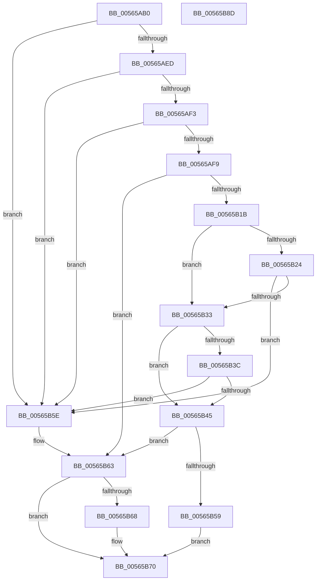

# IommuMapDevice

- RVA: `0x00565AB0`–`0x00565B8E` (길이 `222` bytes)
- VA: `0x0000000140565AB0`
- 실행 섹션: `.text`
- PDB 이름 있음: `예`; PDB Function 태그: `아니요`
- unwind 정보 RVA: `0x0005D7BC`
- 디코드: `66`개 명령, `222/222` bytes 표시
- 미해석 바이트: `0` (있으면 어셈블리에 `.byte`로 보존)

> 이 문서는 커널 이미지의 기계어와 PDB 기호를 분석해 생성했습니다. 4번과 5번은 함수 원형과 자료형을 바이너리 사용 방식에서 추정한 C 해석이며 원본 소스 복구 결과는 아닙니다.

## 1. Dependencies

- 직접 호출 지점: **3**; 고유 호출 대상: **3**
- 직접 호출자로 확인된 함수: **0**
- RIP 상대 이미지 참조: **2**

### Outgoing calls
- `0x00565B0B` → [HalpIommuCreateDevice](../54/HalpIommuCreateDevice_function_0054ED60.md) (function, `0x0054ED60`)
- `0x00565B4E` → [IommupMapDeviceInternal](IommupMapDeviceInternal_function_00566478.md) (function, `0x00566478`)
- `0x00565B6B` → [HalpIommuDeleteDevice](../54/HalpIommuDeleteDevice_function_0054F368.md) (function, `0x0054F368`)

### Direct callers
- 이 함수 시작 RVA로 연결되는 직접 call은 확인되지 않았습니다. 간접 호출은 완전히 역산할 수 없습니다.

### Static image references
- `0x00565B1B` → RVA `0x00FC1710` (`.data`; read)
- `0x00565B3C` → RVA `0x00FC16B0` (`.data`; read)

## 2. Other-region calls and transfers

- 다른 실행 섹션으로 향하는 call: **0**
- 별도 외부 분기/꼬리 이동을 확인하지 못했습니다.

## 3. Assembly (complete function range)

```asm
00565AB0  48 8B C4                        mov rax, rsp
00565AB3  48 89 58 08                     mov qword ptr [rax + 8], rbx
00565AB7  48 89 68 10                     mov qword ptr [rax + 0x10], rbp
00565ABB  48 89 70 18                     mov qword ptr [rax + 0x18], rsi
00565ABF  48 89 78 20                     mov qword ptr [rax + 0x20], rdi
00565AC3  41 56                           push r14
00565AC5  48 83 EC 30                     sub rsp, 0x30
00565AC9  48 8B 74 24 60                  mov rsi, qword ptr [rsp + 0x60]
00565ACE  33 FF                           xor edi, edi
00565AD0  49 8B E9                        mov rbp, r9
00565AD3  48 89 78 28                     mov qword ptr [rax + 0x28], rdi
00565AD7  4D 8B D8                        mov r11, r8
00565ADA  4C 8B D2                        mov r10, rdx
00565ADD  4C 8B F1                        mov r14, rcx
00565AE0  48 83 26 00                     and qword ptr [rsi], 0
00565AE4  44 8D 4F 01                     lea r9d, [rdi + 1]
00565AE8  44 39 0A                        cmp dword ptr [rdx], r9d
00565AEB  75 71                           jne 0x140565b5e
00565AED  44 84 4A 04                     test byte ptr [rdx + 4], r9b
00565AF1  75 6B                           jne 0x140565b5e
00565AF3  F6 42 0A 03                     test byte ptr [rdx + 0xa], 3
00565AF7  75 65                           jne 0x140565b5e
00565AF9  48 8D 40 28                     lea rax, [rax + 0x28]
00565AFD  45 33 C0                        xor r8d, r8d
00565B00  49 8B D3                        mov rdx, r11
00565B03  48 89 44 24 20                  mov qword ptr [rsp + 0x20], rax
00565B08  49 8B CA                        mov rcx, r10
00565B0B  E8 50 92 FE FF                  call 0x14054ed60
00565B10  48 8B 7C 24 60                  mov rdi, qword ptr [rsp + 0x60]
00565B15  8B D8                           mov ebx, eax
00565B17  85 C0                           test eax, eax
00565B19  78 48                           js 0x140565b63
00565B1B  80 3D EE BB A5 00 00            cmp byte ptr [rip + 0xa5bbee], 0
00565B22  75 0F                           jne 0x140565b33
00565B24  48 8B 47 20                     mov rax, qword ptr [rdi + 0x20]
00565B28  8B 88 D8 01 00 00               mov ecx, dword ptr [rax + 0x1d8]
00565B2E  F6 C1 20                        test cl, 0x20
00565B31  74 2B                           je 0x140565b5e
00565B33  48 8B 47 18                     mov rax, qword ptr [rdi + 0x18]
00565B37  48 85 C0                        test rax, rax
00565B3A  74 09                           je 0x140565b45
00565B3C  48 3B 05 6D BB A5 00            cmp rax, qword ptr [rip + 0xa5bb6d]
00565B43  75 19                           jne 0x140565b5e
00565B45  49 8B 0E                        mov rcx, qword ptr [r14]
00565B48  4C 8B C5                        mov r8, rbp
00565B4B  48 8B D7                        mov rdx, rdi
00565B4E  E8 25 09 00 00                  call 0x140566478
00565B53  8B D8                           mov ebx, eax
00565B55  85 C0                           test eax, eax
00565B57  78 0A                           js 0x140565b63
00565B59  48 89 3E                        mov qword ptr [rsi], rdi
00565B5C  EB 12                           jmp 0x140565b70
00565B5E  BB BB 00 00 C0                  mov ebx, 0xc00000bb
00565B63  48 85 FF                        test rdi, rdi
00565B66  74 08                           je 0x140565b70
00565B68  48 8B CF                        mov rcx, rdi
00565B6B  E8 F8 97 FE FF                  call 0x14054f368
00565B70  48 8B 6C 24 48                  mov rbp, qword ptr [rsp + 0x48]
00565B75  8B C3                           mov eax, ebx
00565B77  48 8B 5C 24 40                  mov rbx, qword ptr [rsp + 0x40]
00565B7C  48 8B 74 24 50                  mov rsi, qword ptr [rsp + 0x50]
00565B81  48 8B 7C 24 58                  mov rdi, qword ptr [rsp + 0x58]
00565B86  48 83 C4 30                     add rsp, 0x30
00565B8A  41 5E                           pop r14
00565B8C  C3                              ret
00565B8D  CC                              int3
```

## 4. C-style interpretation (structured pseudocode)

```c
__int64 __fastcall IommuMapDevice(__int64 a1, __int64 a2, __int64 a3, __int64 a4, __int64 a5)
{
    __int64 result;
    __int64 v_rdi;
    __int64 v_rsp;
    unsigned __int64 v_stack_m18;
    unsigned __int64 v_stack_p10;
    unsigned __int64 v_stack_p18;
    unsigned __int64 v_stack_p20;
    unsigned __int64 v_stack_p8;

    *(unsigned __int64 *)(v_rsp + 8) = v_rbx;
    *(unsigned __int64 *)(v_rsp + 16) = v_rbp;
    *(unsigned __int64 *)(v_rsp + 24) = v_rsi;
    *(unsigned __int64 *)(v_rsp + 32) = v_rdi;
    v_rsp = (v_rsp) - (48);
    v_rdi = 0;
    *(unsigned __int64 *)(v_rsp + 40) = 0;
    if ((*(unsigned int *)(a2)) != ((unsigned int)(v_rdi + 1))) goto loc_00565B5E;
    if (((*(unsigned __int8 *)(a2 + 4)) & ((unsigned __int8)(v_rdi + 1))) != 0) goto loc_00565B5E;
    if (((*(unsigned __int8 *)(a2 + 10)) & (3)) != 0) goto loc_00565B5E;
    a3 = 0;
    v_stack_m18 = v_rsp + 40;
    result = HalpIommuCreateDevice(a2, 0, a3, v_rdi + 1);
    if (sign_flag) goto loc_00565B63;
    if ((*(unsigned __int8 *)(v_rip + 10861550)) != 0) goto loc_00565B33;
    if ((((unsigned __int8)((unsigned int)(*(unsigned int *)(*(unsigned __int64 *)(a5 + 32) + 472)))) & (32)) == 0) goto loc_00565B5E;
loc_00565B33:
    if (*(unsigned __int64 *)(a5 + 24) == 0) goto loc_00565B45;
    if ((*(unsigned __int64 *)(a5 + 24)) != (*(unsigned __int64 *)(v_rip + 10861421))) goto loc_00565B5E;
loc_00565B45:
    result = IommupMapDeviceInternal(*(unsigned __int64 *)(a1), a5, a4, v_rdi + 1);
    if (sign_flag) goto loc_00565B63;
    *(unsigned __int64 *)(a5) = a5;
    goto loc_00565B70;
loc_00565B5E:
loc_00565B63:
    if (a5 != 0) {
        a1 = a5;
        result = HalpIommuDeleteDevice(a1, a5, a4, v_rdi + 1);
    }
    v_rsp = (v_rsp) + (48);
    return (unsigned int)((unsigned int)((unsigned int)(0xC00000BBULL)));
}
```

## 5. (Beta) C Style

```c
int64_t IommuMapDevice(void *Arg1, void *Arg2, int64_t Arg3, int64_t Arg4, void *Arg5)
{
    uint8_t *arg1 = (uint8_t *)Arg1;
    uint8_t *arg2 = (uint8_t *)Arg2;
    uint8_t *arg5 = (uint8_t *)Arg5;

    int64_t result;
    int64_t local_rdi;
    int64_t local_rsp;
    uint64_t v_stack_m18;
    uint64_t v_stack_p10;
    uint64_t v_stack_p18;
    uint64_t v_stack_p20;
    uint64_t v_stack_p8;

    *(uint64_t *)(local_rsp + 0x8) = local_rbx;
    *(uint64_t *)(local_rsp + 0x10) = local_rbp;
    *(uint64_t *)(local_rsp + 0x18) = local_rsi;
    *(uint64_t *)(local_rsp + 0x20) = local_rdi;
    local_rsp = (local_rsp) - (48);
    local_rdi = 0;
    *(uint64_t *)(local_rsp + 0x28) = 0;
    if ((*(uint32_t *)(arg2)) != ((uint32_t)(local_rdi + 1))) goto loc_00565B5E;
    if (((*(uint8_t *)(arg2 + 0x4)) & ((uint8_t)(local_rdi + 1))) != 0) goto loc_00565B5E;
    if (((*(uint8_t *)(arg2 + 0xA)) & (3)) != 0) goto loc_00565B5E;
    Arg3 = 0;
    v_stack_m18 = local_rsp + 40;
    result = HalpIommuCreateDevice(Arg2, 0, Arg3, local_rdi + 1);
    if (sign_flag) goto loc_00565B63;
    if ((*(uint8_t *)(v_rip + 0xA5BBEE)) != 0) goto loc_00565B33;
    if ((((uint8_t)((uint32_t)(*(uint32_t *)(*(uint64_t *)(arg5 + 0x20) + 0x1D8)))) & (32)) == 0) goto loc_00565B5E;
loc_00565B33:
    if (*(uint64_t *)(arg5 + 0x18) == 0) goto loc_00565B45;
    if ((*(uint64_t *)(arg5 + 0x18)) != (*(uint64_t *)(v_rip + 0xA5BB6D))) goto loc_00565B5E;
loc_00565B45:
    result = IommupMapDeviceInternal(*(uint64_t *)(arg1), Arg5, Arg4, local_rdi + 1);
    if (sign_flag) goto loc_00565B63;
    *(void **)(arg5) = Arg5;
    goto loc_00565B70;
loc_00565B5E:
loc_00565B63:
    if (Arg5 != NULL) {
        Arg1 = Arg5;
        result = HalpIommuDeleteDevice(Arg1, Arg5, Arg4, local_rdi + 1);
    }
    local_rsp = (local_rsp) + (48);
    return (uint32_t)((uint32_t)((uint32_t)(0xC00000BBULL)));
}
```

### 관측된 메모리 오프셋

구조체 형식이 확인되지 않은 접근은 인자 기준의 오프셋으로만 기록했습니다.

| 기준 인자 | 오프셋 표현 | 폭 (bit) | 접근 |
|---|---:|---:|---|
| `Arg1` | `+ 0x0` | `64` | `R` |
| `Arg2` | `+ 0x0` | `32` | `R` |
| `Arg2` | `+ 0x4` | `8` | `R` |
| `Arg2` | `+ 0xA` | `8` | `R` |
| `Arg5` | `+ 0x0` | `64` | `R/W` |
| `Arg5` | `+ 0x0` | `64` | `W` |
| `Arg5` | `+ 0x18` | `64` | `R` |
| `Arg5` | `+ 0x20` | `64` | `R` |

## 6. Execution-region graph

[열기: 2D/3D 그래프와 함수 탐색 컨트롤 패널](../../../control-panel.html?section=text&rva=0x00565AB0&view=graph)

- 2D 그래프는 위에서 아래로 흐르고, 3D 그래프는 빈 공간을 드래그해 회전합니다. Shift+드래그는 이동, 휠은 확대·축소, 함수 노드 선택은 대상 보고서 이동입니다.

### Static fallback


