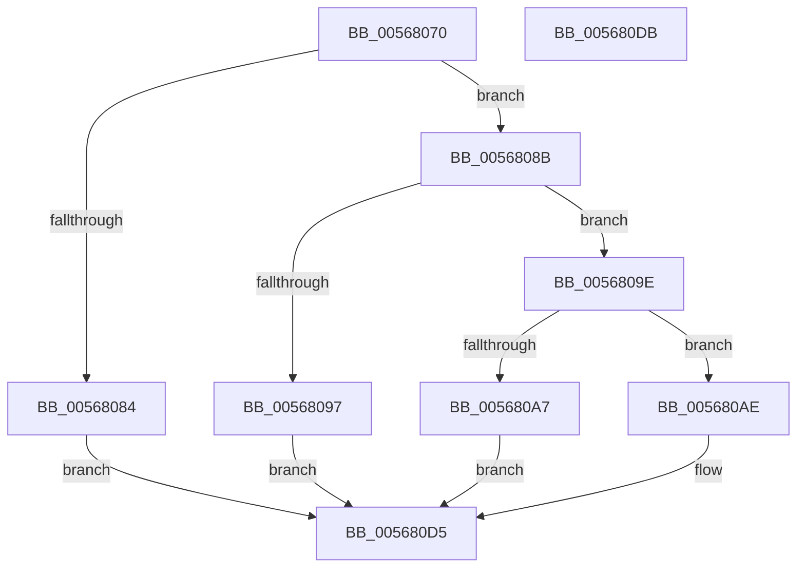

# IommuMapLogicalRange

- RVA: `0x00568070`–`0x005680DC` (길이 `108` bytes)
- VA: `0x0000000140568070`
- 실행 섹션: `.text`
- PDB 이름 있음: `예`; PDB Function 태그: `아니요`
- unwind 정보 RVA: `0x00064C80`
- 디코드: `33`개 명령, `108/108` bytes 표시
- 미해석 바이트: `0` (있으면 어셈블리에 `.byte`로 보존)

> 이 문서는 커널 이미지의 기계어와 PDB 기호를 분석해 생성했습니다. 4번과 5번은 함수 원형과 자료형을 바이너리 사용 방식에서 추정한 C 해석이며 원본 소스 복구 결과는 아닙니다.

## 1. Dependencies

- 직접 호출 지점: **2**; 고유 호출 대상: **2**
- 직접 호출자로 확인된 함수: **0**
- RIP 상대 이미지 참조: **0**

### Outgoing calls
- `0x0056808E` → [IommupValidateMdl](IommupValidateMdl_function_005689D0.md) (function, `0x005689D0`)
- `0x005680D0` → [HalpIommuDomainMapLogical](../30/HalpIommuDomainMapLogical_function_0030769C.md) (function, `0x0030769C`)

### Direct callers
- 이 함수 시작 RVA로 연결되는 직접 call은 확인되지 않았습니다. 간접 호출은 완전히 역산할 수 없습니다.

### Static image references
- 디코드된 RIP-relative 메모리 참조가 없습니다.

## 2. Other-region calls and transfers

- 다른 실행 섹션으로 향하는 call: **0**
- 별도 외부 분기/꼬리 이동을 확인하지 못했습니다.

## 3. Assembly (complete function range)

```asm
00568070  40 53                           push rbx
00568072  48 83 EC 30                     sub rsp, 0x30
00568076  83 79 08 00                     cmp dword ptr [rcx + 8], 0
0056807A  4D 8B D1                        mov r10, r9
0056807D  8B DA                           mov ebx, edx
0056807F  4C 8B D9                        mov r11, rcx
00568082  74 07                           je 0x14056808b
00568084  B8 EF 00 00 C0                  mov eax, 0xc00000ef
00568089  EB 4A                           jmp 0x1405680d5
0056808B  49 8B C8                        mov rcx, r8
0056808E  E8 3D 09 00 00                  call 0x1405689d0
00568093  84 C0                           test al, al
00568095  75 07                           jne 0x14056809e
00568097  B8 F1 00 00 C0                  mov eax, 0xc00000f1
0056809C  EB 37                           jmp 0x1405680d5
0056809E  49 F7 C2 FF 0F 00 00            test r10, 0xfff
005680A5  74 07                           je 0x1405680ae
005680A7  B8 F2 00 00 C0                  mov eax, 0xc00000f2
005680AC  EB 27                           jmp 0x1405680d5
005680AE  41 8B 40 2C                     mov eax, dword ptr [r8 + 0x2c]
005680B2  8B D3                           mov edx, ebx
005680B4  45 8B 48 28                     mov r9d, dword ptr [r8 + 0x28]
005680B8  49 8B CB                        mov rcx, r11
005680BB  48 C1 E8 0C                     shr rax, 0xc
005680BF  49 C1 E9 0C                     shr r9, 0xc
005680C3  4C 89 54 24 20                  mov qword ptr [rsp + 0x20], r10
005680C8  4D 8D 04 C0                     lea r8, [r8 + rax*8]
005680CC  49 83 C0 30                     add r8, 0x30
005680D0  E8 C7 F5 D9 FF                  call 0x14030769c
005680D5  48 83 C4 30                     add rsp, 0x30
005680D9  5B                              pop rbx
005680DA  C3                              ret
005680DB  CC                              int3
```

## 4. C-style interpretation (structured pseudocode)

```c
__int64 __fastcall IommuMapLogicalRange(__int64 a1, int a2, __int64 a3, __int64 a4)
{
    __int64 result;
    __int64 v_rsp;
    unsigned __int64 v_stack_m18;

    v_rsp = (v_rsp) - (48);
    if ((*(unsigned int *)(a1 + 8)) == 0) goto loc_0056808B;
    goto loc_005680D5;
loc_0056808B:
    result = IommupValidateMdl(a3, a2, a3, a4);
    if ((unsigned __int8)(result) != 0) goto loc_0056809E;
    goto loc_005680D5;
loc_0056809E:
    if (((a4) & (0xFFFULL)) == 0) goto loc_005680AE;
    goto loc_005680D5;
loc_005680AE:
    result = ((unsigned int)(*(unsigned int *)(a3 + 44))) >> (12);
    a4 = ((unsigned int)(*(unsigned int *)(a3 + 40))) >> (12);
    v_stack_m18 = a4;
    a3 = (a3 + result * 8) + (48);
    result = HalpIommuDomainMapLogical(a1, (unsigned int)((unsigned int)((unsigned int)(a2))), a3, a4);
loc_005680D5:
    v_rsp = (v_rsp) + (48);
    return result;
}
```

## 5. (Beta) C Style

```c
int64_t IommuMapLogicalRange(void *Arg1, int32_t Arg2, int64_t Arg3, int64_t Arg4)
{
    uint8_t *arg1 = (uint8_t *)Arg1;

    int64_t result;
    int64_t local_rsp;
    uint64_t v_stack_m18;

    local_rsp = (local_rsp) - (48);
    if ((*(uint32_t *)(arg1 + 0x8)) == 0) goto loc_0056808B;
    goto loc_005680D5;
loc_0056808B:
    result = IommupValidateMdl(Arg3, Arg2, Arg3, Arg4);
    if ((uint8_t)(result) != 0) goto loc_0056809E;
    goto loc_005680D5;
loc_0056809E:
    if (((Arg4) & (0xFFFULL)) == 0) goto loc_005680AE;
    goto loc_005680D5;
loc_005680AE:
    result = ((uint32_t)(*(uint32_t *)(Arg3 + 0x2C))) >> (12);
    Arg4 = ((uint32_t)(*(uint32_t *)(Arg3 + 0x28))) >> (12);
    v_stack_m18 = Arg4;
    Arg3 = (Arg3 + result * 8) + (48);
    result = HalpIommuDomainMapLogical(Arg1, (uint32_t)((uint32_t)((uint32_t)(Arg2))), Arg3, Arg4);
loc_005680D5:
    local_rsp = (local_rsp) + (48);
    return result;
}
```

### 관측된 메모리 오프셋

구조체 형식이 확인되지 않은 접근은 인자 기준의 오프셋으로만 기록했습니다.

| 기준 인자 | 오프셋 표현 | 폭 (bit) | 접근 |
|---|---:|---:|---|
| `Arg1` | `+ 0x8` | `32` | `R` |

## 6. Execution-region graph

[열기: 2D/3D 그래프와 함수 탐색 컨트롤 패널](../../../control-panel.html?section=text&rva=0x00568070&view=graph)

- 2D 그래프는 위에서 아래로 흐르고, 3D 그래프는 빈 공간을 드래그해 회전합니다. Shift+드래그는 이동, 휠은 확대·축소, 함수 노드 선택은 대상 보고서 이동입니다.

### Static fallback


