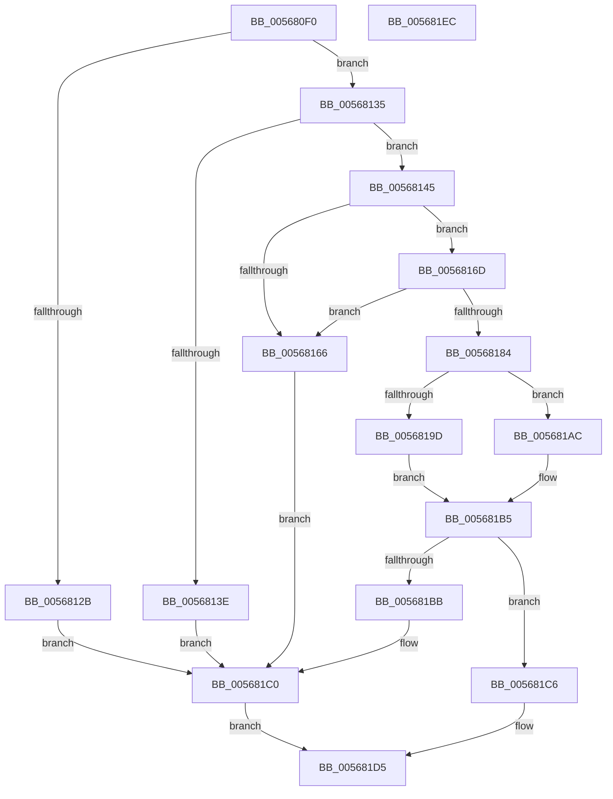

# IommuMapReservedLogicalRange

- RVA: `0x005680F0`–`0x005681ED` (길이 `253` bytes)
- VA: `0x00000001405680F0`
- 실행 섹션: `.text`
- PDB 이름 있음: `예`; PDB Function 태그: `아니요`
- unwind 정보 RVA: `0x000C4EA4`
- 디코드: `74`개 명령, `253/253` bytes 표시
- 미해석 바이트: `0` (있으면 어셈블리에 `.byte`로 보존)

> 이 문서는 커널 이미지의 기계어와 PDB 기호를 분석해 생성했습니다. 4번과 5번은 함수 원형과 자료형을 바이너리 사용 방식에서 추정한 C 해석이며 원본 소스 복구 결과는 아닙니다.

## 1. Dependencies

- 직접 호출 지점: **3**; 고유 호출 대상: **3**
- 직접 호출자로 확인된 함수: **0**
- RIP 상대 이미지 참조: **0**

### Outgoing calls
- `0x0056815D` → [IommupProcessPhysicalAddress](../47/IommupProcessPhysicalAddress_function_0047FF5C.md) (function, `0x0047FF5C`)
- `0x005681A5` → [HalpIommuDomainMapLogical](../30/HalpIommuDomainMapLogical_function_0030769C.md) (function, `0x0030769C`)
- `0x005681B0` → [HalpIommuDomainMapLogicalRange](../55/HalpIommuDomainMapLogicalRange_function_00555064.md) (function, `0x00555064`)

### Direct callers
- 이 함수 시작 RVA로 연결되는 직접 call은 확인되지 않았습니다. 간접 호출은 완전히 역산할 수 없습니다.

### Static image references
- 디코드된 RIP-relative 메모리 참조가 없습니다.

## 2. Other-region calls and transfers

- 다른 실행 섹션으로 향하는 call: **0**
- 별도 외부 분기/꼬리 이동을 확인하지 못했습니다.

## 3. Assembly (complete function range)

```asm
005680F0  48 89 5C 24 10                  mov qword ptr [rsp + 0x10], rbx
005680F5  48 89 74 24 18                  mov qword ptr [rsp + 0x18], rsi
005680FA  55                              push rbp
005680FB  57                              push rdi
005680FC  41 56                           push r14
005680FE  48 8B EC                        mov rbp, rsp
00568101  48 83 EC 50                     sub rsp, 0x50
00568105  48 83 65 F0 00                  and qword ptr [rbp - 0x10], 0
0056810A  4D 8B D1                        mov r10, r9
0056810D  48 83 65 E0 00                  and qword ptr [rbp - 0x20], 0
00568112  45 8B F0                        mov r14d, r8d
00568115  48 83 65 E8 00                  and qword ptr [rbp - 0x18], 0
0056811A  48 8B FA                        mov rdi, rdx
0056811D  48 8B D9                        mov rbx, rcx
00568120  C6 45 20 00                     mov byte ptr [rbp + 0x20], 0
00568124  F0 83 41 18 01                  lock add dword ptr [rcx + 0x18], 1
00568129  7F 0A                           jg 0x140568135
0056812B  B9 01 00 00 C0                  mov ecx, 0xc0000001
00568130  E9 8B 00 00 00                  jmp 0x1405681c0
00568135  48 F7 C7 FF 0F 00 00            test rdi, 0xfff
0056813C  74 07                           je 0x140568145
0056813E  B9 F0 00 00 C0                  mov ecx, 0xc00000f0
00568143  EB 7B                           jmp 0x1405681c0
00568145  48 8D 45 F0                     lea rax, [rbp - 0x10]
00568149  49 8B CA                        mov rcx, r10
0056814C  4C 8D 4D E8                     lea r9, [rbp - 0x18]
00568150  48 89 44 24 20                  mov qword ptr [rsp + 0x20], rax
00568155  4C 8D 45 20                     lea r8, [rbp + 0x20]
00568159  48 8D 55 E0                     lea rdx, [rbp - 0x20]
0056815D  E8 FA 7D F1 FF                  call 0x14047ff5c
00568162  85 C0                           test eax, eax
00568164  79 07                           jns 0x14056816d
00568166  B9 F2 00 00 C0                  mov ecx, 0xc00000f2
0056816B  EB 53                           jmp 0x1405681c0
0056816D  48 8B 75 E0                     mov rsi, qword ptr [rbp - 0x20]
00568171  48 8B 13                        mov rdx, qword ptr [rbx]
00568174  48 8B 4B 08                     mov rcx, qword ptr [rbx + 8]
00568178  48 03 CA                        add rcx, rdx
0056817B  48 8D 04 3E                     lea rax, [rsi + rdi]
0056817F  48 3B C1                        cmp rax, rcx
00568182  77 E2                           ja 0x140568166
00568184  80 7D 20 00                     cmp byte ptr [rbp + 0x20], 0
00568188  48 8D 04 17                     lea rax, [rdi + rdx]
0056818C  48 8B 4B 10                     mov rcx, qword ptr [rbx + 0x10]
00568190  4C 8B CE                        mov r9, rsi
00568193  48 89 44 24 20                  mov qword ptr [rsp + 0x20], rax
00568198  41 8B D6                        mov edx, r14d
0056819B  75 0F                           jne 0x1405681ac
0056819D  4C 8B 45 E8                     mov r8, qword ptr [rbp - 0x18]
005681A1  49 C1 E9 0C                     shr r9, 0xc
005681A5  E8 F2 F4 D9 FF                  call 0x14030769c
005681AA  EB 09                           jmp 0x1405681b5
005681AC  4C 8B 45 F0                     mov r8, qword ptr [rbp - 0x10]
005681B0  E8 AF CE FE FF                  call 0x140555064
005681B5  8B C8                           mov ecx, eax
005681B7  85 C0                           test eax, eax
005681B9  79 0B                           jns 0x1405681c6
005681BB  B9 08 07 00 C0                  mov ecx, 0xc0000708
005681C0  F0 FF 4B 18                     lock dec dword ptr [rbx + 0x18]
005681C4  EB 0F                           jmp 0x1405681d5
005681C6  48 8B 45 40                     mov rax, qword ptr [rbp + 0x40]
005681CA  48 89 18                        mov qword ptr [rax], rbx
005681CD  48 89 78 08                     mov qword ptr [rax + 8], rdi
005681D1  48 89 70 10                     mov qword ptr [rax + 0x10], rsi
005681D5  4C 8D 5C 24 50                  lea r11, [rsp + 0x50]
005681DA  8B C1                           mov eax, ecx
005681DC  49 8B 5B 28                     mov rbx, qword ptr [r11 + 0x28]
005681E0  49 8B 73 30                     mov rsi, qword ptr [r11 + 0x30]
005681E4  49 8B E3                        mov rsp, r11
005681E7  41 5E                           pop r14
005681E9  5F                              pop rdi
005681EA  5D                              pop rbp
005681EB  C3                              ret
005681EC  CC                              int3
```

## 4. C-style interpretation (structured pseudocode)

```c
__int64 __fastcall IommuMapReservedLogicalRange(__int64 a1, __int64 a2, int a3, __int64 a4, __int64 a5)
{
    __int64 result;
    __int64 v_rsp;
    unsigned __int64 v_stack_m18;
    unsigned __int64 v_stack_m28;
    unsigned __int64 v_stack_m30;
    unsigned __int64 v_stack_m38;
    unsigned __int64 v_stack_m48;
    unsigned __int64 v_stack_p10;
    unsigned __int64 v_stack_p18;
    unsigned __int8 v_stack_p8;

    v_stack_p10 = v_rbx;
    v_stack_p18 = v_rsi;
    v_rsp = (v_rsp) - (80);
    v_stack_p8 = 0;
    if (condition_is_greater) goto loc_00568135;
    goto loc_005681C0;
loc_00568135:
    if (((a2) & (0xFFFULL)) == 0) goto loc_00568145;
    goto loc_005681C0;
loc_00568145:
    v_stack_m48 = v_stack_m28;
    result = IommupProcessPhysicalAddress(a4, v_stack_m38, v_stack_p8, v_stack_m30);
    if (!sign_flag) goto loc_0056816D;
loc_00568166:
    goto loc_005681C0;
loc_0056816D:
    a1 = (*(unsigned __int64 *)(a1 + 8)) + (*(unsigned __int64 *)(a1));
    if ((v_stack_m38 + a2 * 1) > a1) goto loc_00568166;
    v_stack_m48 = a2 + *(unsigned __int64 *)(a1) * 1;
    if (v_stack_p8 != 0) goto loc_005681AC;
    a4 = (v_stack_m38) >> (12);
    result = HalpIommuDomainMapLogical(*(unsigned __int64 *)(a1 + 16), (unsigned int)((unsigned int)((unsigned int)(a3))), v_stack_m30, a4);
    goto loc_005681B5;
loc_005681AC:
    result = HalpIommuDomainMapLogicalRange(*(unsigned __int64 *)(a1 + 16), (unsigned int)((unsigned int)((unsigned int)(a3))), v_stack_m28, a4);
loc_005681B5:
    if (!sign_flag) goto loc_005681C6;
loc_005681C0:
    goto loc_005681D5;
loc_005681C6:
    *(unsigned __int64 *)(a5) = a1;
    *(unsigned __int64 *)(a5 + 8) = a2;
    *(unsigned __int64 *)(a5 + 16) = v_stack_m38;
loc_005681D5:
    return (unsigned int)((unsigned int)((unsigned int)(0xC0000708ULL)));
}
```

## 5. (Beta) C Style

```c
int64_t IommuMapReservedLogicalRange(void *Arg1, int64_t Arg2, int32_t Arg3, int64_t Arg4, void *Arg5)
{
    uint8_t *arg1 = (uint8_t *)Arg1;
    uint8_t *arg5 = (uint8_t *)Arg5;

    int64_t result;
    int64_t local_rsp;
    uint64_t v_stack_m18;
    uint64_t v_stack_m28;
    uint64_t v_stack_m30;
    uint64_t v_stack_m38;
    uint64_t v_stack_m48;
    uint64_t v_stack_p10;
    uint64_t v_stack_p18;
    uint8_t v_stack_p8;

    v_stack_p10 = local_rbx;
    v_stack_p18 = local_rsi;
    local_rsp = (local_rsp) - (80);
    v_stack_p8 = 0;
    if (condition_is_greater) goto loc_00568135;
    goto loc_005681C0;
loc_00568135:
    if (((Arg2) & (0xFFFULL)) == 0) goto loc_00568145;
    goto loc_005681C0;
loc_00568145:
    v_stack_m48 = v_stack_m28;
    result = IommupProcessPhysicalAddress(Arg4, v_stack_m38, v_stack_p8, v_stack_m30);
    if (!sign_flag) goto loc_0056816D;
loc_00568166:
    goto loc_005681C0;
loc_0056816D:
    Arg1 = (*(uint64_t *)(arg1 + 0x8)) + (*(uint64_t *)(arg1));
    if ((v_stack_m38 + Arg2 * 1) > Arg1) goto loc_00568166;
    v_stack_m48 = Arg2 + *(uint64_t *)(arg1) * 1;
    if (v_stack_p8 != 0) goto loc_005681AC;
    Arg4 = (v_stack_m38) >> (12);
    result = HalpIommuDomainMapLogical(*(uint64_t *)(arg1 + 0x10), (uint32_t)((uint32_t)((uint32_t)(Arg3))), v_stack_m30, Arg4);
    goto loc_005681B5;
loc_005681AC:
    result = HalpIommuDomainMapLogicalRange(*(uint64_t *)(arg1 + 0x10), (uint32_t)((uint32_t)((uint32_t)(Arg3))), v_stack_m28, Arg4);
loc_005681B5:
    if (!sign_flag) goto loc_005681C6;
loc_005681C0:
    goto loc_005681D5;
loc_005681C6:
    *(void **)(arg5) = Arg1;
    *(uint64_t *)(arg5 + 0x8) = Arg2;
    *(uint64_t *)(arg5 + 0x10) = v_stack_m38;
loc_005681D5:
    return (uint32_t)((uint32_t)((uint32_t)(0xC0000708ULL)));
}
```

### 관측된 메모리 오프셋

구조체 형식이 확인되지 않은 접근은 인자 기준의 오프셋으로만 기록했습니다.

| 기준 인자 | 오프셋 표현 | 폭 (bit) | 접근 |
|---|---:|---:|---|
| `Arg1` | `+ 0x0` | `64` | `R` |
| `Arg1` | `+ 0x8` | `64` | `R` |
| `Arg1` | `+ 0x10` | `64` | `R` |
| `Arg1` | `+ 0x18` | `32` | `R/W` |
| `Arg5` | `+ 0x0` | `64` | `W` |
| `Arg5` | `+ 0x8` | `64` | `W` |
| `Arg5` | `+ 0x10` | `64` | `W` |

## 6. Execution-region graph

[열기: 2D/3D 그래프와 함수 탐색 컨트롤 패널](../../../control-panel.html?section=text&rva=0x005680F0&view=graph)

- 2D 그래프는 위에서 아래로 흐르고, 3D 그래프는 빈 공간을 드래그해 회전합니다. Shift+드래그는 이동, 휠은 확대·축소, 함수 노드 선택은 대상 보고서 이동입니다.

### Static fallback


