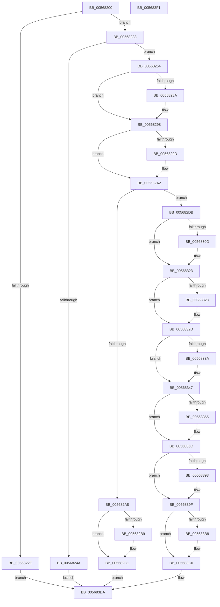

# IommuRegisterInterfaceStateChangeCallback

- RVA: `0x00568200`–`0x005683F2` (길이 `498` bytes)
- VA: `0x0000000140568200`
- 실행 섹션: `.text`
- PDB 이름 있음: `예`; PDB Function 태그: `아니요`
- unwind 정보 RVA: `0x0006F230`
- 디코드: `137`개 명령, `498/498` bytes 표시
- 미해석 바이트: `0` (있으면 어셈블리에 `.byte`로 보존)

> 이 문서는 커널 이미지의 기계어와 PDB 기호를 분석해 생성했습니다. 4번과 5번은 함수 원형과 자료형을 바이너리 사용 방식에서 추정한 C 해석이며 원본 소스 복구 결과는 아닙니다.

## 1. Dependencies

- 직접 호출 지점: **15**; 고유 호출 대상: **9**
- 직접 호출자로 확인된 함수: **0**
- RIP 상대 이미지 참조: **5**

### Outgoing calls
- `0x0056823D` → [HalpMmAllocCtxAlloc](../3E/HalpMmAllocCtxAlloc_function_003E10B8.md) (function, `0x003E10B8`)
- `0x0056827A` → [KeAbPreAcquire](../21/KeAbPreAcquire_function_00210230.md) (function, `0x00210230`)
- `0x00568293` → [ExfAcquirePushLockExclusiveEx](../20/ExfAcquirePushLockExclusiveEx_function_0020FC90.md) (function, `0x0020FC90`)
- `0x005682BC` → [ExfTryToWakePushLock](../26/ExfTryToWakePushLock_function_00265DD0.md) (function, `0x00265DD0`)
- `0x005682C4` → [KeAbPostRelease](../2E/KeAbPostRelease_function_002E1600.md) (function, `0x002E1600`)
- `0x005682CC` → [HalpMmAllocCtxFree](../3E/HalpMmAllocCtxFree_function_003E1904.md) (function, `0x003E1904`)
- `0x005682E4` → [ObfReferenceObjectWithTag](../21/ObfReferenceObjectWithTag_function_00210710.md) (function, `0x00210710`)
- `0x005682F9` → [KeAbPreAcquire](../21/KeAbPreAcquire_function_00210230.md) (function, `0x00210230`)
- `0x0056831E` → [ExfAcquirePushLockExclusiveEx](../20/ExfAcquirePushLockExclusiveEx_function_0020FC90.md) (function, `0x0020FC90`)
- `0x0056833D` → [HalpIommuDeviceGetDomainTypes](../54/HalpIommuDeviceGetDomainTypes_function_0054F538.md) (function, `0x0054F538`)
- `0x0056839A` → [ExfTryToWakePushLock](../26/ExfTryToWakePushLock_function_00265DD0.md) (function, `0x00265DD0`)
- `0x005683A6` → [KeAbPostRelease](../2E/KeAbPostRelease_function_002E1600.md) (function, `0x002E1600`)
- `0x005683BB` → [ExfTryToWakePushLock](../26/ExfTryToWakePushLock_function_00265DD0.md) (function, `0x00265DD0`)
- `0x005683C3` → [KeAbPostRelease](../2E/KeAbPostRelease_function_002E1600.md) (function, `0x002E1600`)
- `0x005683D5` → [guard_dispatch_icall](../6B/guard_dispatch_icall_function_006BAAD0.md) (function, `0x006BAAD0`)

### Direct callers
- 이 함수 시작 RVA로 연결되는 직접 call은 확인되지 않았습니다. 간접 호출은 완전히 역산할 수 없습니다.

### Static image references
- `0x005682F2` → RVA `0x00F8FA98` (`.data`; read)
- `0x005682FE` → RVA `0x00F8FA98` (`.data`; read/write)
- `0x0056834A` → RVA `0x00F8FAA8` (`.data`; read)
- `0x00568355` → RVA `0x00F8FAA0` (`.data`; read)
- `0x0056837D` → RVA `0x00F8FAA8` (`.data`; write)

## 2. Other-region calls and transfers

- 다른 실행 섹션으로 향하는 call: **0**
- 별도 외부 분기/꼬리 이동을 확인하지 못했습니다.

## 3. Assembly (complete function range)

```asm
00568200  48 89 5C 24 10                  mov qword ptr [rsp + 0x10], rbx
00568205  48 89 4C 24 08                  mov qword ptr [rsp + 8], rcx
0056820A  55                              push rbp
0056820B  56                              push rsi
0056820C  57                              push rdi
0056820D  41 54                           push r12
0056820F  41 55                           push r13
00568211  41 56                           push r14
00568213  41 57                           push r15
00568215  48 83 EC 20                     sub rsp, 0x20
00568219  33 DB                           xor ebx, ebx
0056821B  4D 8B F9                        mov r15, r9
0056821E  4D 8B F0                        mov r14, r8
00568221  4C 8B E2                        mov r12, rdx
00568224  48 8B F9                        mov rdi, rcx
00568227  8B EB                           mov ebp, ebx
00568229  41 39 19                        cmp dword ptr [r9], ebx
0056822C  75 0A                           jne 0x140568238
0056822E  BD F2 00 00 C0                  mov ebp, 0xc00000f2
00568233  E9 A2 01 00 00                  jmp 0x1405683da
00568238  BA 30 00 00 00                  mov edx, 0x30
0056823D  E8 76 8E E7 FF                  call 0x1403e10b8
00568242  48 8B F0                        mov rsi, rax
00568245  48 85 C0                        test rax, rax
00568248  75 0A                           jne 0x140568254
0056824A  BD 9A 00 00 C0                  mov ebp, 0xc000009a
0056824F  E9 86 01 00 00                  jmp 0x1405683da
00568254  48 89 18                        mov qword ptr [rax], rbx
00568257  45 33 C0                        xor r8d, r8d
0056825A  48 89 58 08                     mov qword ptr [rax + 8], rbx
0056825E  33 D2                           xor edx, edx
00568260  48 89 58 28                     mov qword ptr [rax + 0x28], rbx
00568264  48 89 78 10                     mov qword ptr [rax + 0x10], rdi
00568268  49 8D BE A0 01 00 00            lea rdi, [r14 + 0x1a0]
0056826F  48 8B CF                        mov rcx, rdi
00568272  4C 89 60 18                     mov qword ptr [rax + 0x18], r12
00568276  4C 89 70 20                     mov qword ptr [rax + 0x20], r14
0056827A  E8 B1 7F CA FF                  call 0x140210230
0056827F  F0 48 0F BA 2F 00               lock bts qword ptr [rdi], 0
00568285  4C 8B E8                        mov r13, rax
00568288  73 0E                           jae 0x140568298
0056828A  4C 8B C7                        mov r8, rdi
0056828D  48 8B D0                        mov rdx, rax
00568290  48 8B CF                        mov rcx, rdi
00568293  E8 F8 79 CA FF                  call 0x14020fc90
00568298  4D 85 ED                        test r13, r13
0056829B  74 05                           je 0x1405682a2
0056829D  41 C6 45 0A 01                  mov byte ptr [r13 + 0xa], 1
005682A2  49 39 5E 50                     cmp qword ptr [r14 + 0x50], rbx
005682A6  74 33                           je 0x1405682db
005682A8  48 83 CB FF                     or rbx, 0xffffffffffffffff
005682AC  F0 48 0F C1 1F                  lock xadd qword ptr [rdi], rbx
005682B1  80 E3 06                        and bl, 6
005682B4  80 FB 02                        cmp bl, 2
005682B7  75 08                           jne 0x1405682c1
005682B9  48 8B CF                        mov rcx, rdi
005682BC  E8 0F DB CF FF                  call 0x140265dd0
005682C1  48 8B CF                        mov rcx, rdi
005682C4  E8 37 93 D7 FF                  call 0x1402e1600
005682C9  48 8B D6                        mov rdx, rsi
005682CC  E8 33 96 E7 FF                  call 0x1403e1904
005682D1  BD 01 00 00 C0                  mov ebp, 0xc0000001
005682D6  E9 FF 00 00 00                  jmp 0x1405683da
005682DB  49 8B 4E 08                     mov rcx, qword ptr [r14 + 8]
005682DF  BA 48 61 6C 44                  mov edx, 0x446c6148
005682E4  E8 27 84 CA FF                  call 0x140210710
005682E9  45 33 C0                        xor r8d, r8d
005682EC  49 89 76 50                     mov qword ptr [r14 + 0x50], rsi
005682F0  33 D2                           xor edx, edx
005682F2  48 8D 0D 9F 77 A2 00            lea rcx, [rip + 0xa2779f]
005682F9  E8 32 7F CA FF                  call 0x140210230
005682FE  F0 48 0F BA 2D 90 77 A2 00 00   lock bts qword ptr [rip + 0xa27790], 0
00568308  4C 8B E8                        mov r13, rax
0056830B  73 16                           jae 0x140568323
0056830D  4C 8D 05 84 77 A2 00            lea r8, [rip + 0xa27784]
00568314  48 8B D0                        mov rdx, rax
00568317  48 8D 0D 7A 77 A2 00            lea rcx, [rip + 0xa2777a]
0056831E  E8 6D 79 CA FF                  call 0x14020fc90
00568323  4D 85 ED                        test r13, r13
00568326  74 05                           je 0x14056832d
00568328  41 C6 45 0A 01                  mov byte ptr [r13 + 0xa], 1
0056832D  41 8B 07                        mov eax, dword ptr [r15]
00568330  89 46 28                        mov dword ptr [rsi + 0x28], eax
00568333  41 8B 07                        mov eax, dword ptr [r15]
00568336  A8 01                           test al, 1
00568338  74 0D                           je 0x140568347
0056833A  49 8B CE                        mov rcx, r14
0056833D  E8 F6 71 FE FF                  call 0x14054f538
00568342  8B D8                           mov ebx, eax
00568344  89 46 2C                        mov dword ptr [rsi + 0x2c], eax
00568347  41 8B 0F                        mov ecx, dword ptr [r15]
0056834A  48 8B 05 57 77 A2 00            mov rax, qword ptr [rip + 0xa27757]
00568351  89 4C 24 78                     mov dword ptr [rsp + 0x78], ecx
00568355  48 8D 0D 44 77 A2 00            lea rcx, [rip + 0xa27744]
0056835C  89 5C 24 7C                     mov dword ptr [rsp + 0x7c], ebx
00568360  48 39 08                        cmp qword ptr [rax], rcx
00568363  74 07                           je 0x14056836c
00568365  B9 03 00 00 00                  mov ecx, 3
0056836A  CD 29                           int 0x29
0056836C  48 89 46 08                     mov qword ptr [rsi + 8], rax
00568370  48 83 CB FF                     or rbx, 0xffffffffffffffff
00568374  48 89 0E                        mov qword ptr [rsi], rcx
00568377  48 89 30                        mov qword ptr [rax], rsi
0056837A  48 8B C3                        mov rax, rbx
0056837D  48 89 35 24 77 A2 00            mov qword ptr [rip + 0xa27724], rsi
00568384  F0 48 0F C1 05 0B 77 A2 00      lock xadd qword ptr [rip + 0xa2770b], rax
0056838D  24 06                           and al, 6
0056838F  3C 02                           cmp al, 2
00568391  75 0C                           jne 0x14056839f
00568393  48 8D 0D FE 76 A2 00            lea rcx, [rip + 0xa276fe]
0056839A  E8 31 DA CF FF                  call 0x140265dd0
0056839F  48 8D 0D F2 76 A2 00            lea rcx, [rip + 0xa276f2]
005683A6  E8 55 92 D7 FF                  call 0x1402e1600
005683AB  F0 48 0F C1 1F                  lock xadd qword ptr [rdi], rbx
005683B0  80 E3 06                        and bl, 6
005683B3  80 FB 02                        cmp bl, 2
005683B6  75 08                           jne 0x1405683c0
005683B8  48 8B CF                        mov rcx, rdi
005683BB  E8 10 DA CF FF                  call 0x140265dd0
005683C0  48 8B CF                        mov rcx, rdi
005683C3  E8 38 92 D7 FF                  call 0x1402e1600
005683C8  48 8B 44 24 60                  mov rax, qword ptr [rsp + 0x60]
005683CD  48 8D 4C 24 78                  lea rcx, [rsp + 0x78]
005683D2  49 8B D4                        mov rdx, r12
005683D5  E8 F6 26 15 00                  call 0x1406baad0
005683DA  48 8B 5C 24 68                  mov rbx, qword ptr [rsp + 0x68]
005683DF  8B C5                           mov eax, ebp
005683E1  48 83 C4 20                     add rsp, 0x20
005683E5  41 5F                           pop r15
005683E7  41 5E                           pop r14
005683E9  41 5D                           pop r13
005683EB  41 5C                           pop r12
005683ED  5F                              pop rdi
005683EE  5E                              pop rsi
005683EF  5D                              pop rbp
005683F0  C3                              ret
005683F1  CC                              int3
```

## 4. C-style interpretation (structured pseudocode)

```c
__int64 __fastcall IommuRegisterInterfaceStateChangeCallback(__int64 a1, __int64 a2, __int64 a3, __int64 a4)
{
    __int64 result;
    __int64 v_rbx;
    __int64 v_rsp;
    unsigned __int64 v_stack_p10;
    unsigned int v_stack_p20;
    unsigned int v_stack_p24;
    unsigned __int64 v_stack_p8;

    v_stack_p10 = v_rbx;
    v_stack_p8 = a1;
    v_rsp = (v_rsp) - (32);
    v_rbx = 0;
    if ((*(unsigned int *)(a4)) != 0) goto loc_00568238;
    goto loc_005683DA;
loc_00568238:
    result = HalpMmAllocCtxAlloc(a1, 48, a3, a4);
    if (result != 0) goto loc_00568254;
    goto loc_005683DA;
loc_00568254:
    *(unsigned __int64 *)(result) = 0;
    a3 = 0;
    *(unsigned __int64 *)(result + 8) = 0;
    a2 = 0;
    *(unsigned __int64 *)(result + 40) = 0;
    *(unsigned __int64 *)(result + 16) = a1;
    *(unsigned __int64 *)(result + 24) = 0;
    *(unsigned __int64 *)(result + 32) = 0;
    result = KeAbPreAcquire(a3 + 416, a2, a3, a4);
    if (!(condition_is_above_or_equal)) {
        a3 = a3 + 416;
        a2 = result;
        a1 = a3 + 416;
        result = ExfAcquirePushLockExclusiveEx(a1, a2, a3, a4);
    }
    if (result != 0) {
        *(unsigned __int8 *)(result + 10) = 1;
    }
    if ((*(unsigned __int64 *)(a3 + 80)) == 0) goto loc_005682DB;
    v_rbx = (v_rbx) | (-1);
    v_rbx = (unsigned __int8)((v_rbx) & (6));
    if (((unsigned __int8)(v_rbx)) == 2) {
        a1 = a3 + 416;
        result = ExfTryToWakePushLock(a1, a2, a3, a4);
    }
    result = KeAbPostRelease(a3 + 416, a2, a3, a4);
    result = HalpMmAllocCtxFree(a3 + 416, result, a3, a4);
    goto loc_005683DA;
loc_005682DB:
    result = ObfReferenceObjectWithTag(*(unsigned __int64 *)(a3 + 8), (unsigned int)(0x446C6148ULL), a3, a4);
    a3 = 0;
    *(unsigned __int64 *)(a3 + 80) = result;
    a2 = 0;
    result = KeAbPreAcquire(v_rip + 10647455, a2, a3, a4);
    if (!(condition_is_above_or_equal)) {
        a3 = v_rip + 10647428;
        a2 = result;
        a1 = v_rip + 10647418;
        result = ExfAcquirePushLockExclusiveEx(a1, a2, a3, a4);
    }
    if (result != 0) {
        *(unsigned __int8 *)(result + 10) = 1;
    }
    *(unsigned int *)(result + 40) = (unsigned int)((unsigned int)(*(unsigned int *)(a4)));
    result = (unsigned int)(*(unsigned int *)(a4));
    if ((((unsigned __int8)((unsigned int)(*(unsigned int *)(a4)))) & (1)) != 0) {
        a1 = a3;
        result = HalpIommuDeviceGetDomainTypes(a1, a2, a3, a4);
        v_rbx = (unsigned int)(result);
        *(unsigned int *)(result + 44) = (unsigned int)(result);
    }
    v_stack_p20 = (unsigned int)((unsigned int)(*(unsigned int *)(a4)));
    v_stack_p24 = (unsigned int)(v_rbx);
    if ((*(unsigned __int64 *)(*(unsigned __int64 *)(v_rip + 10647383))) != (v_rip + 10647364)) {
        a1 = 3;
    }
    *(unsigned __int64 *)(result + 8) = *(unsigned __int64 *)(v_rip + 10647383);
    v_rbx = (v_rbx) | (-1);
    *(unsigned __int64 *)(result) = a1;
    *(unsigned __int64 *)(*(unsigned __int64 *)(v_rip + 10647383)) = result;
    *(unsigned __int64 *)(v_rip + 10647332) = result;
    result = (unsigned __int8)((v_rbx) & (6));
    if (((unsigned __int8)(result)) == 2) {
        a1 = v_rip + 10647294;
        result = ExfTryToWakePushLock(a1, a2, a3, a4);
    }
    result = KeAbPostRelease(v_rip + 10647282, a2, a3, a4);
    v_rbx = (unsigned __int8)((v_rbx) & (6));
    if (((unsigned __int8)(v_rbx)) == 2) {
        a1 = a3 + 416;
        result = ExfTryToWakePushLock(a1, a2, a3, a4);
    }
    result = KeAbPostRelease(a3 + 416, a2, a3, a4);
    result = guard_dispatch_icall(v_stack_p20, a2, a3, a4);
loc_005683DA:
    v_rsp = (v_rsp) + (32);
    return (unsigned int)((unsigned int)((unsigned int)(0xC0000001ULL)));
}
```

## 5. (Beta) C Style

```c
int64_t IommuRegisterInterfaceStateChangeCallback(int64_t Arg1, int64_t Arg2, void *Arg3, void *Arg4)
{
    uint8_t *arg3 = (uint8_t *)Arg3;
    uint8_t *arg4 = (uint8_t *)Arg4;

    int64_t result;
    int64_t local_rbx;
    int64_t local_rsp;
    uint64_t v_stack_p10;
    uint32_t v_stack_p20;
    uint32_t v_stack_p24;
    uint64_t v_stack_p8;

    v_stack_p10 = local_rbx;
    v_stack_p8 = Arg1;
    local_rsp = (local_rsp) - (32);
    local_rbx = 0;
    if ((*(uint32_t *)(arg4)) != 0) goto loc_00568238;
    goto loc_005683DA;
loc_00568238:
    result = HalpMmAllocCtxAlloc(Arg1, 48, Arg3, Arg4);
    if (result != 0) goto loc_00568254;
    goto loc_005683DA;
loc_00568254:
    *(uint64_t *)(result) = 0;
    Arg3 = 0;
    *(uint64_t *)(result + 0x8) = 0;
    Arg2 = 0;
    *(uint64_t *)(result + 0x28) = 0;
    *(uint64_t *)(result + 0x10) = Arg1;
    *(uint64_t *)(result + 0x18) = 0;
    *(uint64_t *)(result + 0x20) = 0;
    result = KeAbPreAcquire(Arg3 + 416, Arg2, Arg3, Arg4);
    if (!(condition_is_above_or_equal)) {
        Arg3 = Arg3 + 416;
        Arg2 = result;
        Arg1 = Arg3 + 416;
        result = ExfAcquirePushLockExclusiveEx(Arg1, Arg2, Arg3, Arg4);
    }
    if (result != 0) {
        *(uint8_t *)(result + 0xA) = 1;
    }
    if ((*(uint64_t *)(arg3 + 0x50)) == 0) goto loc_005682DB;
    local_rbx = (local_rbx) | (-1);
    local_rbx = (uint8_t)((local_rbx) & (6));
    if (((uint8_t)(local_rbx)) == 2) {
        Arg1 = Arg3 + 416;
        result = ExfTryToWakePushLock(Arg1, Arg2, Arg3, Arg4);
    }
    result = KeAbPostRelease(Arg3 + 416, Arg2, Arg3, Arg4);
    result = HalpMmAllocCtxFree(Arg3 + 416, result, Arg3, Arg4);
    goto loc_005683DA;
loc_005682DB:
    result = ObfReferenceObjectWithTag(*(uint64_t *)(arg3 + 0x8), (uint32_t)(0x446C6148ULL), Arg3, Arg4);
    Arg3 = 0;
    *(uint64_t *)(arg3 + 0x50) = result;
    Arg2 = 0;
    result = KeAbPreAcquire(v_rip + 10647455, Arg2, Arg3, Arg4);
    if (!(condition_is_above_or_equal)) {
        Arg3 = v_rip + 10647428;
        Arg2 = result;
        Arg1 = v_rip + 10647418;
        result = ExfAcquirePushLockExclusiveEx(Arg1, Arg2, Arg3, Arg4);
    }
    if (result != 0) {
        *(uint8_t *)(result + 0xA) = 1;
    }
    *(uint32_t *)(result + 0x28) = (uint32_t)((uint32_t)(*(uint32_t *)(arg4)));
    result = (uint32_t)(*(uint32_t *)(arg4));
    if ((((uint8_t)((uint32_t)(*(uint32_t *)(arg4)))) & (1)) != 0) {
        Arg1 = Arg3;
        result = HalpIommuDeviceGetDomainTypes(Arg1, Arg2, Arg3, Arg4);
        local_rbx = (uint32_t)(result);
        *(uint32_t *)(result + 0x2C) = (uint32_t)(result);
    }
    v_stack_p20 = (uint32_t)((uint32_t)(*(uint32_t *)(arg4)));
    v_stack_p24 = (uint32_t)(local_rbx);
    if ((*(uint64_t *)(*(uint64_t *)(v_rip + 0xA27757))) != (v_rip + 10647364)) {
        Arg1 = 3;
    }
    *(uint64_t *)(result + 0x8) = *(uint64_t *)(v_rip + 0xA27757);
    local_rbx = (local_rbx) | (-1);
    *(uint64_t *)(result) = Arg1;
    *(uint64_t *)(*(uint64_t *)(v_rip + 0xA27757)) = result;
    *(uint64_t *)(v_rip + 0xA27724) = result;
    result = (uint8_t)((local_rbx) & (6));
    if (((uint8_t)(result)) == 2) {
        Arg1 = v_rip + 10647294;
        result = ExfTryToWakePushLock(Arg1, Arg2, Arg3, Arg4);
    }
    result = KeAbPostRelease(v_rip + 10647282, Arg2, Arg3, Arg4);
    local_rbx = (uint8_t)((local_rbx) & (6));
    if (((uint8_t)(local_rbx)) == 2) {
        Arg1 = Arg3 + 416;
        result = ExfTryToWakePushLock(Arg1, Arg2, Arg3, Arg4);
    }
    result = KeAbPostRelease(Arg3 + 416, Arg2, Arg3, Arg4);
    result = guard_dispatch_icall(v_stack_p20, Arg2, Arg3, Arg4);
loc_005683DA:
    local_rsp = (local_rsp) + (32);
    return (uint32_t)((uint32_t)((uint32_t)(0xC0000001ULL)));
}
```

### 관측된 메모리 오프셋

구조체 형식이 확인되지 않은 접근은 인자 기준의 오프셋으로만 기록했습니다.

| 기준 인자 | 오프셋 표현 | 폭 (bit) | 접근 |
|---|---:|---:|---|
| `Arg3` | `+ 0x0` | `64` | `R/W` |
| `Arg3` | `+ 0x8` | `64` | `R` |
| `Arg3` | `+ 0x50` | `64` | `R` |
| `Arg3` | `+ 0x50` | `64` | `W` |
| `Arg3` | `+ 0x1A0` | `64` | `R` |
| `Arg4` | `+ 0x0` | `32` | `R` |

## 6. Execution-region graph

[열기: 2D/3D 그래프와 함수 탐색 컨트롤 패널](../../../control-panel.html?section=text&rva=0x00568200&view=graph)

- 2D 그래프는 위에서 아래로 흐르고, 3D 그래프는 빈 공간을 드래그해 회전합니다. Shift+드래그는 이동, 휠은 확대·축소, 함수 노드 선택은 대상 보고서 이동입니다.

### Static fallback


