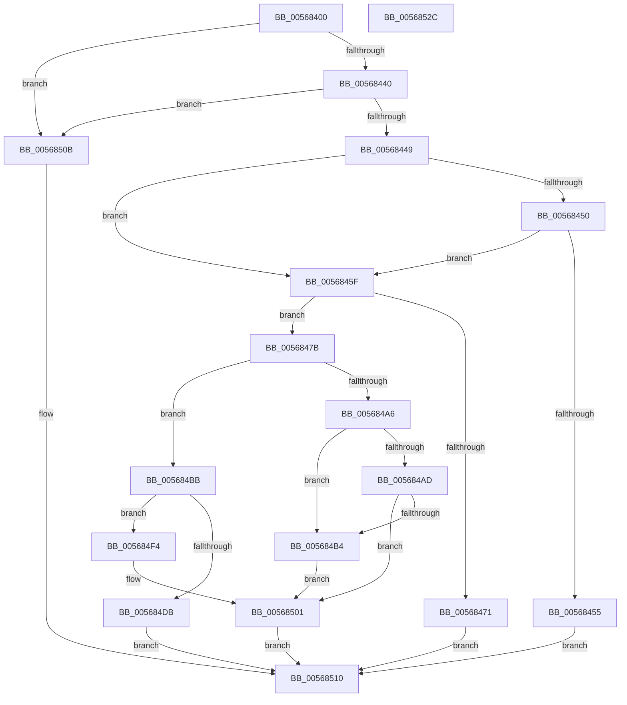

# IommuReserveLogicalAddressRange

- RVA: `0x00568400`–`0x0056852D` (길이 `301` bytes)
- VA: `0x0000000140568400`
- 실행 섹션: `.text`
- PDB 이름 있음: `예`; PDB Function 태그: `아니요`
- unwind 정보 RVA: `0x000C4EBC`
- 디코드: `85`개 명령, `301/301` bytes 표시
- 미해석 바이트: `0` (있으면 어셈블리에 `.byte`로 보존)

> 이 문서는 커널 이미지의 기계어와 PDB 기호를 분석해 생성했습니다. 4번과 5번은 함수 원형과 자료형을 바이너리 사용 방식에서 추정한 C 해석이며 원본 소스 복구 결과는 아닙니다.

## 1. Dependencies

- 직접 호출 지점: **5**; 고유 호출 대상: **5**
- 직접 호출자로 확인된 함수: **0**
- RIP 상대 이미지 참조: **0**

### Outgoing calls
- `0x00568464` → [HalpMmAllocCtxAlloc](../3E/HalpMmAllocCtxAlloc_function_003E10B8.md) (function, `0x003E10B8`)
- `0x0056849B` → [HalpIommuDomainGetLogicalAddressRange](../30/HalpIommuDomainGetLogicalAddressRange_function_00307E48.md) (function, `0x00307E48`)
- `0x005684D0` → [HalpIommuDomainMapLogicalRange](../55/HalpIommuDomainMapLogicalRange_function_00555064.md) (function, `0x00555064`)
- `0x005684FC` → [HalpIommuDomainFreeLogicalAddressRange](../30/HalpIommuDomainFreeLogicalAddressRange_function_003070EC.md) (function, `0x003070EC`)
- `0x00568504` → [HalpMmAllocCtxFree](../3E/HalpMmAllocCtxFree_function_003E1904.md) (function, `0x003E1904`)

### Direct callers
- 이 함수 시작 RVA로 연결되는 직접 call은 확인되지 않았습니다. 간접 호출은 완전히 역산할 수 없습니다.

### Static image references
- 디코드된 RIP-relative 메모리 참조가 없습니다.

## 2. Other-region calls and transfers

- 다른 실행 섹션으로 향하는 call: **0**
- 별도 외부 분기/꼬리 이동을 확인하지 못했습니다.

## 3. Assembly (complete function range)

```asm
00568400  48 8B C4                        mov rax, rsp
00568403  48 89 68 08                     mov qword ptr [rax + 8], rbp
00568407  48 89 70 10                     mov qword ptr [rax + 0x10], rsi
0056840B  48 89 78 18                     mov qword ptr [rax + 0x18], rdi
0056840F  41 54                           push r12
00568411  41 56                           push r14
00568413  41 57                           push r15
00568415  48 83 EC 30                     sub rsp, 0x30
00568419  4C 8B 7C 24 78                  mov r15, qword ptr [rsp + 0x78]
0056841E  49 8B F9                        mov rdi, r9
00568421  48 83 60 30 00                  and qword ptr [rax + 0x30], 0
00568426  4D 8B E0                        mov r12, r8
00568429  4C 8B F2                        mov r14, rdx
0056842C  48 8B E9                        mov rbp, rcx
0056842F  49 83 27 00                     and qword ptr [r15], 0
00568433  48 F7 C2 FF 0F 00 00            test rdx, 0xfff
0056843A  0F 85 CB 00 00 00               jne 0x14056850b
00568440  48 85 D2                        test rdx, rdx
00568443  0F 84 C2 00 00 00               je 0x14056850b
00568449  8B 41 08                        mov eax, dword ptr [rcx + 8]
0056844C  85 C0                           test eax, eax
0056844E  74 0F                           je 0x14056845f
00568450  83 F8 03                        cmp eax, 3
00568453  74 0A                           je 0x14056845f
00568455  BF EF 00 00 C0                  mov edi, 0xc00000ef
0056845A  E9 B1 00 00 00                  jmp 0x140568510
0056845F  BA 20 00 00 00                  mov edx, 0x20
00568464  E8 4F 8C E7 FF                  call 0x1403e10b8
00568469  48 8B F0                        mov rsi, rax
0056846C  48 85 C0                        test rax, rax
0056846F  75 0A                           jne 0x14056847b
00568471  BF 9A 00 00 C0                  mov edi, 0xc000009a
00568476  E9 95 00 00 00                  jmp 0x140568510
0056847B  48 8D 44 24 78                  lea rax, [rsp + 0x78]
00568480  4C 8B CF                        mov r9, rdi
00568483  48 89 44 24 28                  mov qword ptr [rsp + 0x28], rax
00568488  4D 8B C6                        mov r8, r14
0056848B  48 8B 44 24 70                  mov rax, qword ptr [rsp + 0x70]
00568490  49 8B D4                        mov rdx, r12
00568493  48 8B CD                        mov rcx, rbp
00568496  48 89 44 24 20                  mov qword ptr [rsp + 0x20], rax
0056849B  E8 A8 F9 D9 FF                  call 0x140307e48
005684A0  8B F8                           mov edi, eax
005684A2  85 C0                           test eax, eax
005684A4  79 15                           jns 0x1405684bb
005684A6  3D F0 00 00 C0                  cmp eax, 0xc00000f0
005684AB  74 07                           je 0x1405684b4
005684AD  3D 0D 00 00 C0                  cmp eax, 0xc000000d
005684B2  75 4D                           jne 0x140568501
005684B4  BF F1 00 00 C0                  mov edi, 0xc00000f1
005684B9  EB 46                           jmp 0x140568501
005684BB  48 8B 44 24 78                  mov rax, qword ptr [rsp + 0x78]
005684C0  4D 8B CE                        mov r9, r14
005684C3  45 33 C0                        xor r8d, r8d
005684C6  48 89 44 24 20                  mov qword ptr [rsp + 0x20], rax
005684CB  33 D2                           xor edx, edx
005684CD  48 8B CD                        mov rcx, rbp
005684D0  E8 8F CB FE FF                  call 0x140555064
005684D5  8B F8                           mov edi, eax
005684D7  85 C0                           test eax, eax
005684D9  78 19                           js 0x1405684f4
005684DB  83 66 18 00                     and dword ptr [rsi + 0x18], 0
005684DF  48 89 6E 10                     mov qword ptr [rsi + 0x10], rbp
005684E3  48 8B 44 24 78                  mov rax, qword ptr [rsp + 0x78]
005684E8  48 89 06                        mov qword ptr [rsi], rax
005684EB  4C 89 76 08                     mov qword ptr [rsi + 8], r14
005684EF  49 89 37                        mov qword ptr [r15], rsi
005684F2  EB 1C                           jmp 0x140568510
005684F4  48 8B 54 24 78                  mov rdx, qword ptr [rsp + 0x78]
005684F9  48 8B CD                        mov rcx, rbp
005684FC  E8 EB EB D9 FF                  call 0x1403070ec
00568501  48 8B D6                        mov rdx, rsi
00568504  E8 FB 93 E7 FF                  call 0x1403e1904
00568509  EB 05                           jmp 0x140568510
0056850B  BF F0 00 00 C0                  mov edi, 0xc00000f0
00568510  48 8B 6C 24 50                  mov rbp, qword ptr [rsp + 0x50]
00568515  8B C7                           mov eax, edi
00568517  48 8B 7C 24 60                  mov rdi, qword ptr [rsp + 0x60]
0056851C  48 8B 74 24 58                  mov rsi, qword ptr [rsp + 0x58]
00568521  48 83 C4 30                     add rsp, 0x30
00568525  41 5F                           pop r15
00568527  41 5E                           pop r14
00568529  41 5C                           pop r12
0056852B  C3                              ret
0056852C  CC                              int3
```

## 4. C-style interpretation (structured pseudocode)

```c
__int64 __fastcall IommuReserveLogicalAddressRange(__int64 a1, __int64 a2, __int64 a3, __int64 a4, __int64 a5, __int64 a6)
{
    __int64 result;
    __int64 v_rsp;
    unsigned __int64 v_stack_m20;
    unsigned __int64 v_stack_m28;
    unsigned __int64 v_stack_p10;
    unsigned __int64 v_stack_p18;
    unsigned __int64 v_stack_p8;

    *(unsigned __int64 *)(v_rsp + 8) = v_rbp;
    *(unsigned __int64 *)(v_rsp + 16) = v_rsi;
    *(unsigned __int64 *)(v_rsp + 24) = v_rdi;
    v_rsp = (v_rsp) - (48);
    if (((a2) & (0xFFFULL)) != 0) goto loc_0056850B;
    if (a2 == 0) goto loc_0056850B;
    if ((unsigned int)((unsigned int)(*(unsigned int *)(a1 + 8))) == 0) goto loc_0056845F;
    if (((unsigned int)((unsigned int)(*(unsigned int *)(a1 + 8)))) == 3) goto loc_0056845F;
    goto loc_00568510;
loc_0056845F:
    result = HalpMmAllocCtxAlloc(a1, 32, a3, a4);
    if (result != 0) goto loc_0056847B;
    goto loc_00568510;
loc_0056847B:
    v_stack_m20 = a6;
    v_stack_m28 = a5;
    result = HalpIommuDomainGetLogicalAddressRange(a1, a3, a2, (unsigned int)(0xC000009AULL));
    if (!sign_flag) goto loc_005684BB;
    if (((unsigned int)(result)) == 0xC00000F0ULL) goto loc_005684B4;
    if (((unsigned int)(result)) != 0xC000000DULL) goto loc_00568501;
loc_005684B4:
    goto loc_00568501;
loc_005684BB:
    a3 = 0;
    v_stack_m28 = a6;
    a2 = 0;
    result = HalpIommuDomainMapLogicalRange(a1, a2, a3, a2);
    if (sign_flag) goto loc_005684F4;
    *(unsigned __int64 *)(result + 16) = a1;
    *(unsigned __int64 *)(result) = a6;
    *(unsigned __int64 *)(result + 8) = 0;
    *(unsigned __int64 *)(a6) = result;
    goto loc_00568510;
loc_005684F4:
    result = HalpIommuDomainFreeLogicalAddressRange(a1, a6, a3, a2);
loc_00568501:
    result = HalpMmAllocCtxFree(a1, result, a3, a2);
    goto loc_00568510;
loc_0056850B:
loc_00568510:
    v_rsp = (v_rsp) + (48);
    return (unsigned int)((unsigned int)((unsigned int)(0xC00000F0ULL)));
}
```

## 5. (Beta) C Style

```c
int64_t IommuReserveLogicalAddressRange(void *Arg1, int64_t Arg2, int64_t Arg3, int64_t Arg4, int64_t Arg5, void *Arg6)
{
    uint8_t *arg1 = (uint8_t *)Arg1;
    uint8_t *arg6 = (uint8_t *)Arg6;

    int64_t result;
    int64_t local_rsp;
    uint64_t v_stack_m20;
    uint64_t v_stack_m28;
    uint64_t v_stack_p10;
    uint64_t v_stack_p18;
    uint64_t v_stack_p8;

    *(uint64_t *)(local_rsp + 0x8) = local_rbp;
    *(uint64_t *)(local_rsp + 0x10) = local_rsi;
    *(uint64_t *)(local_rsp + 0x18) = local_rdi;
    local_rsp = (local_rsp) - (48);
    if (((Arg2) & (0xFFFULL)) != 0) goto loc_0056850B;
    if (Arg2 == 0) goto loc_0056850B;
    if ((uint32_t)((uint32_t)(*(uint32_t *)(arg1 + 0x8))) == 0) goto loc_0056845F;
    if (((uint32_t)((uint32_t)(*(uint32_t *)(arg1 + 0x8)))) == 3) goto loc_0056845F;
    goto loc_00568510;
loc_0056845F:
    result = HalpMmAllocCtxAlloc(Arg1, 32, Arg3, Arg4);
    if (result != 0) goto loc_0056847B;
    goto loc_00568510;
loc_0056847B:
    v_stack_m20 = Arg6;
    v_stack_m28 = Arg5;
    result = HalpIommuDomainGetLogicalAddressRange(Arg1, Arg3, Arg2, (uint32_t)(0xC000009AULL));
    if (!sign_flag) goto loc_005684BB;
    if (((uint32_t)(result)) == 0xC00000F0ULL) goto loc_005684B4;
    if (((uint32_t)(result)) != 0xC000000DULL) goto loc_00568501;
loc_005684B4:
    goto loc_00568501;
loc_005684BB:
    Arg3 = 0;
    v_stack_m28 = Arg6;
    Arg2 = 0;
    result = HalpIommuDomainMapLogicalRange(Arg1, Arg2, Arg3, Arg2);
    if (sign_flag) goto loc_005684F4;
    *(void **)(result + 0x10) = Arg1;
    *(void **)(result) = Arg6;
    *(uint64_t *)(result + 0x8) = 0;
    *(uint64_t *)(arg6) = result;
    goto loc_00568510;
loc_005684F4:
    result = HalpIommuDomainFreeLogicalAddressRange(Arg1, Arg6, Arg3, Arg2);
loc_00568501:
    result = HalpMmAllocCtxFree(Arg1, result, Arg3, Arg2);
    goto loc_00568510;
loc_0056850B:
loc_00568510:
    local_rsp = (local_rsp) + (48);
    return (uint32_t)((uint32_t)((uint32_t)(0xC00000F0ULL)));
}
```

### 관측된 메모리 오프셋

구조체 형식이 확인되지 않은 접근은 인자 기준의 오프셋으로만 기록했습니다.

| 기준 인자 | 오프셋 표현 | 폭 (bit) | 접근 |
|---|---:|---:|---|
| `Arg1` | `+ 0x8` | `32` | `R` |
| `Arg6` | `+ 0x0` | `64` | `R/W` |
| `Arg6` | `+ 0x0` | `64` | `W` |

## 6. Execution-region graph

[열기: 2D/3D 그래프와 함수 탐색 컨트롤 패널](../../../control-panel.html?section=text&rva=0x00568400&view=graph)

- 2D 그래프는 위에서 아래로 흐르고, 3D 그래프는 빈 공간을 드래그해 회전합니다. Shift+드래그는 이동, 휠은 확대·축소, 함수 노드 선택은 대상 보고서 이동입니다.

### Static fallback


