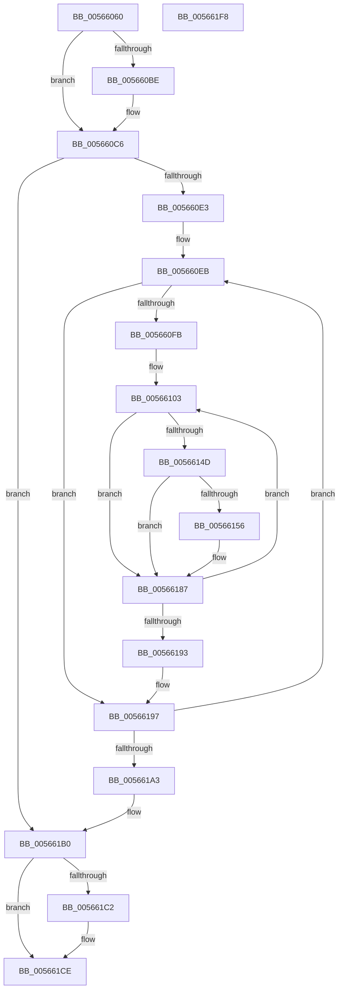

# IommuSetAddressSpace

- RVA: `0x00566060`–`0x005661F9` (길이 `409` bytes)
- VA: `0x0000000140566060`
- 실행 섹션: `.text`
- PDB 이름 있음: `예`; PDB Function 태그: `아니요`
- unwind 정보 RVA: `0x000C4D80`
- 디코드: `102`개 명령, `409/409` bytes 표시
- 미해석 바이트: `0` (있으면 어셈블리에 `.byte`로 보존)

> 이 문서는 커널 이미지의 기계어와 PDB 기호를 분석해 생성했습니다. 4번과 5번은 함수 원형과 자료형을 바이너리 사용 방식에서 추정한 C 해석이며 원본 소스 복구 결과는 아닙니다.

## 1. Dependencies

- 직접 호출 지점: **8**; 고유 호출 대상: **7**
- 직접 호출자로 확인된 함수: **2**
- RIP 상대 이미지 참조: **2**

### Outgoing calls
- `0x00566094` → [KeAcquireSpinLockRaiseToDpc](../20/KeAcquireSpinLockRaiseToDpc_function_00208470.md) (function, `0x00208470`)
- `0x005660C1` → [KiRaiseIrqlProcessIrqlFlags](../4F/KiRaiseIrqlProcessIrqlFlags_function_004F56FC.md) (function, `0x004F56FC`)
- `0x005660CA` → [KeAcquireSpinLockAtDpcLevel](../20/KeAcquireSpinLockAtDpcLevel_function_00208430.md) (function, `0x00208430`)
- `0x00566142` → [guard_dispatch_icall](../6B/guard_dispatch_icall_function_006BAAD0.md) (function, `0x006BAAD0`)
- `0x00566182` → [guard_dispatch_icall](../6B/guard_dispatch_icall_function_006BAAD0.md) (function, `0x006BAAD0`)
- `0x005661B4` → [KxReleaseSpinLock](../20/KxReleaseSpinLock_function_00206670.md) (function, `0x00206670`)
- `0x005661C9` → [KiLowerIrqlProcessIrqlFlags](../4F/KiLowerIrqlProcessIrqlFlags_function_004F5698.md) (function, `0x004F5698`)
- `0x005661E0` → [KeReleaseSpinLock](../39/KeReleaseSpinLock_function_00392BA0.md) (function, `0x00392BA0`)

### Direct callers
- [IommupDomainAttachPasidDevice](../54/IommupDomainAttachPasidDevice_function_0054F984.md) at `0x0054FBDE`
- [IommupDomainDetachPasidDevice](../54/IommupDomainDetachPasidDevice_function_0054FD50.md) at `0x0054FDCE`

### Static image references
- `0x00566085` → RVA `0x00F8FAF8` (`.data`; read)
- `0x005660B5` → RVA `0x00FC6D20` (`ALMOSTRO`; read)

## 2. Other-region calls and transfers

- 다른 실행 섹션으로 향하는 call: **0**
- 별도 외부 분기/꼬리 이동을 확인하지 못했습니다.

## 3. Assembly (complete function range)

```asm
00566060  48 8B C4                        mov rax, rsp
00566063  48 89 50 10                     mov qword ptr [rax + 0x10], rdx
00566067  53                              push rbx
00566068  55                              push rbp
00566069  56                              push rsi
0056606A  57                              push rdi
0056606B  41 54                           push r12
0056606D  41 55                           push r13
0056606F  41 56                           push r14
00566071  41 57                           push r15
00566073  48 83 EC 58                     sub rsp, 0x58
00566077  48 8B 71 08                     mov rsi, qword ptr [rcx + 8]
0056607B  48 8B DA                        mov rbx, rdx
0056607E  C6 40 08 00                     mov byte ptr [rax + 8], 0
00566082  48 8B 01                        mov rax, qword ptr [rcx]
00566085  48 8D 0D 6C 9A A2 00            lea rcx, [rip + 0xa29a6c]
0056608C  48 89 84 24 B8 00 00 00         mov qword ptr [rsp + 0xb8], rax
00566094  E8 D7 23 CA FF                  call 0x140208470
00566099  40 8A F8                        mov dil, al
0056609C  88 84 24 B0 00 00 00            mov byte ptr [rsp + 0xb0], al
005660A3  44 0F 20 C5                     mov rbp, cr8
005660A7  48 89 6C 24 40                  mov qword ptr [rsp + 0x40], rbp
005660AC  BA 0F 00 00 00                  mov edx, 0xf
005660B1  44 0F 22 C2                     mov cr8, rdx
005660B5  83 3D 64 0C A6 00 00            cmp dword ptr [rip + 0xa60c64], 0
005660BC  74 08                           je 0x1405660c6
005660BE  40 8A CD                        mov cl, bpl
005660C1  E8 36 F6 F8 FF                  call 0x1404f56fc
005660C6  48 8D 4E 18                     lea rcx, [rsi + 0x18]
005660CA  E8 61 23 CA FF                  call 0x140208430
005660CF  4C 8D 76 28                     lea r14, [rsi + 0x28]
005660D3  48 89 5E 20                     mov qword ptr [rsi + 0x20], rbx
005660D7  49 8B 1E                        mov rbx, qword ptr [r14]
005660DA  49 3B DE                        cmp rbx, r14
005660DD  0F 84 CD 00 00 00               je 0x1405661b0
005660E3  48 8B AC 24 B8 00 00 00         mov rbp, qword ptr [rsp + 0xb8]
005660EB  4C 8D 7B 18                     lea r15, [rbx + 0x18]
005660EF  49 8B 3F                        mov rdi, qword ptr [r15]
005660F2  49 3B FF                        cmp rdi, r15
005660F5  0F 84 9C 00 00 00               je 0x140566197
005660FB  4C 8B B4 24 A8 00 00 00         mov r14, qword ptr [rsp + 0xa8]
00566103  C6 84 24 A0 00 00 00 01         mov byte ptr [rsp + 0xa0], 1
0056610B  48 8D 8C 24 A0 00 00 00         lea rcx, [rsp + 0xa0]
00566113  48 8B 47 28                     mov rax, qword ptr [rdi + 0x28]
00566117  4D 8B CE                        mov r9, r14
0056611A  44 8B 46 10                     mov r8d, dword ptr [rsi + 0x10]
0056611E  48 89 84 24 B8 00 00 00         mov qword ptr [rsp + 0xb8], rax
00566126  48 89 4C 24 20                  mov qword ptr [rsp + 0x20], rcx
0056612B  4C 8B 68 18                     mov r13, qword ptr [rax + 0x18]
0056612F  48 8B 50 48                     mov rdx, qword ptr [rax + 0x48]
00566133  49 8B 85 F0 00 00 00            mov rax, qword ptr [r13 + 0xf0]
0056613A  48 8B 52 28                     mov rdx, qword ptr [rdx + 0x28]
0056613E  49 8B 4D 10                     mov rcx, qword ptr [r13 + 0x10]
00566142  E8 89 49 15 00                  call 0x1406baad0
00566147  33 C9                           xor ecx, ecx
00566149  85 C0                           test eax, eax
0056614B  78 3A                           js 0x140566187
0056614D  38 8C 24 A0 00 00 00            cmp byte ptr [rsp + 0xa0], cl
00566154  74 31                           je 0x140566187
00566156  4C 8B 8C 24 B8 00 00 00         mov r9, qword ptr [rsp + 0xb8]
0056615E  44 8B 45 10                     mov r8d, dword ptr [rbp + 0x10]
00566162  49 8B 85 F8 00 00 00            mov rax, qword ptr [r13 + 0xf8]
00566169  8B 56 10                        mov edx, dword ptr [rsi + 0x10]
0056616C  4D 8B 49 48                     mov r9, qword ptr [r9 + 0x48]
00566170  48 89 4C 24 30                  mov qword ptr [rsp + 0x30], rcx
00566175  89 4C 24 28                     mov dword ptr [rsp + 0x28], ecx
00566179  48 89 4C 24 20                  mov qword ptr [rsp + 0x20], rcx
0056617E  49 8B 4D 10                     mov rcx, qword ptr [r13 + 0x10]
00566182  E8 49 49 15 00                  call 0x1406baad0
00566187  48 8B 3F                        mov rdi, qword ptr [rdi]
0056618A  49 3B FF                        cmp rdi, r15
0056618D  0F 85 70 FF FF FF               jne 0x140566103
00566193  4C 8D 76 28                     lea r14, [rsi + 0x28]
00566197  48 8B 1B                        mov rbx, qword ptr [rbx]
0056619A  49 3B DE                        cmp rbx, r14
0056619D  0F 85 48 FF FF FF               jne 0x1405660eb
005661A3  48 8B 6C 24 40                  mov rbp, qword ptr [rsp + 0x40]
005661A8  40 8A BC 24 B0 00 00 00         mov dil, byte ptr [rsp + 0xb0]
005661B0  48 8D 4E 18                     lea rcx, [rsi + 0x18]
005661B4  E8 B7 04 CA FF                  call 0x140206670
005661B9  83 3D 60 0B A6 00 00            cmp dword ptr [rip + 0xa60b60], 0
005661C0  74 0C                           je 0x1405661ce
005661C2  44 0F 20 C1                     mov rcx, cr8
005661C6  40 8A D5                        mov dl, bpl
005661C9  E8 CA F4 F8 FF                  call 0x1404f5698
005661CE  40 0F B6 C5                     movzx eax, bpl
005661D2  44 0F 22 C0                     mov cr8, rax
005661D6  40 8A D7                        mov dl, dil
005661D9  48 8D 0D 18 99 A2 00            lea rcx, [rip + 0xa29918]
005661E0  E8 BB C9 E2 FF                  call 0x140392ba0
005661E5  33 C0                           xor eax, eax
005661E7  48 83 C4 58                     add rsp, 0x58
005661EB  41 5F                           pop r15
005661ED  41 5E                           pop r14
005661EF  41 5D                           pop r13
005661F1  41 5C                           pop r12
005661F3  5F                              pop rdi
005661F4  5E                              pop rsi
005661F5  5D                              pop rbp
005661F6  5B                              pop rbx
005661F7  C3                              ret
005661F8  CC                              int3
```

## 4. C-style interpretation (structured pseudocode)

```c
__int64 __fastcall IommuSetAddressSpace(__int64 a1, __int64 a2)
{
    __int64 result;
    __int64 v_rsp;
    unsigned __int64 v_stack_m58;
    unsigned __int64 v_stack_m68;
    unsigned int v_stack_m70;
    unsigned __int64 v_stack_m78;
    unsigned __int64 v_stack_p10;
    unsigned __int8 v_stack_p18;
    unsigned __int64 v_stack_p20;
    unsigned __int8 v_stack_p8;

    *(unsigned __int64 *)(v_rsp + 16) = a2;
    v_rsp = (v_rsp) - (88);
    *(unsigned __int8 *)(v_rsp + 8) = 0;
    v_stack_p20 = *(unsigned __int64 *)(a1);
    result = KeAcquireSpinLockRaiseToDpc(v_rip + 10656364, a2, a3, a4);
    v_stack_p18 = (unsigned __int8)(result);
    v_stack_m58 = v_cr8;
    if ((*(unsigned int *)(v_rip + 10882148)) != 0) {
        a1 = (unsigned __int8)(v_cr8);
        result = KiRaiseIrqlProcessIrqlFlags(a1, 15, a3, a4);
    }
    result = KeAcquireSpinLockAtDpcLevel(*(unsigned __int64 *)(a1 + 8) + 24, 15, a3, a4);
    *(unsigned __int64 *)(*(unsigned __int64 *)(a1 + 8) + 32) = a2;
    if ((*(unsigned __int64 *)(*(unsigned __int64 *)(a1 + 8) + 40)) == (*(unsigned __int64 *)(a1 + 8) + 40)) goto loc_005661B0;
loc_005660EB:
    if ((*(unsigned __int64 *)(*(unsigned __int64 *)(*(unsigned __int64 *)(a1 + 8) + 40) + 24)) == (*(unsigned __int64 *)(*(unsigned __int64 *)(a1 + 8) + 40) + 24)) goto loc_00566197;
loc_00566103:
    v_stack_p8 = 1;
    v_stack_p20 = *(unsigned __int64 *)(*(unsigned __int64 *)(*(unsigned __int64 *)(*(unsigned __int64 *)(a1 + 8) + 40) + 24) + 40);
    v_stack_m78 = v_stack_p8;
    result = guard_dispatch_icall(*(unsigned __int64 *)(*(unsigned __int64 *)(*(unsigned __int64 *)(*(unsigned __int64 *)(*(unsigned __int64 *)(*(unsigned __int64 *)(a1 + 8) + 40) + 24) + 40) + 24) + 16), *(unsigned __int64 *)(*(unsigned __int64 *)(*(unsigned __int64 *)(*(unsigned __int64 *)(*(unsigned __int64 *)(*(unsigned __int64 *)(a1 + 8) + 40) + 24) + 40) + 72) + 40), (unsigned int)(*(unsigned int *)(*(unsigned __int64 *)(a1 + 8) + 16)), v_stack_p10);
    a1 = 0;
    if (sign_flag) goto loc_00566187;
    if (v_stack_p8 != 0) {
        a4 = v_stack_p20;
        a3 = *(unsigned int *)(v_stack_p20 + 16);
        result = *(unsigned __int64 *)(*(unsigned __int64 *)(*(unsigned __int64 *)(*(unsigned __int64 *)(*(unsigned __int64 *)(*(unsigned __int64 *)(a1 + 8) + 40) + 24) + 40) + 24) + 248);
        a2 = *(unsigned int *)(*(unsigned __int64 *)(a1 + 8) + 16);
        a4 = *(unsigned __int64 *)(a4 + 72);
        v_stack_m68 = 0;
        v_stack_m70 = 0;
        v_stack_m78 = 0;
        a1 = *(unsigned __int64 *)(*(unsigned __int64 *)(*(unsigned __int64 *)(*(unsigned __int64 *)(*(unsigned __int64 *)(*(unsigned __int64 *)(a1 + 8) + 40) + 24) + 40) + 24) + 16);
        result = guard_dispatch_icall(a1, a2, a3, a4);
    }
    if ((*(unsigned __int64 *)(*(unsigned __int64 *)(*(unsigned __int64 *)(*(unsigned __int64 *)(a1 + 8) + 40) + 24))) != (*(unsigned __int64 *)(*(unsigned __int64 *)(a1 + 8) + 40) + 24)) goto loc_00566103;
loc_00566197:
    if ((*(unsigned __int64 *)(*(unsigned __int64 *)(*(unsigned __int64 *)(a1 + 8) + 40))) != (*(unsigned __int64 *)(a1 + 8) + 40)) goto loc_005660EB;
loc_005661B0:
    result = KxReleaseSpinLock(*(unsigned __int64 *)(a1 + 8) + 24, a2, a3, a4);
    if ((*(unsigned int *)(v_rip + 10881888)) != 0) {
        a1 = 15;
        a2 = (unsigned __int8)(v_stack_m58);
        result = KiLowerIrqlProcessIrqlFlags(a1, a2, a3, a4);
    }
    result = KeReleaseSpinLock(v_rip + 10656024, (unsigned __int8)(v_stack_p18), a3, a4);
    result = 0;
    v_rsp = (v_rsp) + (88);
    return result;
}
```

## 5. (Beta) C Style

```c
int64_t IommuSetAddressSpace(void *Arg1, int64_t Arg2)
{
    uint8_t *arg1 = (uint8_t *)Arg1;

    int64_t result;
    int64_t local_rsp;
    uint64_t v_stack_m58;
    uint64_t v_stack_m68;
    uint32_t v_stack_m70;
    uint64_t v_stack_m78;
    uint64_t v_stack_p10;
    uint8_t v_stack_p18;
    uint64_t v_stack_p20;
    uint8_t v_stack_p8;

    *(uint64_t *)(local_rsp + 0x10) = Arg2;
    local_rsp = (local_rsp) - (88);
    *(uint8_t *)(local_rsp + 0x8) = 0;
    v_stack_p20 = *(uint64_t *)(arg1);
    result = KeAcquireSpinLockRaiseToDpc(v_rip + 10656364, Arg2, a3, a4);
    v_stack_p18 = (uint8_t)(result);
    v_stack_m58 = v_cr8;
    if ((*(uint32_t *)(v_rip + 0xA60C64)) != 0) {
        Arg1 = (uint8_t)(v_cr8);
        result = KiRaiseIrqlProcessIrqlFlags(Arg1, 15, a3, a4);
    }
    result = KeAcquireSpinLockAtDpcLevel(*(uint64_t *)(arg1 + 0x8) + 24, 15, a3, a4);
    *(uint64_t *)(*(uint64_t *)(arg1 + 0x8) + 0x20) = Arg2;
    if ((*(uint64_t *)(*(uint64_t *)(arg1 + 0x8) + 0x28)) == (*(uint64_t *)(arg1 + 0x8) + 40)) goto loc_005661B0;
loc_005660EB:
    if ((*(uint64_t *)(*(uint64_t *)(*(uint64_t *)(arg1 + 0x8) + 0x28) + 0x18)) == (*(uint64_t *)(*(uint64_t *)(arg1 + 0x8) + 0x28) + 24)) goto loc_00566197;
loc_00566103:
    v_stack_p8 = 1;
    v_stack_p20 = *(uint64_t *)(*(uint64_t *)(*(uint64_t *)(*(uint64_t *)(arg1 + 0x8) + 0x28) + 0x18) + 0x28);
    v_stack_m78 = v_stack_p8;
    result = guard_dispatch_icall(*(uint64_t *)(*(uint64_t *)(*(uint64_t *)(*(uint64_t *)(*(uint64_t *)(*(uint64_t *)(arg1 + 0x8) + 0x28) + 0x18) + 0x28) + 0x18) + 0x10), *(uint64_t *)(*(uint64_t *)(*(uint64_t *)(*(uint64_t *)(*(uint64_t *)(*(uint64_t *)(arg1 + 0x8) + 0x28) + 0x18) + 0x28) + 0x48) + 0x28), (uint32_t)(*(uint32_t *)(*(uint64_t *)(arg1 + 0x8) + 0x10)), v_stack_p10);
    Arg1 = 0;
    if (sign_flag) goto loc_00566187;
    if (v_stack_p8 != 0) {
        a4 = v_stack_p20;
        a3 = *(uint32_t *)(v_stack_p20 + 0x10);
        result = *(uint64_t *)(*(uint64_t *)(*(uint64_t *)(*(uint64_t *)(*(uint64_t *)(*(uint64_t *)(arg1 + 0x8) + 0x28) + 0x18) + 0x28) + 0x18) + 0xF8);
        Arg2 = *(uint32_t *)(*(uint64_t *)(arg1 + 0x8) + 0x10);
        a4 = *(uint64_t *)(a4 + 0x48);
        v_stack_m68 = 0;
        v_stack_m70 = 0;
        v_stack_m78 = 0;
        Arg1 = *(uint64_t *)(*(uint64_t *)(*(uint64_t *)(*(uint64_t *)(*(uint64_t *)(*(uint64_t *)(arg1 + 0x8) + 0x28) + 0x18) + 0x28) + 0x18) + 0x10);
        result = guard_dispatch_icall(Arg1, Arg2, a3, a4);
    }
    if ((*(uint64_t *)(*(uint64_t *)(*(uint64_t *)(*(uint64_t *)(arg1 + 0x8) + 0x28) + 0x18))) != (*(uint64_t *)(*(uint64_t *)(arg1 + 0x8) + 0x28) + 24)) goto loc_00566103;
loc_00566197:
    if ((*(uint64_t *)(*(uint64_t *)(*(uint64_t *)(arg1 + 0x8) + 0x28))) != (*(uint64_t *)(arg1 + 0x8) + 40)) goto loc_005660EB;
loc_005661B0:
    result = KxReleaseSpinLock(*(uint64_t *)(arg1 + 0x8) + 24, Arg2, a3, a4);
    if ((*(uint32_t *)(v_rip + 0xA60B60)) != 0) {
        Arg1 = 15;
        Arg2 = (uint8_t)(v_stack_m58);
        result = KiLowerIrqlProcessIrqlFlags(Arg1, Arg2, a3, a4);
    }
    result = KeReleaseSpinLock(v_rip + 10656024, (uint8_t)(v_stack_p18), a3, a4);
    result = 0;
    local_rsp = (local_rsp) + (88);
    return result;
}
```

### 관측된 메모리 오프셋

구조체 형식이 확인되지 않은 접근은 인자 기준의 오프셋으로만 기록했습니다.

| 기준 인자 | 오프셋 표현 | 폭 (bit) | 접근 |
|---|---:|---:|---|
| `Arg1` | `+ 0x0` | `64` | `R` |
| `Arg1` | `+ 0x8` | `64` | `R` |

## 6. Execution-region graph

[열기: 2D/3D 그래프와 함수 탐색 컨트롤 패널](../../../control-panel.html?section=text&rva=0x00566060&view=graph)

- 2D 그래프는 위에서 아래로 흐르고, 3D 그래프는 빈 공간을 드래그해 회전합니다. Shift+드래그는 이동, 휠은 확대·축소, 함수 노드 선택은 대상 보고서 이동입니다.

### Static fallback


