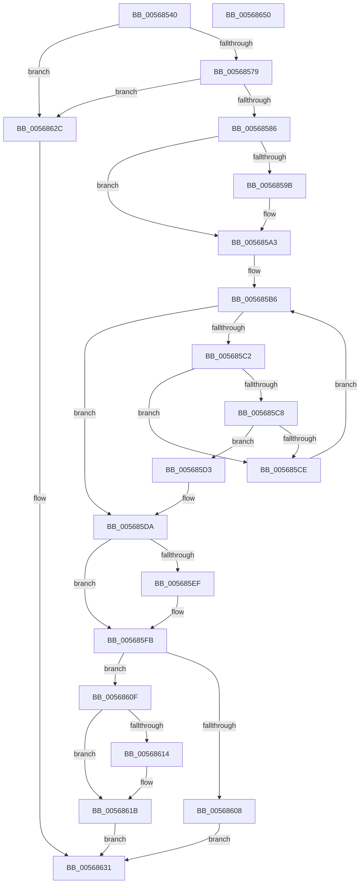

# IommuSetDeviceFaultReporting

- RVA: `0x00568540`–`0x00568651` (길이 `273` bytes)
- VA: `0x0000000140568540`
- 실행 섹션: `.text`
- PDB 이름 있음: `예`; PDB Function 태그: `아니요`
- unwind 정보 RVA: `0x0005FEF8`
- 디코드: `72`개 명령, `273/273` bytes 표시
- 미해석 바이트: `0` (있으면 어셈블리에 `.byte`로 보존)

> 이 문서는 커널 이미지의 기계어와 PDB 기호를 분석해 생성했습니다. 4번과 5번은 함수 원형과 자료형을 바이너리 사용 방식에서 추정한 C 해석이며 원본 소스 복구 결과는 아닙니다.

## 1. Dependencies

- 직접 호출 지점: **4**; 고유 호출 대상: **4**
- 직접 호출자로 확인된 함수: **0**
- RIP 상대 이미지 참조: **5**

### Outgoing calls
- `0x0056859E` → [KiRaiseIrqlProcessIrqlFlags](../4F/KiRaiseIrqlProcessIrqlFlags_function_004F56FC.md) (function, `0x004F56FC`)
- `0x005685AA` → [KeAcquireSpinLockAtDpcLevel](../20/KeAcquireSpinLockAtDpcLevel_function_00208430.md) (function, `0x00208430`)
- `0x005685E1` → [KxReleaseSpinLock](../20/KxReleaseSpinLock_function_00206670.md) (function, `0x00206670`)
- `0x005685F6` → [KiLowerIrqlProcessIrqlFlags](../4F/KiLowerIrqlProcessIrqlFlags_function_004F5698.md) (function, `0x004F5698`)

### Direct callers
- 이 함수 시작 RVA로 연결되는 직접 call은 확인되지 않았습니다. 간접 호출은 완전히 역산할 수 없습니다.

### Static image references
- `0x00568563` → RVA `0x00FC1710` (`.data`; read)
- `0x00568579` → RVA `0x00FC1711` (`.data`; read)
- `0x00568593` → RVA `0x00FC6D20` (`ALMOSTRO`; read)
- `0x005685A3` → RVA `0x00F8FAC0` (`.data`; read)
- `0x005685AF` → RVA `0x00F8FAB0` (`.data`; read)

## 2. Other-region calls and transfers

- 다른 실행 섹션으로 향하는 call: **0**
- 별도 외부 분기/꼬리 이동을 확인하지 못했습니다.

## 3. Assembly (complete function range)

```asm
00568540  48 8B C4                        mov rax, rsp
00568543  48 89 58 08                     mov qword ptr [rax + 8], rbx
00568547  48 89 68 10                     mov qword ptr [rax + 0x10], rbp
0056854B  48 89 70 18                     mov qword ptr [rax + 0x18], rsi
0056854F  48 89 78 20                     mov qword ptr [rax + 0x20], rdi
00568553  41 54                           push r12
00568555  41 56                           push r14
00568557  41 57                           push r15
00568559  48 83 EC 20                     sub rsp, 0x20
0056855D  40 32 F6                        xor sil, sil
00568560  4D 8B F1                        mov r14, r9
00568563  40 38 35 A6 91 A5 00            cmp byte ptr [rip + 0xa591a6], sil
0056856A  41 8A E8                        mov bpl, r8b
0056856D  44 8B FA                        mov r15d, edx
00568570  4C 8B E1                        mov r12, rcx
00568573  0F 84 B3 00 00 00               je 0x14056862c
00568579  40 38 35 91 91 A5 00            cmp byte ptr [rip + 0xa59191], sil
00568580  0F 84 A6 00 00 00               je 0x14056862c
00568586  33 DB                           xor ebx, ebx
00568588  44 0F 20 C7                     mov rdi, cr8
0056858C  8D 53 0C                        lea edx, [rbx + 0xc]
0056858F  44 0F 22 C2                     mov cr8, rdx
00568593  39 1D 87 E7 A5 00               cmp dword ptr [rip + 0xa5e787], ebx
00568599  74 08                           je 0x1405685a3
0056859B  40 8A CF                        mov cl, dil
0056859E  E8 59 D1 F8 FF                  call 0x1404f56fc
005685A3  48 8D 0D 16 75 A2 00            lea rcx, [rip + 0xa27516]
005685AA  E8 81 FE C9 FF                  call 0x140208430
005685AF  48 8B 05 FA 74 A2 00            mov rax, qword ptr [rip + 0xa274fa]
005685B6  48 8D 0D F3 74 A2 00            lea rcx, [rip + 0xa274f3]
005685BD  48 3B C1                        cmp rax, rcx
005685C0  74 18                           je 0x1405685da
005685C2  4C 39 60 10                     cmp qword ptr [rax + 0x10], r12
005685C6  75 06                           jne 0x1405685ce
005685C8  44 39 78 18                     cmp dword ptr [rax + 0x18], r15d
005685CC  74 05                           je 0x1405685d3
005685CE  48 8B 00                        mov rax, qword ptr [rax]
005685D1  EB E3                           jmp 0x1405685b6
005685D3  48 8B 58 20                     mov rbx, qword ptr [rax + 0x20]
005685D7  40 B6 01                        mov sil, 1
005685DA  48 8D 0D DF 74 A2 00            lea rcx, [rip + 0xa274df]
005685E1  E8 8A E0 C9 FF                  call 0x140206670
005685E6  83 3D 33 E7 A5 00 00            cmp dword ptr [rip + 0xa5e733], 0
005685ED  74 0C                           je 0x1405685fb
005685EF  44 0F 20 C1                     mov rcx, cr8
005685F3  40 8A D7                        mov dl, dil
005685F6  E8 9D D0 F8 FF                  call 0x1404f5698
005685FB  40 0F B6 C7                     movzx eax, dil
005685FF  44 0F 22 C0                     mov cr8, rax
00568603  40 84 F6                        test sil, sil
00568606  75 07                           jne 0x14056860f
00568608  B8 0D 00 00 C0                  mov eax, 0xc000000d
0056860D  EB 22                           jmp 0x140568631
0056860F  40 84 ED                        test bpl, bpl
00568612  74 07                           je 0x14056861b
00568614  49 8B 06                        mov rax, qword ptr [r14]
00568617  48 89 43 68                     mov qword ptr [rbx + 0x68], rax
0056861B  48 83 63 68 00                  and qword ptr [rbx + 0x68], 0
00568620  B8 02 00 00 C0                  mov eax, 0xc0000002
00568625  48 83 63 70 00                  and qword ptr [rbx + 0x70], 0
0056862A  EB 05                           jmp 0x140568631
0056862C  B8 BB 00 00 C0                  mov eax, 0xc00000bb
00568631  48 8B 5C 24 40                  mov rbx, qword ptr [rsp + 0x40]
00568636  48 8B 6C 24 48                  mov rbp, qword ptr [rsp + 0x48]
0056863B  48 8B 74 24 50                  mov rsi, qword ptr [rsp + 0x50]
00568640  48 8B 7C 24 58                  mov rdi, qword ptr [rsp + 0x58]
00568645  48 83 C4 20                     add rsp, 0x20
00568649  41 5F                           pop r15
0056864B  41 5E                           pop r14
0056864D  41 5C                           pop r12
0056864F  C3                              ret
00568650  CC                              int3
```

## 4. C-style interpretation (structured pseudocode)

```c
__int64 __fastcall IommuSetDeviceFaultReporting(__int64 a1, int a2, unsigned __int8 a3, __int64 a4)
{
    __int64 result;
    __int64 v_rbx;
    __int64 v_rsi;
    __int64 v_rsp;
    unsigned __int64 v_stack_p10;
    unsigned __int64 v_stack_p18;
    unsigned __int64 v_stack_p20;
    unsigned __int64 v_stack_p8;

    *(unsigned __int64 *)(v_rsp + 8) = v_rbx;
    *(unsigned __int64 *)(v_rsp + 16) = v_rbp;
    *(unsigned __int64 *)(v_rsp + 24) = v_rsi;
    *(unsigned __int64 *)(v_rsp + 32) = v_rdi;
    v_rsp = (v_rsp) - (32);
    v_rsi = 0;
    if ((*(unsigned __int8 *)(v_rip + 10850726)) == 0) goto loc_0056862C;
    if ((*(unsigned __int8 *)(v_rip + 10850705)) == 0) goto loc_0056862C;
    v_rbx = 0;
    result = v_rsp;
    if ((*(unsigned int *)(v_rip + 10872711)) != 0) {
        a1 = (unsigned __int8)(v_cr8);
        result = KiRaiseIrqlProcessIrqlFlags(a1, v_rbx + 12, a3, a4);
    }
    result = KeAcquireSpinLockAtDpcLevel(v_rip + 10646806, v_rbx + 12, a3, a4);
loc_005685B6:
    if ((*(unsigned __int64 *)(v_rip + 10646778)) == (v_rip + 10646771)) goto loc_005685DA;
    if ((*(unsigned __int64 *)(*(unsigned __int64 *)(v_rip + 10646778) + 16)) != a1) goto loc_005685CE;
    if ((*(unsigned int *)(*(unsigned __int64 *)(v_rip + 10646778) + 24)) == ((unsigned int)((unsigned int)(a2)))) goto loc_005685D3;
loc_005685CE:
    goto loc_005685B6;
loc_005685D3:
loc_005685DA:
    result = KxReleaseSpinLock(v_rip + 10646751, v_rbx + 12, a3, a4);
    if ((*(unsigned int *)(v_rip + 10872627)) != 0) {
        a1 = v_rbx + 12;
        a2 = (unsigned __int8)(v_cr8);
        result = KiLowerIrqlProcessIrqlFlags(a1, a2, a3, a4);
    }
    if (1 != 0) goto loc_0056860F;
    goto loc_00568631;
loc_0056860F:
    result = (unsigned int)(0xC000000DULL);
    if (a3 != 0) {
        result = *(unsigned __int64 *)(a4);
        *(unsigned __int64 *)(*(unsigned __int64 *)(*(unsigned __int64 *)(*(unsigned __int64 *)(v_rip + 10646778)) + 32) + 104) = result;
    }
    goto loc_00568631;
loc_0056862C:
loc_00568631:
    v_rsp = (v_rsp) + (32);
    return (unsigned int)(0xC00000BBULL);
}
```

## 5. (Beta) C Style

```c
int64_t IommuSetDeviceFaultReporting(int64_t Arg1, int32_t Arg2, uint8_t Arg3, void *Arg4)
{
    uint8_t *arg4 = (uint8_t *)Arg4;

    int64_t result;
    int64_t local_rbx;
    int64_t local_rsi;
    int64_t local_rsp;
    uint64_t v_stack_p10;
    uint64_t v_stack_p18;
    uint64_t v_stack_p20;
    uint64_t v_stack_p8;

    *(uint64_t *)(local_rsp + 0x8) = local_rbx;
    *(uint64_t *)(local_rsp + 0x10) = local_rbp;
    *(uint64_t *)(local_rsp + 0x18) = local_rsi;
    *(uint64_t *)(local_rsp + 0x20) = local_rdi;
    local_rsp = (local_rsp) - (32);
    local_rsi = 0;
    if ((*(uint8_t *)(v_rip + 0xA591A6)) == 0) goto loc_0056862C;
    if ((*(uint8_t *)(v_rip + 0xA59191)) == 0) goto loc_0056862C;
    local_rbx = 0;
    result = local_rsp;
    if ((*(uint32_t *)(v_rip + 0xA5E787)) != 0) {
        Arg1 = (uint8_t)(v_cr8);
        result = KiRaiseIrqlProcessIrqlFlags(Arg1, local_rbx + 12, Arg3, Arg4);
    }
    result = KeAcquireSpinLockAtDpcLevel(v_rip + 10646806, local_rbx + 12, Arg3, Arg4);
loc_005685B6:
    if ((*(uint64_t *)(v_rip + 0xA274FA)) == (v_rip + 10646771)) goto loc_005685DA;
    if ((*(uint64_t *)(*(uint64_t *)(v_rip + 0xA274FA) + 0x10)) != Arg1) goto loc_005685CE;
    if ((*(uint32_t *)(*(uint64_t *)(v_rip + 0xA274FA) + 0x18)) == ((uint32_t)((uint32_t)(Arg2)))) goto loc_005685D3;
loc_005685CE:
    goto loc_005685B6;
loc_005685D3:
loc_005685DA:
    result = KxReleaseSpinLock(v_rip + 10646751, local_rbx + 12, Arg3, Arg4);
    if ((*(uint32_t *)(v_rip + 0xA5E733)) != 0) {
        Arg1 = local_rbx + 12;
        Arg2 = (uint8_t)(v_cr8);
        result = KiLowerIrqlProcessIrqlFlags(Arg1, Arg2, Arg3, Arg4);
    }
    if (1 != 0) goto loc_0056860F;
    goto loc_00568631;
loc_0056860F:
    result = (uint32_t)(0xC000000DULL);
    if (Arg3 != 0) {
        result = *(uint64_t *)(arg4);
        *(uint64_t *)(*(uint64_t *)(*(uint64_t *)(*(uint64_t *)(v_rip + 0xA274FA)) + 0x20) + 0x68) = result;
    }
    goto loc_00568631;
loc_0056862C:
loc_00568631:
    local_rsp = (local_rsp) + (32);
    return (uint32_t)(0xC00000BBULL);
}
```

### 관측된 메모리 오프셋

구조체 형식이 확인되지 않은 접근은 인자 기준의 오프셋으로만 기록했습니다.

| 기준 인자 | 오프셋 표현 | 폭 (bit) | 접근 |
|---|---:|---:|---|
| `Arg4` | `+ 0x0` | `64` | `R` |

## 6. Execution-region graph

[열기: 2D/3D 그래프와 함수 탐색 컨트롤 패널](../../../control-panel.html?section=text&rva=0x00568540&view=graph)

- 2D 그래프는 위에서 아래로 흐르고, 3D 그래프는 빈 공간을 드래그해 회전합니다. Shift+드래그는 이동, 휠은 확대·축소, 함수 노드 선택은 대상 보고서 이동입니다.

### Static fallback


