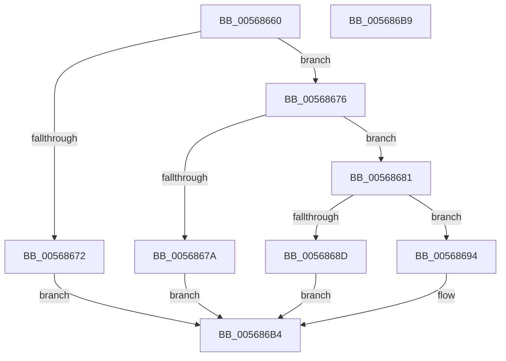

# IommuUnmapIdentityRange

- RVA: `0x00568660`–`0x005686BA` (길이 `90` bytes)
- VA: `0x0000000140568660`
- 실행 섹션: `.text`
- PDB 이름 있음: `예`; PDB Function 태그: `아니요`
- unwind 정보 RVA: `0x0005C788`
- 디코드: `29`개 명령, `90/90` bytes 표시
- 미해석 바이트: `0` (있으면 어셈블리에 `.byte`로 보존)

> 이 문서는 커널 이미지의 기계어와 PDB 기호를 분석해 생성했습니다. 4번과 5번은 함수 원형과 자료형을 바이너리 사용 방식에서 추정한 C 해석이며 원본 소스 복구 결과는 아닙니다.

## 1. Dependencies

- 직접 호출 지점: **2**; 고유 호출 대상: **2**
- 직접 호출자로 확인된 함수: **0**
- RIP 상대 이미지 참조: **0**

### Outgoing calls
- `0x00568684` → [IommupValidateMdl](IommupValidateMdl_function_005689D0.md) (function, `0x005689D0`)
- `0x005686AF` → [HalpIommuDomainUnmapIdentityRange](../4A/HalpIommuDomainUnmapIdentityRange_function_004A0070.md) (function, `0x004A0070`)

### Direct callers
- 이 함수 시작 RVA로 연결되는 직접 call은 확인되지 않았습니다. 간접 호출은 완전히 역산할 수 없습니다.

### Static image references
- 디코드된 RIP-relative 메모리 참조가 없습니다.

## 2. Other-region calls and transfers

- 다른 실행 섹션으로 향하는 call: **0**
- 별도 외부 분기/꼬리 이동을 확인하지 못했습니다.

## 3. Assembly (complete function range)

```asm
00568660  48 83 EC 28                     sub rsp, 0x28
00568664  8B 41 08                        mov eax, dword ptr [rcx + 8]
00568667  4C 8B CA                        mov r9, rdx
0056866A  4C 8B D1                        mov r10, rcx
0056866D  83 F8 01                        cmp eax, 1
00568670  75 04                           jne 0x140568676
00568672  33 C0                           xor eax, eax
00568674  EB 3E                           jmp 0x1405686b4
00568676  85 C0                           test eax, eax
00568678  74 07                           je 0x140568681
0056867A  B8 EF 00 00 C0                  mov eax, 0xc00000ef
0056867F  EB 33                           jmp 0x1405686b4
00568681  49 8B C9                        mov rcx, r9
00568684  E8 47 03 00 00                  call 0x1405689d0
00568689  84 C0                           test al, al
0056868B  75 07                           jne 0x140568694
0056868D  B8 F0 00 00 C0                  mov eax, 0xc00000f0
00568692  EB 20                           jmp 0x1405686b4
00568694  41 8B 41 2C                     mov eax, dword ptr [r9 + 0x2c]
00568698  49 8B CA                        mov rcx, r10
0056869B  45 8B 41 28                     mov r8d, dword ptr [r9 + 0x28]
0056869F  49 83 C1 30                     add r9, 0x30
005686A3  48 C1 E8 0C                     shr rax, 0xc
005686A7  49 C1 E8 0C                     shr r8, 0xc
005686AB  49 8D 14 C1                     lea rdx, [r9 + rax*8]
005686AF  E8 BC 79 F3 FF                  call 0x1404a0070
005686B4  48 83 C4 28                     add rsp, 0x28
005686B8  C3                              ret
005686B9  CC                              int3
```

## 4. C-style interpretation (structured pseudocode)

```c
__int64 __fastcall IommuUnmapIdentityRange(__int64 a1, __int64 a2)
{
    __int64 result;
    __int64 v_rsp;

    v_rsp = (v_rsp) - (40);
    if (((unsigned int)((unsigned int)(*(unsigned int *)(a1 + 8)))) != 1) goto loc_00568676;
    result = 0;
    goto loc_005686B4;
loc_00568676:
    if (0 == 0) goto loc_00568681;
    goto loc_005686B4;
loc_00568681:
    result = IommupValidateMdl(a2, a2, a3, a2);
    if ((unsigned __int8)(result) != 0) goto loc_00568694;
    goto loc_005686B4;
loc_00568694:
    a4 = (a2) + (48);
    result = ((unsigned int)(*(unsigned int *)(a2 + 44))) >> (12);
    a3 = ((unsigned int)(*(unsigned int *)(a2 + 40))) >> (12);
    result = HalpIommuDomainUnmapIdentityRange(a1, a4 + result * 8, a3, a4);
loc_005686B4:
    v_rsp = (v_rsp) + (40);
    return result;
}
```

## 5. (Beta) C Style

```c
int64_t IommuUnmapIdentityRange(void *Arg1, int64_t Arg2)
{
    uint8_t *arg1 = (uint8_t *)Arg1;

    int64_t result;
    int64_t local_rsp;

    local_rsp = (local_rsp) - (40);
    if (((uint32_t)((uint32_t)(*(uint32_t *)(arg1 + 0x8)))) != 1) goto loc_00568676;
    result = 0;
    goto loc_005686B4;
loc_00568676:
    if (0 == 0) goto loc_00568681;
    goto loc_005686B4;
loc_00568681:
    result = IommupValidateMdl(Arg2, Arg2, a3, Arg2);
    if ((uint8_t)(result) != 0) goto loc_00568694;
    goto loc_005686B4;
loc_00568694:
    a4 = (Arg2) + (48);
    result = ((uint32_t)(*(uint32_t *)(Arg2 + 0x2C))) >> (12);
    a3 = ((uint32_t)(*(uint32_t *)(Arg2 + 0x28))) >> (12);
    result = HalpIommuDomainUnmapIdentityRange(Arg1, a4 + result * 8, a3, a4);
loc_005686B4:
    local_rsp = (local_rsp) + (40);
    return result;
}
```

### 관측된 메모리 오프셋

구조체 형식이 확인되지 않은 접근은 인자 기준의 오프셋으로만 기록했습니다.

| 기준 인자 | 오프셋 표현 | 폭 (bit) | 접근 |
|---|---:|---:|---|
| `Arg1` | `+ 0x8` | `32` | `R` |

## 6. Execution-region graph

[열기: 2D/3D 그래프와 함수 탐색 컨트롤 패널](../../../control-panel.html?section=text&rva=0x00568660&view=graph)

- 2D 그래프는 위에서 아래로 흐르고, 3D 그래프는 빈 공간을 드래그해 회전합니다. Shift+드래그는 이동, 휠은 확대·축소, 함수 노드 선택은 대상 보고서 이동입니다.

### Static fallback


