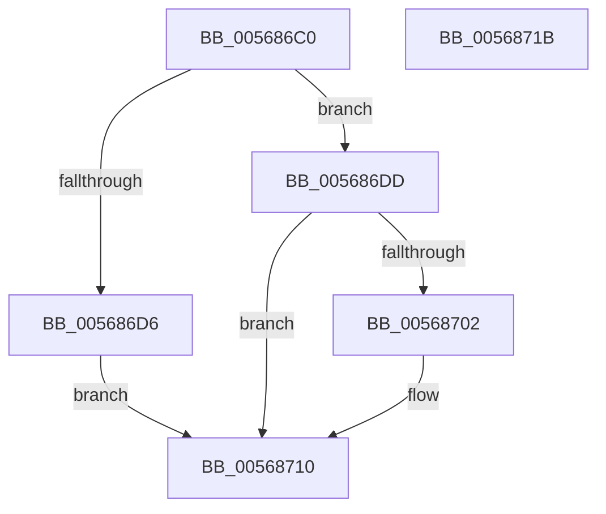

# IommuUnmapReservedLogicalRange

- RVA: `0x005686C0`–`0x0056871C` (길이 `92` bytes)
- VA: `0x00000001405686C0`
- 실행 섹션: `.text`
- PDB 이름 있음: `예`; PDB Function 태그: `아니요`
- unwind 정보 RVA: `0x00068D5C`
- 디코드: `27`개 명령, `92/92` bytes 표시
- 미해석 바이트: `0` (있으면 어셈블리에 `.byte`로 보존)

> 이 문서는 커널 이미지의 기계어와 PDB 기호를 분석해 생성했습니다. 4번과 5번은 함수 원형과 자료형을 바이너리 사용 방식에서 추정한 C 해석이며 원본 소스 복구 결과는 아닙니다.

## 1. Dependencies

- 직접 호출 지점: **1**; 고유 호출 대상: **1**
- 직접 호출자로 확인된 함수: **0**
- RIP 상대 이미지 참조: **0**

### Outgoing calls
- `0x005686F9` → [HalpIommuDomainUnmapLogicalRange](../30/HalpIommuDomainUnmapLogicalRange_function_00307258.md) (function, `0x00307258`)

### Direct callers
- 이 함수 시작 RVA로 연결되는 직접 call은 확인되지 않았습니다. 간접 호출은 완전히 역산할 수 없습니다.

### Static image references
- 디코드된 RIP-relative 메모리 참조가 없습니다.

## 2. Other-region calls and transfers

- 다른 실행 섹션으로 향하는 call: **0**
- 별도 외부 분기/꼬리 이동을 확인하지 못했습니다.

## 3. Assembly (complete function range)

```asm
005686C0  48 89 5C 24 10                  mov qword ptr [rsp + 0x10], rbx
005686C5  57                              push rdi
005686C6  48 83 EC 20                     sub rsp, 0x20
005686CA  48 8B 39                        mov rdi, qword ptr [rcx]
005686CD  48 8B D9                        mov rbx, rcx
005686D0  83 7F 18 00                     cmp dword ptr [rdi + 0x18], 0
005686D4  7F 07                           jg 0x1405686dd
005686D6  B8 0D 00 00 C0                  mov eax, 0xc000000d
005686DB  EB 33                           jmp 0x140568710
005686DD  48 8B 41 10                     mov rax, qword ptr [rcx + 0x10]
005686E1  4C 8D 44 24 30                  lea r8, [rsp + 0x30]
005686E6  48 8B 17                        mov rdx, qword ptr [rdi]
005686E9  41 B1 01                        mov r9b, 1
005686EC  48 03 51 08                     add rdx, qword ptr [rcx + 8]
005686F0  48 8B 4F 10                     mov rcx, qword ptr [rdi + 0x10]
005686F4  48 89 44 24 30                  mov qword ptr [rsp + 0x30], rax
005686F9  E8 5A EB D9 FF                  call 0x140307258
005686FE  85 C0                           test eax, eax
00568700  78 0E                           js 0x140568710
00568702  F0 FF 4F 18                     lock dec dword ptr [rdi + 0x18]
00568706  48 83 63 10 00                  and qword ptr [rbx + 0x10], 0
0056870B  48 83 63 08 00                  and qword ptr [rbx + 8], 0
00568710  48 8B 5C 24 38                  mov rbx, qword ptr [rsp + 0x38]
00568715  48 83 C4 20                     add rsp, 0x20
00568719  5F                              pop rdi
0056871A  C3                              ret
0056871B  CC                              int3
```

## 4. C-style interpretation (structured pseudocode)

```c
__int64 __fastcall IommuUnmapReservedLogicalRange(__int64 a1)
{
    __int64 result;
    __int64 v_rsp;
    unsigned __int64 v_stack_p10;
    unsigned __int64 v_stack_p8;

    v_stack_p10 = v_rbx;
    v_rsp = (v_rsp) - (32);
    if ((*(unsigned int *)(*(unsigned __int64 *)(a1) + 24)) > 0) goto loc_005686DD;
    goto loc_00568710;
loc_005686DD:
    a2 = (*(unsigned __int64 *)(*(unsigned __int64 *)(a1))) + (*(unsigned __int64 *)(a1 + 8));
    v_stack_p8 = *(unsigned __int64 *)(a1 + 16);
    result = HalpIommuDomainUnmapLogicalRange(*(unsigned __int64 *)(*(unsigned __int64 *)(a1) + 16), a2, v_stack_p8, 1);
    if (!(sign_flag)) {
    }
    v_rsp = (v_rsp) + (32);
    return result;
}
```

## 5. (Beta) C Style

```c
int64_t IommuUnmapReservedLogicalRange(void *Arg1)
{
    uint8_t *arg1 = (uint8_t *)Arg1;

    int64_t result;
    int64_t local_rsp;
    uint64_t v_stack_p10;
    uint64_t v_stack_p8;

    v_stack_p10 = local_rbx;
    local_rsp = (local_rsp) - (32);
    if ((*(uint32_t *)(*(uint64_t *)(arg1) + 0x18)) > 0) goto loc_005686DD;
    goto loc_00568710;
loc_005686DD:
    a2 = (*(uint64_t *)(*(uint64_t *)(arg1))) + (*(uint64_t *)(arg1 + 0x8));
    v_stack_p8 = *(uint64_t *)(arg1 + 0x10);
    result = HalpIommuDomainUnmapLogicalRange(*(uint64_t *)(*(uint64_t *)(arg1) + 0x10), a2, v_stack_p8, 1);
    if (!(sign_flag)) {
    }
    local_rsp = (local_rsp) + (32);
    return result;
}
```

### 관측된 메모리 오프셋

구조체 형식이 확인되지 않은 접근은 인자 기준의 오프셋으로만 기록했습니다.

| 기준 인자 | 오프셋 표현 | 폭 (bit) | 접근 |
|---|---:|---:|---|
| `Arg1` | `+ 0x0` | `64` | `R` |
| `Arg1` | `+ 0x8` | `64` | `R` |
| `Arg1` | `+ 0x8` | `64` | `R/W` |
| `Arg1` | `+ 0x10` | `64` | `R` |
| `Arg1` | `+ 0x10` | `64` | `R/W` |

## 6. Execution-region graph

[열기: 2D/3D 그래프와 함수 탐색 컨트롤 패널](../../../control-panel.html?section=text&rva=0x005686C0&view=graph)

- 2D 그래프는 위에서 아래로 흐르고, 3D 그래프는 빈 공간을 드래그해 회전합니다. Shift+드래그는 이동, 휠은 확대·축소, 함수 노드 선택은 대상 보고서 이동입니다.

### Static fallback


