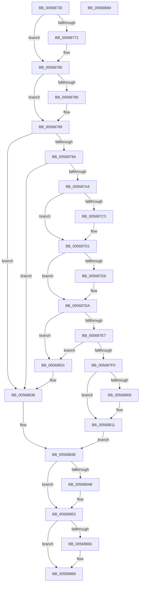

# IommuUnregisterInterfaceStateChangeCallback

- RVA: `0x00568730`–`0x00568885` (길이 `341` bytes)
- VA: `0x0000000140568730`
- 실행 섹션: `.text`
- PDB 이름 있음: `예`; PDB Function 태그: `아니요`
- unwind 정보 RVA: `0x00060300`
- 디코드: `96`개 명령, `341/341` bytes 표시
- 미해석 바이트: `0` (있으면 어셈블리에 `.byte`로 보존)

> 이 문서는 커널 이미지의 기계어와 PDB 기호를 분석해 생성했습니다. 4번과 5번은 함수 원형과 자료형을 바이너리 사용 방식에서 추정한 C 해석이며 원본 소스 복구 결과는 아닙니다.

## 1. Dependencies

- 직접 호출 지점: **10**; 고유 호출 대상: **6**
- 직접 호출자로 확인된 함수: **0**
- RIP 상대 이미지 참조: **2**

### Outgoing calls
- `0x00568762` → [KeAbPreAcquire](../21/KeAbPreAcquire_function_00210230.md) (function, `0x00210230`)
- `0x0056877B` → [ExfAcquirePushLockExclusiveEx](../20/ExfAcquirePushLockExclusiveEx_function_0020FC90.md) (function, `0x0020FC90`)
- `0x005687B3` → [KeAbPreAcquire](../21/KeAbPreAcquire_function_00210230.md) (function, `0x00210230`)
- `0x005687CC` → [ExfAcquirePushLockExclusiveEx](../20/ExfAcquirePushLockExclusiveEx_function_0020FC90.md) (function, `0x0020FC90`)
- `0x0056880C` → [ExfTryToWakePushLock](../26/ExfTryToWakePushLock_function_00265DD0.md) (function, `0x00265DD0`)
- `0x00568814` → [KeAbPostRelease](../2E/KeAbPostRelease_function_002E1600.md) (function, `0x002E1600`)
- `0x0056882A` → [ObfDereferenceObjectWithTag](../2F/ObfDereferenceObjectWithTag_function_002F78E0.md) (function, `0x002F78E0`)
- `0x0056884E` → [ExfTryToWakePushLock](../26/ExfTryToWakePushLock_function_00265DD0.md) (function, `0x00265DD0`)
- `0x00568856` → [KeAbPostRelease](../2E/KeAbPostRelease_function_002E1600.md) (function, `0x002E1600`)
- `0x00568863` → [HalpMmAllocCtxFree](../3E/HalpMmAllocCtxFree_function_003E1904.md) (function, `0x003E1904`)

### Direct callers
- 이 함수 시작 RVA로 연결되는 직접 call은 확인되지 않았습니다. 간접 호출은 완전히 역산할 수 없습니다.

### Static image references
- `0x005687A4` → RVA `0x00F8FA98` (`.data`; read)
- `0x005687FA` → RVA `0x00F8FA98` (`.data`; read/write)

## 2. Other-region calls and transfers

- 다른 실행 섹션으로 향하는 call: **0**
- 별도 외부 분기/꼬리 이동을 확인하지 못했습니다.

## 3. Assembly (complete function range)

```asm
00568730  48 89 5C 24 08                  mov qword ptr [rsp + 8], rbx
00568735  48 89 6C 24 10                  mov qword ptr [rsp + 0x10], rbp
0056873A  48 89 74 24 18                  mov qword ptr [rsp + 0x18], rsi
0056873F  57                              push rdi
00568740  41 56                           push r14
00568742  41 57                           push r15
00568744  48 83 EC 20                     sub rsp, 0x20
00568748  48 8D BA A0 01 00 00            lea rdi, [rdx + 0x1a0]
0056874F  48 8B EA                        mov rbp, rdx
00568752  4C 8B F9                        mov r15, rcx
00568755  45 33 C0                        xor r8d, r8d
00568758  48 8B CF                        mov rcx, rdi
0056875B  33 D2                           xor edx, edx
0056875D  33 F6                           xor esi, esi
0056875F  45 33 F6                        xor r14d, r14d
00568762  E8 C9 7A CA FF                  call 0x140210230
00568767  F0 48 0F BA 2F 00               lock bts qword ptr [rdi], 0
0056876D  48 8B D8                        mov rbx, rax
00568770  73 0E                           jae 0x140568780
00568772  4C 8B C7                        mov r8, rdi
00568775  48 8B D0                        mov rdx, rax
00568778  48 8B CF                        mov rcx, rdi
0056877B  E8 10 75 CA FF                  call 0x14020fc90
00568780  48 85 DB                        test rbx, rbx
00568783  74 04                           je 0x140568789
00568785  C6 43 0A 01                     mov byte ptr [rbx + 0xa], 1
00568789  48 8B 45 50                     mov rax, qword ptr [rbp + 0x50]
0056878D  48 83 CB FF                     or rbx, 0xffffffffffffffff
00568791  48 85 C0                        test rax, rax
00568794  0F 84 9E 00 00 00               je 0x140568838
0056879A  4C 39 78 10                     cmp qword ptr [rax + 0x10], r15
0056879E  0F 85 94 00 00 00               jne 0x140568838
005687A4  4C 8D 3D ED 72 A2 00            lea r15, [rip + 0xa272ed]
005687AB  45 33 C0                        xor r8d, r8d
005687AE  49 8B CF                        mov rcx, r15
005687B1  33 D2                           xor edx, edx
005687B3  E8 78 7A CA FF                  call 0x140210230
005687B8  F0 49 0F BA 2F 00               lock bts qword ptr [r15], 0
005687BE  48 8B F0                        mov rsi, rax
005687C1  73 0E                           jae 0x1405687d1
005687C3  4D 8B C7                        mov r8, r15
005687C6  48 8B D0                        mov rdx, rax
005687C9  49 8B CF                        mov rcx, r15
005687CC  E8 BF 74 CA FF                  call 0x14020fc90
005687D1  48 85 F6                        test rsi, rsi
005687D4  74 04                           je 0x1405687da
005687D6  C6 46 0A 01                     mov byte ptr [rsi + 0xa], 1
005687DA  48 8B 45 50                     mov rax, qword ptr [rbp + 0x50]
005687DE  4C 8B 00                        mov r8, qword ptr [rax]
005687E1  49 39 40 08                     cmp qword ptr [r8 + 8], rax
005687E5  75 4A                           jne 0x140568831
005687E7  48 8B 50 08                     mov rdx, qword ptr [rax + 8]
005687EB  48 39 02                        cmp qword ptr [rdx], rax
005687EE  75 41                           jne 0x140568831
005687F0  4C 89 02                        mov qword ptr [rdx], r8
005687F3  48 8B C3                        mov rax, rbx
005687F6  49 89 50 08                     mov qword ptr [r8 + 8], rdx
005687FA  F0 48 0F C1 05 95 72 A2 00      lock xadd qword ptr [rip + 0xa27295], rax
00568803  24 06                           and al, 6
00568805  3C 02                           cmp al, 2
00568807  75 08                           jne 0x140568811
00568809  49 8B CF                        mov rcx, r15
0056880C  E8 BF D5 CF FF                  call 0x140265dd0
00568811  49 8B CF                        mov rcx, r15
00568814  E8 E7 8D D7 FF                  call 0x1402e1600
00568819  48 8B 75 50                     mov rsi, qword ptr [rbp + 0x50]
0056881D  BA 48 61 6C 44                  mov edx, 0x446c6148
00568822  4C 21 75 50                     and qword ptr [rbp + 0x50], r14
00568826  48 8B 4D 08                     mov rcx, qword ptr [rbp + 8]
0056882A  E8 B1 F0 D8 FF                  call 0x1402f78e0
0056882F  EB 0D                           jmp 0x14056883e
00568831  B9 03 00 00 00                  mov ecx, 3
00568836  CD 29                           int 0x29
00568838  41 BE 01 00 00 C0               mov r14d, 0xc0000001
0056883E  F0 48 0F C1 1F                  lock xadd qword ptr [rdi], rbx
00568843  80 E3 06                        and bl, 6
00568846  80 FB 02                        cmp bl, 2
00568849  75 08                           jne 0x140568853
0056884B  48 8B CF                        mov rcx, rdi
0056884E  E8 7D D5 CF FF                  call 0x140265dd0
00568853  48 8B CF                        mov rcx, rdi
00568856  E8 A5 8D D7 FF                  call 0x1402e1600
0056885B  48 85 F6                        test rsi, rsi
0056885E  74 08                           je 0x140568868
00568860  48 8B D6                        mov rdx, rsi
00568863  E8 9C 90 E7 FF                  call 0x1403e1904
00568868  48 8B 5C 24 40                  mov rbx, qword ptr [rsp + 0x40]
0056886D  41 8B C6                        mov eax, r14d
00568870  48 8B 6C 24 48                  mov rbp, qword ptr [rsp + 0x48]
00568875  48 8B 74 24 50                  mov rsi, qword ptr [rsp + 0x50]
0056887A  48 83 C4 20                     add rsp, 0x20
0056887E  41 5F                           pop r15
00568880  41 5E                           pop r14
00568882  5F                              pop rdi
00568883  C3                              ret
00568884  CC                              int3
```

## 4. C-style interpretation (structured pseudocode)

```c
__int64 __fastcall IommuUnregisterInterfaceStateChangeCallback(__int64 a1, __int64 a2, int a3)
{
    __int64 result;
    __int64 v_r14;
    __int64 v_rbx;
    __int64 v_rsi;
    __int64 v_rsp;
    unsigned __int64 v_stack_p10;
    unsigned __int64 v_stack_p18;
    unsigned __int64 v_stack_p8;

    v_stack_p8 = v_rbx;
    v_stack_p10 = v_rbp;
    v_stack_p18 = v_rsi;
    v_rsp = (v_rsp) - (32);
    a3 = 0;
    a2 = 0;
    v_rsi = 0;
    v_r14 = 0;
    result = KeAbPreAcquire(a2 + 416, a2, a3, a4);
    if (!(condition_is_above_or_equal)) {
        a3 = a2 + 416;
        a2 = result;
        a1 = a2 + 416;
        result = ExfAcquirePushLockExclusiveEx(a1, a2, a3, a4);
    }
    if (result != 0) {
        *(unsigned __int8 *)(result + 10) = 1;
    }
    v_rbx = (result) | (-1);
    if (*(unsigned __int64 *)(a2 + 80) == 0) goto loc_00568838;
    if ((*(unsigned __int64 *)(*(unsigned __int64 *)(a2 + 80) + 16)) != a1) goto loc_00568838;
    a3 = 0;
    a2 = 0;
    result = KeAbPreAcquire(v_rip + 10646253, a2, a3, a4);
    if (!(condition_is_above_or_equal)) {
        a3 = v_rip + 10646253;
        a2 = result;
        a1 = v_rip + 10646253;
        result = ExfAcquirePushLockExclusiveEx(a1, a2, a3, a4);
    }
    if (result != 0) {
        *(unsigned __int8 *)(result + 10) = 1;
    }
    if ((*(unsigned __int64 *)(*(unsigned __int64 *)(*(unsigned __int64 *)(a2 + 80)) + 8)) != (*(unsigned __int64 *)(a2 + 80))) goto loc_00568831;
    if ((*(unsigned __int64 *)(*(unsigned __int64 *)(*(unsigned __int64 *)(a2 + 80) + 8))) != (*(unsigned __int64 *)(a2 + 80))) goto loc_00568831;
    *(unsigned __int64 *)(*(unsigned __int64 *)(*(unsigned __int64 *)(a2 + 80) + 8)) = *(unsigned __int64 *)(*(unsigned __int64 *)(a2 + 80));
    *(unsigned __int64 *)(*(unsigned __int64 *)(*(unsigned __int64 *)(a2 + 80)) + 8) = *(unsigned __int64 *)(*(unsigned __int64 *)(a2 + 80) + 8);
    result = (unsigned __int8)((v_rbx) & (6));
    if (((unsigned __int8)(result)) == 2) {
        a1 = v_rip + 10646253;
        result = ExfTryToWakePushLock(a1, *(unsigned __int64 *)(*(unsigned __int64 *)(a2 + 80) + 8), *(unsigned __int64 *)(*(unsigned __int64 *)(a2 + 80)), a4);
    }
    result = KeAbPostRelease(v_rip + 10646253, *(unsigned __int64 *)(*(unsigned __int64 *)(a2 + 80) + 8), *(unsigned __int64 *)(*(unsigned __int64 *)(a2 + 80)), a4);
    result = ObfDereferenceObjectWithTag(*(unsigned __int64 *)(a2 + 8), (unsigned int)(0x446C6148ULL), *(unsigned __int64 *)(*(unsigned __int64 *)(a2 + 80)), a4);
    goto loc_0056883E;
loc_00568831:
loc_00568838:
loc_0056883E:
    v_rbx = (unsigned __int8)((v_rbx) & (6));
    if (((unsigned __int8)(v_rbx)) == 2) {
        a1 = a2 + 416;
        result = ExfTryToWakePushLock(a1, (unsigned int)(0x446C6148ULL), *(unsigned __int64 *)(*(unsigned __int64 *)(a2 + 80)), a4);
    }
    result = KeAbPostRelease(a2 + 416, (unsigned int)(0x446C6148ULL), *(unsigned __int64 *)(*(unsigned __int64 *)(a2 + 80)), a4);
    if (*(unsigned __int64 *)(a2 + 80) != 0) {
        a2 = *(unsigned __int64 *)(a2 + 80);
        result = HalpMmAllocCtxFree(a2 + 416, a2, *(unsigned __int64 *)(*(unsigned __int64 *)(a2 + 80)), a4);
    }
    v_rsp = (v_rsp) + (32);
    return (unsigned int)((unsigned int)((unsigned int)(0xC0000001ULL)));
}
```

## 5. (Beta) C Style

```c
int64_t IommuUnregisterInterfaceStateChangeCallback(int64_t Arg1, void *Arg2, int32_t Arg3)
{
    uint8_t *arg2 = (uint8_t *)Arg2;

    int64_t result;
    int64_t local_r14;
    int64_t local_rbx;
    int64_t local_rsi;
    int64_t local_rsp;
    uint64_t v_stack_p10;
    uint64_t v_stack_p18;
    uint64_t v_stack_p8;

    v_stack_p8 = local_rbx;
    v_stack_p10 = local_rbp;
    v_stack_p18 = local_rsi;
    local_rsp = (local_rsp) - (32);
    Arg3 = 0;
    Arg2 = 0;
    local_rsi = 0;
    local_r14 = 0;
    result = KeAbPreAcquire(Arg2 + 416, Arg2, Arg3, a4);
    if (!(condition_is_above_or_equal)) {
        Arg3 = Arg2 + 416;
        Arg2 = result;
        Arg1 = Arg2 + 416;
        result = ExfAcquirePushLockExclusiveEx(Arg1, Arg2, Arg3, a4);
    }
    if (result != 0) {
        *(uint8_t *)(result + 0xA) = 1;
    }
    local_rbx = (result) | (-1);
    if (*(uint64_t *)(arg2 + 0x50) == 0) goto loc_00568838;
    if ((*(uint64_t *)(*(uint64_t *)(arg2 + 0x50) + 0x10)) != Arg1) goto loc_00568838;
    Arg3 = 0;
    Arg2 = 0;
    result = KeAbPreAcquire(v_rip + 10646253, Arg2, Arg3, a4);
    if (!(condition_is_above_or_equal)) {
        Arg3 = v_rip + 10646253;
        Arg2 = result;
        Arg1 = v_rip + 10646253;
        result = ExfAcquirePushLockExclusiveEx(Arg1, Arg2, Arg3, a4);
    }
    if (result != 0) {
        *(uint8_t *)(result + 0xA) = 1;
    }
    if ((*(uint64_t *)(*(uint64_t *)(*(uint64_t *)(arg2 + 0x50)) + 0x8)) != (*(uint64_t *)(arg2 + 0x50))) goto loc_00568831;
    if ((*(uint64_t *)(*(uint64_t *)(*(uint64_t *)(arg2 + 0x50) + 0x8))) != (*(uint64_t *)(arg2 + 0x50))) goto loc_00568831;
    *(uint64_t *)(*(uint64_t *)(*(uint64_t *)(arg2 + 0x50) + 0x8)) = *(uint64_t *)(*(uint64_t *)(arg2 + 0x50));
    *(uint64_t *)(*(uint64_t *)(*(uint64_t *)(arg2 + 0x50)) + 0x8) = *(uint64_t *)(*(uint64_t *)(arg2 + 0x50) + 0x8);
    result = (uint8_t)((local_rbx) & (6));
    if (((uint8_t)(result)) == 2) {
        Arg1 = v_rip + 10646253;
        result = ExfTryToWakePushLock(Arg1, *(uint64_t *)(*(uint64_t *)(arg2 + 0x50) + 0x8), *(uint64_t *)(*(uint64_t *)(arg2 + 0x50)), a4);
    }
    result = KeAbPostRelease(v_rip + 10646253, *(uint64_t *)(*(uint64_t *)(arg2 + 0x50) + 0x8), *(uint64_t *)(*(uint64_t *)(arg2 + 0x50)), a4);
    result = ObfDereferenceObjectWithTag(*(uint64_t *)(arg2 + 0x8), (uint32_t)(0x446C6148ULL), *(uint64_t *)(*(uint64_t *)(arg2 + 0x50)), a4);
    goto loc_0056883E;
loc_00568831:
loc_00568838:
loc_0056883E:
    local_rbx = (uint8_t)((local_rbx) & (6));
    if (((uint8_t)(local_rbx)) == 2) {
        Arg1 = Arg2 + 416;
        result = ExfTryToWakePushLock(Arg1, (uint32_t)(0x446C6148ULL), *(uint64_t *)(*(uint64_t *)(arg2 + 0x50)), a4);
    }
    result = KeAbPostRelease(Arg2 + 416, (uint32_t)(0x446C6148ULL), *(uint64_t *)(*(uint64_t *)(arg2 + 0x50)), a4);
    if (*(uint64_t *)(arg2 + 0x50) != 0) {
        Arg2 = *(uint64_t *)(arg2 + 0x50);
        result = HalpMmAllocCtxFree(Arg2 + 416, Arg2, *(uint64_t *)(*(uint64_t *)(arg2 + 0x50)), a4);
    }
    local_rsp = (local_rsp) + (32);
    return (uint32_t)((uint32_t)((uint32_t)(0xC0000001ULL)));
}
```

### 관측된 메모리 오프셋

구조체 형식이 확인되지 않은 접근은 인자 기준의 오프셋으로만 기록했습니다.

| 기준 인자 | 오프셋 표현 | 폭 (bit) | 접근 |
|---|---:|---:|---|
| `Arg2` | `+ 0x0` | `64` | `R/W` |
| `Arg2` | `+ 0x8` | `64` | `R` |
| `Arg2` | `+ 0x50` | `64` | `R` |
| `Arg2` | `+ 0x50` | `64` | `R/W` |
| `Arg2` | `+ 0x1A0` | `64` | `R` |

## 6. Execution-region graph

[열기: 2D/3D 그래프와 함수 탐색 컨트롤 패널](../../../control-panel.html?section=text&rva=0x00568730&view=graph)

- 2D 그래프는 위에서 아래로 흐르고, 3D 그래프는 빈 공간을 드래그해 회전합니다. Shift+드래그는 이동, 휠은 확대·축소, 함수 노드 선택은 대상 보고서 이동입니다.

### Static fallback


