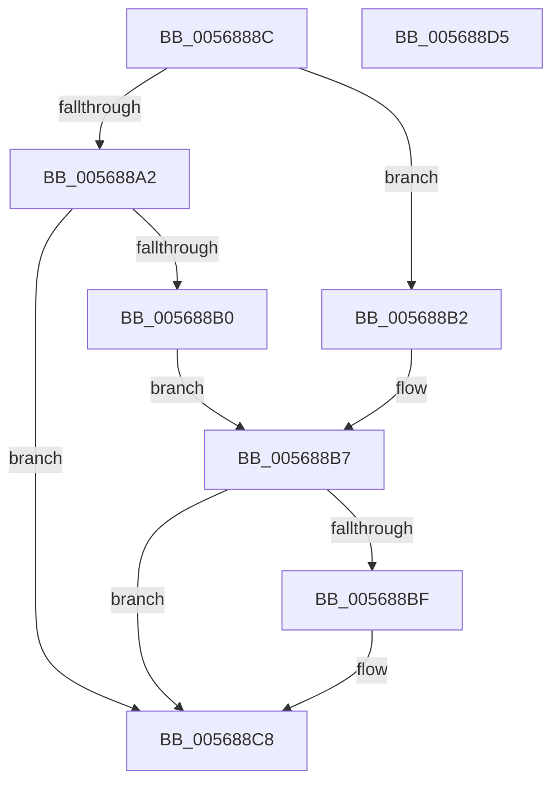

# IommupCreateDeviceId

- RVA: `0x0056888C`–`0x005688D6` (길이 `74` bytes)
- VA: `0x000000014056888C`
- 실행 섹션: `.text`
- PDB 이름 있음: `예`; PDB Function 태그: `아니요`
- unwind 정보 RVA: `0x0005CAAC`
- 디코드: `25`개 명령, `74/74` bytes 표시
- 미해석 바이트: `0` (있으면 어셈블리에 `.byte`로 보존)

> 이 문서는 커널 이미지의 기계어와 PDB 기호를 분석해 생성했습니다. 4번과 5번은 함수 원형과 자료형을 바이너리 사용 방식에서 추정한 C 해석이며 원본 소스 복구 결과는 아닙니다.

## 1. Dependencies

- 직접 호출 지점: **2**; 고유 호출 대상: **2**
- 직접 호출자로 확인된 함수: **1**
- RIP 상대 이미지 참조: **0**

### Outgoing calls
- `0x005688A5` → [HalpIommuGetDeviceId](../55/HalpIommuGetDeviceId_function_005536C0.md) (function, `0x005536C0`)
- `0x005688BF` → [HalpMmAllocCtxFree](../3E/HalpMmAllocCtxFree_function_003E1904.md) (function, `0x003E1904`)

### Direct callers
- [IommuDeviceCreate](../../page/70/IommuDeviceCreate_function_0070D030.md) at `0x0070D05A`

### Static image references
- 디코드된 RIP-relative 메모리 참조가 없습니다.

## 2. Other-region calls and transfers

- 다른 실행 섹션으로 향하는 call: **0**
- 별도 외부 분기/꼬리 이동을 확인하지 못했습니다.

## 3. Assembly (complete function range)

```asm
0056888C  48 89 5C 24 08                  mov qword ptr [rsp + 8], rbx
00568891  57                              push rdi
00568892  48 83 EC 20                     sub rsp, 0x20
00568896  49 83 20 00                     and qword ptr [r8], 0
0056889A  49 8B D8                        mov rbx, r8
0056889D  48 85 C9                        test rcx, rcx
005688A0  74 10                           je 0x1405688b2
005688A2  48 8B D3                        mov rdx, rbx
005688A5  E8 16 AE FE FF                  call 0x1405536c0
005688AA  8B F8                           mov edi, eax
005688AC  85 C0                           test eax, eax
005688AE  79 18                           jns 0x1405688c8
005688B0  EB 05                           jmp 0x1405688b7
005688B2  BF BB 00 00 C0                  mov edi, 0xc00000bb
005688B7  48 8B 13                        mov rdx, qword ptr [rbx]
005688BA  48 85 D2                        test rdx, rdx
005688BD  74 09                           je 0x1405688c8
005688BF  E8 40 90 E7 FF                  call 0x1403e1904
005688C4  48 83 23 00                     and qword ptr [rbx], 0
005688C8  48 8B 5C 24 30                  mov rbx, qword ptr [rsp + 0x30]
005688CD  8B C7                           mov eax, edi
005688CF  48 83 C4 20                     add rsp, 0x20
005688D3  5F                              pop rdi
005688D4  C3                              ret
005688D5  CC                              int3
```

## 4. C-style interpretation (structured pseudocode)

```c
__int64 __fastcall IommupCreateDeviceId(__int64 a1, __int64 a2, __int64 a3)
{
    __int64 result;
    __int64 v_rsp;
    unsigned __int64 v_stack_p8;

    v_stack_p8 = v_rbx;
    v_rsp = (v_rsp) - (32);
    if (a1 == 0) goto loc_005688B2;
    result = HalpIommuGetDeviceId(a1, a3, a3, a4);
    if (!sign_flag) goto loc_005688C8;
    goto loc_005688B7;
loc_005688B2:
loc_005688B7:
    if (*(unsigned __int64 *)(a3) != 0) {
        result = HalpMmAllocCtxFree(a1, *(unsigned __int64 *)(a3), a3, a4);
    }
    v_rsp = (v_rsp) + (32);
    return (unsigned int)((unsigned int)((unsigned int)(0xC00000BBULL)));
}
```

## 5. (Beta) C Style

```c
int64_t IommupCreateDeviceId(int64_t Arg1, int64_t Arg2, void *Arg3)
{
    uint8_t *arg3 = (uint8_t *)Arg3;

    int64_t result;
    int64_t local_rsp;
    uint64_t v_stack_p8;

    v_stack_p8 = local_rbx;
    local_rsp = (local_rsp) - (32);
    if (Arg1 == 0) goto loc_005688B2;
    result = HalpIommuGetDeviceId(Arg1, Arg3, Arg3, a4);
    if (!sign_flag) goto loc_005688C8;
    goto loc_005688B7;
loc_005688B2:
loc_005688B7:
    if (*(uint64_t *)(arg3) != 0) {
        result = HalpMmAllocCtxFree(Arg1, *(uint64_t *)(arg3), Arg3, a4);
    }
    local_rsp = (local_rsp) + (32);
    return (uint32_t)((uint32_t)((uint32_t)(0xC00000BBULL)));
}
```

### 관측된 메모리 오프셋

구조체 형식이 확인되지 않은 접근은 인자 기준의 오프셋으로만 기록했습니다.

| 기준 인자 | 오프셋 표현 | 폭 (bit) | 접근 |
|---|---:|---:|---|
| `Arg3` | `+ 0x0` | `64` | `R` |
| `Arg3` | `+ 0x0` | `64` | `R/W` |

## 6. Execution-region graph

[열기: 2D/3D 그래프와 함수 탐색 컨트롤 패널](../../../control-panel.html?section=text&rva=0x0056888C&view=graph)

- 2D 그래프는 위에서 아래로 흐르고, 3D 그래프는 빈 공간을 드래그해 회전합니다. Shift+드래그는 이동, 휠은 확대·축소, 함수 노드 선택은 대상 보고서 이동입니다.

### Static fallback


