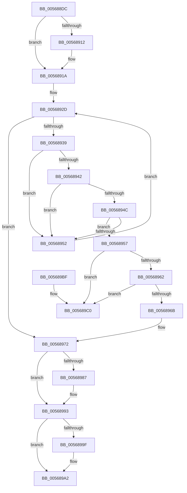

# IommupFindAndPopCachedDevice

- RVA: `0x005688DC`–`0x005689C7` (길이 `235` bytes)
- VA: `0x00000001405688DC`
- 실행 섹션: `.text`
- PDB 이름 있음: `예`; PDB Function 태그: `아니요`
- unwind 정보 RVA: `0x0006B020`
- 디코드: `66`개 명령, `235/235` bytes 표시
- 미해석 바이트: `0` (있으면 어셈블리에 `.byte`로 보존)

> 이 문서는 커널 이미지의 기계어와 PDB 기호를 분석해 생성했습니다. 4번과 5번은 함수 원형과 자료형을 바이너리 사용 방식에서 추정한 C 해석이며 원본 소스 복구 결과는 아닙니다.

## 1. Dependencies

- 직접 호출 지점: **4**; 고유 호출 대상: **4**
- 직접 호출자로 확인된 함수: **3**
- RIP 상대 이미지 참조: **3**

### Outgoing calls
- `0x00568915` → [KiRaiseIrqlProcessIrqlFlags](../4F/KiRaiseIrqlProcessIrqlFlags_function_004F56FC.md) (function, `0x004F56FC`)
- `0x00568921` → [KeAcquireSpinLockAtDpcLevel](../20/KeAcquireSpinLockAtDpcLevel_function_00208430.md) (function, `0x00208430`)
- `0x00568979` → [KxReleaseSpinLock](../20/KxReleaseSpinLock_function_00206670.md) (function, `0x00206670`)
- `0x0056898E` → [KiLowerIrqlProcessIrqlFlags](../4F/KiLowerIrqlProcessIrqlFlags_function_004F5698.md) (function, `0x004F5698`)

### Direct callers
- [IommuDomainAttachDevice](IommuDomainAttachDevice_function_00567960.md) at `0x00567A11`
- [IommuDomainAttachDeviceEx](IommuDomainAttachDeviceEx_function_00567B60.md) at `0x00567BC0`
- [IommuDomainDetachDeviceEx](IommuDomainDetachDeviceEx_function_00567E80.md) at `0x00567EAC`

### Static image references
- `0x0056890A` → RVA `0x00FC6D20` (`ALMOSTRO`; read)
- `0x0056891A` → RVA `0x00F8FAC0` (`.data`; read)
- `0x00568926` → RVA `0x00F8FAB0` (`.data`; read)

## 2. Other-region calls and transfers

- 다른 실행 섹션으로 향하는 call: **0**
- 별도 외부 분기/꼬리 이동을 확인하지 못했습니다.

## 3. Assembly (complete function range)

```asm
005688DC  48 8B C4                        mov rax, rsp
005688DF  48 89 58 08                     mov qword ptr [rax + 8], rbx
005688E3  48 89 68 10                     mov qword ptr [rax + 0x10], rbp
005688E7  48 89 70 18                     mov qword ptr [rax + 0x18], rsi
005688EB  48 89 78 20                     mov qword ptr [rax + 0x20], rdi
005688EF  41 56                           push r14
005688F1  48 83 EC 20                     sub rsp, 0x20
005688F5  33 ED                           xor ebp, ebp
005688F7  4C 8B F2                        mov r14, rdx
005688FA  32 DB                           xor bl, bl
005688FC  48 8B F1                        mov rsi, rcx
005688FF  44 0F 20 C7                     mov rdi, cr8
00568903  8D 55 0C                        lea edx, [rbp + 0xc]
00568906  44 0F 22 C2                     mov cr8, rdx
0056890A  39 2D 10 E4 A5 00               cmp dword ptr [rip + 0xa5e410], ebp
00568910  74 08                           je 0x14056891a
00568912  40 8A CF                        mov cl, dil
00568915  E8 E2 CD F8 FF                  call 0x1404f56fc
0056891A  48 8D 0D 9F 71 A2 00            lea rcx, [rip + 0xa2719f]
00568921  E8 0A FB C9 FF                  call 0x140208430
00568926  48 8B 0D 83 71 A2 00            mov rcx, qword ptr [rip + 0xa27183]
0056892D  48 8D 05 7C 71 A2 00            lea rax, [rip + 0xa2717c]
00568934  48 3B C8                        cmp rcx, rax
00568937  74 39                           je 0x140568972
00568939  48 8B E9                        mov rbp, rcx
0056893C  48 39 71 20                     cmp qword ptr [rcx + 0x20], rsi
00568940  75 10                           jne 0x140568952
00568942  48 8B 46 18                     mov rax, qword ptr [rsi + 0x18]
00568946  48 39 41 28                     cmp qword ptr [rcx + 0x28], rax
0056894A  75 06                           jne 0x140568952
0056894C  83 79 18 00                     cmp dword ptr [rcx + 0x18], 0
00568950  74 05                           je 0x140568957
00568952  48 8B 09                        mov rcx, qword ptr [rcx]
00568955  EB D6                           jmp 0x14056892d
00568957  48 8B 11                        mov rdx, qword ptr [rcx]
0056895A  B3 01                           mov bl, 1
0056895C  48 39 4A 08                     cmp qword ptr [rdx + 8], rcx
00568960  75 5E                           jne 0x1405689c0
00568962  48 8B 41 08                     mov rax, qword ptr [rcx + 8]
00568966  48 39 08                        cmp qword ptr [rax], rcx
00568969  75 55                           jne 0x1405689c0
0056896B  48 89 10                        mov qword ptr [rax], rdx
0056896E  48 89 42 08                     mov qword ptr [rdx + 8], rax
00568972  48 8D 0D 47 71 A2 00            lea rcx, [rip + 0xa27147]
00568979  E8 F2 DC C9 FF                  call 0x140206670
0056897E  83 3D 9B E3 A5 00 00            cmp dword ptr [rip + 0xa5e39b], 0
00568985  74 0C                           je 0x140568993
00568987  44 0F 20 C1                     mov rcx, cr8
0056898B  40 8A D7                        mov dl, dil
0056898E  E8 05 CD F8 FF                  call 0x1404f5698
00568993  40 0F B6 CF                     movzx ecx, dil
00568997  44 0F 22 C1                     mov cr8, rcx
0056899B  84 DB                           test bl, bl
0056899D  74 03                           je 0x1405689a2
0056899F  49 89 2E                        mov qword ptr [r14], rbp
005689A2  48 8B 6C 24 38                  mov rbp, qword ptr [rsp + 0x38]
005689A7  8A C3                           mov al, bl
005689A9  48 8B 5C 24 30                  mov rbx, qword ptr [rsp + 0x30]
005689AE  48 8B 74 24 40                  mov rsi, qword ptr [rsp + 0x40]
005689B3  48 8B 7C 24 48                  mov rdi, qword ptr [rsp + 0x48]
005689B8  48 83 C4 20                     add rsp, 0x20
005689BC  41 5E                           pop r14
005689BE  C3                              ret
005689BF  CC                              int3
005689C0  B9 03 00 00 00                  mov ecx, 3
005689C5  CD 29                           int 0x29
```

## 4. C-style interpretation (structured pseudocode)

```c
__int64 __fastcall IommupFindAndPopCachedDevice(__int64 a1, __int64 a2)
{
    __int64 result;
    __int64 v_rbp;
    __int64 v_rbx;
    __int64 v_rsp;
    unsigned __int64 v_stack_p10;
    unsigned __int64 v_stack_p18;
    unsigned __int64 v_stack_p20;
    unsigned __int64 v_stack_p8;

    *(unsigned __int64 *)(v_rsp + 8) = v_rbx;
    *(unsigned __int64 *)(v_rsp + 16) = v_rbp;
    *(unsigned __int64 *)(v_rsp + 24) = v_rsi;
    *(unsigned __int64 *)(v_rsp + 32) = v_rdi;
    v_rsp = (v_rsp) - (32);
    v_rbp = 0;
    v_rbx = 0;
    result = v_rsp;
    if ((*(unsigned int *)(v_rip + 10871824)) != 0) {
        a1 = (unsigned __int8)(v_cr8);
        result = KiRaiseIrqlProcessIrqlFlags(a1, v_rbp + 12, a3, a4);
    }
    result = KeAcquireSpinLockAtDpcLevel(v_rip + 10645919, v_rbp + 12, a3, a4);
loc_0056892D:
    if ((*(unsigned __int64 *)(v_rip + 10645891)) == (v_rip + 10645884)) goto loc_00568972;
    if ((*(unsigned __int64 *)(*(unsigned __int64 *)(v_rip + 10645891) + 32)) != a1) goto loc_00568952;
    if ((*(unsigned __int64 *)(*(unsigned __int64 *)(v_rip + 10645891) + 40)) != (*(unsigned __int64 *)(a1 + 24))) goto loc_00568952;
    if ((*(unsigned int *)(*(unsigned __int64 *)(v_rip + 10645891) + 24)) == 0) goto loc_00568957;
loc_00568952:
    goto loc_0056892D;
loc_00568957:
    if ((*(unsigned __int64 *)(*(unsigned __int64 *)(*(unsigned __int64 *)(*(unsigned __int64 *)(v_rip + 10645891))) + 8)) != (*(unsigned __int64 *)(*(unsigned __int64 *)(v_rip + 10645891)))) goto loc_005689C0;
    if ((*(unsigned __int64 *)(*(unsigned __int64 *)(*(unsigned __int64 *)(*(unsigned __int64 *)(v_rip + 10645891)) + 8))) != (*(unsigned __int64 *)(*(unsigned __int64 *)(v_rip + 10645891)))) goto loc_005689C0;
    *(unsigned __int64 *)(*(unsigned __int64 *)(*(unsigned __int64 *)(*(unsigned __int64 *)(v_rip + 10645891)) + 8)) = *(unsigned __int64 *)(*(unsigned __int64 *)(*(unsigned __int64 *)(v_rip + 10645891)));
    *(unsigned __int64 *)(*(unsigned __int64 *)(*(unsigned __int64 *)(*(unsigned __int64 *)(v_rip + 10645891))) + 8) = *(unsigned __int64 *)(*(unsigned __int64 *)(*(unsigned __int64 *)(v_rip + 10645891)) + 8);
loc_00568972:
    result = KxReleaseSpinLock(v_rip + 10645831, *(unsigned __int64 *)(*(unsigned __int64 *)(*(unsigned __int64 *)(v_rip + 10645891))), a3, a4);
    if ((*(unsigned int *)(v_rip + 10871707)) != 0) {
        a1 = v_rbp + 12;
        a2 = (unsigned __int8)(v_cr8);
        result = KiLowerIrqlProcessIrqlFlags(a1, a2, a3, a4);
    }
    if (1 != 0) {
        *(unsigned __int64 *)(a2) = *(unsigned __int64 *)(v_rip + 10645891);
    }
    v_rsp = (v_rsp) + (32);
    return 1;
loc_005689C0:
    return 1;
}
```

## 5. (Beta) C Style

```c
int64_t IommupFindAndPopCachedDevice(void *Arg1, void *Arg2)
{
    uint8_t *arg1 = (uint8_t *)Arg1;
    uint8_t *arg2 = (uint8_t *)Arg2;

    int64_t result;
    int64_t local_rbp;
    int64_t local_rbx;
    int64_t local_rsp;
    uint64_t v_stack_p10;
    uint64_t v_stack_p18;
    uint64_t v_stack_p20;
    uint64_t v_stack_p8;

    *(uint64_t *)(local_rsp + 0x8) = local_rbx;
    *(uint64_t *)(local_rsp + 0x10) = local_rbp;
    *(uint64_t *)(local_rsp + 0x18) = local_rsi;
    *(uint64_t *)(local_rsp + 0x20) = local_rdi;
    local_rsp = (local_rsp) - (32);
    local_rbp = 0;
    local_rbx = 0;
    result = local_rsp;
    if ((*(uint32_t *)(v_rip + 0xA5E410)) != 0) {
        Arg1 = (uint8_t)(v_cr8);
        result = KiRaiseIrqlProcessIrqlFlags(Arg1, local_rbp + 12, a3, a4);
    }
    result = KeAcquireSpinLockAtDpcLevel(v_rip + 10645919, local_rbp + 12, a3, a4);
loc_0056892D:
    if ((*(uint64_t *)(v_rip + 0xA27183)) == (v_rip + 10645884)) goto loc_00568972;
    if ((*(uint64_t *)(*(uint64_t *)(v_rip + 0xA27183) + 0x20)) != Arg1) goto loc_00568952;
    if ((*(uint64_t *)(*(uint64_t *)(v_rip + 0xA27183) + 0x28)) != (*(uint64_t *)(arg1 + 0x18))) goto loc_00568952;
    if ((*(uint32_t *)(*(uint64_t *)(v_rip + 0xA27183) + 0x18)) == 0) goto loc_00568957;
loc_00568952:
    goto loc_0056892D;
loc_00568957:
    if ((*(uint64_t *)(*(uint64_t *)(*(uint64_t *)(*(uint64_t *)(v_rip + 0xA27183))) + 0x8)) != (*(uint64_t *)(*(uint64_t *)(v_rip + 0xA27183)))) goto loc_005689C0;
    if ((*(uint64_t *)(*(uint64_t *)(*(uint64_t *)(*(uint64_t *)(v_rip + 0xA27183)) + 0x8))) != (*(uint64_t *)(*(uint64_t *)(v_rip + 0xA27183)))) goto loc_005689C0;
    *(uint64_t *)(*(uint64_t *)(*(uint64_t *)(*(uint64_t *)(v_rip + 0xA27183)) + 0x8)) = *(uint64_t *)(*(uint64_t *)(*(uint64_t *)(v_rip + 0xA27183)));
    *(uint64_t *)(*(uint64_t *)(*(uint64_t *)(*(uint64_t *)(v_rip + 0xA27183))) + 0x8) = *(uint64_t *)(*(uint64_t *)(*(uint64_t *)(v_rip + 0xA27183)) + 0x8);
loc_00568972:
    result = KxReleaseSpinLock(v_rip + 10645831, *(uint64_t *)(*(uint64_t *)(*(uint64_t *)(v_rip + 0xA27183))), a3, a4);
    if ((*(uint32_t *)(v_rip + 0xA5E39B)) != 0) {
        Arg1 = local_rbp + 12;
        Arg2 = (uint8_t)(v_cr8);
        result = KiLowerIrqlProcessIrqlFlags(Arg1, Arg2, a3, a4);
    }
    if (1 != 0) {
        *(uint64_t *)(arg2) = *(uint64_t *)(v_rip + 0xA27183);
    }
    local_rsp = (local_rsp) + (32);
    return 1;
loc_005689C0:
    return 1;
}
```

### 관측된 메모리 오프셋

구조체 형식이 확인되지 않은 접근은 인자 기준의 오프셋으로만 기록했습니다.

| 기준 인자 | 오프셋 표현 | 폭 (bit) | 접근 |
|---|---:|---:|---|
| `Arg1` | `+ 0x18` | `64` | `R` |
| `Arg2` | `+ 0x0` | `64` | `W` |

## 6. Execution-region graph

[열기: 2D/3D 그래프와 함수 탐색 컨트롤 패널](../../../control-panel.html?section=text&rva=0x005688DC&view=graph)

- 2D 그래프는 위에서 아래로 흐르고, 3D 그래프는 빈 공간을 드래그해 회전합니다. Shift+드래그는 이동, 휠은 확대·축소, 함수 노드 선택은 대상 보고서 이동입니다.

### Static fallback


